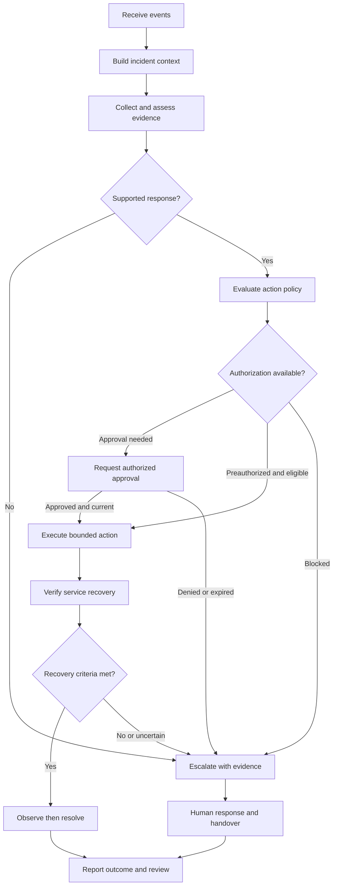

# Continuum — Business Solution Document

Oct 4, 2026 · @Abdul Wadood

**Customizable NOC automation for telecommunications, banking, and data centers**

| Document control | Value |
| --- | --- |
| Document ID | CONT-BSD-001 |
| Version | 0.2 |
| Date | 4 October 2026 |
| Status | Draft for business review; not an approved delivery commitment |
| Prepared for | Muzaffar Hussain |
| Working product name | Continuum |
| Document purpose | Define the business solution, product scope, operating model, business requirements, and acceptance basis |
| Product direction | Custom, self-contained platform built by Techfinity |
| Subsequent document | Separate Software Requirements Specification (SRS), derived from this BSD |

**Terminology:** BSD means **Business Solution Document** in this document. It describes the business need and proposed solution at a level suitable for scope agreement. Detailed software behavior, API contracts, database design, and engineering test specifications belong in the SRS and technical design.

**Baseline:** An earlier proof of concept (POC) demonstrated the core routing flow. It has not been audited for this BSD. All future capabilities below are proposed requirements, not statements that the product already implements them.

## Contents

1. [Executive business case](#msd81ayjx1k.1202)
2. [Business context and current state](#msd81ayjx1k.4226)
3. [Objectives and intended outcomes](#msd81ayjx1k.6696)
4. [Stakeholders and accountability](#msd81ayjx1k.8054)
5. [Proposed business solution](#msd81ayjx1k.10615)
6. [Scope and delivery boundaries](#msd81ayjx1k.13043)
7. [Business requirements](#msd81ayjx1k.18989)
8. [Target operating process](#msd81ayjx1k.24662)
9. [Business use cases](#msd81ayjx1k.27769)
10. [Automation and AI operating rules](#msd81ayjx1k.30388)
11. [User experience and customization](#msd81ayjx1k.33738)
12. [Integration and information scope](#msd81ayjx1k.35920)
13. [Reporting and benefit measurement](#msd81ayjx1k.39044)
14. [Service quality and operational expectations](#msd81ayjx1k.42611)
15. [Delivery, transition, and support](#msd81ayjx1k.44410)
16. [Business acceptance](#msd81ayjx1k.46060)
17. [Assumptions, dependencies, risks, and decisions](#msd81ayjx1k.50498)
18. [Governance and SRS handover](#msd81ayjx1k.55244)
19. [Reference baseline and glossary](#msd81ayjx1k.57956)

## 1. Executive business case

Continuum is proposed as a configurable NOC operations platform that receives information from multiple monitoring systems, gathers additional infrastructure evidence, manages incidents, and coordinates or executes authorized response workflows. Its operational cycle ends with verification of service recovery and a traceable incident record.

The business opportunity is to reduce repetitive operational work, shorten the time spent understanding incidents, and improve consistency of response across mixed technology environments. The product will initially focus on telecom IT and service operations, with a common platform extended through banking and data center configurations and domain packs.

Continuum is built as its own workflow product. Customers will configure monitoring sources, asset and service context, ownership, workflows, approvals, AI models, dashboards, and reporting through a unified interface. The product may use third-party infrastructure components underneath, subject to technical and commercial review.

The intended automation coverage is broad L1 handling and named, validated L2 recovery scenarios. Full automation of every NOC incident is not a credible initial commitment. Cases outside supported diagnostic or remediation coverage will remain visible and be escalated with collected evidence.

The first customer pilot will prove a complete response cycle across multiple event sources and one supported infrastructure environment. It will demonstrate diagnosis, authorized action, recovery verification, and reporting before the number of integrations and autonomous scenarios expands.

Before the pilot, a short demonstration build (about three weeks) shows the core flow on made-up telecom data. Full product development starts only after a customer commits to a concrete next step, such as a pilot or sharing real operational data.

### Proposed business value

| Beneficiary | Expected value | How it will be demonstrated |
| --- | --- | --- |
| NOC management | Less repetitive triage and more consistent incident handling | Measured operator effort, routing accuracy, backlog, and incident outcomes |
| L1 operators | One investigation workspace and fewer duplicate work items | Representative operator journeys and event-replay results |
| L2/service teams | Better evidence at escalation and repeatable recovery execution | Diagnostic completeness, handoff quality, and verified runbook outcomes |
| Business service owners | Visibility into service impact and restoration | Service-linked incidents, recovery evidence, and agreed service reports |
| Enterprise IT/security | Controlled infrastructure access and auditable automation | Access tests, action authorization records, and audit review |
| Product business | A reusable core that can be configured for different customers | A second supported customer configuration without a separate core code fork |

These are hypotheses to validate. No quantified savings, service availability guarantee, or staffing reduction is established by this document.

## 2. Business context and current state

### 2.1 Confirmed starting point

- A proof of concept exists with a personalized UI.
- Continuum is built as a self-contained platform with its own workflow capabilities.
- The target industries are telecom operators, banks, and data centers.
- Monitoring must support multiple inward flows, with direct VM/infrastructure diagnostics where required.
- Setup should be assisted, customization extensive, and UI/reporting suitable for operational use.
- AI model configuration and reliable automation are part of the intended product.

### 2.2 Current-state problems to validate during discovery

| Problem | Operational consequence | Required change |
| --- | --- | --- |
| Events spread across monitoring tools | Operators assemble context manually and may create duplicate work | Unified incident context with original source evidence preserved |
| Alert volume exceeds useful incident volume | Repeated acknowledgement and investigation consume capacity | Explainable grouping, suppression, and service-aware prioritization |
| Diagnostics depend on individual knowledge | Investigation quality varies by operator and shift | Approved diagnostic workflows and accessible operational knowledge |
| Response differs across teams | Ownership, escalation, and closure become inconsistent | Explicit policies, accountable owners, and a shared incident lifecycle |
| Command completion is mistaken for recovery | Incidents close while the business service remains impaired | Independent recovery criteria and observation windows |
| Customization relies on ad hoc workflow edits | Changes are hard to review, support, and reproduce | Versioned configuration, controlled publication, and reusable packs |
| AI and automation lack operational evidence | Adoption stalls or actions become unsafe | Evidence-linked recommendations, bounded execution, and outcome measurement |

These describe the problem the product is intended to address. They are not audited findings about a named customer's NOC.

### 2.3 Change from the POC

The POC is an input to business discovery. Its useful scenarios and UI patterns may be retained after review. The product scope expands from a limited demonstration to a configurable operational platform with explicit identity, authorization, recovery, and support requirements.

Existing UI components may be reused if they satisfy the new workflows and quality requirements. This BSD does not require a cosmetic rewrite of usable code or assume the current UI is production-ready.

## 3. Objectives and intended outcomes

| ID | Business objective | Evidence of achievement |
| --- | --- | --- |
| OBJ-01 | Reduce duplicate operational work across monitoring sources | Correctly grouped incidents with original events retained and unrelated failures kept distinct |
| OBJ-02 | Improve incident understanding and response consistency | Evidence-backed investigations, accountable assignment, and repeatable escalation |
| OBJ-03 | Automate eligible L1/L2 work with controlled operational impact | Authorized actions and verified recovery for the agreed scenario set |
| OBJ-04 | Reduce customer onboarding and customization effort | Guided setup and configuration changes demonstrated without modifying the core product |
| OBJ-05 | Support customer control over AI, data, and access | Enforced model routing, permissions, tenant boundaries, and traceable use of information |
| OBJ-06 | Establish an independently deployable and supportable product | Successful installation, recovery, handover, and operation as a self-contained product |
| OBJ-07 | Demonstrate service and commercial value | Reproducible operational metrics, automation coverage, and measured cost/effort indicators |

Numeric targets will be agreed from a representative baseline before pilot acceptance is finalized. Zero unauthorized execution is a release constraint, not a benefit target that can be traded against speed.

## 4. Stakeholders and accountability

Role assignments below are proposed. Named individuals and customer-specific responsibilities will be confirmed during discovery.

| Stakeholder | Accountability | Primary product needs |
| --- | --- | --- |
| Product owner/sponsor | Product scope, priorities, investment, and acceptance of business tradeoffs | Delivery visibility, measurable value, and scope control |
| Customer NOC lead | Operational process, scenario eligibility, rosters, and NOC acceptance | Reliable queue, ownership, escalation, and reporting |
| L1 operator | Initial handling and approved standard diagnostics | Clear incidents, useful evidence, and consistent next steps |
| L2 engineer/service owner | Technical applicability, service impact, runbooks, and recovery criteria | Detailed diagnostics, action review, and accountable escalation |
| Change/action approver | Authorization for actions subject to customer policy | Exact target, intended change, impact, expiry, and verification |
| Automation author | Workflow configuration and controlled publication | Testable templates, version comparison, and execution history |
| Customer platform administrator | Deployment, connectivity, identity, secrets, and platform operations | Readiness checks, health, upgrades, backup, and supportability |
| Security/data owner | Access boundaries, data handling, and permitted model use | Auditable controls, residency rules, and isolation evidence |
| AI/model owner | Model suitability, evaluation, routing, and promotion | Quality evidence, usage/cost visibility, and rollback |
| Auditor/report consumer | Review operational outcomes and control execution | Read-only evidence, consistent metrics, and exportable records |
| Delivery and QA leads | Implementation coordination and independent verification | Traceable requirements, environments, and acceptance evidence |

### Decision ownership

| Decision | Accountable role | Required contributors |
| --- | --- | --- |
| Include a use case in a release | Product owner | NOC lead, service owner, delivery lead |
| Permit an automatic production action | Customer service owner or delegated authority | NOC lead, security, change approver |
| Approve a workflow for operational use | Designated workflow owner | Service owner, QA, security where applicable |
| Approve a model and data route | Customer AI/data authority | Security, platform owner, NOC lead |
| Accept the pilot | Product owner and designated customer acceptance authority | NOC lead, service owners, QA, platform owner |
| Approve production rollout | Customer deployment/change authority | Service owners, security, support and delivery leads |

## 5. Proposed business solution

### 5.1 Capability model

| Capability | Business purpose |
| --- | --- |
| Guided onboarding | Turn customer environment details into a validated connection and deployment plan |
| Integration hub | Receive and reconcile operational signals from existing tools |
| Infrastructure diagnostics | Collect missing information directly from supported assets with authorized access |
| Asset and service context | Connect technical faults to dependencies, owners, and business impact |
| Event intelligence | Convert related signals into actionable incidents with visible grouping reasons |
| Incident operations | Manage assignment, acknowledgement, escalation, response, and closure |
| AI-assisted investigation | Retrieve knowledge, identify evidence gaps, and explain supported hypotheses |
| Workflow customization | Configure repeatable operations and approvals without editing core code |
| Controlled execution | Perform eligible operations with explicit targets, limits, and authorization |
| Recovery verification | Establish whether the service has recovered and whether further action is needed |
| Reporting and audit | Explain outcomes, effort, coverage, costs, and control execution |
| Administration | Manage access, models, configuration, data lifecycle, and platform health |

### 5.2 Two distinct forms of agent

| Type | Business role | Boundary |
| --- | --- | --- |
| Runtime AI assistants | Assist setup, investigation, planning, communication, and knowledge maintenance | Use approved information and tools within customer policy |
| Collectors/execution runners | Gather diagnostics or execute registered operations | Hold only the infrastructure authority required for their declared tasks |

An AI recommendation does not grant permission to execute. A collector installed on a VM does not automatically have remediation authority. These distinctions must remain visible in both the operating model and product configuration.

### 5.3 Product positioning

The proposed differentiation is the combination of mixed-tool integration, direct diagnostic evidence, assisted onboarding, extensive workflow customization, customer-controlled AI, and verified recovery. Industry packs will reduce configuration effort without hiding workflow behavior from the customer.

This BSD does not claim that individual capabilities are unique in the market. Competitive value must be demonstrated through implementation quality, onboarding effort, scenario coverage, and operational outcomes.

## 6. Scope and delivery boundaries

### 6.1 Delivery stages

| Stage | Purpose | Scope interpretation |
| --- | --- | --- |
| Demo | Show the core flow end to end on made-up telecom data | Sales demonstration; not a pilot or production release |
| Foundation | Confirm scenarios, contracts, environments, ownership, and acceptance measures | Discovery and implementation baseline |
| Validation | Prove observe–investigate–approved recovery in a lab | Engineering validation; not production acceptance |
| Pilot | Operate the agreed customer scenario set with controls, customization, and reporting | Proposed first customer release |
| Expansion | Add supported environments, advanced capabilities, and additional industry packs | Requires separately prioritized scope and acceptance |

Each stage starts only when the previous one is accepted. Foundation starts once a customer commits to a concrete next step after the demo.

### 6.2 In-scope capability boundaries

| Area | Validation and pilot baseline | Expansion scope | Explicit boundary |
| --- | --- | --- | --- |
| Monitoring intake | Zabbix, Prometheus Alertmanager, and generic webhook events | Additional commercial, cloud, EMS/NMS, and observability adapters | Supported products/versions listed in an integration register |
| Direct infrastructure | One agreed Linux VM/service profile and authorized diagnostics | Windows, hypervisors, Kubernetes, cloud and network/device interfaces | No assumption of unrestricted shell or administrator access |
| Inventory/context | Asset identity, service association, owners, criticality, and basic dependencies | Richer discovery, topology history, and CMDB reconciliation | Discovery quality and missing relationships remain visible |
| Incident intelligence | Deduplication, basic cross-source grouping, maintenance handling, and priority rules | Advanced topology-based grouping, anomaly detection, and forecasting | Correlation is a hypothesis about relationships, not proof of cause |
| L1 operations | Incident lifecycle, assignment, acknowledgement, escalation, diagnostics, and handover | Additional team processes and channel coverage | Customer ownership and escalation policies must be supplied |
| L2 operations | One approved lab action; a limited named pilot runbook set | Broader registered actions after scenario-specific validation | No blanket authority for arbitrary production changes |
| Workflow product | Custom workflow format, reusable nodes, approvals, test/simulate, publish, and execution views | Advanced composition, richer extension catalog, and distribution features | Self-contained; no external workflow engine required |
| AI | Grounded investigation, structured action proposals, provider configuration, and evaluation | Additional model classes and advanced optimization | Model availability does not replace policy or verification |
| Local models | One customer-approved local inference profile in the pilot baseline | Additional hardware profiles and restricted-network packages | Customer supplies or funds suitable compute and permitted model artifacts |
| UI | Setup, command center, incident workspace, approvals, workflow configuration, administration, and basic reports | Advanced visualization, localization, and report building | Simulated and live behavior must be distinguishable |
| Ticketing/communications | One named ITSM integration and one named notification channel, selected in discovery | Additional ticketing and communication channels | Bidirectional sync and channel identity capabilities are individually specified |
| Enterprise controls | Scoped access, identity integration, secrets handling, audit, backup procedure, and platform health | Wider deployment profiles, enhanced HA/DR, and fleet lifecycle | Production resilience requirements are defined before production rollout |
| Deployment | A reproducible lab installation and one agreed on-premises or customer-cloud pilot profile | Additional deployment profiles and full disconnected operation | A local collector alone does not qualify as an offline platform |
| Industry content | Initial telecom IT/service operations scenarios | Banking and data center domain packs | Common capabilities can be reused; each domain's actions need validation |

The proposed first pilot is single-customer and bounded by a named asset/service register. Tenant-aware design and isolation tests are required from the foundation; managed-service operations across many customer tenants are expansion scope.

### 6.3 Industry boundaries

| Industry | Intended service coverage | Initial boundary |
| --- | --- | --- |
| Telecom | Application/VM health, SMS/SMPP, USSD, APIs, middleware, queues, and service dependencies | Deep RAN/core configuration and vendor-specific network changes require separate adapters, expertise, and approval |
| Banking | Availability of banking applications, middleware, batch services, and approved transaction-health probes | Financial record changes, payment reversals, and financial reconciliation decisions are excluded |
| Data centers | Compute, virtualization, storage/network health, and supported rack/power/cooling information | Physical intervention and safety-critical facility control are excluded unless separately engineered |

### 6.4 Out of scope for the proposed first release

- Replacing every monitoring platform, ITSM system, or CMDB used by a customer.
- A general-purpose workflow automation tool for uses outside NOC operations.
- Guaranteeing autonomous resolution of every L1/L2 incident or replacing all NOC staff.
- Unrestricted model-generated commands, scripts, production code deployment, or self-granted infrastructure privileges.
- Destructive data operations, uncontrolled cluster/network failover, or broad configuration changes outside named runbooks.
- Physical field service, equipment replacement, and facility safety operations.
- Compliance certification, independently guaranteed savings, or service levels not explicitly agreed and validated.
- A public extension marketplace, monetization/billing engine, and advanced predictive models without a separate scope decision.

## 7. Business requirements

**Priority:** Must = required for the allocated stage; Should = desirable within that stage and subject to explicit deferral. Foundation/Validation requirements continue to apply to subsequent stages. Acceptance references point to Section 16. These are business requirements; the SRS will decompose them into software-level requirements and tests.

| ID | Business requirement | Priority / stage | Objective | Acceptance |
| --- | --- | --- | --- | --- |
| BSD-BR-001 | Authorized administrators must be able to complete guided setup, review discovery results, and see unresolved readiness gaps. | Must / Pilot | OBJ-04 | AC-01 |
| BSD-BR-002 | The solution must combine events from the agreed monitoring sources while preserving source identity and original evidence. | Must / Validation | OBJ-01 | AC-02 |
| BSD-BR-003 | The solution must collect approved diagnostics directly from supported infrastructure when existing monitoring lacks required evidence. | Must / Validation | OBJ-02 | AC-03 |
| BSD-BR-004 | Operators must be able to distinguish a healthy source from a disconnected, stale, or failing source. | Must / Validation | OBJ-01 | AC-02 |
| BSD-BR-005 | Incidents must be associated with known assets, business services, owners, criticality, and available dependencies. | Must / Validation | OBJ-02 | AC-04 |
| BSD-BR-006 | The solution must reduce duplicate work through explainable event grouping and preserve unrelated incidents. | Must / Validation | OBJ-01 | AC-04 |
| BSD-BR-007 | Severity, priority, routing, and maintenance treatment must follow customer-configurable business rules. | Must / Pilot | OBJ-02 | AC-05 |
| BSD-BR-008 | Operators must manage incidents through explicit assignment, investigation, response, recovery, closure, and reopening states. | Must / Validation | OBJ-02 | AC-05 |
| BSD-BR-009 | The solution must track acknowledgement and escalate according to ownership, roster, elapsed time, and delivery outcome. | Must / Pilot | OBJ-02 | AC-05 |
| BSD-BR-010 | The solution must exchange agreed incident information with the selected ITSM system and send notifications through the selected channel. | Must / Pilot | OBJ-02 | AC-06 |
| BSD-BR-011 | Investigations must combine current diagnostics and approved knowledge, showing supporting evidence and unresolved uncertainty. | Must / Validation | OBJ-02 | AC-07 |
| BSD-BR-012 | Remediation must be limited to registered actions, authorized targets, current prerequisites, and defined impact limits. | Must / Validation | OBJ-03 | AC-08 |
| BSD-BR-013 | A workflow interrupted by a restart, timeout, or uncertain external result must resume or reconcile without unintended repeated effects. | Must / Validation | OBJ-03 | AC-09 |
| BSD-BR-014 | Incidents must not be automatically closed merely because a command succeeded; recovery criteria must be satisfied. | Must / Validation | OBJ-03 | AC-10 |
| BSD-BR-015 | Authorized users must configure supported workflows, conditions, approvals, and escalation without changing core product code. | Must / Pilot | OBJ-04 | AC-11 |
| BSD-BR-016 | Operational workflows and policies must be versioned, tested, reviewed, and published through controlled changes. | Must / Pilot | OBJ-04 | AC-11 |
| BSD-BR-017 | New integrations and actions should be addable through a documented extension mechanism with declared support and validation. | Should / Pilot | OBJ-04 | AC-11 |
| BSD-BR-018 | The product must support reusable industry configurations; initial telco content is required for the pilot, with banking/data center packs delivered in expansion. | Must / Allocated industry stage | OBJ-04 | AC-16 |
| BSD-BR-019 | Authorized administrators must configure approved AI providers/models and observe their availability, use, and quality. | Must / Pilot | OBJ-05 | AC-12 |
| BSD-BR-020 | Data must remain within the customer's permitted processing locations, including supported local inference where required. | Must / Pilot | OBJ-05 | AC-12 |
| BSD-BR-021 | AI outputs must be evidence-linked, evaluated, and bounded; unsupported conclusions or unavailable models must trigger defined fallback or escalation. | Must / Validation | OBJ-05 | AC-07, AC-12 |
| BSD-BR-022 | Operators must have one usable workspace for incident context, diagnostics, approvals, execution status, and recovery evidence. | Must / Validation, extended in Pilot | OBJ-02 | AC-13 |
| BSD-BR-023 | Business and operational users must receive reproducible service, incident, automation, and cost/effort reports within their access rights. | Must / Pilot | OBJ-07 | AC-14 |
| BSD-BR-024 | Access to customer information, configuration, and infrastructure actions must follow identity, role, tenant, and scope restrictions. | Must / Foundation onward | OBJ-05 | AC-15 |
| BSD-BR-025 | Decisions, approvals, actions, outcomes, and material configuration changes must be auditable under an agreed data lifecycle. | Must / Foundation onward | OBJ-05 | AC-15 |
| BSD-BR-026 | The solution must meet the agreed availability, recovery, capacity, and supported-upgrade profile for its release. | Must / Pilot | OBJ-06 | AC-17 |
| BSD-BR-027 | Platform and runner failures must be observable, assigned to an owner, and actionable through documented support procedures. | Must / Pilot | OBJ-06 | AC-17 |
| BSD-BR-028 | Installation and supported operations must work as a self-contained product with no external workflow engine dependency. | Must / Validation | OBJ-06 | AC-18 |
| BSD-BR-029 | Customer onboarding, handover, and offboarding must define ownership, training, credential removal, and data disposition. | Must / Pilot | OBJ-06 | AC-01, AC-18 |
| BSD-BR-030 | Automation authority must be assigned per scenario/service/action, reviewed against outcomes, and withdrawable when performance or risk changes. | Must / Pilot | OBJ-03, OBJ-07 | AC-08, AC-14 |

## 8. Target operating process

### 8.1 Operational flow

The diagram describes a remediation case. Incidents resolved through diagnosis, operator action, or external recovery may proceed directly to verification under the applicable closure policy.

### 8.2 Business process steps

| Step | Responsible actor | Required outcome |
| --- | --- | --- |
| 1. Prepare operations | Administrator and NOC/service owners | Connected sources, approved access, service ownership, runbooks, rosters, and recovery criteria |
| 2. Receive and qualify | Platform | Accepted events, visible ingestion errors, and retained source identity |
| 3. Form and prioritize | Platform, with operator correction | Appropriate incident grouping, impact, priority, and accountable owner |
| 4. Investigate | Runtime assistant and authorized diagnostic tools | Fresh evidence, relevant knowledge, supported hypotheses, and identified gaps |
| 5. Decide response | Policy engine and authorized human where required | Escalation, observation, or a permitted action with exact scope |
| 6. Execute | Registered execution runner | Bounded operation with an auditable result or explicit uncertainty |
| 7. Verify | Recovery checks and service owner where needed | Confirmed recovery, continued observation, or escalation |
| 8. Resolve and learn | NOC owner and reporting process | Closure/reopening record, outcome measures, and reviewable improvement proposals |

### 8.3 Exception handling

| Exception | Business response |
| --- | --- |
| Evidence is missing or stale | Request permitted diagnostics or escalate; do not present unsupported certainty |
| Source is disconnected | Show degraded coverage and investigate collection; absence of alarms is not proof of health |
| No owner is identified | Route to the agreed fallback NOC queue and flag the ownership gap |
| Notification fails | Record delivery failure and use the configured alternate route/escalation |
| Approval is denied or expires | Block the action and return responsibility to the incident owner |
| Action result is unknown | Reconcile actual target state before deciding whether another attempt is permissible |
| Recovery check fails | Keep the incident active or reopen; stop automatic attempts at the configured limit |
| AI service is unavailable | Continue supported deterministic operations; suspend AI-dependent steps and disclose degraded investigation |
| Automation is disabled | Block new mutations and handle in-flight operations according to their declared stopping behavior |

## 9. Business use cases

These use cases define customer-visible outcomes. Detailed sequences, data fields, timing, permissions, and error codes will be specified in the SRS.

| ID / use case | Actor and preconditions | Normal outcome | Exception outcome | Requirements |
| --- | --- | --- | --- | --- |
| UC-01 — Onboard an environment | Administrator has approved access and environment details | Connections tested; discovered assets reviewed; operational gaps and readiness visible | Missing access or unsupported systems are identified without claiming completion | BSD-BR-001–005, BSD-BR-029 |
| UC-02 — Manage a cross-source incident | Two supported monitoring sources describe a related service problem | One incident retains source evidence, service impact, priority, and owner | Unrelated faults remain distinct; uncertain groupings can be corrected | BSD-BR-002, BSD-BR-004–008 |
| UC-03 — Investigate a service failure | Incident exists; permitted diagnostics and knowledge are available | Operator sees current evidence, plausible causes, and supported next steps | Stale, conflicting, or insufficient evidence produces further investigation or escalation | BSD-BR-003, BSD-BR-011, BSD-BR-021–022 |
| UC-04 — Perform approved recovery | Registered runbook applies; target, approval, and prerequisites are valid | Bounded action executes and independent checks establish recovery | Denied, stale, failed, or uncertain action stops or reconciles without uncontrolled repetition | BSD-BR-012–014, BSD-BR-024–025, BSD-BR-030 |
| UC-05 — Coordinate an unacknowledged incident | Ownership, roster, ITSM, and channel are configured | Incident is assigned and escalated with confirmed acknowledgement evidence | Failed delivery or missing acknowledgement triggers the configured alternate route | BSD-BR-007–010 |
| UC-06 — Customize an operational workflow | Authorized author has a supported template and test fixtures | Modified workflow is tested, reviewed, versioned, and published | Invalid or unauthorized configuration is rejected with a usable explanation | BSD-BR-015–018 |
| UC-07 — Change AI configuration | Model/data authority approves a provider or local model profile | Evaluation and routing rules support controlled promotion with visible usage | Quality failure, outage, or prohibited data route prevents promotion or triggers approved fallback | BSD-BR-019–021, BSD-BR-024–025 |
| UC-08 — Review operations and value | Authorized manager selects a service and reporting period | Reproducible report shows incidents, service recovery, human effort, and automation outcomes | Missing or incomplete data is disclosed and is not counted as success | BSD-BR-023, BSD-BR-025, BSD-BR-030 |

## 10. Automation and AI operating rules

### 10.1 Automation modes

| Mode | Permitted behavior | Promotion condition |
| --- | --- | --- |
| Observe | Receive, group, display, and report information | Connected sources and data access validated |
| Investigate | Execute approved read-only diagnostics and produce evidence-linked recommendations | Diagnostic scope and information handling accepted |
| Approve then act | Execute a registered action after a valid human approval | Action, target, prerequisites, limits, and verification tested |
| Policy-authorized action | Execute a specifically preauthorized action when all eligibility conditions hold | Demonstrated outcomes, customer approval, monitoring, and withdrawal criteria |

Modes apply per service, scenario, environment, and action. A customer can use different modes simultaneously. The terminology is internal and is not a claim of certification against an external autonomy framework.

### 10.2 Mandatory business rules

| ID | Rule |
| --- | --- |
| RULE-01 | Every active incident has an accountable owner or a defined fallback queue. |
| RULE-02 | Source events and material investigation evidence remain traceable through the incident lifecycle. |
| RULE-03 | Severity and priority follow customer policy; an AI suggestion cannot silently override required routing. |
| RULE-04 | Read-only diagnostic authority and mutating action authority are granted separately. |
| RULE-05 | An approval authorizes the exact action, parameters, target set, and validity period presented to the approver. Material changes require reevaluation. |
| RULE-06 | Eligibility, evidence freshness, target state, and authorization are rechecked before execution. |
| RULE-07 | Maximum attempts, target count, concurrency, and stopping conditions are defined for each operational action. |
| RULE-08 | Service recovery requires its declared checks; a successful command or AI statement is insufficient. |
| RULE-09 | Low-quality or conflicting evidence leads to an explicit uncertainty state, additional permitted diagnostics, or escalation. |
| RULE-10 | Data cannot be routed to a model/provider or location prohibited by the customer's information policy, including during fallback. |
| RULE-11 | New workflows, knowledge changes affecting actions, and models follow controlled review and promotion. |
| RULE-12 | Tenant boundaries, audit records, and authorization controls cannot be bypassed through customer workflow customization. |

### 10.3 Model portfolio

The business solution supports a combination of rule-based logic, statistical detection, retrieval, and LLMs. LLMs are suited to interpreting evidence, retrieving relevant knowledge, drafting explanations, and proposing structured response plans. Routine thresholds, permission decisions, timers, and recovery checks remain explicit operational logic.

Customers must be able to configure approved local or hosted model endpoints, task routing, information restrictions, use limits, and promotion criteria. Exact model names, hardware sizing, and licensing depend on the selected deployment profile and evaluation results; they are not fixed business commitments here.

Evaluation must include familiar incidents, novel incidents, contradictory evidence, model outages, and misleading instructions embedded in operational data. Historical examples used to configure the system must be distinguished from the held-out examples used to measure it.

## 11. User experience and customization

### 11.1 Required workspaces

| Workspace | Required business interaction |
| --- | --- |
| Setup center | Check readiness, connect systems, review assets, understand permission gaps, and track completion |
| Command center | Prioritize the incident queue by service impact, severity, ownership, and age |
| Incident workspace | Review source events, dependencies, timeline, evidence, hypotheses, and response history |
| Action review | Understand the exact target, impact, prerequisites, approval status, and recovery plan |
| Execution view | Track current work, waiting states, failures, attempts, and permitted cancellation |
| Workflow studio | Configure supported operations, test with examples, compare versions, and publish |
| AI administration | Select approved models, configure routing, view health and evaluations, and inspect usage |
| Reporting | Review services, incident performance, automation coverage, effort, cost, and audit evidence |
| Administration | Manage roles, secret references, operational policies, retention, and platform health |

The interface must distinguish observation, hypothesis, proposed action, execution result, and verified outcome. Loading, empty, stale, disconnected, partial, and unauthorized states are part of each user journey. A demonstration result must never be shown as live infrastructure execution.

### 11.2 Customization model

| Level | Customer configuration | Governance |
| --- | --- | --- |
| Business settings | Ownership, severity, rosters, maintenance calendars, labels, forms, and report views | Role checks, validation, and change history |
| Operational workflows | Supported triggers, diagnostics, decisions, approvals, actions, escalation, and recovery checks | Test, review, version, and publish |
| Industry content | Service templates, terminology, dependencies, runbooks, and reporting definitions | Domain review and compatibility validation |
| Extensions | New connectors, diagnostic tools, or action adapters | Documented SDK, engineering review, and support declaration |

The customization objective is to support customer variation without separate core code forks. Changes to core execution semantics or authorization remain controlled engineering work.

## 12. Integration and information scope

### 12.1 Integration responsibilities

| Integration class | Direction | Customer responsibility | Continuum responsibility |
| --- | --- | --- | --- |
| Monitoring | Inbound events and selected read queries | Access, source configuration, meaning of severity and clear events | Supported ingestion, mapping, source health, and event traceability |
| Infrastructure | Read diagnostics; outbound actions where authorized | Asset ownership, credentials/scopes, maintenance access, and approved commands/actions | Scoped collection/execution, result tracking, and verification |
| ITSM | Defined inbound/outbound incident updates | Field mapping, lifecycle rules, permissions, and system-of-record decisions | Reliable synchronization, visible conflicts/failures, and duplicate prevention |
| Notifications | Outbound updates; supported inbound acknowledgement | Approved channels, recipient rosters, identity mapping, and communication policy | Delivery tracking, acknowledgement handling, and escalation logic |
| Identity/secrets | Authentication and authorized credential retrieval | Enterprise configuration, accounts, and secret lifecycle | Enforced access and safe use of credential references |
| Knowledge | Approved document and incident-history ingestion | Source ownership, quality, access classification, and permitted use | Access-aware retrieval, provenance, freshness, and review lifecycle |
| Models | Requests to approved inference endpoints | Approved provider/model, residency policy, and compute/licensing | Routing, bounded use, health, evaluation, and usage records |

A connector is considered supported only when its product/version, authentication, data mappings, operational limits, failure behavior, and acceptance evidence are recorded. Channel or vendor names are candidates until that record exists.

### 12.2 Information ownership and lifecycle

| Information | Intended use | Required handling |
| --- | --- | --- |
| Events and diagnostics | Detection, correlation, investigation, and evidence | Preserve source and collection time; limit unnecessary sensitive content |
| Asset/service inventory | Ownership, impact, routing, and action targeting | Track provenance and conflicting identities; restrict changes |
| Runbooks and knowledge | Consistent diagnosis and response | Version, owner, applicability, review date, and access classification |
| Approvals and execution records | Demonstrate permission and operational outcome | Auditable identity, exact scope, timestamps, and outcome |
| Model interaction metadata | Quality, cost, and incident explanation | Record configuration and permitted evidence references; redact restricted content |
| Reports and exports | Operational management and assurance | Apply the same access and retention rules as underlying information |

The customer remains the authority for permitted use of its operational data. Reuse across customers or for model training is not assumed. Customer-specific retention, deletion, export, backup, and offboarding rules must be agreed before production use. Required legal or regulatory obligations are inputs from the customer's responsible teams; this BSD does not assert compliance certification.

## 13. Reporting and benefit measurement

### 13.1 Reporting audiences

- **Operators:** active incidents, ownership, evidence gaps, pending approvals, failed actions, and shift handover.
- **NOC managers:** acknowledgement, restoration, backlog, recurrence, escalation, workload, and automation outcomes.
- **Service owners:** service impact, recurring dependencies, verified recovery, and runbook applicability.
- **Executives/product owners:** coverage, adoption, measured effort, operating cost, and progress against agreed outcomes.
- **Security/audit:** access changes, configuration changes, approvals, actions, and data/model routing records.

### 13.2 Metric dictionary

| Metric | Proposed definition | Interpretation control |
| --- | --- | --- |
| Actionable incident reduction | Reduction in operator work items compared with the agreed source-alert baseline | Also measure false merges and false splits; fewer incidents alone is not success |
| Time to acknowledge | Qualified owner acknowledgement time minus incident creation time | Separate automatic receipt from human acknowledgement |
| Time to restore | Verified recovery time minus agreed impact-start time | Where impact-start is unknown, label the measure as time from first observed detection |
| Time to close | Administrative closure time minus incident creation time | Report separately from service restoration |
| Diagnostic completeness | Cases containing required scenario evidence divided by evaluated cases | Evaluate evidence freshness and usefulness, not merely field presence |
| Supported coverage | Incidents matching supported scenarios divided by all incidents in the defined population | Show unsupported/unknown cases and exclusions |
| Verified automatic resolution | Incidents resolved without human response action and meeting recovery criteria divided by eligible incidents | Also report as a share of all incidents; exclude approval-assisted cases from fully automatic counts |
| Action success | Executions meeting the intended postconditions divided by attempted executions | Report failed, uncertain, canceled, and compensated outcomes separately |
| Reopen rate | Resolved incidents reopened within the agreed observation window divided by resolved incidents | State the observation window and matching rules |
| Human effort | Measured active handling time per scenario or a clearly labeled estimation model | Do not infer labor savings directly from lower elapsed restoration time |
| Platform/model cost | Allocated infrastructure, support, integration, and inference cost for the reporting period | Disclose allocation assumptions and avoid double counting |
| Onboarding effort | Elapsed and active effort from agreed prerequisites to readiness acceptance | Separate customer access delays from product setup effort |

Targets, observation periods, source data, and accountable owners must be recorded before the pilot comparison. Reports must expose missing data and uncertainty rather than converting them into successful outcomes.

### 13.3 Economic assessment

Prepare a baseline using incident volume by scenario, average active handling effort, support costs, and current tooling costs. Estimate operational benefit only for scenarios Continuum demonstrably handles. Subtract model/infrastructure costs, implementation and integration effort, ongoing support, and runbook maintenance.

Recovered operator capacity is not automatically a cash saving. Avoided service disruption may be reported only with an agreed business valuation method. Commercial packaging and pricing require a separate decision; this BSD does not establish a price or return-on-investment forecast.

## 14. Service quality and operational expectations

| Quality area | Business expectation | SRS input still required |
| --- | --- | --- |
| Capacity | Handle the customer's stated event and diagnostic workload without silent loss | Asset count, average/burst rates, payload size, concurrency, and retention |
| Responsiveness | Core operator actions and status updates support effective incident handling | Measured percentile response targets and test workload |
| Availability | Supported operations remain available within the agreed deployment profile | Availability target, planned maintenance, dependency model, and support hours |
| Recovery | Restore configuration/state and resume or reconcile operational work after failure | Recovery time and recovery point objectives; backup/restore scope |
| Security/isolation | Prevent unauthorized data access and infrastructure operations | Identity mapping, tenant design, access matrix, and abuse tests |
| Usability | Operators can complete key journeys with understandable evidence and errors | Accessibility criteria, supported browsers, languages, and usability acceptance |
| Maintainability | Supported upgrades and configuration changes do not invalidate operational records silently | Compatibility, migration, rollback, and retention rules |
| AI reliability | Model unavailability does not stop supported deterministic incident operations | Degraded-mode behavior and task-level quality thresholds |
| Observability | Platform failures and blind spots are visible to an accountable owner | Health indicators, alerts, logs, tracing, and support diagnostics |

No throughput, latency, availability, or recovery figures are committed without a named environment and workload. An HA/DR expansion phase cannot be used to waive the minimum recovery controls required for the first production deployment.

## 15. Delivery, transition, and support

### 15.1 Delivery approach

| Stage | Main deliverables | Exit evidence |
| --- | --- | --- |
| Demo | Working demonstration of alert merging, AI routing, notifications, escalation, suggested fixes and dashboard on made-up data | Demo delivered and a customer agrees to a concrete next step |
| Foundation | Scope baseline, POC inventory, scenario register, business ownership, lab, contracts, and acceptance plan | Traceable requirements and reproducible working environment |
| Validation | Multi-source incident, VM diagnostics, investigation UI, one authorized lab action, and recovery checks | Complete operational cycle and negative/failure cases demonstrated |
| Pilot | Guided setup, configurable workflows, identity, agreed ticket/channel integrations, AI/local-model profile, reports, and handover | Business acceptance against named services/scenarios and customer deployment conditions |
| Expansion | Additional connectors, banking/data center packs, richer analytics, deployment profiles, and scale | Separate scenario and operational acceptance for each added scope |

### 15.2 Operational handover

Handover includes administrator and operator guidance, supported connector/action registers, ownership and escalation contacts, training on approval and verification behavior, backup/recovery procedures, platform health checks, model management, and known limitations.

The customer and product support teams must agree responsibility for failed integrations, infrastructure credentials, model endpoints, domain runbooks, and platform defects. Support hours, severity response expectations, and post-pilot support arrangements remain to be contracted.

## 16. Business acceptance

### 16.1 Acceptance principles

- Acceptance uses representative scenarios, explicitly labeled simulations, and controlled real infrastructure tests.
- A UI demonstration alone does not establish operational readiness.
- Approval of this BSD establishes business scope only; it does not authorize production infrastructure actions.
- Numerical performance and quality criteria must be agreed before executing acceptance tests, not chosen after results are known.
- Failed authorization, tenant isolation, or uncontrolled-action tests block release until resolved.

### 16.2 Acceptance matrix

| ID | Acceptance scenario and evidence | Requirements | Acceptance owner |
| --- | --- | --- | --- |
| AC-01 | An authorized administrator completes setup for the named environment; missing prerequisites are visible; handover/offboarding responsibilities are documented. | BSD-BR-001, BSD-BR-029 | Platform owner + NOC lead |
| AC-02 | Events from both baseline monitoring sources retain identity; duplicates, out-of-order arrivals, and source outage are handled with visible results. | BSD-BR-002, BSD-BR-004 | NOC lead |
| AC-03 | Approved diagnostics return fresh evidence from the supported VM; denied access and unsupported operations produce no unauthorized execution. | BSD-BR-003 | Service owner |
| AC-04 | A labeled replay demonstrates appropriate grouping, distinct unrelated faults, asset/service context, and inspectable grouping reasons. | BSD-BR-005, BSD-BR-006 | NOC lead + service owner |
| AC-05 | Priority, ownership, maintenance, acknowledgement, escalation, closure, and reopening follow the agreed operational policy across normal and exception cases. | BSD-BR-007–009 | NOC lead |
| AC-06 | The selected ITSM/channel exchange the agreed information; duplicate messages, failed delivery, acknowledgement identity, and synchronization conflicts are handled as specified. | BSD-BR-010 | Integration owner + NOC lead |
| AC-07 | Investigation results identify supporting evidence and uncertainty; missing or contradictory information does not produce unsupported action authority. | BSD-BR-011, BSD-BR-021 | Service owner + AI owner |
| AC-08 | Exact action/target approvals and preauthorized policies are enforced; expired, changed, out-of-scope, and disabled automation requests are blocked. | BSD-BR-012, BSD-BR-030 | Service owner + security |
| AC-09 | Restart and lost-response exercises demonstrate reconciliation without unintended repeat effects; pending approval state remains recoverable. | BSD-BR-013 | Platform owner + service owner |
| AC-10 | A successful command with failed service checks does not close the incident; a valid recovery follows the agreed observation and closure policy. | BSD-BR-014 | Service owner |
| AC-11 | An authorized user modifies, tests, versions, and publishes a supported workflow without core code changes; extension acceptance is included if BSD-BR-017 is retained. | BSD-BR-015–017 | Product owner + automation owner |
| AC-12 | The approved model profiles, including the agreed local profile, pass evaluation and routing checks; outage does not silently send restricted data elsewhere. | BSD-BR-019–021 | AI owner + data/security owner |
| AC-13 | Operators complete agreed incident journeys using the UI, including stale, partial, disconnected, and unauthorized states. | BSD-BR-022 | NOC lead |
| AC-14 | Reports reproduce the agreed metrics from known fixtures, disclose denominators and exclusions, and support review of automation authority. | BSD-BR-023, BSD-BR-030 | NOC lead + product owner |
| AC-15 | Role/tenant restrictions and audit controls hold across UI/API, evidence, retrieval, actions, and exports under the agreed information lifecycle. | BSD-BR-024, BSD-BR-025 | Security/data owner |
| AC-16 | The industry pack for the allocated release demonstrates its named scenarios, business language, ownership rules, and applicability limits. | BSD-BR-018 | Industry service owner |
| AC-17 | The named deployment passes its agreed load, recovery, backup/restore, upgrade, and platform-failure visibility exercises. | BSD-BR-026, BSD-BR-027 | Platform owner |
| AC-18 | A fresh deployment runs the retained operational scenarios as a self-contained product; operational handover is evidenced. | BSD-BR-028, BSD-BR-029 | Product owner + platform owner |

Acceptance evidence must identify the release, environment, scenario data, actual results, defects, and any formally accepted limitations. A deferred capability remains visible in scope records and customer communication.

## 17. Assumptions, dependencies, risks, and decisions

### 17.1 Assumptions and dependencies

| ID | Assumption or dependency | Owner / validation point |
| --- | --- | --- |
| DEP-01 | POC flows, UI/code, and operational examples will be available for discovery. | Product owner / Foundation |
| DEP-02 | The first pilot will use telecom IT/service operations unless explicitly reprioritized. | Product owner / Foundation |
| DEP-03 | A lab with at least two event sources and one supported infrastructure target will be available. | Delivery/platform owner / Validation entry |
| DEP-04 | Customer source credentials, network paths, certificates, and identity access will be provided through approved processes. | Customer platform owner / Integration readiness |
| DEP-05 | Service owners will supply or validate runbooks, maintenance rules, and recovery criteria. | NOC/service owners / Scenario acceptance |
| DEP-06 | Representative historical or labeled synthetic scenarios can be used lawfully for development and evaluation. | Data owner / Evaluation readiness |
| DEP-07 | Suitable compute and approved artifacts are available for the selected local model profile. | Platform/AI owners / Pilot readiness |
| DEP-08 | Customer response authority, production scope, and escalation ownership are explicitly assigned. | Customer sponsor/NOC lead / Before operational actions |
| DEP-09 | Integration product versions and licenses support the intended operations. | Integration owner / Connector acceptance |
| DEP-10 | Budget, staffing, hosting, and support arrangements will be established outside this BSD. | Sponsor / Delivery commitment |

### 17.2 Risk register

| ID | Risk and business impact | Response | Owner |
| --- | --- | --- | --- |
| RISK-01 | Connector and industry breadth expands faster than delivery capacity | Prioritize a named pilot register and accept each extension separately | Product owner |
| RISK-02 | Poor source data or asset identity causes wrong grouping and targeting | Track provenance, allow correction, test conflicting identities, and block ambiguous actions | NOC/service owner |
| RISK-03 | Incorrect AI reasoning or malicious text influences a response | Ground outputs, evaluate hostile inputs, and enforce independent action policy | AI/security owners |
| RISK-04 | Retried or concurrent operations increase service disruption | Bound execution, reconcile uncertain outcomes, and test recovery failure paths | Engineering/service owner |
| RISK-05 | Deployment/model costs erase expected efficiency gains | Measure full operating cost and choose a validated deployment profile | Product/platform owner |
| RISK-06 | Domain rules differ across customers and resist generic automation | Configurable packs with customer domain validation; avoid unreviewed core forks | Domain/product owners |
| RISK-07 | Operators distrust or over-trust automation | Clear evidence, visible uncertainty, bounded authority, and scenario-based training | NOC lead |
| RISK-08 | Availability or regulatory expectations exceed the selected release profile | Confirm required controls and service levels before production commitment | Sponsor/platform/security owners |

### 17.3 Decisions to finalize

These decisions do not block drafting this BSD. They block specific downstream commitments and must be resolved by the indicated stage.

| ID | Decision | Current position | Accountable role / due point |
| --- | --- | --- | --- |
| DEC-01 | Product identity and document approvers | Continuum is the working name; approvers are not yet named | Product owner / BSD baseline |
| DEC-02 | First customer/service scenario and runbook set | Telecom IT/service operations proposed; exact services pending | Product owner + NOC lead / SRS scope baseline |
| DEC-03 | Integration product/version register | Zabbix, Alertmanager, generic webhook, Linux profile proposed; ITSM/channel selection pending | Integration owner / SRS interface baseline |
| DEC-04 | Deployment and information boundary | One on-premises or customer-cloud pilot profile; local AI required in agreed profile | Platform + data owners / SRS quality baseline |
| DEC-05 | Workload, retention, availability, and recovery targets | Not measured or committed | NOC/platform owners / Before performance design and acceptance freeze |
| DEC-06 | Automation authority and production action scope | Approval-led operation initially; automatic actions require scenario-specific authority | Customer service owner / Before pilot actions |
| DEC-07 | Evaluation corpus and quality thresholds | Representative labeled corpus and held-out cases required | AI owner + service owner / Before model promotion |
| DEC-08 | Engineering stack and durable runtime | Detailed technology decision remains an engineering responsibility | Architecture lead / Technical design |
| DEC-09 | Delivery funding, dates, and support model | No commercial commitment in this BSD | Sponsor / Delivery agreement |

## 18. Governance and SRS handover

### 18.1 Scope control

Changes to this baseline must identify the affected business requirement, justification, delivery stage, integrations/data, operational risk, acceptance impact, owner, and schedule/cost implications. Customer-specific requests should first be assessed against configuration or extension mechanisms.

Requirements are not removed merely because implementation is difficult. Deferrals require a recorded business decision and an updated acceptance baseline. New production actions require their own applicability, authority, and recovery checks even when the underlying workflow engine already exists.

### 18.2 Review and approval record

| Review area | Required reviewer role | Current status |
| --- | --- | --- |
| Business objectives and scope | Product owner/sponsor | Pending review |
| NOC operating model and scenarios | Customer NOC lead/service owners | Pending review |
| Data, AI, and access boundaries | Customer security/data authority | Pending review |
| Deployability and support | Platform/support owner | Pending review |
| Acceptance and traceability | QA/acceptance lead | Pending review |

No approvals are implied by preparing this document.

### 18.3 Required SRS derivation

| BSD source | SRS output |
| --- | --- |
| Objectives and business requirements | Numbered functional and nonfunctional requirements with business traceability |
| Scope and integration register | Supported products/versions, interfaces, environments, and explicit exclusions |
| Stakeholders and operating rules | Actor permissions, role matrix, approvals, and separation of duties |
| Use cases and process | Detailed normal/alternate flows, incident/action states, timing, and error behavior |
| Information scope | Data entities, required fields, relationships, validation, retention, and access rules |
| AI rules and evaluation | Model/tool contracts, evaluation thresholds, grounding, abstention, and fallback behavior |
| UI workspaces | Screen requirements, user interactions, accessibility, and loading/error/permission states |
| Service quality expectations | Measurable capacity, latency, availability, recovery, security, and compatibility requirements |
| Reporting definitions | Calculation rules, denominators, source timestamps, schedules, and export behavior |
| Acceptance matrix | Detailed UAT and verification cases with expected results and test evidence |

Preserve every `BSD-BR-###` identifier in the SRS traceability matrix. One business requirement may map to multiple software requirements; every software requirement must link to a business need, control, or approved technical constraint. Unresolved decisions must remain explicitly marked rather than filled with invented values.

The separate SRS is not included in this deliverable.

## 19. Reference baseline and glossary

### 19.1 Basis of this document

This BSD is based on the current project materials and user direction. It is not a new market survey, a customer environment audit, or a declaration of tested product capabilities. The broader feature catalog is not automatically a commitment to deliver every feature in the first release.

### 19.2 Glossary

| Term | Meaning in this document |
| --- | --- |
| NOC | Network Operations Center; operational service and infrastructure monitoring/response function |
| L1 | First-line event handling, triage, routing, and standard diagnostic work |
| L2 | Deeper diagnosis and supported service recovery requiring domain knowledge or elevated authority |
| BSD | Business Solution Document: business need, scope, solution, operating model, and acceptance basis |
| SRS | Software Requirements Specification: detailed, testable software behavior and quality requirements |
| Event | An individual source signal; multiple events can relate to one incident |
| Incident | A managed operational condition affecting or threatening a defined service |
| Evidence | Traceable observation with source, time, relevance, and applicable access restrictions |
| Runbook | A versioned operational procedure with applicability, steps, limits, and recovery criteria |
| Workflow | A configured sequence or graph of operational activities and decisions |
| Recovery verification | Checking that the required service condition has been restored, independently of command success |
| Shadow operation | Evaluating decisions alongside operational handling without performing competing external mutations |
| Local inference | Running an approved model within the customer's permitted environment |
| Industry pack | Reusable domain templates, policies, scenarios, and operational content |
| Tenant | An isolated customer or organizational information and execution boundary |
| HA/DR | High availability and disaster recovery, defined against a specific deployment profile |

### 19.3 Revision history

| Version | Date | Change |
| --- | --- | --- |
| 0.1 | 3 October 2026 | Initial BSD for a custom Continuum platform, with 30 business requirements and 18 acceptance scenarios |
| 0.2 | 4 October 2026 | Added the demo stage and the customer-commitment gate before full development; removed internal build-method and tooling references |
