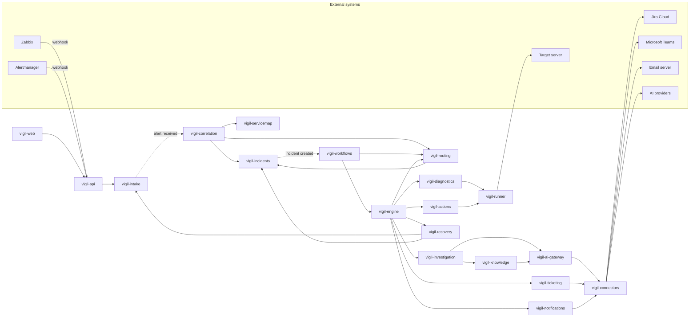

# Vigil — Product Map

| Field | Value |
| --- | --- |
| Document | 10-product-map (ID prefix `PM-`) |
| Version | 1.3 |
| Date | 12 October 2026 |
| Owner | Abdul Wadood |
| Status | Baseline (owner reviewed). Amended by Round 2 (Section 19), Round 4 (Section 20) and Round 5 (Section 21). |

## 1. Purpose

This document lists every module of the full Vigil product: its job, the records it owns, the modules and external systems it talks to, and which of its responsibilities are built for the demo and which are "Later (not built)". It assigns working module names (final names in Round 5, CTX §3), assigns every workflow step type and every AI task to an owning module, and confirms the AI task list (`01-scope-lock` Section 5.5).

Round 2 defines the records named here in detail (fields, relationships, lifecycles). Round 4 decides, per module, keep / simplify / stage / later for the demo. Round 5 decides how modules are deployed, how they communicate, and the final names.

## 2. Inputs read

- `docs/00-context.md` v1.4 (v1.5 records the closure of this round).
- `docs/01-scope-lock.md` v1.4 (v1.5 adds the clarification of PM-D-13).
- `docs/sources/Continuum — Business Solution Document.md` v0.2 (the BSD), all sections.
- `docs/sources/Techfinity NOC Demo — What Will Be Delivered.md`, 7 October 2026.

At the start of Round 1 the repository held v1.3 of `00-context` and `01-scope-lock` and the project mirror held v1.4 (the version that closed Round 0). Version 1.4 was written to the repository in this round, so the repository copy and this document's inputs are the same (Section 17, PM-Q-N1).

## 3. Terms used in this document (complete list)

| Term | Meaning |
| --- | --- |
| Module | A part of the Vigil product with one job and its own records. A module is a code boundary. Whether modules run in one process or several is decided in Round 5 (PM-O-01). |
| Owns | The module is the only one that creates, changes or deletes that record type (PM-R-01). |
| Request | One module asks another to do something or to return data, and waits for the answer. |
| Event | A module announces that something has happened. Other modules MAY react. The announcing module does not wait. |
| Built | A responsibility that is built, because it traces to list A or list B of `01-scope-lock`. Round 4 MAY narrow how it is shown (Simplified) but MUST NOT remove it without the change rule `SL-CR-02`. |
| Later (not built) | A responsibility of the full product that is not built now. It traces to the BSD or to list C of `01-scope-lock`. It is listed so the built parts leave room for it. |
| Evidence register entry | A record on the incident (owned by `vigil-incidents`) that holds an unchangeable copy of one piece of evidence: producing module, reference to the producer's record, source system, collection time, a one-line summary and the content needed by other modules. |
| Seed bundle | A set of configuration and data, one part per owning module, that brings a tenant to a defined state (for the demo: the starting state). |
| Import interface | The request by which a module accepts its part of a seed bundle. |
| Action proposal | A registered action with exact parameters and target, proposed for one incident. |
| Long-running step | A step that can wait: Approval, Recovery check, Escalation, Wait/timer. Protocol in Section 8. |
| Test-mode run | A workflow run started for a test replay (PM-M12-09). |
| Demo-only component | Software or material outside the Vigil product (`01-scope-lock` list A3, CTX-C-03). Its names use the prefix `demo-`, never `vigil-`. |
| External system | A system Vigil talks to but does not build (for example Zabbix or Jira Cloud). |

## 4. Module overview

### 4.1 Module list (complete list)

Modules PM-M01 to PM-M24 are built. Modules PM-M25 to PM-M28 have only "Later (not built)" responsibilities.

| ID | Working name | Group | Job |
| --- | --- | --- | --- |
| PM-M01 | `vigil-tenancy` | Platform | Keeps tenants and tenant-wide product settings: customer name, logo, environment label. |
| PM-M02 | `vigil-identity` | Platform | Keeps users, teams, permissions and login sessions; answers "who is this and what may they do". |
| PM-M03 | `vigil-audit` | Platform | Keeps the append-only audit log and answers audit trail queries. |
| PM-M04 | `vigil-connectors` | Platform | Defines the common connector interface per connector type, keeps connector instances and credential references, and tests connections. |
| PM-M05 | `vigil-runner` | Platform | The only part of Vigil that touches a target server. Runs registered operations only, with diagnostic and action permissions held separately. |
| PM-M06 | `vigil-intake` | Signals and context | Receives monitoring alerts by webhook, stores them unchanged, normalises them, tracks firing/resolved state and source health. |
| PM-M07 | `vigil-servicemap` | Signals and context | Keeps the service map: business services, components, dependencies, owners, criticality, and the keys that match alerts to components. |
| PM-M08 | `vigil-correlation` | Signals and context | Groups alerts into incidents with reasons, computes the root-cause hypothesis and the customer impact. |
| PM-M09 | `vigil-incidents` | Incident operations | Keeps incidents, their lifecycle, alert membership, assignment, acknowledgements, evidence register and timeline. |
| PM-M10 | `vigil-routing` | Incident operations | Keeps routing rules and escalation levels; assigns severity, owner team and informed parties; implements the Escalation step. |
| PM-M11 | `vigil-workflows` | Workflow | Keeps workflow definitions, drafts and versions; validates, publishes, rolls back, compares versions, runs test replays, and starts live runs. |
| PM-M12 | `vigil-engine` | Workflow | Executes workflow runs durably, step by step; holds timers; enforces the action path; announces step changes. |
| PM-M13 | `vigil-diagnostics` | Response | Keeps diagnostic definitions, runs read-only diagnostics through the runner, and records results as evidence. |
| PM-M14 | `vigil-actions` | Response | Keeps registered actions and their policies; proposes actions; handles approvals; rechecks, executes through the runner, and reconciles unknown results. |
| PM-M15 | `vigil-recovery` | Response | Keeps recovery check definitions and decides, independently of action results, whether a service has recovered. |
| PM-M16 | `vigil-knowledge` | Knowledge and AI | Keeps runbooks and the past-incident history; selects applicable runbooks; runs similar-incident search. |
| PM-M17 | `vigil-investigation` | Knowledge and AI | Implements the AI task step: prepares, runs, checks and stores SL-T-1 and SL-T-2, passes SL-T-3 to `vigil-knowledge`, and produces the template summary when AI is unavailable. |
| PM-M18 | `vigil-ai-gateway` | Knowledge and AI | The only path to AI providers: provider per task, fallback order, data routing, usage and cost records. |
| PM-M19 | `vigil-ticketing` | Outbound | Creates and updates tickets in the ticketing system and keeps the incident-to-ticket links. |
| PM-M20 | `vigil-notifications` | Outbound | Composes and sends messages to teams and users through channel connectors and records delivery. |
| PM-M21 | `vigil-reporting` | Insight and setup | Computes dashboard metrics and compares them with baseline values. |
| PM-M22 | `vigil-setup` | Insight and setup | Guided setup: connection tests, readiness gaps, and import of a seed bundle into a tenant. |
| PM-M23 | `vigil-api` | Interface | Vigil's public interface: authenticates every caller, checks permissions, passes requests to modules, pushes live updates to screens. |
| PM-M24 | `vigil-web` | Interface | All Vigil screens SL-A4-01 to SL-A4-11, including the mobile Acknowledge and Approval pages. |
| PM-M25 | `vigil-packs` | Later only | Industry pack mechanism (BSD-BR-018). |
| PM-M26 | `vigil-ai-evaluation` | Later only | AI model evaluation and promotion (BSD-BR-019, BSD-BR-021, SL-C-16). |
| PM-M27 | `vigil-platform-health` | Later only | Platform and runner failure visibility and ownership (BSD-BR-026, BSD-BR-027). |
| PM-M28 | `vigil-discovery` | Later only | Automatic discovery of servers and services (SL-C-12, BSD-BR-001). |

### 4.2 Picture of the built modules and their main requests

Arrows show requests in the demo flow (who asks whom). Audit requests from every module to `vigil-audit` are left out for readability. The complete list of requests and events is Section 9.

Solid arrows are requests. Dotted arrows are events.

## 5. Module rules (complete list)

| ID | Rule | Trace |
| --- | --- | --- |
| PM-R-01 | Every record type MUST have exactly one owning module, named in its module card (Section 6). Modules other than the owning module MUST NOT create, change or delete records of that type. | SL-B-02, SL-B-06; BSD §12.2 |
| PM-R-02 | A module MUST read or change another module's records only by a request to the owning module or by reacting to its events. A module MUST NOT read another module's stored records directly. | CTX-C-01, CTX-G-2 |
| PM-R-03 | The request graph MUST be acyclic. Every module MUST appear in this order, and a module MUST send requests only to modules earlier in the order (complete list, earliest first): `vigil-audit`, `vigil-tenancy`, `vigil-identity`, `vigil-connectors`, `vigil-runner`, `vigil-servicemap`, `vigil-intake`, `vigil-ai-gateway`, `vigil-knowledge`, `vigil-incidents`, `vigil-investigation`, `vigil-notifications`, `vigil-ticketing`, `vigil-routing`, `vigil-correlation`, `vigil-recovery`, `vigil-diagnostics`, `vigil-actions`, `vigil-engine`, `vigil-workflows`, `vigil-reporting`, `vigil-setup`, `vigil-api`, `vigil-web`. Communication in the other direction MUST use events. | CTX-C-01 (keeps each module buildable and testable alone) |
| PM-R-04 | Modules other than `vigil-runner` MUST NOT run anything on a target server. Code other than connectors registered with `vigil-connectors` MUST NOT start a call to an external system (inbound webhooks arrive through `vigil-api`, PM-R-07). Modules other than `vigil-ai-gateway` MUST NOT call AI providers. | SL-B-05, SL-B-07, SL-B-08; BSD §5.2 |
| PM-R-05 | Every record MUST carry a tenant identifier, and every request and event MUST be handled within one tenant. | SL-B-01 |
| PM-R-06 | Every module except `vigil-api` and `vigil-web` MUST send an audit event to `vigil-audit` for each of these (complete list): incident creation; grouping of an alert; hypothesis change; assignment change; acknowledgement; escalation; AI result accepted or rejected; policy check result; approval request and decision; action execution and reconciliation; recovery verification; lifecycle transition; notification sent; ticket change; configuration change (settings, users and teams, sources, service map, routing rules, escalation levels, workflows, AI settings, registered actions, seed import). Test-mode runs MUST NOT write live audit events (PM-M12-09). This list is complete for this document; a later round extends it only by a recorded change. | SL-B-06, SL-A2-08 |
| PM-R-07 | `vigil-web` and the demo control panel MUST reach Vigil only through `vigil-api`. Monitoring webhooks MUST reach `vigil-intake` only through `vigil-api`. | SL-A3-03, SL-B-10 |
| PM-R-08 | A module MUST NOT contain logic that exists only for the demo. Demo behaviour MUST come from configuration values and seeded data. | SL-B-10 |
| PM-R-09 | A user action MUST reach a module only after `vigil-api` has authenticated the user and confirmed the permission with `vigil-identity`. Modules MUST record the acting user with the change. | SL-B-13 |

## 6. Module cards

Section 19 lists the amendments made by Round 2 (`20-domain-model`), Section 20 those made by Round 4 (`40-demo-cut`) and Section 21 those made by Round 5 (`50-architecture`). Where an amendment section and an item in Sections 4 to 14 differ, the amendment section wins; where amendment sections differ, the later section wins.

Each card lists: job; records owned (complete list); requests it sends; events it publishes; events it reacts to; responsibilities. Responsibility IDs are `PM-Mnn-nn` (built) and `PM-Mnn-Ln` (Later, not built). Record names are working names; Round 2 defines them.

### 6.1 Platform

#### PM-M01 `vigil-tenancy`

| Item | Content |
| --- | --- |
| Job | Keeps tenants and tenant-wide product settings. |
| Owns (complete list) | Tenant; tenant settings (customer name, customer logo, environment label). |
| Sends requests to | `vigil-audit`. |
| Publishes events | Tenant settings changed. |
| Reacts to events | None. |

| ID | Responsibility | Status | Trace |
| --- | --- | --- | --- |
| PM-M01-01 | MUST create tenants and give each a tenant identifier used on every record (PM-R-05). | Built | SL-B-01 |
| PM-M01-02 | MUST keep the customer name, customer logo and environment label as settings, and MUST return them to any module that requests them. | Built | SL-A3-06, SL-B-09; SL-DR-03 |
| PM-M01-03 | MUST create a new tenant on request through `vigil-api`. This responsibility exists for the reset mechanism recommended in SL-O-17; if Round 5 chooses another mechanism, Round 5 withdraws it by a decision log entry. | Built | SL-A3-03; SL-O-17 |
| PM-M01-L1 | Multi-customer administration across tenants. | Later (not built) | SL-C-06; BSD §6.2 |
| PM-M01-L2 | Customer data lifecycle: retention, export, deletion and offboarding of a tenant. | Later (not built) | BSD-BR-029; BSD §12.2 |

#### PM-M02 `vigil-identity`

| Item | Content |
| --- | --- |
| Job | Keeps users, teams and permissions, logs users in, and answers permission questions. |
| Owns (complete list) | User; team; team membership; permission grant; login session. |
| Sends requests to | `vigil-tenancy`, `vigil-audit`. |
| Publishes events | None. |
| Reacts to events | None. |

| ID | Responsibility | Status | Trace |
| --- | --- | --- | --- |
| PM-M02-01 | MUST keep named users, teams, team membership and permission grants as data. | Built | SL-B-13, SL-A3-07 |
| PM-M02-02 | MUST log users in with a username and password. Passwords of seeded users MUST come from secrets supplied at deployment; a password MUST NOT be stored in the repository or be the same on every installation. | Built | SL-B-14, SL-A4-01 |
| PM-M02-03 | MUST answer, for a user and a permission, whether the user holds it; and for a user and a team, whether the user is a member. | Built | SL-B-13, SL-B-03 (eligible teams) |
| PM-M02-04 | MUST return the members of a team. | Built | SL-A1-05 |
| PM-M02-L1 | Company sign-in (SSO) and identity integration. | Later (not built) | SL-C-06; BSD §6.2 |
| PM-M02-L2 | User, team and role management screens. | Later (not built) | SL-C-06; BSD §11.1 Administration |

#### PM-M03 `vigil-audit`

| Item | Content |
| --- | --- |
| Job | Keeps the append-only audit log and answers audit trail queries. |
| Owns (complete list) | Audit event. |
| Sends requests to | None. |
| Publishes events | None. |
| Reacts to events | None. |

| ID | Responsibility | Status | Trace |
| --- | --- | --- | --- |
| PM-M03-01 | MUST accept audit events from every module, each with tenant, acting user or module, time, event type and subject. | Built | SL-B-06 |
| PM-M03-02 | MUST NOT offer any way to change or delete an audit event. | Built | SL-B-06; SL-A3-03 (reset keeps earlier runs) |
| PM-M03-03 | MUST return audit events filtered by time range, user, event type and subject, for the audit trail screen. | Built | SL-A2-08, SL-A4-11 |
| PM-M03-L1 | Audit export and retention under an agreed data lifecycle. | Later (not built) | BSD-BR-025; BSD §12.2 |

#### PM-M04 `vigil-connectors`

| Item | Content |
| --- | --- |
| Job | Defines the common interface for each connector type, keeps connector instances and credential references, and runs connection tests. |
| Owns (complete list) | Connector type definition; connector instance (one configured external system: type, address, credential reference); credential reference (for every secret Vigil holds, including webhook tokens and target credentials; other modules hold only its identifier). |
| Sends requests to | `vigil-audit`; external systems through the connectors in Section 7. |
| Publishes events | None. |
| Reacts to events | None. |

| ID | Responsibility | Status | Trace |
| --- | --- | --- | --- |
| PM-M04-01 | MUST define one interface per connector type (complete list): monitoring source; target; ticketing; notification channel; AI provider. | Built | SL-B-07 |
| PM-M04-02 | MUST let a new connector of an existing type be added without changes to any module other than the connector itself. `vigil-runner` is the registered implementation of the target connector type (PM-K-03). | Built | SL-B-07 |
| PM-M04-03 | MUST keep connector instances with credential references only; secret values MUST NOT be stored in the repository (storage mechanism decided in Round 5). | Built | SL-B-14 |
| PM-M04-04 | MUST run a connection test for a monitoring source connector instance on request and return pass or fail with the reason. | Built | SL-A2-01 |
| PM-M04-L1 | Connector SDK and extension kit for third parties, with declared support and validation. | Later (not built) | SL-C-09; BSD-BR-017 |
| PM-M04-L2 | Connector register recording product, version, authentication, mappings, limits and acceptance evidence per connector. | Later (not built) | BSD §12.1 |
| PM-M04-L3 | Connection tests for ticketing, notification, AI provider and target connectors. | Later (not built) | BSD §11.1 Setup center |

#### PM-M05 `vigil-runner`

| Item | Content |
| --- | --- |
| Job | The only part of Vigil that touches a target server. It implements the target connector type. |
| Owns (complete list) | Operation catalogue (each registered operation: exact command, parameter types, permission kind "diagnostic" or "action"); target access grant (target, permission kind, credential reference identifier); operation run record. |
| Sends requests to | `vigil-audit`; target servers. |
| Publishes events | None. |
| Reacts to events | None. |

| ID | Responsibility | Status | Trace |
| --- | --- | --- | --- |
| PM-M05-01 | MUST run only operations in its operation catalogue, with parameters checked against their declared types. It MUST NOT run free-form commands. | Built | SL-B-04; BSD-BR-012, BSD §6.4 |
| PM-M05-02 | MUST hold diagnostic and action access to a target as separate grants with separate credentials, and MUST refuse an action operation on a target that has only a diagnostic grant. | Built | SL-B-05 |
| PM-M05-03 | MUST return each run's result with the target, the operation, the collection time and the outcome (succeeded, failed, unknown). | Built | SL-A1-03, SL-B-11 |
| PM-M05-04 | MUST answer state queries (registered read-only operations) that `vigil-actions` uses to reconcile an action whose result is unknown. | Built | SL-B-11 |
| PM-M05-L1 | Runner installed inside a customer network, separate from the Vigil server, with its own health reporting. | Later (not built) | BSD §5.2, BSD §6.2 Deployment; BSD-BR-027 |
| PM-M05-L2 | Target types other than the one Linux server profile: Windows, hypervisors, Kubernetes, cloud, network devices. | Later (not built) | BSD §6.2 Direct infrastructure |

### 6.2 Signals and context

#### PM-M06 `vigil-intake`

| Item | Content |
| --- | --- |
| Job | Receives alerts from monitoring sources, stores them unchanged, normalises them, tracks their state and the health of each source. |
| Owns (complete list) | Monitoring source (with the credential reference identifier of its webhook token); raw alert (unchanged payload, source identity, receive time); normalised alert (alert type, source, component identity keys, status firing or resolved, source time); alert state history; source health status. |
| Sends requests to | `vigil-connectors` (monitoring connector parsing and connection test), `vigil-audit`. |
| Publishes events | Alert received; alert state changed; source health changed. |
| Reacts to events | None. |

| ID | Responsibility | Status | Trace |
| --- | --- | --- | --- |
| PM-M06-01 | MUST accept webhook calls from each monitoring source only with that source's own token. | Built | SL-B-14 |
| PM-M06-02 | MUST split a webhook call that carries several alerts into one alert entry per alert. | Built | SL-A1-01 |
| PM-M06-03 | MUST store every received alert unchanged with its source identity and receive time, and MUST NOT change or delete stored alerts. | Built | SL-B-02 |
| PM-M06-04 | MUST normalise each alert through the source's monitoring connector into: alert type, component identity keys, status (firing or resolved), source time. Normalisation results are stored separately from the raw alert. | Built | SL-A1-01, SL-A1-07 |
| PM-M06-05 | MUST track each alert's state as firing or resolved from the source's own resolve notifications. | Built | SL-A1-07 |
| PM-M06-06 | MUST compute each source's health as healthy, stale or disconnected (inputs PM-O-12, thresholds SL-O-12) and publish changes. | Built | SL-A2-01; BSD-BR-004 |
| PM-M06-L1 | Generic webhook source and further monitoring products. | Later (not built) | SL-C-03; BSD §6.2 Monitoring intake |
| PM-M06-L2 | Visible ingestion errors for payloads that cannot be parsed. | Later (not built) | BSD §8.2 step 2 |

#### PM-M07 `vigil-servicemap`

| Item | Content |
| --- | --- |
| Job | Keeps the service map and answers dependency, ownership, criticality and impact questions. |
| Owns (complete list) | Business service; component (server, application, database, queue, check); component identity key (the values that match an alert to a component); dependency; owner assignment (component or service to team); criticality. |
| Sends requests to | `vigil-audit`. |
| Publishes events | Service map imported. |
| Reacts to events | None. |

| ID | Responsibility | Status | Trace |
| --- | --- | --- | --- |
| PM-M07-01 | MUST import a service map (services, servers, owners, criticality, dependencies) from a file (format SL-O-11), replacing the current service map. | Built | SL-A2-01 |
| PM-M07-02 | MUST return the component that matches a normalised alert's identity keys, or "unknown component". | Built | SL-A1-02 |
| PM-M07-03 | MUST answer dependency questions: direct and indirect dependents of a component; whether two components are related under the grouping relation (definition PM-O-13). | Built | SL-A1-02 |
| PM-M07-04 | MUST return the business services affected by a set of components. | Built | SL-A1-02 |
| PM-M07-05 | MUST return owner team and criticality of a component or service. | Built | SL-A1-04; BSD-BR-005 |
| PM-M07-06 | MUST return the target server of a component, for diagnostics and actions. | Built | SL-A1-03, SL-A1-06 |
| PM-M07-L1 | CMDB reconciliation, service map versions and topology history, and visible conflicting identities. | Later (not built) | BSD §6.2 Inventory/context; BSD §12.2 |

#### PM-M08 `vigil-correlation`

| Item | Content |
| --- | --- |
| Job | Groups alerts into incidents, records why, computes the root-cause hypothesis and the customer impact. |
| Owns (complete list) | Grouping decision (alert, incident, service-map relation used, time relation, decision time); hypothesis computation record (inputs and result of the root-cause rule). |
| Sends requests to | `vigil-intake`, `vigil-servicemap`, `vigil-incidents`, `vigil-routing`, `vigil-audit`. |
| Publishes events | None. |
| Reacts to events | Alert received (`vigil-intake`). |

| ID | Responsibility | Status | Trace |
| --- | --- | --- | --- |
| PM-M08-01 | MUST, for each received firing alert, either add it to an open incident whose components are related to the alert's component under the grouping relation (PM-O-13) within the time window (length SL-O-04), or ask `vigil-incidents` to create a new incident. | Built | SL-A1-02; BSD-BR-006 |
| PM-M08-02 | MUST record, for each alert added to an incident, the service-map relation and the time relation that caused the grouping, and pass a copy of this reason to `vigil-incidents` with the alert. | Built | SL-A1-02, SL-A4-03 |
| PM-M08-03 | MUST keep alerts whose component is not related to an open incident's components in a separate incident. | Built | SL-A1-02 (SL-F-3) |
| PM-M08-04 | MUST compute the root-cause hypothesis by the rule in SL-A1-02 (most dependents, then higher criticality, then component ID alphabetical) each time an incident's components change, and set it on the incident labelled "Hypothesis". | Built | SL-A1-02 |
| PM-M08-05 | MUST compute the customer impact as the affected business services and set it on the incident. | Built | SL-A1-02; BSD-BR-005 |
| PM-M08-06 | MUST produce the same grouping, hypothesis and impact for the same set of alerts whatever their arrival order within the time window, including when an alert relates to two or more open incidents (rule PM-O-13). | Built | SL-A1-02, SL-A3-04 |
| PM-M08-07 | MUST ask `vigil-routing` to evaluate the incident each time it creates an incident or changes its components, affected services or hypothesis, before it processes the next alert (PM-D-07). | Built | SL-A1-04 |
| PM-M08-08 | MUST request the reopen transition when a firing alert meets the reopen rule defined in Round 2 (PM-O-14). | Built | SL-B-12 |
| PM-M08-L1 | Operator correction of a grouping (split, merge, move an alert), recorded with user and reason. | Later (not built) | BSD §9 (UC-02), BSD §8.2 step 3 |
| PM-M08-L2 | Maintenance-window treatment of alerts. | Later (not built) | BSD-BR-007 |
| PM-M08-L3 | Machine-learning correlation, anomaly detection, forecasting. | Later (not built) | SL-C-15; BSD §6.2 Incident intelligence |

### 6.3 Incident operations

#### PM-M09 `vigil-incidents`

| Item | Content |
| --- | --- |
| Job | Keeps incidents and everything recorded on them. |
| Owns (complete list) | Incident (including its title); incident lifecycle state and transition history; incident-alert membership (with the grouping reason copied from `vigil-correlation`); root-cause hypothesis and customer impact fields (written only on request of `vigil-correlation`); assignment (severity, owner team, informed parties; written only on request of `vigil-routing`); escalation level; notified teams (teams that received a notification or escalation for the incident); acknowledgement; evidence register entry; AI availability status; timeline entry. |
| Sends requests to | `vigil-identity`, `vigil-audit`. |
| Publishes events | Incident created; incident acknowledged; incident state changed; incident changed. |
| Reacts to events | None. |

| ID | Responsibility | Status | Trace |
| --- | --- | --- | --- |
| PM-M09-01 | MUST create incidents and record alert membership on request of `vigil-correlation`, and set the incident title from a fixed pattern of incident fields (pattern defined in Round 2), updated when the hypothesis or impact changes. | Built | SL-A1-02, SL-A1-05 |
| PM-M09-02 | MUST move incidents only through the lifecycle states and transitions defined in Round 2, including reopening, and record each transition with time and actor. | Built | SL-B-12; BSD-BR-008 |
| PM-M09-03 | MUST accept severity, owner team and informed parties only from `vigil-routing`. Requests from any other module, including AI output, MUST be refused. | Built | SL-A1-04; BSD RULE-03 |
| PM-M09-04 | MUST record an acknowledgement only from a logged-in user who holds the acknowledge permission and is a member of a team in the incident's notified teams, with user and time, and publish "incident acknowledged". | Built | SL-A1-05, SL-A2-03, SL-B-13 |
| PM-M09-05 | MUST keep evidence register entries as unchangeable copies supplied by the producing module (Section 3), so other modules read evidence content from `vigil-incidents` only. | Built | SL-A1-03; BSD RULE-02 |
| PM-M09-06 | MUST change an incident to resolved only on request of `vigil-recovery`, and only when the request carries the identifier of a recovery verification that passed for that incident (PM-D-05). | Built | SL-A1-07; BSD RULE-08 |
| PM-M09-07 | MUST record AI availability status ("AI investigation unavailable" with reason) on request of `vigil-investigation`. | Built | SL-A2-05 |
| PM-M09-08 | MUST record each escalation with level, time and recipients on request of `vigil-routing`, and each notified team on request of `vigil-notifications`. | Built | SL-A2-03, SL-A1-05 |
| PM-M09-09 | MUST keep a timeline of every change to the incident, for the incident workspace. | Built | SL-A4-03 |
| PM-M09-10 | Withdrawn in v0.2 by PM-D-07 (was: publish "routing inputs changed"). | Withdrawn | PM-D-07 |
| PM-M09-11 | MUST return an evidence summary of an incident: the one-line summaries of its evidence register entries, in collection-time order. | Built | SL-A1-05, SL-A2-04 |
| PM-M09-L1 | Operator-initiated resolution under a closure policy (diagnosis, operator action, external recovery). | Later (not built) | BSD §8.1 note |
| PM-M09-L2 | Manual reassignment by an operator, and shift handover. | Later (not built) | BSD §8.2 step 3, BSD §13.1 |

#### PM-M10 `vigil-routing`

| Item | Content |
| --- | --- |
| Job | Keeps routing rules and escalation levels, assigns severity and ownership, and implements the Escalation step. |
| Owns (complete list) | Routing rule set (ending with a default rule) and its change history; escalation policy (levels and the team or teams at each level); routing evaluation record (inputs, matched rule, result). |
| Sends requests to | `vigil-incidents`, `vigil-servicemap`, `vigil-identity`, `vigil-notifications`, `vigil-ticketing`, `vigil-audit`. |
| Publishes events | None. |
| Reacts to events | None. |

| ID | Responsibility | Status | Trace |
| --- | --- | --- | --- |
| PM-M10-01 | MUST keep routing rules as configuration data, edited in the routing-rules settings screen, with every change recorded with user, time, before and after. | Built | SL-B-09, SL-A4-08, SL-A2-06, SL-A2-08 |
| PM-M10-02 | MUST, on request of `vigil-correlation` or `vigil-workflows`, evaluate the routing rules for an incident and ask `vigil-incidents` to set severity, owner team and informed parties. Evaluation MUST give the same result for the same incident fields. | Built | SL-A1-04, SL-A3-04; BSD-BR-007 |
| PM-M10-03 | MUST refuse a routing rule set that does not end with a default rule matching every incident, so every incident gets an owner team. | Built | SL-A1-04; SL-O-05; BSD RULE-01 |
| PM-M10-04 | MUST keep escalation levels (which team or teams receive each level) as configuration data. | Built | SL-B-09, SL-A2-03; SL-O-14 |
| PM-M10-05 | MUST implement the Escalation step as a long-running step (Section 8, PM-D-08) with a mode parameter (complete list): "wait for acknowledgement" and "escalate now". In "escalate now" mode it escalates one level at once, as described next, and leaves by "next". In "wait for acknowledgement" mode the step's timer parameter sets how long to wait for an acknowledgement made after the step started, at each level; on each timeout it moves the incident to the next level, asks `vigil-notifications` to notify that level's teams with the evidence summary, asks `vigil-incidents` to record the escalation, and asks `vigil-ticketing` to record it in the incident's ticket with the evidence summary; it leaves by "next" when the incident is acknowledged or when the last level has been notified. | Built | SL-A2-03, SL-A2-04, SL-A2-06 |
| PM-M10-L1 | On-call schedules and rosters. | Later (not built) | SL-C-05; BSD-BR-009 |
| PM-M10-L2 | Escalation on notification delivery failure through an alternate route. | Later (not built) | BSD §8.3; BSD-BR-009 |
| PM-M10-L3 | Maintenance calendars applied to priority and routing. | Later (not built) | BSD-BR-007; BSD §11.2 |

### 6.4 Workflow

#### PM-M11 `vigil-workflows`

| Item | Content |
| --- | --- |
| Job | Keeps workflow definitions and versions, validates and publishes them, runs test replays, and starts live runs. |
| Owns (complete list) | Step type catalogue (each step type's parameters, parameter types and named outputs, for the editor); workflow; workflow draft; workflow version (published, with publisher, time and change list); active version marker; validation result; test replay result. A tenant has one workflow in the build. |
| Sends requests to | `vigil-engine`, `vigil-incidents`, `vigil-routing`, `vigil-audit`. |
| Publishes events | Workflow version published. |
| Reacts to events | Incident created (`vigil-incidents`). |

| ID | Responsibility | Status | Trace |
| --- | --- | --- | --- |
| PM-M11-01 | MUST store workflows as versioned definitions: steps, connections and parameters as data. | Built | SL-B-03; BSD-BR-015 |
| PM-M11-02 | MUST return the step type catalogue (complete list of step types and named outputs in SL-B-03) for the editor palette and parameter panel. | Built | SL-WE-01, SL-WE-04 |
| PM-M11-03 | MUST save editor changes to a draft and MUST leave the active published version unchanged until the draft is published. | Built | SL-WE-07 |
| PM-M11-04 | MUST validate a draft against every rule in SL-WE-08 before a test replay or publish and return each violation with the step it concerns; publish MUST be refused while any violation remains. | Built | SL-WE-08 |
| PM-M11-05 | MUST publish a valid draft as the next version, make it active, and record publisher, time and the steps added, removed or changed compared with the previous version. | Built | SL-A2-06, SL-WE-09 |
| PM-M11-06 | MUST roll back by creating a new version whose content equals the chosen earlier version, and publish it. | Built | SL-B-03, SL-A2-06 |
| PM-M11-07 | MUST, on "incident created", ask `vigil-routing` to evaluate the incident, then ask `vigil-engine` to start a live run of the tenant's active published version, passing the version content (PM-D-11). The Trigger step's only built trigger is "incident created". | Built | SL-A1-08, SL-B-03 |
| PM-M11-08 | MUST run a test replay: re-process the stored alerts of a selected earlier incident through a selected version or draft by asking `vigil-engine` for a test-mode run with that content, and store the result labelled "Test" (definition: `01-scope-lock` Section 3; step-by-step test behaviour PM-O-07). | Built | SL-A2-06 |
| PM-M11-L1 | Review and sign-off of a workflow by a designated workflow owner before publish. | Later (not built) | BSD-BR-016; BSD §4 Decision ownership |
| PM-M11-L2 | Reusable templates and composition of workflows from shared parts. | Later (not built) | BSD §6.2 Workflow product |
| PM-M11-L3 | Several users editing the same workflow at the same time. | Later (not built) | SL-C-18 |
| PM-M11-L4 | Several workflows per tenant, chosen by Trigger step conditions. | Later (not built) | BSD §11.2 Operational workflows |

#### PM-M12 `vigil-engine`

| Item | Content |
| --- | --- |
| Job | Executes workflow runs durably and enforces the action path. |
| Owns (complete list) | Workflow run (with a copy of the version or draft content it started on); step execution record (step, start, end, named output, result reference); durable timer; run checkpoint. |
| Sends requests to | `vigil-incidents` (fields for Condition steps); step-implementing modules (Section 8): `vigil-diagnostics`, `vigil-investigation`, `vigil-actions`, `vigil-recovery`, `vigil-routing`, `vigil-notifications`, `vigil-ticketing`; and `vigil-audit`. |
| Publishes events | Run started; step changed (step started, step finished with named output); run finished. |
| Reacts to events | Incident acknowledged and incident state changed (`vigil-incidents`); approval decided (`vigil-actions`); alert state changed (`vigil-intake`); its own timers expiring. |

| ID | Responsibility | Status | Trace |
| --- | --- | --- | --- |
| PM-M12-01 | MUST run a workflow run to completion on the content it started with, using its own copy of that content. | Built | SL-B-03 |
| PM-M12-02 | MUST implement the Trigger, Condition and Wait/timer steps itself and pass every other step to its implementing module (Section 8). | Built | SL-B-03 |
| PM-M12-03 | MUST evaluate Condition steps as structured comparisons (field, operator, value, joined by AND) over incident fields read from `vigil-incidents`; fields and operators per SL-O-23. | Built | SL-B-03 |
| PM-M12-04 | MUST save the run state after each step and, after a restart, resume each run from its last completed step. | Built | SL-B-11; BSD-BR-013 |
| PM-M12-05 | MUST run long-running steps by the protocol in Section 8, holding every durable timer they ask for (Wait/timer durations, approval expiry, escalation timers, recovery observation windows and maximum waits). | Built | SL-B-03, SL-A1-06, SL-A1-07, SL-A2-03 |
| PM-M12-06 | MUST, whatever the workflow graph contains, refuse to start an Action step unless (complete list) an Approval step in the same run has left by "approved" for that exact action proposal (after the policy check in `vigil-actions`), and every path from each of the Action step's outputs passes through a Recovery check step before the run can end. A refused Action step MUST leave by "failed" with the reason, without asking `vigil-actions` to execute. A run that executed an action MUST NOT finish without a recovery verification recorded after that action. | Built | SL-B-04, SL-WE-08 |
| PM-M12-07 | MUST pass to `vigil-actions`, for each Approval step, the approvers of earlier Approval steps in the same run, so a later approver differs from every earlier one. | Built | SL-B-03 |
| PM-M12-08 | MUST publish "step changed" when a step starts or finishes, so screens update within 2 seconds (SL-A1-08). | Built | SL-A1-08, SL-WE-10 |
| PM-M12-09 | MUST support test-mode runs in which no step calls a connector, the runner or an AI provider; Diagnostic, AI task and Action steps return the named outputs and results recorded in the original incident's step execution records; other step types follow PM-O-07. Test-mode runs MUST NOT write live audit events or change live incidents. | Built | SL-A2-06 (test replay definition) |
| PM-M12-10 | MUST, after a restart, ask `vigil-actions` to reconcile every Action step that has no recorded named output before the run continues (PM-D-12). | Built | SL-B-03, SL-B-11 |
| PM-M12-L1 | Permitted cancellation of a running step from the execution view. | Later (not built) | BSD §11.1 Execution view |
| PM-M12-L2 | Tenant-wide automation stop: block new actions and stop in-flight operations by their declared stopping behaviour. | Later (not built) | BSD §8.3; BSD-BR-030 |

### 6.5 Response

#### PM-M13 `vigil-diagnostics`

| Item | Content |
| --- | --- |
| Job | Runs registered read-only diagnostics on targets and records the results as evidence. |
| Owns (complete list) | Diagnostic definition (runner operation used, parameters, how the output is read); diagnostic result (target, definition, values, collection time, outcome). |
| Sends requests to | `vigil-runner`, `vigil-servicemap`, `vigil-incidents`, `vigil-audit`. |
| Publishes events | None. |
| Reacts to events | None. |

| ID | Responsibility | Status | Trace |
| --- | --- | --- | --- |
| PM-M13-01 | MUST keep diagnostic definitions as data, each referring to a runner operation of permission kind "diagnostic". The demo set is (complete list): disk usage per filesystem; largest folders under the configured data path; disk usage growth over a recent period (exact definitions SL-O-06). | Built | SL-A1-03 |
| PM-M13-02 | MUST implement the Diagnostic step (Section 8): find the target server through `vigil-servicemap`, run the diagnostics through `vigil-runner` with diagnostic permission only, store each result with source and collection time, and add an evidence register entry (with a copy of the result) to the incident. | Built | SL-A1-03, SL-B-05 |
| PM-M13-03 | MUST leave the Diagnostic step by "failed" with the reason when the runner refuses or fails, and by "done" otherwise. | Built | SL-B-03 |
| PM-M13-L1 | Operator-requested diagnostics from the incident workspace. | Later (not built) | BSD §9 (UC-03), BSD §8.3 |
| PM-M13-L2 | Evidence freshness rules and automatic re-collection of stale evidence. | Later (not built) | BSD RULE-06, RULE-09 |

#### PM-M14 `vigil-actions`

| Item | Content |
| --- | --- |
| Job | Owns the whole path by which anything changes a target: registered actions, policy check, proposal, approval, recheck, execution and reconciliation. |
| Owns (complete list) | Registered action (runner operation of permission kind "action", parameter types, limits, attempt limit, precondition, linked recovery check definition); action policy (per action and service: blocked, approval required, preauthorized); action proposal; approval request (exact snapshot of action, parameters, target, limits, expiry time, evidence references, recovery checks); approval decision; action execution record (attempt number, result, reconciliation outcome). |
| Sends requests to | `vigil-knowledge`, `vigil-runner`, `vigil-servicemap`, `vigil-incidents`, `vigil-identity`, `vigil-notifications`, `vigil-recovery`, `vigil-audit`. |
| Publishes events | Approval decided (a human approved or rejected). |
| Reacts to events | None. |

| ID | Responsibility | Status | Trace |
| --- | --- | --- | --- |
| PM-M14-01 | MUST keep registered actions as data; only registered actions MUST be proposed, approved or executed. | Built | SL-B-04; BSD-BR-012 |
| PM-M14-02 | MUST create an action proposal from the registered action linked to the incident's best similar past incident as stored by `vigil-knowledge`, with exact parameters and target (values SL-O-08). When `vigil-knowledge` holds "no match" or no search result for the incident, no proposal is created; the Approval step then MUST leave by "rejected" with reason "no proposal", without a policy check, approval request, decision record or "approval decided" event, and the audit event records "no proposal". | Built | SL-A1-06, SL-A1-02 (SL-F-3 triggers no action) |
| PM-M14-03 | MUST run the policy check for a proposal with the outcomes (complete list): blocked; approval required; preauthorized. On "preauthorized" the Approval step MUST record "preauthorized" and leave by "approved" without a human; on "blocked" it MUST leave by "rejected". Both outcomes MUST have automated tests. | Built | SL-B-04, SL-C-17 |
| PM-M14-04 | MUST implement the Approval step as a long-running step (Section 8): store the approval request snapshot with expiry (SL-O-09), ask `vigil-notifications` to send the request with a link to the Approval page to every member of the step's eligible teams who holds the approve permission, and decide "approved", "rejected" or "expired". | Built | SL-A1-06 |
| PM-M14-05 | MUST accept an approval decision only from a logged-in user who holds the approve permission, belongs to a team named in the step's eligible teams, and differs from every earlier approver in the run. | Built | SL-B-13, SL-B-03 |
| PM-M14-06 | MUST return, for the Approval page, the complete content listed in SL-A1-06. | Built | SL-A1-06, SL-A4-05 |
| PM-M14-07 | MUST implement the Action step (Section 8): recheck (complete list) approval not expired, action, parameters and target unchanged since approval, incident still open, precondition still true; only then execute through `vigil-runner` with action permission. | Built | SL-A1-06; BSD RULE-06 |
| PM-M14-08 | MUST write the execution record before calling `vigil-runner`. An execution record with no final result, or with result "unknown", MUST be reconciled by querying the target's actual state through `vigil-runner` before the result is decided or any further attempt is made. The action's attempt limit (SL-O-15) MUST NOT be exceeded. | Built | SL-B-03, SL-B-11, SL-A2-04; BSD RULE-07 |
| PM-M14-09 | MUST add evidence register entries to the incident for the approval and each execution. | Built | SL-A1-06; BSD RULE-02 |
| PM-M14-L1 | Showing preauthorized automatic actions to customers, with eligibility conditions and withdrawal criteria. | Later (not built) | SL-C-17; BSD §10.1 |
| PM-M14-L2 | Automation authority assigned per scenario, service and action, reviewed against outcomes and withdrawable. | Later (not built) | BSD-BR-030 |
| PM-M14-L3 | Target-count and concurrency limits across incidents. | Later (not built) | BSD RULE-07 |

#### PM-M15 `vigil-recovery`

| Item | Content |
| --- | --- |
| Job | Decides, independently of action results, whether a service has recovered. |
| Owns (complete list) | Recovery check definition (conditions and observation window); recovery verification (incident, conditions checked, times, outcome recovered or not recovered). |
| Sends requests to | `vigil-intake`, `vigil-incidents`, `vigil-audit`. |
| Publishes events | None. |
| Reacts to events | None. |

| ID | Responsibility | Status | Trace |
| --- | --- | --- | --- |
| PM-M15-01 | MUST keep recovery check definitions as data. The demo definition's conditions are (complete list): every alert grouped into the incident is resolved at its source; the synthetic USSD check reports success through monitoring; both held for the observation window (SL-O-01). | Built | SL-A1-07 |
| PM-M15-02 | MUST implement the Recovery check step as a long-running step (Section 8): evaluate the conditions from alert states held by `vigil-intake`, never from action results; decide "recovered" when all conditions have held for the observation window, and "not recovered" when the step's maximum wait (PM-O-08) ends first. | Built | SL-A1-07, SL-A2-04; BSD RULE-08 |
| PM-M15-03 | MUST store each recovery verification and add an evidence register entry for it; when the outcome is "recovered", MUST ask `vigil-incidents` to resolve the incident with that verification's identifier. | Built | SL-A1-07 (PM-D-05) |
| PM-M15-04 | MUST return the recovery checks linked to a registered action, for display on the Approval page. | Built | SL-A1-06 |
| PM-M15-L1 | Recovery confirmation by a service owner where the closure policy requires it. | Later (not built) | BSD §8.2 step 7 |

### 6.6 Knowledge and AI

#### PM-M16 `vigil-knowledge`

| Item | Content |
| --- | --- |
| Job | Keeps runbooks and past-incident history; selects runbooks; finds similar past incidents. |
| Owns (complete list) | Runbook (ID, version, applicability, text); past incident (history record with its fix, linked registered action, recorded success count, and the times the dashboard needs, PM-O-15); incident embedding (per SL-T-3 provider); similarity search result (per incident: best match and score, or "no match"); minimum similarity setting. |
| Sends requests to | `vigil-ai-gateway`, `vigil-audit`. |
| Publishes events | None. |
| Reacts to events | Task provider changed for SL-T-3 (`vigil-ai-gateway`). |

| ID | Responsibility | Status | Trace |
| --- | --- | --- | --- |
| PM-M16-01 | MUST import runbooks and past incidents (the demo data set holds exactly 50, SL-DR-04), each runbook with a stable ID and applicability (fields PM-O-05). | Built | SL-DR-04 |
| PM-M16-02 | MUST return the runbooks whose applicability matches the inputs given by the caller (alert types and component types), by rules only, without AI (PM-D-04). | Built | SL-A1-04 |
| PM-M16-03 | MUST run similar-incident search for an incident: build the search text only from the alert types, affected services and root-cause hypothesis component given by the caller; label it with its data category; get its embedding through `vigil-ai-gateway` (task SL-T-3); store and return the best match with its similarity score rounded to 2 decimal places and its recorded success count, or "no match" when the best score is below the minimum similarity setting (value PM-O-16). | Built | SL-A1-06, SL-T-3; SL-A1-02 (SL-F-3 triggers no action) |
| PM-M16-04 | MUST, on "task provider changed" for SL-T-3, re-embed every stored past incident with the new provider before the next search, and refuse searches until that is done. | Built | `01-scope-lock` Section 5.5 |
| PM-M16-05 | MUST keep history limited to imported records; resolved live incidents MUST NOT be added (PM-D-06). | Built | SL-A3-04 |
| PM-M16-L1 | Adding reviewed resolved incidents to history, and improvement proposals for runbooks. | Later (not built) | BSD §8.2 step 8; BSD RULE-11 |
| PM-M16-L2 | Ingestion of approved knowledge documents with owner, provenance, freshness, review date and access classification. | Later (not built) | BSD §12.1 Knowledge, BSD §12.2 |

#### PM-M17 `vigil-investigation`

| Item | Content |
| --- | --- |
| Job | Prepares, runs, checks and stores AI tasks for incidents. |
| Owns (complete list) | AI investigation result (likely cause, hypothesis confirmed or disputed, evidence references, uncertainty, runbook ID cited, provider used, validation outcome); incident summary (text, source "AI" or "template"). Prompt definitions are code, not records. |
| Sends requests to | `vigil-incidents`, `vigil-servicemap`, `vigil-knowledge`, `vigil-ai-gateway`, `vigil-audit`. |
| Publishes events | None. |
| Reacts to events | None. |

| ID | Responsibility | Status | Trace |
| --- | --- | --- | --- |
| PM-M17-01 | MUST implement the AI task step (Section 8) for SL-T-1, SL-T-2 and SL-T-3 (SL-T-3 by asking `vigil-knowledge` for the similar-incident search). | Built | SL-T-1, SL-T-2, SL-T-3 |
| PM-M17-02 | MUST build the SL-T-1 input from the incident's alerts, hypothesis, customer impact, evidence register entries (read from `vigil-incidents`) and the runbooks returned by `vigil-knowledge`. Every part of every SL-T-1 and SL-T-2 request MUST carry its data category (SL-O-13). | Built | SL-A1-04, SL-A1-05; SL-B-08 |
| PM-M17-03 | MUST accept an SL-T-1 output only if it states a likely cause, states whether it confirms or disputes the hypothesis, states what remains uncertain, references at least one evidence register entry and only entries that exist on the incident, and cites at least one runbook ID, each from those supplied. Otherwise the output MUST NOT be shown as the investigation result, no other provider is tried (PM-D-14), the step MUST leave by "unavailable", and the incident MUST show "AI investigation unavailable" with reason "output failed checks". | Built | SL-A1-04; BSD-BR-021, BSD RULE-09 |
| PM-M17-04 | MUST store each accepted result and add an evidence register entry for it. | Built | SL-A1-04 |
| PM-M17-05 | MUST produce the incident summary with SL-T-2, or, when SL-T-2 is unavailable, from the fixed template of incident fields. | Built | SL-A1-05 |
| PM-M17-06 | MUST ask `vigil-incidents` to record "AI investigation unavailable" when no allowed provider answers. | Built | SL-A2-05 |
| PM-M17-07 | MUST run "Re-run AI investigation" on request of a user holding the re-run permission (PM-D-13), live, through `vigil-ai-gateway`, with the incident's current evidence. | Built | SL-A2-07 |
| PM-M17-L1 | Further AI tasks listed in Section 10.2. | Later (not built) | BSD §5.2, BSD §10.3 |

#### PM-M18 `vigil-ai-gateway`

| Item | Content |
| --- | --- |
| Job | The only path to AI providers. Applies provider choice, fallback and data routing; records usage and cost. |
| Owns (complete list) | AI provider configuration (connector instance, model name, price per unit); task assignment (provider per AI task and fallback order); data routing policy (data category to allowed providers); AI usage record (tenant, task, provider, model, units used, cost, time, outcome, incident reference). |
| Sends requests to | `vigil-connectors` (AI provider connectors), `vigil-audit`. |
| Publishes events | Task provider changed. |
| Reacts to events | None. |

| ID | Responsibility | Status | Trace |
| --- | --- | --- | --- |
| PM-M18-01 | MUST keep the allowed providers per AI task as data (seeded from `01-scope-lock` Section 5.5), allow only those, and let an admin choose the provider and fallback order per task. | Built | SL-A2-02 |
| PM-M18-02 | MUST refuse to send any part of a request to a provider not allowed for that part's data category, including during fallback. | Built | SL-A2-02, SL-B-08; BSD RULE-10 |
| PM-M18-03 | MUST, when a provider is unreachable, try the next allowed provider in the fallback order, and return "unavailable" when none answers. | Built | SL-A2-05; BSD-BR-021 |
| PM-M18-04 | MUST record every call as an AI usage record, and return usage and cost per provider and per task. | Built | SL-A2-02, SL-A2-07 |
| PM-M18-05 | MUST hold the default AI settings (SL-O-20; SL-T-3 default local embedding model, CTX-D-011). | Built | SL-O-20 |
| PM-M18-L1 | Provider health and quality views, and use limits per task or provider. | Later (not built) | BSD-BR-019; BSD §10.3 |
| PM-M18-L2 | Redaction of restricted content from stored AI interaction records. | Later (not built) | BSD §12.2 |

### 6.7 Outbound

#### PM-M19 `vigil-ticketing`

| Item | Content |
| --- | --- |
| Job | Creates and updates tickets in the ticketing system and keeps incident-to-ticket links. |
| Owns (complete list) | Ticket link (incident, ticketing connector instance, external ticket key, ticket address); ticket sync record (request, time, outcome). |
| Sends requests to | `vigil-connectors` (ticketing connector), `vigil-incidents`, `vigil-investigation`, `vigil-tenancy`, `vigil-audit`. |
| Publishes events | None. |
| Reacts to events | None. |

| ID | Responsibility | Status | Trace |
| --- | --- | --- | --- |
| PM-M19-01 | MUST implement the Ticket create/update step (Section 8), and record escalations on request of `vigil-routing`. Tickets MUST change only in these two ways (PM-D-10). | Built | SL-A1-05, SL-A1-07, SL-A2-03 |
| PM-M19-02 | MUST create the ticket with the content listed in SL-A1-05 (complete list), with the title prefixed by the environment label. | Built | SL-A1-05, SL-DR-03 |
| PM-M19-03 | MUST update the ticket to resolved with the recovery evidence (read from the evidence register) when the step asks, and record escalations with the evidence summary. | Built | SL-A1-07, SL-A2-03, SL-A2-04 |
| PM-M19-04 | MUST leave the step by "failed" with the reason when the ticketing system refuses or does not answer, and record it. | Built | SL-B-03 |
| PM-M19-L1 | Two-way synchronisation with conflict and duplicate handling. | Later (not built) | BSD §12.1 ITSM; BSD §16.2 (AC-06) |
| PM-M19-L2 | Ticketing systems other than Jira Cloud. | Later (not built) | SL-C-14 |

#### PM-M20 `vigil-notifications`

| Item | Content |
| --- | --- |
| Job | Composes and sends messages to teams and users, and records delivery. |
| Owns (complete list) | Delivery address (team or user to channel address, per channel); notification record (incident, recipients, channel, content, link, delivery status, time). |
| Sends requests to | `vigil-connectors` (notification channel connectors), `vigil-identity`, `vigil-incidents`, `vigil-investigation`, `vigil-tenancy`, `vigil-audit`. |
| Publishes events | None. |
| Reacts to events | None. |

| ID | Responsibility | Status | Trace |
| --- | --- | --- | --- |
| PM-M20-01 | MUST implement the Notification step (Section 8) and accept send requests from `vigil-routing` (escalation) and `vigil-actions` (approval request). | Built | SL-A1-05, SL-A1-06, SL-A2-03 |
| PM-M20-02 | MUST send each message through every channel configured for the recipient: Microsoft Teams and email in the demo. | Built | SL-A1-05 |
| PM-M20-03 | MUST prefix every message with the environment label and include the incident summary and the link to the Acknowledge page or Approval page; escalation messages MUST also include the evidence summary. A link MUST grant no authority by itself. | Built | SL-A1-05, SL-A2-04, SL-B-13, SL-DR-03 |
| PM-M20-04 | MUST record delivery status per recipient and channel, and leave the step by "failed" when no message was delivered. | Built | SL-B-03 |
| PM-M20-05 | MUST take the Notification step's recipients from its parameters (complete list of recipient kinds: owner team; informed parties; named teams) and ask `vigil-incidents` to record each notified team. | Built | SL-A1-05 |
| PM-M20-L1 | WhatsApp channel. | Later (not built) | SL-C-01 |
| PM-M20-L2 | Acknowledgement received inside a messaging channel, with identity mapping; authority and audit stay in Vigil (CTX-D-006). | Later (not built) | BSD §12.1 Notifications |

### 6.8 Insight and setup

#### PM-M21 `vigil-reporting`

| Item | Content |
| --- | --- |
| Job | Computes dashboard metrics and compares them with baselines. |
| Owns (complete list) | Metric definition; baseline value (labelled "Illustrative baseline"). |
| Sends requests to | `vigil-incidents`, `vigil-intake`, `vigil-knowledge`, `vigil-tenancy`, `vigil-audit`. |
| Publishes events | None. |
| Reacts to events | None. |

| ID | Responsibility | Status | Trace |
| --- | --- | --- | --- |
| PM-M21-01 | MUST compute (complete list): time to acknowledge; time to recover; alerts suppressed (alerts received minus incidents created); incidents merged; over the data source SL-O-10. | Built | SL-A1-09 |
| PM-M21-02 | MUST return each metric with its baseline value labelled "Illustrative baseline". | Built | SL-A1-09 |
| PM-M21-L1 | Reports beyond the dashboard: service, incident, automation, effort and cost reports with disclosed denominators and missing data. | Later (not built) | SL-C-13; BSD-BR-023, BSD §13.2 |
| PM-M21-L2 | Report exports under the same access and retention rules as the underlying records. | Later (not built) | BSD §12.2 |

#### PM-M22 `vigil-setup`

| Item | Content |
| --- | --- |
| Job | Guided setup, readiness gaps, and loading a seed bundle into a tenant. |
| Owns (complete list) | Readiness gap rule; seed bundle import record. |
| Sends requests to | `vigil-connectors`, `vigil-intake`, `vigil-servicemap`; and, for seed import, the import interface of `vigil-tenancy`, `vigil-identity`, `vigil-connectors`, `vigil-runner`, `vigil-servicemap`, `vigil-intake`, `vigil-ai-gateway`, `vigil-knowledge`, `vigil-routing`, `vigil-diagnostics`, `vigil-actions`, `vigil-recovery`, `vigil-notifications`, `vigil-workflows`, `vigil-reporting`; and `vigil-audit`. |
| Publishes events | None. |
| Reacts to events | Source health changed (`vigil-intake`); service map imported (`vigil-servicemap`). |

| ID | Responsibility | Status | Trace |
| --- | --- | --- | --- |
| PM-M22-01 | MUST let an admin connect Zabbix and Alertmanager (connector instance and monitoring source), test each connection, and see each source's health. | Built | SL-A2-01 |
| PM-M22-02 | MUST list readiness gaps of these types (complete list): server with no owner; service with no criticality; source not healthy. | Built | SL-A2-01 |
| PM-M22-03 | MUST load a seed bundle into a tenant on request through `vigil-api`, by passing each part to its owning module's import interface (PM-D-09). This is the Vigil operation behind reset, whatever mechanism SL-O-17 chooses (identity of the caller: PM-O-17). | Built | SL-A3-03 (starting state); SL-DR-04, SL-O-17 |
| PM-M22-L1 | Discovery review and an onboarding plan built from discovered assets. | Later (not built) | BSD-BR-001; BSD §5.1 Guided onboarding |
| PM-M22-L2 | Permission gap checks per target and source. | Later (not built) | BSD §11.1 Setup center |

### 6.9 Interface

#### PM-M23 `vigil-api`

| Item | Content |
| --- | --- |
| Job | Vigil's single public interface. |
| Owns (complete list) | Public interface definition (operations, inputs, outputs, required permission). It owns no stored records. |
| Sends requests to | Every module that offers a user or public operation; `vigil-identity` for every authenticated call. |
| Publishes events | None. |
| Reacts to events | Run started, step changed, run finished (`vigil-engine`); incident changed (`vigil-incidents`); workflow version published (`vigil-workflows`); tenant settings changed (`vigil-tenancy`). It passes them to open screens. |

| ID | Responsibility | Status | Trace |
| --- | --- | --- | --- |
| PM-M23-01 | MUST be the only entry point for `vigil-web`, the demo control panel and monitoring webhooks. | Built | SL-A3-03, SL-B-10 |
| PM-M23-02 | MUST authenticate every user call through `vigil-identity` and check the operation's required permission before passing it on. | Built | SL-B-13, SL-A3-07 |
| PM-M23-03 | MUST pass webhook calls to `vigil-intake`, which checks the source token. | Built | SL-B-14 |
| PM-M23-04 | MUST push step changes and incident changes to open screens so they show within 2 seconds of the change. | Built | SL-A1-08 |
| PM-M23-05 | MUST accept connections over HTTPS only. | Built | SL-B-14, SL-A3-05 |
| PM-M23-L1 | Documented public interface for customer and partner integrations. | Later (not built) | BSD-BR-017 |

#### PM-M24 `vigil-web`

| Item | Content |
| --- | --- |
| Job | All Vigil screens. |
| Owns (complete list) | None (editor undo history is held only in the browser during the editing session). |
| Sends requests to | `vigil-api` only. |
| Publishes events | None. |
| Reacts to events | Live updates pushed by `vigil-api`. |

| ID | Responsibility | Status | Trace |
| --- | --- | --- | --- |
| PM-M24-01 | MUST provide screens SL-A4-01 to SL-A4-11 (content defined in Round 4). | Built | SL-A4-01 to SL-A4-11 |
| PM-M24-02 | MUST show the environment label as a persistent banner on every screen, and the customer name and logo. | Built | SL-A3-06, SL-DR-03 |
| PM-M24-03 | MUST make the Acknowledge and Approval pages usable at 360 px screen width and require login before showing them. | Built | SL-A4-04, SL-A4-05, SL-B-13 |
| PM-M24-04 | MUST provide the workflow editor capabilities SL-WE-01 to SL-WE-06 and SL-WE-10 on the canvas, using `vigil-workflows` for saving, validation, test replay, publish, versions and rollback. | Built | Section 5.6 of `01-scope-lock` |
| PM-M24-05 | MUST show these labels where they apply (complete list): "Hypothesis" on the root-cause hypothesis; "Test" on test replay results; "Illustrative baseline" on dashboard baselines; a fictional-data label on incident history records. | Built | SL-A1-02, SL-A2-06, SL-A1-09, SL-DR-03 |
| PM-M24-L1 | Command center ordering of the incident queue by service impact, severity, ownership and age. | Later (not built) | BSD §11.1 Command center |
| PM-M24-L2 | Localisation, advanced visualisation and a report builder. | Later (not built) | BSD §6.2 UI |

### 6.10 Later-only modules

| ID | Working name | Responsibility (all Later, not built) | Trace |
| --- | --- | --- | --- |
| PM-M25 | `vigil-packs` | PM-M25-L1: package, version, validate and apply industry content (service templates, terminology, dependencies, runbooks, reporting definitions) for telecom, banking and data centers. | BSD-BR-018, BSD §11.2; SL-C-08 |
| PM-M26 | `vigil-ai-evaluation` | PM-M26-L1: keep an evaluation set with held-out cases (familiar, novel, contradictory, outage, embedded misleading instructions); evaluate providers per task; control promotion and rollback of a model for a task. | BSD-BR-019, BSD-BR-021, BSD §10.3, BSD §9 (UC-07); SL-C-16 |
| PM-M27 | `vigil-platform-health` | PM-M27-L1: make platform and runner failures visible, assigned and actionable; backup, restore, upgrade and capacity checks for a deployment profile. | BSD-BR-026, BSD-BR-027, BSD §14; SL-C-07 |
| PM-M28 | `vigil-discovery` | PM-M28-L1: discover servers and services and present them for review in setup, with discovery quality visible. | BSD-BR-001, BSD §6.2 Inventory/context; SL-C-12 |

## 7. Connector catalogue (complete list)

Every connector implements one connector type interface of `vigil-connectors` (PM-M04-01). Product facts about these external systems are checked in Round 5 (CTX-Q-6).

| ID | Connector | Type | Used by | Status | Trace |
| --- | --- | --- | --- | --- | --- |
| PM-K-01 | Zabbix | Monitoring source | `vigil-intake`, `vigil-setup` | Built | SL-A1-01, SL-A2-01 |
| PM-K-02 | Prometheus Alertmanager | Monitoring source | `vigil-intake`, `vigil-setup` | Built | SL-A1-01, SL-A2-01; SL-ASM-01 |
| PM-K-03 | Linux server (implemented by `vigil-runner`) | Target | `vigil-diagnostics`, `vigil-actions` | Built | SL-A1-03, SL-A1-06 |
| PM-K-04 | Jira Cloud | Ticketing | `vigil-ticketing` | Built | SL-A1-05 |
| PM-K-05 | Microsoft Teams | Notification channel | `vigil-notifications` | Built | SL-A1-05; SL-ASM-02 |
| PM-K-06 | Email | Notification channel | `vigil-notifications` | Built | SL-A1-05 |
| PM-K-07 | Claude | AI provider (SL-T-1, SL-T-2) | `vigil-ai-gateway` | Built | `01-scope-lock` Section 5.5 |
| PM-K-08 | OpenAI | AI provider (SL-T-1, SL-T-2, SL-T-3) | `vigil-ai-gateway` | Built | `01-scope-lock` Section 5.5 |
| PM-K-09 | Local model | AI provider (SL-T-1, SL-T-2) | `vigil-ai-gateway` | Built | SL-A2-07; CTX-O-04 |
| PM-K-10 | Local embedding model | AI provider (SL-T-3) | `vigil-ai-gateway` | Built | CTX-D-011; SL-ASM-04 |
| PM-K-11 | Generic webhook | Monitoring source | `vigil-intake` | Later (not built) | BSD §6.2 Monitoring intake |
| PM-K-12 | WhatsApp | Notification channel | `vigil-notifications` | Later (not built) | SL-C-01 |
| PM-K-13 | Other monitoring tools and vendor OSS | Monitoring source | `vigil-intake` | Later (not built) | SL-C-03 |
| PM-K-14 | Other ticketing systems | Ticketing | `vigil-ticketing` | Later (not built) | SL-C-14 |

## 8. Workflow step types and their implementing modules (complete list)

Step types and named outputs are fixed by SL-B-03. `vigil-engine` dispatches each step to the module below and moves on by the named output it returns.

| ID | Step type | Named outputs | Implementing module | Trace |
| --- | --- | --- | --- | --- |
| PM-S-01 | Trigger | next | `vigil-engine` (run start); runs start on "incident created" (PM-M11-07) | SL-B-03 |
| PM-S-02 | Condition | one per branch, plus "otherwise" | `vigil-engine` | SL-B-03; SL-O-23 |
| PM-S-03 | Diagnostic | done, failed | `vigil-diagnostics` | SL-A1-03 |
| PM-S-04 | AI task | done, unavailable | `vigil-investigation` (SL-T-3 through `vigil-knowledge`) | SL-A1-04, SL-A1-05, SL-A1-06 |
| PM-S-05 | Approval | approved, rejected, expired | `vigil-actions` | SL-A1-06, SL-B-04 |
| PM-S-06 | Action | succeeded, failed | `vigil-actions` (path enforced by `vigil-engine`, PM-M12-06) | SL-A1-06, SL-B-04 |
| PM-S-07 | Recovery check | recovered, not recovered | `vigil-recovery` | SL-A1-07 |
| PM-S-08 | Escalation | next | `vigil-routing` | SL-A2-03 |
| PM-S-09 | Notification | sent, failed | `vigil-notifications` | SL-A1-05 |
| PM-S-10 | Ticket create/update | done, failed | `vigil-ticketing` | SL-A1-05, SL-A1-07 |
| PM-S-11 | Wait/timer | event received, timed out | `vigil-engine` | SL-B-03 |

Protocol for long-running steps (Approval, Recovery check, Escalation, Wait/timer):

| ID | Rule | Trace |
| --- | --- | --- |
| PM-S-12 | When `vigil-engine` starts a step, the implementing module MUST answer either with a named output or with "waiting" plus its wake conditions: events it waits for and, if any, a timer duration. "Waiting" is a protocol state, never a named output: it is not shown as an output on the canvas and is ignored by the SL-WE-08 checks. | SL-B-03, SL-B-11 |
| PM-S-13 | `vigil-engine` MUST hold the timer durably and, when a listed event arrives or the timer ends, ask the implementing module to evaluate the step again. The implementing module alone MUST decide the named output, including "expired" and "not recovered". | SL-B-11 |
| PM-S-14 | A step's state between evaluations MUST be saved so that it survives a restart (PM-M12-04). | SL-B-11 |

### 8.1 Requirements on workflow version 1 (complete list; input to SL-O-22)

Several scope lock outcomes depend on the content of workflow version 1, because ticket, message and escalation behaviour is configured in the workflow (PM-D-10). Round 3 MUST define workflow version 1 so that it meets each of these.

| ID | Requirement | Trace |
| --- | --- | --- |
| PM-WV-01 | Before any Condition, Diagnostic, AI task or Notification step, the run MUST wait until the incident's alert group is stable (rule PM-O-03). | SL-A1-02, SL-A3-04 |
| PM-WV-02 | It MUST contain, on the path of the storm incident: Diagnostic; AI task SL-T-1; AI task SL-T-2; Ticket create; Notification to the owner team and the NOC L1 team; Escalation in "wait for acknowledgement" mode; AI task SL-T-3; Approval; Action; Recovery check; Ticket update to resolved. | SL-A1-03 to SL-A1-07, SL-A2-03 |
| PM-WV-03 | It MUST contain a severity Condition step with a P1 branch; Approval and Action steps MUST be reachable only on the P1 branch. Proposed input to SL-O-05 (decided in Round 3 with owner review): the SL-F-3 incident is not P1. | SL-O-22, SL-A1-02 |
| PM-WV-04 | After a "not recovered" output it MUST reach an Escalation step in "escalate now" mode (escalation with the evidence) and MUST NOT attempt the action more often than the attempt limit. | SL-A2-04 |

## 9. Interaction map

### 9.1 Requests (complete list)

| ID | From | To | Purpose | Trace |
| --- | --- | --- | --- | --- |
| PM-I-01 | Every module except `vigil-web` and `vigil-api` | `vigil-audit` | Write an audit event | SL-B-06 |
| PM-I-02 | `vigil-identity` | `vigil-tenancy` | Confirm the tenant at login | SL-B-01 |
| PM-I-03 | `vigil-api` | `vigil-identity` | Authenticate a caller; check a permission | SL-B-13 |
| PM-I-04 | `vigil-api` | Modules with user or public operations (complete list): `vigil-tenancy`, `vigil-identity`, `vigil-audit`, `vigil-intake`, `vigil-servicemap`, `vigil-incidents`, `vigil-routing`, `vigil-workflows`, `vigil-engine`, `vigil-actions`, `vigil-investigation`, `vigil-ai-gateway`, `vigil-knowledge`, `vigil-ticketing`, `vigil-reporting`, `vigil-setup` | Pass an authorised user request, a control panel request or a webhook call (the operations themselves are defined in Round 5) | SL-A4-01 to SL-A4-11, SL-A3-03 |
| PM-I-05 | `vigil-web` | `vigil-api` | Every screen operation | SL-A4-01 to SL-A4-11 |
| PM-I-06 | `vigil-intake` | `vigil-connectors` | Parse a webhook payload with the source's monitoring connector; test a source connection | SL-A1-01, SL-A2-01 |
| PM-I-07 | `vigil-correlation` | `vigil-intake` | Read a normalised alert | SL-A1-02 |
| PM-I-08 | `vigil-correlation` | `vigil-servicemap` | Match an alert to a component; dependency and impact questions | SL-A1-02 |
| PM-I-09 | `vigil-correlation` | `vigil-incidents` | Create an incident; add an alert with its grouping reason; set hypothesis and customer impact; request reopening | SL-A1-02, SL-B-12 |
| PM-I-10 | `vigil-incidents` | `vigil-identity` | Check an acknowledging user's team membership | SL-A1-05 |
| PM-I-11 | `vigil-routing` | `vigil-incidents` | Read incident fields used by routing rules; set severity, owner team, informed parties; record an escalation | SL-A1-04, SL-A2-03 |
| PM-I-12 | `vigil-routing` | `vigil-servicemap` | Read criticality and owners used by routing rules | SL-A1-04 |
| PM-I-13 | `vigil-routing` | `vigil-identity` | Confirm that teams named in rules and escalation levels exist | SL-B-09 |
| PM-I-14 | `vigil-routing` | `vigil-notifications`, `vigil-ticketing` | Send escalation messages; record the escalation in the ticket | SL-A2-03 |
| PM-I-15 | `vigil-workflows` | `vigil-engine` | Start a live run on a version; start a test-mode run | SL-A1-08, SL-A2-06 |
| PM-I-16 | `vigil-workflows` | `vigil-incidents`, `vigil-routing` | Read the stored incident and its alerts for a test replay; ask routing to evaluate a new incident before its run starts | SL-A2-06, SL-A1-04 |
| PM-I-17 | `vigil-engine` | `vigil-incidents` | Read incident fields for Condition steps | SL-B-03 |
| PM-I-18 | `vigil-engine` | Step-implementing modules (Section 8) | Run a step and receive its named output | SL-B-03 |
| PM-I-19 | `vigil-diagnostics` | `vigil-servicemap` | Find the target server of a component | SL-A1-03 |
| PM-I-20 | `vigil-diagnostics` | `vigil-runner` | Run a diagnostic operation | SL-A1-03, SL-B-05 |
| PM-I-21 | `vigil-diagnostics` | `vigil-incidents` | Add an evidence entry | SL-A1-03 |
| PM-I-22 | `vigil-actions` | `vigil-knowledge` | Get the incident's stored best match (or "no match") and its linked action | SL-A1-06 |
| PM-I-23 | `vigil-actions` | `vigil-servicemap` | Find the target server | SL-A1-06 |
| PM-I-24 | `vigil-actions` | `vigil-identity` | Check an approver's permission and team | SL-B-13 |
| PM-I-25 | `vigil-actions` | `vigil-notifications` | Send an approval request | SL-A1-06 |
| PM-I-26 | `vigil-actions` | `vigil-recovery` | Get the recovery checks linked to an action | SL-A1-06 |
| PM-I-27 | `vigil-actions` | `vigil-incidents` | Check the incident is open; add evidence entries | SL-A1-06 |
| PM-I-28 | `vigil-actions` | `vigil-runner` | Execute an action operation; query target state for reconciliation and preconditions | SL-A1-06, SL-B-11 |
| PM-I-29 | `vigil-recovery` | `vigil-intake` | Read alert states | SL-A1-07 |
| PM-I-30 | `vigil-recovery` | `vigil-incidents` | Read the incident's alerts; add evidence; resolve with a passed verification | SL-A1-07 |
| PM-I-31 | `vigil-knowledge` | `vigil-ai-gateway` | Get embeddings (SL-T-3) | SL-A1-06 |
| PM-I-32 | `vigil-investigation` | `vigil-incidents` | Read incident and evidence; add evidence; record AI availability | SL-A1-04, SL-A2-05 |
| PM-I-33 | `vigil-investigation` | `vigil-servicemap` | Read component and service context | SL-A1-04 |
| PM-I-34 | `vigil-investigation` | `vigil-knowledge` | Get runbooks for given alert types and component types; run similar-incident search with given search fields | SL-A1-04, SL-A1-06 |
| PM-I-35 | `vigil-investigation` | `vigil-ai-gateway` | Run SL-T-1 or SL-T-2 | SL-A1-04, SL-A1-05 |
| PM-I-36 | `vigil-ai-gateway` | `vigil-connectors` | Call an AI provider connector | SL-B-08 |
| PM-I-37 | `vigil-ticketing` | `vigil-connectors`, `vigil-incidents`, `vigil-investigation`, `vigil-tenancy` | Call Jira; read incident, evidence summary and recovery evidence; read the summary; read environment label | SL-A1-05, SL-A1-07 |
| PM-I-38 | `vigil-notifications` | `vigil-connectors`, `vigil-identity`, `vigil-incidents`, `vigil-investigation`, `vigil-tenancy` | Call Teams and email; read team members, incident, evidence summary, summary, environment label; record notified teams | SL-A1-05 |
| PM-I-39 | `vigil-reporting` | `vigil-incidents`, `vigil-intake`, `vigil-knowledge`, `vigil-tenancy` | Read incident times and counts, alert counts, seeded history | SL-A1-09; SL-O-10 |
| PM-I-40 | `vigil-setup` | `vigil-connectors`, `vigil-intake`, `vigil-servicemap` | Create and test connections; read source health; import the service map; read gap data | SL-A2-01 |
| PM-I-41 | `vigil-setup` | Import interfaces listed in PM-M22 | Load a seed bundle | SL-A3-03; SL-O-17 |
| PM-I-42 | `vigil-runner` | Target servers | Run registered operations | SL-A1-03, SL-A1-06 |
| PM-I-43 | `vigil-correlation` | `vigil-routing` | Evaluate routing after each incident change | SL-A1-04 |

### 9.2 Events (complete list)

| ID | Event | Published by | Reacted to by | Trace |
| --- | --- | --- | --- | --- |
| PM-EV-01 | Alert received | `vigil-intake` | `vigil-correlation` | SL-A1-01, SL-A1-02 |
| PM-EV-02 | Alert state changed | `vigil-intake` | `vigil-engine` (wakes waiting Recovery check steps) | SL-A1-07 |
| PM-EV-03 | Source health changed | `vigil-intake` | `vigil-setup` | SL-A2-01 |
| PM-EV-04 | Service map imported | `vigil-servicemap` | `vigil-setup` | SL-A2-01 |
| PM-EV-05 | Incident created | `vigil-incidents` | `vigil-workflows` | SL-A1-08 |
| PM-EV-06 | Withdrawn in v0.2 by PM-D-07 (was: routing inputs changed). | — | — | PM-D-07 |
| PM-EV-07 | Incident acknowledged | `vigil-incidents` | `vigil-engine` (wakes Escalation and Wait/timer steps) | SL-A1-05, SL-A2-03 |
| PM-EV-08 | Incident state changed | `vigil-incidents` | `vigil-engine` | SL-B-12 |
| PM-EV-09 | Incident changed | `vigil-incidents` | `vigil-api` | SL-A4-03 |
| PM-EV-10 | Approval decided (a human approved or rejected) | `vigil-actions` | `vigil-engine` (wakes the Approval step) | SL-A1-06 |
| PM-EV-11 | Run started, step changed, run finished | `vigil-engine` | `vigil-api` | SL-A1-08 |
| PM-EV-12 | Task provider changed | `vigil-ai-gateway` | `vigil-knowledge` (SL-T-3 re-embedding) | `01-scope-lock` Section 5.5 |
| PM-EV-13 | Workflow version published | `vigil-workflows` | `vigil-api` | SL-A2-06 |
| PM-EV-14 | Tenant settings changed | `vigil-tenancy` | `vigil-api` | SL-A3-06 |

## 10. AI tasks

### 10.1 Confirmation of the built AI task list

The AI task list in `01-scope-lock` Section 5.5 (SL-T-1, SL-T-2, SL-T-3) is confirmed as complete for the build. No AI task is added. Runbook selection for SL-T-1 is done by rules in `vigil-knowledge`, not by AI (PM-D-04), and the action proposal is taken from the best similar past incident by `vigil-actions`, not by AI (SL-A1-06).

| ID | AI task | Owning module | Inputs (complete list) | Output | Step and outputs | If no allowed provider answers |
| --- | --- | --- | --- | --- | --- | --- |
| SL-T-1 | Incident investigation | `vigil-investigation` | Grouped alerts (types, components, times); root-cause hypothesis; customer impact; evidence register entries with their content; applicable runbooks from `vigil-knowledge` | Likely cause; hypothesis confirmed or disputed; evidence references; uncertainty; cited runbook ID; checked by PM-M17-03 | AI task step: done, unavailable | Step leaves by "unavailable"; incident shows "AI investigation unavailable"; routing continues by rules (SL-A2-05) |
| SL-T-2 | Incident summary | `vigil-investigation` | Incident title, grouped alert count and types, customer impact, hypothesis, accepted SL-T-1 result if one exists, evidence summary | Summary text for ticket and messages | AI task step: done, unavailable | Template summary from incident fields (PM-M17-05); the step leaves by "done" with source "template" |
| SL-T-3 | Text embedding for similar-incident search | `vigil-knowledge` (asked by `vigil-investigation`) | Search text built only from alert types, affected services, hypothesis component, passed by `vigil-investigation` | Best match, similarity score (2 decimal places), success count; or "no match" below the minimum similarity (PM-M16-03) | AI task step: done, unavailable | Step leaves by "unavailable"; no proposal is created (PM-M14-02) |

The SL-T-2 row means: when SL-T-2 is unavailable, the step still delivers a summary (from the template), so it leaves by "done". This is the behaviour SL-A1-05 requires.

### 10.2 AI tasks of the full product (Later, not built)

| ID | AI task | Trace |
| --- | --- | --- |
| PM-T-L1 | Setup assistant: helps an admin turn environment details into connections and a readiness plan. | BSD §5.2, BSD §5.1 Guided onboarding |
| PM-T-L2 | Structured action plan proposal for incidents with no matching past incident, always subject to the action path SL-B-04. | BSD §6.2 AI, BSD §10.3 |
| PM-T-L3 | Evidence gap finding: names the diagnostics that would reduce uncertainty. | BSD §5.1 AI-assisted investigation; BSD RULE-09 |
| PM-T-L4 | Knowledge maintenance: drafts runbook updates from resolved incidents for human review. | BSD §5.2, BSD §8.2 step 8, BSD RULE-11 |
| PM-T-L5 | Stakeholder communication drafts beyond the incident summary. | BSD §5.2 |

## 11. Outside the product

### 11.1 Demo-only components (complete list)

These are not part of Vigil (CTX-C-03). They MUST be kept in a separate part of the repository from the Vigil modules, and Vigil MUST NOT call them (SL-B-10).

| ID | Working name | Job | Talks to | Trace |
| --- | --- | --- | --- | --- |
| PM-DC-01 | `demo-lab` | Mock Jazz services (complete list): USSD gateway; balance-check API; bundle-purchase API; database server; SMS queue; synthetic USSD session check. | Monitored by PM-DC-02; the database server is reached by `vigil-runner` as a target | SL-A3-01 |
| PM-DC-02 | `demo-monitoring` | Configuration of the real Zabbix, Prometheus and Alertmanager that monitor the lab and send webhooks to Vigil. | `demo-lab`; `vigil-api` (webhooks) | SL-A3-01, SL-A1-01 |
| PM-DC-03 | `demo-faults` | Triggers faults SL-F-1 to SL-F-4 and the storm re-run. | `demo-lab`; blocking of outbound traffic to cloud AI providers for SL-F-4 (PM-ASM-04) | SL-A3-02 |
| PM-DC-04 | `demo-control` | Demo control panel application (screen SL-A4-12), with its own presenter login: triggers faults, starts a storm re-run, resets to the starting state in 60 seconds or less. | `demo-faults`; `vigil-api` only (reset) | SL-A3-03, SL-A4-12 |
| PM-DC-05 | `demo-data` | The invented Jazz data set and seed bundle (`31-demo-data/`), loaded through `vigil-setup` (PM-M22-03). It is content, not code. | `vigil-api` (through `demo-control` at reset) | SL-DR-01 to SL-DR-04 |
| PM-DC-06 | Backup video | Recording of the full demo. Not software. | None | SL-A3-08 |

### 11.2 External systems (complete list)

| ID | External system | Reached by | Trace |
| --- | --- | --- | --- |
| PM-EX-01 | Zabbix | Sends webhooks to `vigil-api`; queried by PM-K-01 for connection tests | SL-A1-01 |
| PM-EX-02 | Prometheus with Alertmanager | Sends webhooks to `vigil-api`; queried by PM-K-02 for connection tests | SL-A1-01 |
| PM-EX-03 | Jira Cloud (our own project) | PM-K-04 | SL-A1-05 |
| PM-EX-04 | Microsoft Teams | PM-K-05 | SL-A1-05 |
| PM-EX-05 | Email server | PM-K-06 | SL-A1-05 |
| PM-EX-06 | Claude API | PM-K-07 | SL-T-1, SL-T-2 |
| PM-EX-07 | OpenAI API | PM-K-08 | SL-T-1, SL-T-2, SL-T-3 |
| PM-EX-08 | Local model runtime (GPU server, CTX-O-04) | PM-K-09 | SL-A2-07 |
| PM-EX-09 | Local embedding model runtime | PM-K-10 | SL-T-3 |
| PM-EX-10 | Lab database server (target) | `vigil-runner` (PM-K-03) | SL-A1-03, SL-A1-06 |

## 12. Decisions and assumptions

### 12.1 Decisions made in this round

Status "Agreed by owner" means Abdul agreed the decision under CTX-Q-7 on 9 October 2026. Status "Proposed" means Claude made the decision within the scope lock; Abdul MAY change any of them through the `00-context` decision log. Adoption of this document is recorded as CTX-D-012.

| ID | Decision | Reason | Status | Trace |
| --- | --- | --- | --- | --- |
| PM-D-01 | Vigil is divided into 24 built modules and 4 Later-only modules (Section 4.1). Modules are code boundaries with their own records; how they are deployed is decided in Round 5. | Clear ownership lets Claude Code build and test one module at a time (CTX-C-01) and lets the pilot add parts without rebuilding (CTX-G-2). | Agreed by owner | CTX-C-01, CTX-G-2; BSD §5.1 |
| PM-D-02 | `vigil-runner` is the only part of Vigil that touches target servers. It runs only operations from its catalogue and holds diagnostic and action access as separate grants. | Matches BSD §5.2; in a pilot the runner can sit inside the customer network without changing other modules. | Agreed by owner | SL-B-04, SL-B-05; BSD §5.2 |
| PM-D-03 | Approvals belong to `vigil-actions`, which owns the whole action path; there is no separate approvals module. | One module owns policy check, approval, recheck, execution and reconciliation, so there is no second way to run an action. | Proposed | SL-B-04 |
| PM-D-04 | Runbooks for SL-T-1 are selected by applicability rules in `vigil-knowledge`. The AI task list stays SL-T-1 to SL-T-3. | Same runbooks on every run (SL-A3-04); the AI cites only runbooks it was given; no extra AI task to build. | Agreed by owner | SL-A1-04, SL-A3-04 |
| PM-D-05 | Only `vigil-recovery` can resolve an incident, and only with a passed recovery verification. | Makes BSD RULE-08 a property of the incident record, not only of the workflow graph. | Proposed | SL-A1-07; BSD RULE-08 |
| PM-D-06 | Similar-incident history holds only imported records; resolved live incidents are not added (Later, PM-M16-L1). Search returns "no match" below a minimum similarity, and then no action is proposed. | Without the first rule a storm re-run in the same demo run would match the incident just resolved. Without the second, nearest-neighbour search always returns a match, so the unrelated SL-F-3 incident could get an action proposal. | Agreed by owner | SL-A3-04, SL-A1-02 |
| PM-D-07 | Severity and owner are assigned outside the workflow by direct requests: `vigil-correlation` asks `vigil-routing` to evaluate after every incident change, and `vigil-workflows` asks it once more before starting a run. Condition steps read the result. (v0.1 used an event for this; withdrawn because the event could arrive after the run had started.) | SL-B-03 has no routing step type; the P1 branch needs severity before the Condition step; direct requests remove the timing race. | Agreed by owner | SL-A1-04, SL-B-03, SL-A3-04 |
| PM-D-08 | The Escalation step is a long-running step with two modes. "Wait for acknowledgement": it waits up to its timer parameter for acknowledgement at each level, escalates one level on each timeout, and leaves by "next" when acknowledged or after the last level. "Escalate now": it escalates one level at once and leaves by "next" (used after a failed recovery, SL-A2-04, when the incident is already acknowledged). The timer is a step parameter (edited in the workflow editor); the teams at each level are routing configuration. | SL-A2-06 edits the timer in the Escalation step's parameter panel; levels are shared configuration (SL-B-09); the step has the single output "next" (SL-B-03). | Agreed by owner | SL-A2-03, SL-A2-06, SL-B-03, SL-B-09; SL-O-14 |
| PM-D-09 | A seed bundle is loaded by `vigil-setup`, which passes each part to its owning module's import interface. | Keeps PM-R-01; the same path serves the demo starting state and a later customer onboarding. | Proposed | SL-A3-03; SL-O-17 |
| PM-D-10 | Tickets change only through Ticket create/update steps and through escalations recorded by `vigil-routing`. | Ticket behaviour is visible in the workflow, as customers change behaviour through workflows (CTX §4); escalations reach the ticket when they happen (SL-A2-03). | Proposed | SL-A1-05, SL-A2-03, SL-B-03 |
| PM-D-11 | `vigil-workflows` starts live runs and passes the version content to `vigil-engine`, which keeps its own copy; the engine never reads workflow definitions itself. One workflow per tenant in the build. | Keeps the request graph acyclic (PM-R-03) and lets runs resume on their start version (SL-B-11). | Proposed | SL-B-03, SL-B-11 |
| PM-D-12 | The reconciliation that SL-B-03 assigns to "the engine" is started by `vigil-engine` (PM-M12-10) and carried out by `vigil-actions` (PM-M14-08). | Only `vigil-actions` knows the action's state query; the engine keeps control of when the run continues. | Proposed | SL-B-03, SL-B-11 |
| PM-D-13 | "Re-run AI investigation" is permitted to the admin user. This clarifies SL-A3-07, whose admin list did not name it; recorded as CTX-D-013 and in `01-scope-lock` v1.5. | SL-A2-07 says the admin switches providers and then re-runs; no demo user holds the permission today. | Agreed by owner | SL-A2-07, SL-A3-07 |
| PM-D-14 | An SL-T-1 output that fails the checks of PM-M17-03 is not retried with another provider. | Keeps the shown result and the provider used the same on every run (SL-A3-04); fallback stays reserved for unreachable providers (SL-A2-05). | Proposed | SL-A1-04, SL-A3-04 |

### 12.2 Assumptions (complete list)

| ID | Assumption | Verified by |
| --- | --- | --- |
| PM-ASM-01 | Zabbix and Alertmanager can each be configured to send a resolve notification by webhook when an alert clears (Alertmanager: resolved notifications enabled; Zabbix: recovery operations). PM-M06-05 and PM-M15-02 depend on it. | Fact check in R5; early build spike |
| PM-ASM-02 | Zabbix and Alertmanager each offer an interface that a connection test can call to confirm address and credentials (PM-M04-04). | Fact check in R5 |
| PM-ASM-03 | The Jira Cloud project can be set up so that Vigil can move a ticket to a resolved status through the Jira API (PM-M19-03). | Fact check in R5; early build spike |
| PM-ASM-04 | Fault SL-F-4 can block Vigil's outbound traffic to the cloud AI providers without blocking Jira, Teams, email or webhooks (PM-DC-03). | Decided with SL-O-16 in R3; tested in build |

## 13. Traceability

### 13.1 Scope lock items to this document (complete list)

Every item of `01-scope-lock` is listed. Group headings (SL-A1, SL-A2, SL-A4, SL-T) are covered by their items.

| Scope lock item | Covered by |
| --- | --- |
| SL-A1-01 | PM-M06-01 to PM-M06-04; PM-K-01, PM-K-02; PM-DC-02 |
| SL-A1-02 | PM-M08-01 to PM-M08-06; PM-M07-02 to PM-M07-04; PM-M24-05; PM-M16-03, PM-M14-02 and PM-WV-03 (SL-F-3 triggers no action) |
| SL-A1-03 | PM-M13-01 to PM-M13-03; PM-M05-01 to PM-M05-03; PM-M09-05 |
| SL-A1-04 | PM-M17-02 to PM-M17-04; PM-M16-02; PM-M10-02, PM-M10-03; PM-M08-07; PM-M11-07; PM-M09-03; PM-D-07 |
| SL-A1-05 | PM-M19-01, PM-M19-02; PM-M20-01 to PM-M20-03, PM-M20-05; PM-M09-01, PM-M09-04, PM-M09-11; PM-M17-05; PM-WV-02 |
| SL-A1-06 | PM-M16-03; PM-M14-02 to PM-M14-07; PM-M15-04 |
| SL-A1-07 | PM-M15-01 to PM-M15-03; PM-M09-06; PM-M06-05; PM-M19-03; PM-WV-02 |
| SL-A1-08 | PM-M11-07; PM-M12-08; PM-M23-04; PM-M24-04 |
| SL-A1-09 | PM-M21-01, PM-M21-02 |
| SL-A2-01 | PM-M22-01, PM-M22-02; PM-M06-06; PM-M07-01; PM-M04-04 |
| SL-A2-02 | PM-M18-01, PM-M18-02, PM-M18-04 |
| SL-A2-03 | PM-M10-04, PM-M10-05; PM-M09-08; PM-M19-01, PM-M19-03; PM-M12-05; PM-D-08 |
| SL-A2-04 | PM-M14-08; PM-M15-02; PM-M10-05; PM-M20-03; PM-WV-04 |
| SL-A2-05 | PM-M18-03; PM-M17-06; PM-M09-07 |
| SL-A2-06 | PM-M11-03 to PM-M11-08; PM-M10-01; PM-M12-07; PM-M14-05; PM-M24-04; PM-D-08 |
| SL-A2-07 | PM-M17-07; PM-M18-04; PM-K-09; PM-D-13 |
| SL-A2-08 | PM-M03-03; PM-R-06 |
| SL-A3-01 | PM-DC-01, PM-DC-02 |
| SL-A3-02 | PM-DC-03 |
| SL-A3-03 | PM-DC-04; PM-M22-03; PM-M01-03; PM-M23-01; PM-M03-02 |
| SL-A3-04 | PM-D-04, PM-D-06, PM-D-07; PM-M08-06; PM-M10-02; PM-M16-03, PM-M16-05; PM-WV-01 |
| SL-A3-05 | PM-M23-05 (hosting decided in Round 5) |
| SL-A3-06 | PM-M01-02; PM-M24-02 |
| SL-A3-07 | PM-M02-01; PM-M23-02; PM-D-13 |
| SL-A3-08 | PM-DC-06 |
| SL-A4-01 | PM-M24-01; PM-M02-02 |
| SL-A4-02 | PM-M24-01; PM-M09 |
| SL-A4-03 | PM-M24-01; PM-M09-09; PM-M17-07; PM-M12-08 |
| SL-A4-04 | PM-M24-03; PM-M09-04 |
| SL-A4-05 | PM-M24-03; PM-M14-06 |
| SL-A4-06 | PM-M24-04; PM-M11 |
| SL-A4-07 | PM-M24-01; PM-M22 |
| SL-A4-08 | PM-M24-01; PM-M10-01 |
| SL-A4-09 | PM-M24-01; PM-M18 |
| SL-A4-10 | PM-M24-01; PM-M21 |
| SL-A4-11 | PM-M24-01; PM-M03-03 |
| SL-A4-12 | PM-DC-04 |
| SL-T-1, SL-T-2, SL-T-3 | Section 10.1; PM-M17-01; PM-M16-03 |
| SL-WE-01 | PM-M24-04; PM-M11-02 |
| SL-WE-02, SL-WE-03, SL-WE-05, SL-WE-06 | PM-M24-04 |
| SL-WE-04 | PM-M24-04; PM-M11-02 |
| SL-WE-07 | PM-M11-03 |
| SL-WE-08 | PM-M11-04 |
| SL-WE-09 | PM-M11-05 |
| SL-WE-10 | PM-M24-04; PM-M12-08 |
| SL-B-01 | PM-R-05; PM-M01-01 |
| SL-B-02 | PM-M06-03 |
| SL-B-03 | PM-M11-01; PM-M12-01 to PM-M12-03; Section 8 |
| SL-B-04 | PM-M14-01, PM-M14-03, PM-M14-07; PM-M12-06; PM-M09-06; PM-D-03 |
| SL-B-05 | PM-M05-02; PM-M13-02 |
| SL-B-06 | PM-M03-01, PM-M03-02; PM-R-06 |
| SL-B-07 | PM-M04-01, PM-M04-02; PM-R-04; Section 7 |
| SL-B-08 | PM-M18-01 to PM-M18-04; PM-R-04 |
| SL-B-09 | PM-M10-01, PM-M10-04; PM-M01-02; PM-D-08 |
| SL-B-10 | PM-R-07, PM-R-08; Section 11.1 |
| SL-B-11 | PM-M12-04, PM-M12-10; PM-M14-08; PM-M05-04; PM-S-12 to PM-S-14; PM-D-12 |
| SL-B-12 | PM-M09-02; PM-M08-08 |
| SL-B-13 | PM-M02-01 to PM-M02-03; PM-R-09; PM-M23-02; PM-M24-03 |
| SL-B-14 | PM-M06-01; PM-M04-03; PM-M02-02; PM-M23-05 |
| SL-DR-01, SL-DR-02, SL-DR-04 | PM-DC-05 |
| SL-DR-03 | PM-DC-05; PM-M24-02, PM-M24-05; PM-M19-02; PM-M20-03 |
| SL-F-1 | PM-DC-03 |
| SL-F-2 | PM-DC-03; PM-M15-02 |
| SL-F-3 | PM-DC-03; PM-M08-03 |
| SL-F-4 | PM-DC-03; PM-M18-03 |
| SL-ASM-01 | PM-K-02 |
| SL-ASM-02 | PM-K-05 |
| SL-ASM-03 | PM-K-07; Section 10.1 |
| SL-ASM-04 | PM-K-10; PM-M16-03 |
| SL-O-01 | PM-M15-01 |
| SL-O-02 | PM-DC-03 |
| SL-O-03 | Not a product item (Round 3 script) |
| SL-O-04 | PM-M08-01 |
| SL-O-05 | PM-M08-03 (separate incident); PM-WV-03 (not P1, no action); visible handling set by routing and workflow data in Round 3 |
| SL-O-06 | PM-M13-01 |
| SL-O-07 | PM-M10-02 |
| SL-O-08 | PM-M14-02; PM-M16-03 |
| SL-O-09 | PM-M14-04 |
| SL-O-10 | PM-M21-01 |
| SL-O-11 | PM-M07-01 |
| SL-O-12 | PM-M06-06 |
| SL-O-13 | PM-M17-02; PM-M18-02 |
| SL-O-14 | PM-M10-04, PM-M10-05; PM-D-08 |
| SL-O-15 | PM-M14-08 |
| SL-O-16 | PM-DC-03; PM-M18-03 |
| SL-O-17 | PM-M01-03; PM-M22-03; PM-D-09; PM-O-17 |
| SL-O-18 | PM-M02-01 |
| SL-O-19 | Not a product item (Round 6 build plan) |
| SL-O-20 | PM-M18-05 |
| SL-O-21 | PM-M10-01 |
| SL-O-22 | PM-M11-01 (workflow version 1 is seed data of `vigil-workflows`); PM-WV-01 to PM-WV-04 |
| SL-O-23 | PM-M12-03 |
| SL-C-01 | PM-K-12; PM-M20-L1 |
| SL-C-02 | PM-EX-10 is the only target; PM-M05-01 |
| SL-C-03 | PM-K-13; PM-M06-L1 |
| SL-C-04 | No module in the build; would need PM-K-13 connectors and PM-M25 content |
| SL-C-05 | PM-M10-L1 |
| SL-C-06 | PM-M02-L1, PM-M02-L2; PM-M01-L1 |
| SL-C-07 | PM-M27 |
| SL-C-08 | PM-M25 |
| SL-C-09 | PM-M04-L1 |
| SL-C-10 | PM-M24-03 (mobile web pages; no native app) |
| SL-C-11 | Withdrawn in `01-scope-lock`; no mapping |
| SL-C-12 | PM-M28 |
| SL-C-13 | PM-M21-L1 |
| SL-C-14 | PM-K-14; PM-M19-L2 |
| SL-C-15 | PM-M08-L3 |
| SL-C-16 | PM-M26 |
| SL-C-17 | PM-M14-03 (built and tested); PM-M14-L1 (not shown) |
| SL-C-18 | PM-M11-L3 |
| SL-C-19 | PM-M11-02 (fixed step type catalogue) |
| SL-X-01, SL-X-02, SL-X-03, SL-X-04, SL-X-05, SL-X-06, SL-X-07, SL-X-08, SL-X-09, SL-X-10, SL-X-11, SL-X-12, SL-X-13, SL-X-14, SL-X-15, SL-X-16 | Not product items (record of differences from the demo document); their outcomes are covered through the items they point to |
| SL-CR-01, SL-CR-02, SL-CR-03, SL-CP-1, SL-CP-2, SL-CP-3 | Not product items (change control and checkpoints) |

### 13.2 BSD business requirements to modules (complete list)

| BSD requirement | Built in | Later (not built) in |
| --- | --- | --- |
| BSD-BR-001 | PM-M22 (setup, readiness gaps) | PM-M28 (discovery); PM-M22-L1 |
| BSD-BR-002 | PM-M06 | PM-M06-L1 |
| BSD-BR-003 | PM-M13; PM-M05 | PM-M13-L1, PM-M13-L2 |
| BSD-BR-004 | PM-M06-06 | — |
| BSD-BR-005 | PM-M07; PM-M08-05 | PM-M07-L1 |
| BSD-BR-006 | PM-M08 | PM-M08-L1 |
| BSD-BR-007 | PM-M10 | PM-M10-L3; PM-M08-L2 |
| BSD-BR-008 | PM-M09-02 | PM-M09-L1 |
| BSD-BR-009 | PM-M10-05; PM-M09-04 | PM-M10-L1, PM-M10-L2 |
| BSD-BR-010 | PM-M19; PM-M20 | PM-M19-L1; PM-M20-L2 |
| BSD-BR-011 | PM-M17; PM-M16 | PM-M16-L2 |
| BSD-BR-012 | PM-M14 | PM-M14-L3 |
| BSD-BR-013 | PM-M12-04; PM-M14-08 | — |
| BSD-BR-014 | PM-M15; PM-M09-06 | PM-M15-L1 |
| BSD-BR-015 | PM-M11; PM-M12; PM-M24-04 | PM-M11-L2 |
| BSD-BR-016 | PM-M11 | PM-M11-L1 |
| BSD-BR-017 | PM-M04-02 | PM-M04-L1, PM-M04-L2; PM-M23-L1 |
| BSD-BR-018 | — | PM-M25 |
| BSD-BR-019 | PM-M18 | PM-M18-L1; PM-M26 |
| BSD-BR-020 | PM-M18-02; PM-K-09, PM-K-10 | — |
| BSD-BR-021 | PM-M17-03; PM-M18-03 | PM-M26 |
| BSD-BR-022 | PM-M24; PM-M09 | PM-M12-L1; PM-M24-L1 |
| BSD-BR-023 | PM-M21 | PM-M21-L1, PM-M21-L2 |
| BSD-BR-024 | PM-M02; PM-R-05; PM-M05-02 | PM-M02-L1, PM-M02-L2 |
| BSD-BR-025 | PM-M03 | PM-M03-L1 |
| BSD-BR-026 | — | PM-M27 |
| BSD-BR-027 | PM-M06-06 (monitoring-source health only) | PM-M27; PM-M05-L1 |
| BSD-BR-028 | PM-M11; PM-M12 (own workflow engine) | — |
| BSD-BR-029 | — | PM-M01-L2 |
| BSD-BR-030 | PM-M14-03 (policy outcomes) | PM-M14-L2; PM-M12-L2 |

### 13.3 BSD capabilities and workspaces to modules

| BSD capability (BSD §5.1) | Modules |
| --- | --- |
| Guided onboarding | PM-M22; PM-M28 (Later) |
| Integration hub | PM-M06; PM-M04; PM-M19; PM-M20 |
| Infrastructure diagnostics | PM-M13; PM-M05 |
| Asset and service context | PM-M07 |
| Event intelligence | PM-M08 |
| Incident operations | PM-M09; PM-M10 |
| AI-assisted investigation | PM-M17; PM-M16; PM-M18 |
| Workflow customization | PM-M11; PM-M12; PM-M24 |
| Controlled execution | PM-M14; PM-M05 |
| Recovery verification | PM-M15 |
| Reporting and audit | PM-M21; PM-M03 |
| Administration | PM-M01; PM-M02; PM-M04; PM-M18; PM-M27 (Later) |

| BSD workspace (BSD §11.1) | Screen | Modules |
| --- | --- | --- |
| Setup center | SL-A4-07 | PM-M22 |
| Command center | SL-A4-02 | PM-M09; ordering by impact Later (PM-M24-L1) |
| Incident workspace | SL-A4-03 | PM-M09; PM-M17; PM-M12 |
| Action review | SL-A4-05 | PM-M14 |
| Execution view | SL-A4-03 (workflow graph with live highlight) | PM-M12; cancellation Later (PM-M12-L1) |
| Workflow studio | SL-A4-06 | PM-M11 |
| AI administration | SL-A4-09 | PM-M18 |
| Reporting | SL-A4-10, SL-A4-11 | PM-M21; PM-M03 |
| Administration | None (SL-C-06) | PM-M02-L2 (Later) |

## 14. Scenario walkthrough of the primary demo (CTX-Q-3)

| Scene | Owning modules, in order | Data needed (complete list) | Defined outcome |
| --- | --- | --- | --- |
| SL-A1-01 | `demo-faults` injects SL-F-1 in `demo-lab`; Zabbix and Alertmanager send webhooks to `vigil-api`; `vigil-intake` checks the token, stores, splits and normalises each alert (PM-M06-01 to PM-M06-04) | Monitoring sources with tokens; monitoring connectors PM-K-01, PM-K-02; Alertmanager timing settings (SL-ASM-01) | 100 to 200 alerts stored unchanged and normalised; "alert received" (PM-EV-01) per alert |
| SL-A1-02 | `vigil-correlation` matches each alert to a component and groups by service map and time window; `vigil-incidents` creates the incident; correlation sets hypothesis and impact; the SL-F-3 alert forms a second incident. After each change `vigil-correlation` asks `vigil-routing` to evaluate, which sets severity P1 and owner (SL-O-07). `vigil-workflows` reacts to PM-EV-05, asks routing to evaluate once more, and starts a run of workflow version 1 | Service map with identity keys (PM-O-02), dependencies, criticality; grouping relation (PM-O-13); time window (SL-O-04); routing rules; workflow version 1 (SL-O-22) | One storm incident with a grouping reason per alert, the "Hypothesis" and the affected business services; a separate SL-F-3 incident; a running workflow that waits for a stable group (PM-WV-01, PM-O-03) |
| SL-A1-03 | `vigil-engine` runs the Diagnostic step; `vigil-diagnostics` finds the target through `vigil-servicemap` and runs the three diagnostics through `vigil-runner`; evidence entries are added to the incident | Diagnostic definitions (SL-O-06); runner operation catalogue; diagnostic grant on the lab database server | Three results attached with source and collection time; step leaves by "done" |
| SL-A1-04 | AI task step SL-T-1: `vigil-investigation` gets applicable runbooks from `vigil-knowledge` and calls `vigil-ai-gateway`; checks and stores the result. The Condition step reads severity P1, already set by `vigil-routing` | Runbooks with applicability (PM-O-05); AI settings (SL-O-20); data categories (SL-O-13) | Likely cause, evidence references, uncertainty and runbook ID shown; severity and owner unchanged by AI |
| SL-A1-05 | AI task step SL-T-2 (or template); Ticket create step through `vigil-ticketing`; Notification step through `vigil-notifications` to the owner team and NOC L1; Escalation step waits for acknowledgement; noc-l1 logs in on the Acknowledge page and `vigil-incidents` records it (PM-EV-07 wakes the Escalation step, which leaves by "next" without escalating) | Jira connector; delivery addresses for NOC L1 and owner team; environment label; demo users and teams (SL-A3-07); escalation timer (SL-O-14) | Jira ticket with the SL-A1-05 content; Teams and email messages with Acknowledge link; acknowledgement recorded with user and time |
| SL-A1-06 | AI task step SL-T-3: `vigil-knowledge` returns the best match; Approval step: `vigil-actions` creates the proposal, runs the policy check ("approval required"), sends the request through `vigil-notifications`; dbops-engineer approves on the Approval page (PM-EV-10); Action step: `vigil-engine` confirms the approval and a reachable Recovery check step, then `vigil-actions` writes the execution record, rechecks and executes through `vigil-runner` | 50 past incidents with linked actions (SL-O-08); local embedding model; minimum similarity (PM-O-16); registered action, limits and expiry (SL-O-09); action grant on the lab database server; how steps refer to the proposal (PM-O-04) | Best match with score and success count shown; action executed once on the lab database server |
| SL-A1-07 | Recovery check step: `vigil-recovery` reads alert states from `vigil-intake`; `vigil-engine` holds the observation window and wakes on PM-EV-02; on "recovered" `vigil-recovery` resolves the incident; Ticket update step sets the Jira ticket to resolved | Recovery check definition; observation window (SL-O-01); resolve notifications from both sources (PM-O-09) | Incident resolved only after all conditions held for the window; Jira ticket resolved with recovery evidence |
| SL-A1-08 | `vigil-engine` publishes PM-EV-11 on every step change; `vigil-api` pushes it; `vigil-web` highlights the step on the read-only canvas | Workflow version of the run; live update channel (PM-O-01) | Highlight changes within 2 seconds of each step change |
| SL-A1-09 | `vigil-reporting` reads incident times and counts, alert counts and seeded history | Data source rule (SL-O-10); baseline values | Four metrics shown, each against an "Illustrative baseline" |

Result: every scene has owning modules, named data and a defined outcome. Questions that the module map cannot answer by itself are open items with a target round: PM-O-03, PM-O-04, PM-O-09, PM-O-13 and PM-O-16.

## 15. Explicitly out of scope for this document

Record fields, relationships and lifecycle states (Round 2); demo values and the invented data set (Round 3); keep / simplify / stage per module and screen content (Round 4); technology stack, deployment and process layout, communication mechanism, hosting and final module names (Round 5); build packages and repository layout (Round 6).

## 16. Open items

| ID | Item | Owner | Resolved in |
| --- | --- | --- | --- |
| PM-O-01 | Process layout of modules, and the mechanism for requests, events and pushes to screens that meets the 2-second highlight (SL-A1-08) | Claude | R5 |
| PM-O-02 | Fields of the component identity keys, and how Zabbix and Alertmanager alert fields map to them | Claude | R2 (structure), R3 (values) |
| PM-O-03 | The rule by which a run knows the incident's alert group is stable before Condition, Diagnostic, AI task and Notification steps (PM-WV-01), and whether the assignment is frozen after the first notification or acknowledgement (Example: a Wait/timer step at the start of workflow version 1); the rule MAY add an event to which `vigil-engine` reacts | Claude, reviewed by Abdul | R2 (rule), R3 (in SL-O-22) |
| PM-O-04 | How Approval and Action step parameters refer to the action proposal from the best similar past incident | Claude | R2 |
| PM-O-05 | Runbook applicability fields used by PM-M16-02 | Claude | R2 |
| PM-O-06 | Whether a routing-rule change takes effect on save or through draft and publish, and which routing rules a test replay uses | Claude, reviewed by Abdul | R2 |
| PM-O-07 | Test-mode behaviour of every step type, including steps with no stored output in the original incident (Example: the second Approval step added in SL-A2-06); how timers are shortened so a test replay finishes within the SL-A2-06 scene; whether a test replay re-runs grouping and routing on the stored alerts | Claude, reviewed by Abdul | R2 |
| PM-O-08 | Maximum time a Recovery check step waits before leaving by "not recovered" | Claude, reviewed by Abdul | R2 (parameter), R3 (value) |
| PM-O-09 | How "resolved at its source" and "synthetic USSD check reports success" are read: from resolve notifications only, or also by querying the source | Claude | R2 (rule), R5 (connector capability) |
| PM-O-10 | Form of the Teams delivery address per team (channel or chat), which depends on SL-ASM-02 | Claude | R5 |
| PM-O-11 | Storage mechanism for secret values behind credential references (PM-M04-03) | Claude | R5 |
| PM-O-12 | Inputs to source health (time since the last webhook, periodic connection test, or a heartbeat alert), given that the starting state has no alerts but healthy sources | Claude | R2 (rule), R3 (values with SL-O-12) |
| PM-O-13 | Exact grouping relation: dependency direction, shared-dependency rule, and handling of an alert related to two or more open incidents, such that PM-M08-06 holds and the SL-F-3 alert stays separate. It MUST also decide either that incident creation waits until the group is stable, or how incidents merge (incident state of the absorbed incident, what happens to its workflow run, how the dashboard counts it), with a built owner | Claude, reviewed by Abdul | R2 |
| PM-O-14 | Reopen rule (which firing alert reopens a resolved incident, within what window), with the constraint that a storm re-run in SL-A2-06 MUST create a new incident; how an incident left open by SL-A2-04 is handled before a storm re-run; and whether a reopened incident starts a new workflow run | Claude, reviewed by Abdul | R2 (rule), R3 (values and demo order) |
| PM-O-15 | Fields of seeded past incidents needed by the dashboard (SL-O-10), and whether the dashboard's seeded history is the same 50 records as the similar-incident history | Claude | R2, R3 |
| PM-O-16 | Minimum similarity value for a match (PM-M16-03), checked against the 50 past incidents so the storm incident matches and the SL-F-3 incident does not | Claude, reviewed by Abdul | R3 |
| PM-O-17 | Identity and permission the demo control panel uses to call Vigil's reset operations (SL-A3-07 has no such user) | Claude, reviewed by Abdul | R5 (with SL-O-17) |

## 17. Quality-check results

| Check | Result |
| --- | --- |
| PM-Q-N1 Input versions | The repository held `00-context` and `01-scope-lock` v1.3; the project mirror held v1.4, the version that closed Round 0 (differences: review pass 3 changes). Version 1.4 of both files was written to the repository in Round 1, so the repository (master copy, CTX-D-009) matches the inputs of this document. |
| CTX-Q-1 Coverage both ways | Done by script on v0.2. Every ID in `01-scope-lock` (140 items, excluding the group headings SL-A1, SL-A2, SL-A4, SL-T) appears in Section 13.1. Every SL ID cited in this document exists in the scope lock. Every built responsibility traces to the scope lock, `00-context` or an earlier item; every Later item traces to the BSD or list C. Items found over-building in review and changed: service map versions (made Later, PM-M07-L1), connection tests for non-monitoring connectors (made Later, PM-M04-L3), fallback team record (replaced by the default-rule check PM-M10-03, traced to SL-A1-04 and SL-O-05). |
| CTX-Q-2 Consistency | Compared with `00-context` v1.4 and `01-scope-lock` v1.4. Conflicts found and resolved by decision, not silently: escalation timer location (SL-A2-06 versus SL-B-09 and the single "next" output of SL-B-03), PM-D-08; reconciliation "by the engine" (SL-B-03), PM-D-12; re-run permission missing from SL-A3-07, PM-D-13 (scope-lock clarification on owner agreement); test replay wording aligned with the scope lock definition (PM-M11-08). Interpretation recorded: SL-A1-06 sends the approval request "to the approver demo user"; PM-M14-04 sends it to every eligible approver, which includes that user (in the demo dbops-lead also receives it); Round 3 MAY narrow the recipients by step data. |
| CTX-Q-3 Scenario walkthrough | Done (Section 14). Every scene SL-A1-01 to SL-A1-09 has owning modules, named data and a defined outcome. Gaps found became PM-WV-01 to PM-WV-04 and open items PM-O-03, PM-O-04, PM-O-09, PM-O-13, PM-O-16. |
| CTX-Q-4 Independent review | Done, 8 Oct 2026, on v0.1 by a separate Claude reviewer: 37 findings (7 High, 17 Medium, 13 Low). All resolved in v0.2. High findings and resolutions: (1) request order blocked evidence flow, fixed by evidence register entries holding copies (PM-M09-05) and callers passing search inputs to `vigil-knowledge`; (2) engine enforcement of SL-B-04 incomplete, fixed in PM-M12-06 (approval and reachable Recovery check) with PM-M09-06; (3) grouping could depend on arrival order, fixed by PM-M08-06 and open item PM-O-13; (4) escalation timer had no coherent owner, fixed by the long-running step protocol (PM-S-12 to PM-S-14) and PM-D-08; (5) inputs differed from the repository copy, fixed by PM-Q-N1; (6) nothing stopped SL-F-3 triggering an action, fixed by "no match" (PM-M16-03, PM-M14-02) and PM-WV-03; (7) routing could race the workflow run, fixed by direct requests (PM-D-07, PM-M08-07, PM-M11-07; event PM-EV-06 and PM-M09-10 withdrawn). Main Medium fixes: acknowledgers from notified teams, not a named team (PM-M09-04); Notification step recipient kinds (PM-M20-05); execution record written before the runner call (PM-M14-08); engine keeps its own copy of run content (PM-M12-01); all secrets as credential references (PM-M04); reset owned by PM-M22-03 with PM-O-17; data categories on every AI request (PM-M17-02, PM-M16-03); SL-T-1 checks require citations and define rejection (PM-M17-03); workflow version 1 requirements (Section 8.1); escalation evidence (PM-M20-03, PM-M19-03); incident title and evidence summary owners (PM-M09-01, PM-M09-11); one workflow per tenant (PM-M11-07); public-operation modules listed (PM-I-04); terms added (Section 3); open items PM-O-12, PM-O-14, PM-O-15. Low fixes: wording of PM-R-01, PM-R-04, PM-R-06, PM-M02-02; BSD trace forms (§9, §16.2); traces of PM-R-02, PM-M05-01, PM-M14-05, PM-M25; external-product dependencies recorded as PM-ASM-01 to PM-ASM-04; decision status column. |
| CTX-Q-4 pass 2 | Done, 8 Oct 2026, on v0.2 by the same reviewer (verification): 34 of 37 findings resolved, 3 partly resolved; 13 new findings (1 High, 4 Medium, 8 Low). All resolved in v0.3: Escalation step "escalate now" mode so SL-A2-04 escalates after acknowledgement (PM-M10-05, PM-D-08, PM-WV-04); engine requires a Recovery check on every path and a recovery verification after any executed action (PM-M12-06); grouping reason copied to the incident (PM-M09, PM-M08-02); merge or delayed creation added to PM-O-13; "no search result" treated as "no match" with no approval records (PM-M14-02); approval event wording aligned; "waiting" defined as a protocol state (PM-S-12); runbook citation "at least one" and no retry recorded as PM-D-14; stale wording in PM-S-01 and PM-R-06; PM-WV-03 marked as proposed input to SL-O-05; reopen-run question added to PM-O-14; layout. The partly resolved approval-recipient finding is recorded under CTX-Q-2. |
| CTX-Q-7 Owner review | Done, 9 Oct 2026. Seven decisions reviewed (PM-D-01, PM-D-02, PM-D-04, PM-D-06, PM-D-07, PM-D-08, PM-D-13): all agreed as proposed. |

## 18. Change history

| Version | Date | Change |
| --- | --- | --- |
| 0.1 | 8 Oct 2026 | First draft (Round 1). |
| 0.2 | 8 Oct 2026 | Resolved independent review findings (Section 17). |
| 0.3 | 8 Oct 2026 | Resolved review pass 2 findings (Section 17). |
| 1.0 | 9 Oct 2026 | Owner review recorded; Round 1 closed. |
| 1.1 | 9 Oct 2026 | Amendments DM-A-01 to DM-A-28 from Round 2 added as Section 19 (CTX-D-014). |
| 1.2 | 10 Oct 2026 | Amendments from Round 4 (`40-demo-cut` DC-A-01, DC-A-02, DC-A-08 to DC-A-12, DC-A-18) added as Section 20 (CTX-D-022). |
| 1.3 | 12 Oct 2026 | Amendments from Round 5 (`50-architecture` AR-A-01 to AR-A-08, AR-A-21, AR-A-22, AR-A-24) added as Section 21 (CTX-D-025); working module names are final; PM-O-01, PM-O-09, PM-O-10, PM-O-11, PM-O-17 closed. |

## 19. Amendments from Round 2 (complete list)

These amendments were made by `docs/20-domain-model.md` v1.0 (decision DM-D-18, adopted as CTX-D-014). Each row names the product map item it changes. New responsibility IDs (PM-M08-09, PM-M08-10, PM-M09-12, PM-M12-11, PM-M22-04) and request IDs (PM-I-44, PM-I-45) are defined here. Reasons and the rules referred to (`DM-` IDs) are in `20-domain-model`.

| ID | Product map item | Amendment | Reason |
| --- | --- | --- | --- |
| DM-A-01 | PM-M06 `vigil-intake`, Owns | Adds: alert (firing episode, DM-E-21); webhook call (DM-E-18); alert type definition (DM-E-16); alert type mapping (DM-E-17); source health change (DM-E-23). | Normalisation needs alert types as data; recovery needs alert episodes and health history. |
| DM-A-02 | PM-M07 `vigil-servicemap`, Owns | Adds: service map generation (DM-E-24). | No deletion (DM-C-04); references stay resolvable after a re-import. |
| DM-A-03 | PM-M08 `vigil-correlation` | Owns adds correlation settings (DM-E-31). New responsibility PM-M08-09: MUST check forming incidents for stability and merge forming incidents (DM-R-12, DM-R-15). New responsibility PM-M08-10: MUST return, for a component, the alerts whose matched component it is (DM-R-35). | PM-O-03, PM-O-13, PM-O-09. |
| DM-A-04 | PM-M09 `vigil-incidents` | Owns adds incident settings (DM-E-40). New responsibility PM-M09-12: MUST merge forming incidents on request of `vigil-correlation` (DM-R-12) and MUST close resolved incidents after the reopen window (DM-R-23). PM-I-09 purpose adds "merge forming incidents; move a stable incident to open". | PM-O-13, PM-O-14. |
| DM-A-05 | PM-M10-02 | Adds: "The result is applied only while the incident is forming; afterwards it is recorded and not applied (DM-R-17). A dry run for a test replay is recorded and never applied." | PM-O-03, PM-O-06. |
| DM-A-06 | PM-M10-05 | "an acknowledgement made after the step started" is replaced by "an acknowledgement, whenever it was made" (DM-D-09). | Avoids escalation of an incident that was acknowledged between the Notification step and the Escalation step. |
| DM-A-07 | PM-M12 `vigil-engine` | New responsibility PM-M12-11: MUST NOT start any step other than the Trigger step of a live run while the incident is forming, and MUST cancel the unfinished live runs of an incident that becomes merged or closed, and the unfinished live run of a reopened incident when starting its new run (DM-R-16, DM-R-22, DM-SM07-T5). PM-WV-01 is then met by the engine for every workflow. | PM-O-03, PM-O-13. |
| DM-A-08 | PM-M14-04, PM-M14-08 | PM-M14-04 adds: the approval expiry is the Approval step parameter `expiry` (Section 9). PM-M14-08 adds: the attempt limit and unresolved executions are also checked at the Approval step (DM-R-30). | SL-O-09, SL-A2-04. |
| DM-A-09 | PM-M15 `vigil-recovery`, Sends requests to | Adds `vigil-correlation` (matched components, DM-R-35) — new request PM-I-44; PM-I-29 purpose adds "read source health history". | PM-O-09. |
| DM-A-10 | PM-M16 `vigil-knowledge`, Owns | "minimum similarity setting" becomes "knowledge settings (minimum similarity, runbook limit, embedding provider and state)" (DM-E-67). | PM-O-05, PM-M16-04. |
| DM-A-11 | PM-EV-02 "Alert state changed" | Also published when a new alert starts firing (DM-E21-R1 a). | Recovery checks MUST wake when a new alert fires (DM-R-37). |
| DM-A-12 | PM-I-16 | Purpose adds "ask routing for a dry-run evaluation for a test replay". | DM-R-28. |
| DM-A-13 | PM-M17-01 | Adds: after an SL-T-3 match, `vigil-investigation` adds an evidence entry of kind `similarity_match`. | The Approval page shows the evidence the proposal is based on (SL-A1-06). |
| DM-A-14 | PM-WV-01 | Note added: met by PM-M12-11 (DM-A-07); workflow version 1 needs no extra step for it. | DM-R-16. |
| DM-A-15 | PM-I-18 (`vigil-engine` → step-implementing modules) | Purpose adds (complete list): ask `vigil-actions` for the recovery check key of the run's latest executed action and pass it to `vigil-recovery` in the Recovery check step-start request (DM-R-34); ask `vigil-actions` whether the run has a proposal and an approved request for it (DM-R-31 guard); ask `vigil-actions` and `vigil-recovery` to cancel the run's pending approval request and observing verification when a run is cancelled (DM-SM07-T5). PM-I-17 purpose adds "read incident state". | PM-R-03: `vigil-recovery` cannot request `vigil-actions`. |
| DM-A-16 | PM-M07-L1 | Clarified: earlier service map generations are kept as stored records only (DM-C-04); viewing, comparing or using them stays Later. | DM-C-04. |
| DM-A-17 | PM-M22 `vigil-setup`, PM-I-41 | The import interfaces list adds `vigil-incidents` and `vigil-correlation` (DM-R-56). New responsibility PM-M22-04: MUST check cross-module key references after import (DM-R-60). | DM-E-31, DM-E-40. |
| DM-A-18 | PM-M11 `vigil-workflows`, Sends requests to | Adds `vigil-identity` (check that teams named in step parameters are active, `parameter_valid`). PM-M11-07 adds: MUST start a new live run when an incident is reopened (DM-R-22); `vigil-workflows` reacts to "incident state changed" (PM-EV-08). The Trigger step's event value becomes `incident_created_or_reopened` (PM-S-01, DM-S-01). | DM-R-22; SL-WE-08. |
| DM-A-19 | PM-M14-02 | The "no proposal" cases are the complete list of DM-R-29. | PM-O-04. |
| DM-A-20 | PM-M08-01 | "open incident" means an incident in state `forming` or `open` (DM-R-10). | PM-O-13. |
| DM-A-21 | PM-M19 `vigil-ticketing` | PM-M19-01 adds: a Ticket create step for a reopened incident reopens the existing ticket (DM-E76-R1, DM-SM14-T3); a created ticket carries the incident identifier as a label, used to avoid a duplicate after a restart (DM-E76-R2). | DM-R-22. |
| DM-A-22 | PM-EV-03 "Source health changed" | Reacted to also by `vigil-engine` (wakes waiting Recovery check steps, DM-R-37). | DM-R-37. |
| DM-A-23 | PM-M09-04 | Acknowledgement is per episode of the incident (DM-E-35 `episode`); reopening clears it. | DM-R-21. |
| DM-A-24 | PM-M12-09, PM-M12 card | `vigil-engine` computes test-mode outputs itself (DM-R-48) and publishes test step changes with `mode = test` (DM-R-59). PM-I-18 is not used for test-mode steps. The engine's "Sends requests to" adds `vigil-knowledge` and `vigil-servicemap` (read-only test-mode reads); new request PM-I-45 lists the test-mode reads of DM-R-48. | PM-O-07. |
| DM-A-25 | PM-M10-05 | Adds the start level and last-level behaviour of DM-S-08. | DM-S-08. |
| DM-A-26 | PM-M22 `vigil-setup`, Sends requests to | Adds `vigil-identity` outside import: readiness gap `server_without_owner` checks that the owner team is active (DM-E-81). | DM-E-81. |
| DM-A-27 | PM-M11 `vigil-workflows`, Sends requests to | Adds `vigil-diagnostics` (check that diagnostic keys in Diagnostic step parameters are active definitions, `parameter_valid`). | DM-S-03. |
| DM-A-28 | PM-M18-03, PM-M16-03 | PM-M18-03 applies to SL-T-1 and SL-T-2 only, with the fallback triggers of DM-R-69; for SL-T-3 `vigil-knowledge` names its provider and there is no fallback (DM-E72-R2, DM-D-21). | DM-D-21. |

## 20. Amendments from Round 4 (complete list)

These amendments were made by `docs/40-demo-cut.md` v1.0 (adopted as CTX-D-022). Each row names the product map item it changes. New IDs defined here: rule PM-R-10, responsibility PM-M06-07, request PM-I-46. None adds an item to list A or list B of `01-scope-lock`.

| ID | Product map item | Amendment | Reason |
| --- | --- | --- | --- |
| DC-A-01 | Section 5; PM-I-04 | New module rule PM-R-10: "Every module listed in PM-I-04 MUST return its own records to `vigil-api` for display, filtered by incident, run, key or time range, ordered, paged, counted or summed as the screens of `40-demo-cut` state; these are reads only and write no audit event (`40-demo-cut` DC-R-08)." PM-I-04's complete list adds `vigil-correlation`, `vigil-recovery` and `vigil-diagnostics`. | Screens show hypothesis counts, recovery progress and diagnostic definitions (`40-demo-cut` DC-D-11). |
| DC-A-02 | PM-M12 card, "Sends requests to"; PM-I-45 | Adds `vigil-identity` (team display names for test-mode notes, `20-domain-model` DM-R-48). | Test replay notes name teams (`40-demo-cut` DC-TX-09). |
| DC-A-08 | PM-M24-05 | The complete list of labels becomes the kind tags of `40-demo-cut` DC-U-10: the four existing labels plus "Observation", "AI analysis", "History match", "Proposed action", "Approval", "Execution result", "Verified outcome" and "Not recovered". | BSD §11.1: the interface distinguishes observation, hypothesis, proposed action, execution result and verified outcome. |
| DC-A-09 | PM-M01 card, Owns; PM-M01-02 | Tenant settings add the product display name (`20-domain-model` DM-E-02 `product_display_name`); PM-M01-02 returns it. | `40-demo-cut` DC-U-02, CTX-D-024. |
| DC-A-10 | PM-I-11; PM-I-14 | PM-I-11's purpose adds: "passes the matched rule's name with each assignment, and the timer with each escalation, for the texts `vigil-incidents` writes". PM-I-14's purpose adds: "passes the escalation cause and timer with each escalation message and Jira record". | Timeline, audit and outbound texts name the rule and the timer (`40-demo-cut` DC-TX-01, DC-TX-04). |
| DC-A-11 | PM-M22-01 | Becomes: "MUST let an admin change the address of each monitoring source loaded by seed import and see each source's health and test result; the test itself is run by `vigil-intake` (PM-M06-07); adding a source is Later (`40-demo-cut` DC-L-01)." | CTX-D-023 (SL-A2-01 clarification). |
| DC-A-12 | PM-M15 card, "Sends requests to"; Section 9.1 | `vigil-recovery` adds `vigil-servicemap`. New request PM-I-46: `vigil-recovery` → `vigil-servicemap`, read component names for the recovery condition texts (`40-demo-cut` DC-TX-03); allowed by PM-R-03. | Condition texts name components. |
| DC-A-18 | PM-M06 | New responsibility PM-M06-07: "MUST run a connection test for a monitoring source on request through `vigil-api` and record it and recompute health exactly as for a periodic test (`20-domain-model` DM-R-39, DM-R-40)." Built; trace SL-A2-01. | `40-demo-cut` DC-S07-02 "Test connection". |

## 21. Amendments from Round 5 (complete list)

These amendments were made by `docs/50-architecture.md` v1.0 (adopted as CTX-D-025). Each row names the product map item it changes. New IDs defined here: rule PM-R-11, responsibilities PM-M01-04, PM-M22-05, PM-M23-06, requests PM-I-47 to PM-I-49, event PM-EV-15. None adds an item to list A or list B of `01-scope-lock`. Reasons refer to `50-architecture`.

| ID | Product map item | Amendment | Reason |
| --- | --- | --- | --- |
| AR-A-01 | PM-M01 card | Owns adds "tenant alias (DM-E-83)". New responsibility PM-M01-04, Built, trace SL-A3-03, SL-O-17: "MUST keep tenant aliases as installation-level revisioned records; resolve a host name to the tenant its alias points to; set an alias to a `ready` tenant on an installation operation; return a tenant's public base address (the host name of its latest alias revision)." | Reset by a new tenant per run with an alias (`50-architecture` AR-B-01 to AR-B-03, AR-D-06). |
| AR-A-02 | PM-M05 card; Section 9.1 | "Sends requests to" adds `vigil-connectors`. New request PM-I-47: `vigil-runner` → `vigil-connectors`, "read a grant's credential secret through the secret store; implement the target connector type" (allowed by PM-R-03). | The runner reads its grants' credentials through the secret store (`50-architecture` AR-S-04). |
| AR-A-03 | PM-M23 card | "Reacts to events" adds PM-EV-01, PM-EV-02, PM-EV-03 and PM-EV-10 (live update notices only, `50-architecture` AR-I-04). PM-M23-05 becomes "MUST be reachable from outside the host only over HTTPS (`50-architecture` AR-S-09, AR-D-18)." New responsibility PM-M23-06, Built, trace SL-A3-03, PM-O-17: "MUST accept the installation operations (`50-architecture` AR-I-95 to AR-I-98) only with the installation token, which grants nothing else." PM-O-17 closed. | Live update notices for the strip and lists; HTTPS ends at the load balancer; installation token (`50-architecture` AR-I-04, AR-D-18, AR-S-07). |
| AR-A-04 | PM-I-07 | Purpose adds "read the alerts created after a given alert sequence number, in sequence order (`50-architecture` AR-R-17)". | Correlation reads the intake log in sequence order (`50-architecture` AR-R-17). |
| AR-A-05 | PM-I-37, PM-I-38 | Purposes add "read the tenant's public base address for links (`50-architecture` Section 10.3)". | Links into Vigil use the host of the tenant's alias (`50-architecture` Section 10.3). |
| AR-A-06 | PM-M22 card | "Sends requests to" adds `vigil-tenancy` (alias). New responsibility PM-M22-05, Built, trace SL-A3-03, SL-O-17: "MUST carry out the installation operations of seed import and alias setting used by reset (`50-architecture` AR-B-03), and pass the seeded users' passwords, read from the secret store through `vigil-connectors`, to `vigil-identity`'s import (AR-S-06)." | Reset protocol (`50-architecture` AR-B-03, AR-S-06). |
| AR-A-07 | Section 5 | New module rule PM-R-11: "Scheduled work runs only for active tenants, that is, tenants that a tenant alias points to (`50-architecture` AR-R-19, AR-R-23)." | Earlier demo runs stay unchanged (SL-A3-03; `50-architecture` AR-R-19). |
| AR-A-08 | Section 4.1 and `00-context` Section 3 | The working module names are final (`50-architecture` AR-D-12). | `50-architecture` AR-D-12. |
| AR-A-21 | Section 9.2 and cards PM-M02, PM-M05, PM-M06, PM-M08, PM-M09, PM-M11, PM-M12, PM-M16 | New event PM-EV-15 "Tenant alias changed" (installation-level), published by `vigil-tenancy`, reacted to by `vigil-identity`, `vigil-intake`, `vigil-incidents`, `vigil-correlation`, `vigil-knowledge` and `vigil-engine` (start and stop scheduled work, `50-architecture` AR-E-14). "Sends requests to" of `vigil-runner`, `vigil-intake`, `vigil-incidents`, `vigil-correlation`, `vigil-knowledge`, `vigil-engine` and `vigil-workflows` adds `vigil-tenancy` (read the active tenants), new request PM-I-49; `vigil-engine`'s adds `vigil-intake` (event types), allowed by PM-R-03. | Modules start and stop per-tenant scheduled work when the alias moves (`50-architecture` AR-R-19, AR-E-14). |
| AR-A-22 | PM-M19 card; Section 9.1 | "Sends requests to" adds `vigil-intake`; new request PM-I-48: `vigil-ticketing` → `vigil-intake`, "read the reopening alert's title, source kind and receive time for DC-OUT-04". | DC-OUT-04 names the reopening alert (`50-architecture` Section 7.1). |
| AR-A-24 | Section 16; PM-M01-03 | PM-O-01, PM-O-09, PM-O-10, PM-O-11 and PM-O-17 closed by `50-architecture` (Section 21.1). PM-M01-03 is kept: the reset creates a new tenant (AR-D-06), so its condition "if Round 5 chooses another mechanism" does not apply. | `50-architecture` Section 21.1. |

