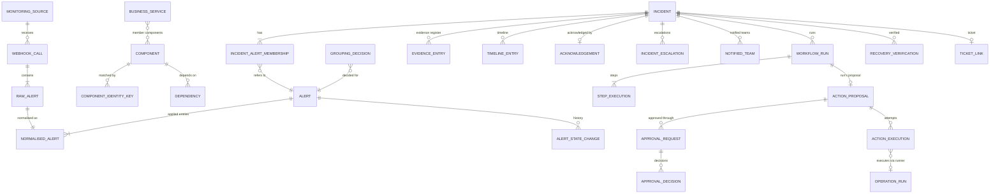
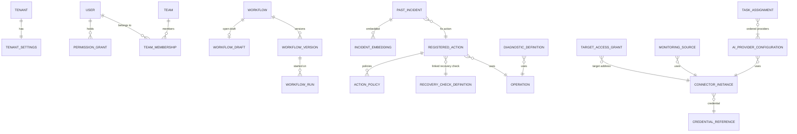

# Vigil — Domain Model

| Field | Value |
| --- | --- |
| Document | 20-domain-model (ID prefix `DM-`) |
| Version | 1.1 |
| Date | 9 October 2026 |
| Owner | Abdul Wadood |
| Status | Baseline (owner reviewed). Round 2 closed. Amended by Round 3 (`30-jazz-storyboard` SB-A-01, SB-A-06, SB-A-07, SB-A-08). |

## 1. Purpose

This document defines the core domain model of the full Vigil product: every record type (entity) that a module owns, its fields, its relationships, the rules that keep it consistent, and the lifecycle (state machine) of every entity that changes state. It also resolves the open items assigned to Round 2: SL-O-11 (structure), SL-O-13, SL-O-23, PM-O-02 (structure), PM-O-03 (rule), PM-O-04, PM-O-05, PM-O-06, PM-O-07, PM-O-08 (parameter), PM-O-09 (rule), PM-O-12 (rule), PM-O-13, PM-O-14 (rule) and PM-O-15.

This is a logical model. Storage technology, physical column types, identifier format, indexes and the communication mechanism between modules are decided in Round 5. Demo values (the invented Jazz data, timer lengths, thresholds) are decided in Round 3; this document names every such value as a field or setting and states which open item fixes it.

## 2. Inputs read

- `docs/00-context.md` v1.5.
- `docs/01-scope-lock.md` v1.5.
- `docs/10-product-map.md` v1.0 (project mirror copy; see DM-Q-N1 in Section 17).
- `docs/sources/Continuum — Business Solution Document.md` v0.2 (the BSD): Sections 7, 8, 9, 10, 11, 12, 13.2 and 19.2 in detail; the rest for background.
- `docs/sources/Techfinity NOC Demo — What Will Be Delivered.md`, 7 October 2026.

## 3. Terms used in this document (complete list)

Terms defined in `01-scope-lock` Section 3 and `10-product-map` Section 3 keep their meaning. The terms below are added.

| Term | Meaning |
| --- | --- |
| Entity | A record type with an owning module (PM-R-01). Each entity has an ID `DM-E-nn`. |
| Value structure | A structured value that is stored inside an entity's field and has no identity of its own. Each has an ID `DM-V-nn`. |
| Code catalogue | A fixed list defined in code, the same for every tenant and every installation (Example: the step type catalogue). It is listed as an entity so its owner is clear, but it is not tenant data and is not changed at run time. |
| Configuration entity | An entity that holds configuration data (SL-B-09). It changes only through a configuration operation or a seed import, and every change is audited with before and after values (DM-C-07). |
| Alert entry | One alert carried in a webhook call (`01-scope-lock` SL-A1-01). Stored as a raw alert (DM-E-19). |
| Alert | One firing episode of one alert at one source: it starts with the first firing alert entry for an alert key that has no firing alert, and ends with the resolved alert entry for that key (DM-E21-R1). Stored as DM-E-21. Every place in Vigil that counts or groups "alerts" counts alerts in this sense, except SL-A1-01, which counts alert entries. |
| Alert key | The identifier that a monitoring source gives to an alert so that its firing and resolved notifications can be matched (Example: Alertmanager fingerprint). Extracted by the monitoring connector. |
| Identity pair | A (key name, key value) pair taken from an alert entry by the monitoring connector, used to match the alert to a component (Section 8.2). |
| Member alert | An alert with an active membership (DM-E-34) in an incident. |
| Affected component | A component that is the matched component of at least one member alert of an incident. |
| Forming | The first lifecycle state of an incident, during which alerts are still being grouped and incidents MAY merge (Section 8.3). |
| Service map generation | One imported service map. An import creates a new generation; earlier generations are kept unchanged (DM-E-24). |
| Current | For a revisioned or generational entity: the record with the highest revision or generation number in the tenant. |
| Run's proposal | The single action proposal that belongs to a workflow run (Section 8.9). |
| Simulated clock | The clock of a test-mode run. It starts at the source incident's `stable_at` and jumps forward instead of waiting (Section 8.13). |
| Incident episode | The period of an incident from its creation, or from a reopening, to its next resolution. Episode 1 starts at creation; each reopening starts the next episode (DM-R-21). Not to be confused with an alert, which is one firing episode of an alert. |
| Dry run | A routing evaluation whose result is returned and recorded but not applied to the incident (DM-E-43). |

## 4. Modelling conventions (complete list)

| ID | Convention | Trace |
| --- | --- | --- |
| DM-C-01 | **Field types (complete list).** `Id`: an opaque identifier, unique within the Vigil installation (format decided in Round 5, DM-O-08). `Key`: a stable identifier written in configuration or seed data; 1 to 64 characters from `A–Z a–z 0–9 . _ -`; case-sensitive; unique within its entity type and tenant (and, for generational entities, within its generation). "Alphabetical order" of keys or texts in this document means ascending order of Unicode code points. `Text(n)`: UTF-8 text of at most n characters. `Integer`: 64-bit signed integer. `Decimal(p,s)`: exact decimal with p digits, s of them after the point. `Boolean`. `Timestamp`: a UTC instant with millisecond precision. `Duration`: a whole number of seconds, 0 or more. `Enum{…}`: one value from the listed complete set. `List<T>`: ordered list. `Set<T>`: unordered, no duplicates; when shown or compared it is sorted alphabetically. `Ref<E>`: the `Id` of a record of entity E. `Json`: a structured value whose structure is given where the field is defined. `Bytes`: exact octets as received. `Vector`: list of 32-bit floating-point numbers. | CTX-W-08 |
| DM-C-02 | **Common fields.** Every entity except DM-E-01 (Tenant) and code catalogues has `id: Id`, `tenant_id: Ref<Tenant>` and `created_at: Timestamp`. Entities that can change after creation also have `updated_at: Timestamp`. These fields are not repeated in the entity tables. | SL-B-01, PM-R-05 |
| DM-C-03 | **Actor.** Every field of type `Actor` (DM-V-01) records who caused a change: a named user, or a module acting on its own (Example: on a timer). A user action MUST record the user (PM-R-09). | SL-B-13 |
| DM-C-04 | **No deletion.** No operation of the built product deletes a stored record. Records that stop being used are marked: `active = false` (configuration entities), a terminal state (stateful entities), a newer revision or generation (revisioned and generational entities). This keeps every reference resolvable and supports the reset rule of SL-A3-03. | SL-B-02, SL-B-06; SL-A3-03 |
| DM-C-05 | **Mutability classes (complete list).** Each entity in Section 7 is one of: **Immutable** — written once, never changed; **Stateful** — changes only through the transitions of its state machine (Section 10), each recorded; **Configuration** — see DM-C-07; **Revisioned** — never changed; a change creates a new record with the next revision number; **Code** — a code catalogue (Section 3). Fields marked "set once" in an entity table MAY be written once after creation and never changed again. | SL-B-02, SL-B-06, SL-B-09 |
| DM-C-06 | **Cross-module references.** A field that refers to a record owned by another module holds only that record's `Id` or `Key`. Storage MUST NOT join across module boundaries. A module that needs the content of another module's record MUST request it from the owner (PM-R-02) or keep a copy given to it in a request; copies are named `*_snapshot` or listed as copies in the field meaning. Configuration and seed data refer to other modules' records by `Key` (team key, component key, alert type, action key, recovery check key) so a seed bundle is portable between tenants. | PM-R-01, PM-R-02 |
| DM-C-07 | **Configuration changes.** Every change to a configuration entity, every new revision of a revisioned configuration entity, and every seed import MUST produce one audit event of type `configuration_changed` (DM-E-08) with the configuration area (DM-V-11), the acting user or module, and the before and after values. In the build, configuration entities that have no screen (SL-A4) change only through seed import (DM-E-82). | PM-R-06; SL-B-06, SL-B-09 |
| DM-C-08 | **Time.** All `Timestamp` fields are taken from the Vigil server clock in UTC, except fields whose name starts with `source_`, which hold the time stated by the external system. | SL-B-02 |
| DM-C-09 | **Test-mode isolation.** Records of a test-mode run (PM-M12-09) are stored only by `vigil-engine` (DM-E-50, DM-E-51, DM-E-52, all with `mode = test`) and `vigil-workflows` (DM-E-49), and by `vigil-routing` as dry-run evaluations (DM-E-43, `applied = false`). No other entity is created or changed by a test-mode run. | SL-A2-06 (test replay definition), PM-M12-09 |
| DM-C-10 | **Tenant scope.** Every uniqueness rule in this document applies within one tenant. A request or event MUST NOT read or change records of another tenant (PM-R-05). | SL-B-01 |
| DM-C-11 | **Sizes.** Where a `Text` field holds content produced outside Vigil (alert payload text, command output, AI output) and the content is longer than the field limit, Vigil MUST store the first part up to the limit and set the matching `*_truncated: Boolean` field to true. Raw alert entries and webhook bodies (DM-E-18, DM-E-19) are never truncated. | SL-B-02 |
| DM-C-12 | **Rule statements.** A rule in Sections 7 to 10 that states what Vigil does (Example: "the incident moves to `open`") is required behaviour with the force of MUST; Vigil MUST NOT behave otherwise. | CTX-W-02 |

## 5. Value structures (complete list)

| ID | Value structure | Content | Used in |
| --- | --- | --- | --- |
| DM-V-01 | Actor | `kind: Enum{user, module}`; `user_id: Ref<User>` (when `user`); `module: Text(40)` working module name (when `module`). | Every `*_by` and `actor` field |
| DM-V-02 | Identity pair | `name: Key` (identity key name, fixed per monitoring connector, Section 8.2); `value: Text(200)`. | DM-E-20, DM-E-21, DM-E-27 |
| DM-V-03 | Comparison | `field: Enum` (Section 8.7); `operator: Enum` (Section 8.7); `value`: one value, or a list for `in` / `not_in`, of the field's value type. | DM-V-04, DM-E-41 |
| DM-V-04 | Condition branch | `label: Key` (becomes the named output); `comparisons: List<Comparison>`, at least 1, joined by AND. | Condition step parameters (Section 9) |
| DM-V-05 | Workflow content | `steps: List<Step>`; `connections: List<Connection>`. A Step is `step_id: Key` (unique in the content, never reused after deletion within one workflow), `type: Enum` (Section 9), `label: Text(60)`, `parameters: Json` (per Section 9), `position: {x: Integer, y: Integer}` (canvas coordinates). A Connection is `from_step_id: Key`, `from_output: Key` (a named output of that step), `to_step_id: Key`. Each (from_step_id, from_output) pair MUST have at most one connection. A named output with no connection ends the run when taken. | DM-E-46, DM-E-47, DM-E-50 |
| DM-V-06 | Parameter definition | `name: Key`; `value_type: Enum{integer, decimal, text, path, duration, enum, boolean}`; `required: Boolean`; constraints (complete list): `min`, `max` (integer, decimal, duration), `allowed_values` (enum), `max_length` (text), `allowed_prefixes` (path: the value MUST be an absolute path that equals one of these prefixes or starts with one of them followed by `/`, and MUST NOT contain `..`; SB-A-07). | DM-E-12 |
| DM-V-07 | Recovery condition | `kind: Enum{incident_alerts_resolved, component_no_firing_alert}`; for `component_no_firing_alert`: `component_key: Key` and `alert_types: Set<Key>` (empty set means any alert type). Semantics in Section 8.10. | DM-E-61 |
| DM-V-08 | State check | `operation_key: Key` (a runner operation of permission kind `diagnostic`); `parameters: Json`; `result_field: Text(100)` (name of a value in the operation's parsed output); `operator: Enum{equals, not_equals, greater_than, greater_or_equal, less_than, less_or_equal}`; `value: Text(100)` (compared as a number when both sides parse as numbers, otherwise as text). | DM-E-55 (precondition, reconciliation) |
| DM-V-09 | Routing result | `severity: Enum{P1, P2, P3, P4}`; `owner_team_key: Key`; `informed_team_keys: Set<Key>`. | DM-E-32, DM-E-43 |
| DM-V-10 | Affected service copy | `service_key: Key`; `name: Text(100)`; `criticality: Enum{critical, high, medium, low} or none`; `via_component_keys: Set<Key>` (the affected components that are members of the service). | DM-E-32 |
| DM-V-11 | Configuration area | `Enum{tenant_settings, users_and_teams, sources, service_map, routing_rules, escalation_levels, workflows, ai_settings, registered_actions, seed_import}` — the complete list of PM-R-06. | DM-E-08 |
| DM-V-12 | Approval snapshot | The content of the Approval page, one part per item of the SL-A1-06 complete list: action name — `action_key`, `action_name`; exact parameters — `parameters`; target server — `target_key`, `target_name`; limits — `limits: List<Text(200)>` plus `attempt_number` and `attempt_limit` (the attempt limit is one of the action's limits); expiry time — `expires_at`; the evidence the proposal is based on — `evidence: List<{evidence_entry_id, kind, summary, collected_at}>`, holding every evidence entry of the incident of kind `diagnostic_result`, `ai_investigation` or `similarity_match` existing when the request is created, in `collected_at` order, plus `based_on: {past_incident_key, past_incident_title, score, success_count}` (the similarity match itself); the recovery checks — `recovery_checks: {recovery_check_key, name, conditions (DM-V-07 rendered as text), observation_window}`. `snapshot_hash` is a hash of the canonical form of the whole snapshot (hash function and canonical form decided in Round 5, DM-O-08). | DM-E-58 |

## 6. Entity overview

### 6.1 Entity index (complete list)

Class abbreviations (DM-C-05): Imm = Immutable, Sta = Stateful, Cfg = Configuration, Rev = Revisioned, Code = code catalogue. "PM record" is the working record name in the owning module's card in `10-product-map`; "new" marks an entity added by this document (Section 11).

| ID | Entity | Owner | Class | PM record |
| --- | --- | --- | --- | --- |
| DM-E-01 | Tenant | `vigil-tenancy` | Sta | Tenant |
| DM-E-02 | Tenant settings | `vigil-tenancy` | Cfg | Tenant settings |
| DM-E-03 | User | `vigil-identity` | Cfg | User |
| DM-E-04 | Team | `vigil-identity` | Cfg | Team |
| DM-E-05 | Team membership | `vigil-identity` | Cfg | Team membership |
| DM-E-06 | Permission grant | `vigil-identity` | Cfg | Permission grant |
| DM-E-07 | Login session | `vigil-identity` | Sta | Login session |
| DM-E-08 | Audit event | `vigil-audit` | Imm | Audit event |
| DM-E-09 | Connector kind | `vigil-connectors` | Code | Connector type definition |
| DM-E-10 | Connector instance | `vigil-connectors` | Cfg | Connector instance |
| DM-E-11 | Credential reference | `vigil-connectors` | Cfg | Credential reference |
| DM-E-12 | Operation | `vigil-runner` | Cfg | Operation catalogue |
| DM-E-13 | Target access grant | `vigil-runner` | Cfg | Target access grant |
| DM-E-14 | Operation run | `vigil-runner` | Sta | Operation run record |
| DM-E-15 | Monitoring source | `vigil-intake` | Cfg (health fields Sta) | Monitoring source; source health status |
| DM-E-16 | Alert type definition | `vigil-intake` | Cfg | new |
| DM-E-17 | Alert type mapping | `vigil-intake` | Cfg | new |
| DM-E-18 | Webhook call | `vigil-intake` | Imm | Raw alert (whole call) |
| DM-E-19 | Raw alert | `vigil-intake` | Imm | Raw alert |
| DM-E-20 | Normalised alert | `vigil-intake` | Imm | Normalised alert |
| DM-E-21 | Alert | `vigil-intake` | Sta | new (alert state) |
| DM-E-22 | Alert state change | `vigil-intake` | Imm | Alert state history |
| DM-E-23 | Source health change | `vigil-intake` | Imm | new (source health history) |
| DM-E-24 | Service map generation | `vigil-servicemap` | Imm | new |
| DM-E-25 | Business service | `vigil-servicemap` | Imm (per generation) | Business service; owner assignment; criticality |
| DM-E-26 | Component | `vigil-servicemap` | Imm (per generation) | Component; owner assignment; criticality |
| DM-E-27 | Component identity key | `vigil-servicemap` | Imm (per generation) | Component identity key |
| DM-E-28 | Dependency | `vigil-servicemap` | Imm (per generation) | Dependency |
| DM-E-29 | Grouping decision | `vigil-correlation` | Imm | Grouping decision |
| DM-E-30 | Hypothesis computation | `vigil-correlation` | Imm | Hypothesis computation record |
| DM-E-31 | Correlation settings | `vigil-correlation` | Cfg | new |
| DM-E-32 | Incident | `vigil-incidents` | Sta | Incident; lifecycle state; hypothesis and impact fields; assignment; escalation level; AI availability status |
| DM-E-33 | Incident state transition | `vigil-incidents` | Imm | Transition history |
| DM-E-34 | Incident alert membership | `vigil-incidents` | Sta | Incident-alert membership |
| DM-E-35 | Acknowledgement | `vigil-incidents` | Imm | Acknowledgement |
| DM-E-36 | Incident escalation | `vigil-incidents` | Imm | Escalation level (history) |
| DM-E-37 | Notified team | `vigil-incidents` | Imm | Notified teams |
| DM-E-38 | Evidence entry | `vigil-incidents` | Imm | Evidence register entry |
| DM-E-39 | Timeline entry | `vigil-incidents` | Imm | Timeline entry |
| DM-E-40 | Incident settings | `vigil-incidents` | Cfg | new |
| DM-E-41 | Routing rule set revision | `vigil-routing` | Rev | Routing rule set and its change history |
| DM-E-42 | Escalation policy revision | `vigil-routing` | Rev | Escalation policy |
| DM-E-43 | Routing evaluation | `vigil-routing` | Imm | Routing evaluation record |
| DM-E-44 | Step type definition | `vigil-workflows` | Code | Step type catalogue |
| DM-E-45 | Workflow | `vigil-workflows` | Cfg | Workflow; active version marker |
| DM-E-46 | Workflow draft | `vigil-workflows` | Sta | Workflow draft |
| DM-E-47 | Workflow version | `vigil-workflows` | Imm | Workflow version |
| DM-E-48 | Validation result | `vigil-workflows` | Imm | Validation result |
| DM-E-49 | Test replay result | `vigil-workflows` | Sta | Test replay result |
| DM-E-50 | Workflow run | `vigil-engine` | Sta | Workflow run; run checkpoint |
| DM-E-51 | Step execution | `vigil-engine` | Sta | Step execution record |
| DM-E-52 | Durable timer | `vigil-engine` | Sta | Durable timer |
| DM-E-53 | Diagnostic definition | `vigil-diagnostics` | Cfg | Diagnostic definition |
| DM-E-54 | Diagnostic result | `vigil-diagnostics` | Imm | Diagnostic result |
| DM-E-55 | Registered action | `vigil-actions` | Cfg | Registered action |
| DM-E-56 | Action policy | `vigil-actions` | Cfg | Action policy |
| DM-E-57 | Action proposal | `vigil-actions` | Imm | Action proposal |
| DM-E-58 | Approval request | `vigil-actions` | Sta | Approval request |
| DM-E-59 | Approval decision | `vigil-actions` | Imm | Approval decision |
| DM-E-60 | Action execution | `vigil-actions` | Sta | Action execution record |
| DM-E-61 | Recovery check definition | `vigil-recovery` | Cfg | Recovery check definition |
| DM-E-62 | Recovery verification | `vigil-recovery` | Sta | Recovery verification |
| DM-E-63 | Runbook | `vigil-knowledge` | Cfg | Runbook |
| DM-E-64 | Past incident | `vigil-knowledge` | Cfg | Past incident |
| DM-E-65 | Incident embedding | `vigil-knowledge` | Imm | Incident embedding |
| DM-E-66 | Similarity search result | `vigil-knowledge` | Imm | Similarity search result |
| DM-E-67 | Knowledge settings | `vigil-knowledge` | Cfg (embedding state Sta) | Minimum similarity setting |
| DM-E-68 | AI investigation result | `vigil-investigation` | Imm | AI investigation result |
| DM-E-69 | Incident summary | `vigil-investigation` | Imm | Incident summary |
| DM-E-70 | AI provider configuration | `vigil-ai-gateway` | Cfg | AI provider configuration |
| DM-E-71 | Allowed provider | `vigil-ai-gateway` | Cfg | Task assignment (allowed providers) |
| DM-E-72 | Task assignment | `vigil-ai-gateway` | Cfg | Task assignment |
| DM-E-73 | Data routing rule | `vigil-ai-gateway` | Cfg | Data routing policy |
| DM-E-74 | AI usage record | `vigil-ai-gateway` | Imm | AI usage record |
| DM-E-75 | Ticket link | `vigil-ticketing` | Sta | Ticket link |
| DM-E-76 | Ticket sync record | `vigil-ticketing` | Sta | Ticket sync record |
| DM-E-77 | Delivery address | `vigil-notifications` | Cfg | Delivery address |
| DM-E-78 | Notification record | `vigil-notifications` | Imm | Notification record |
| DM-E-79 | Metric definition | `vigil-reporting` | Code | Metric definition |
| DM-E-80 | Baseline value | `vigil-reporting` | Cfg | Baseline value |
| DM-E-81 | Readiness gap rule | `vigil-setup` | Code | Readiness gap rule |
| DM-E-82 | Seed import record | `vigil-setup` | Sta | Seed bundle import record |

`vigil-api` and `vigil-web` own no entities (PM-M23, PM-M24). The public interface definition owned by `vigil-api` is defined in Round 5.

### 6.2 Relationship picture: signals, incidents and response

Lines show references (the left entity holds the identifier of the right entity, or the key). Cross-module references are identifiers only (DM-C-06).

### 6.3 Relationship picture: configuration and workflows

## 7. Entities by module

Each entity lists its owner, class (DM-C-05), fields (beyond the common fields of DM-C-02) and its rules. "Req" = Y: the field always has a value; N: the field MAY be empty. A rule ID has the form `DM-Enn-Rk`.

### 7.1 `vigil-tenancy`

#### DM-E-01 Tenant

Owner `vigil-tenancy` · Stateful (DM-SM-01) · Trace: SL-B-01, PM-M01-01, PM-M01-03.

| Field | Type | Req | Meaning |
| --- | --- | --- | --- |
| `id` | Id | Y | The tenant identifier carried by every record (DM-C-02). |
| `name` | Text(100) | Y | Internal name of the tenant (not shown to the demo audience). |
| `state` | Enum{provisioning, ready, failed} | Y | DM-SM-01. |
| `created_at` | Timestamp | Y | |
| `created_by` | Actor | Y | |
| `ready_at` | Timestamp | N | Set once when the state becomes `ready`. |

- **DM-E01-R1** Logins, webhook calls and workflow run starts MUST be refused for a tenant that is not in state `ready`.

#### DM-E-02 Tenant settings

Owner `vigil-tenancy` · Configuration (area `tenant_settings`) · Trace: SL-A3-06, SL-B-09, SL-DR-03, PM-M01-02.

| Field | Type | Req | Meaning |
| --- | --- | --- | --- |
| `customer_name` | Text(100) | Y | Shown on every screen (PM-M24-02). |
| `customer_logo` | Bytes | N | PNG or SVG image, at most 512 KB. |
| `customer_logo_media_type` | Enum{image/png, image/svg+xml} | N | Required when `customer_logo` is set. |
| `environment_label` | Text(100) | N | When not empty: shown as a banner on every screen and prefixed to every ticket title and message (`01-scope-lock` Section 3). |
| `updated_by` | Actor | Y | |

- **DM-E02-R1** Exactly one tenant settings record exists per tenant in state `ready`.
- **DM-E02-R2** The prefix is applied (complete list): to the Jira ticket title; to the email subject and the first line of the email body; to the first line of the Teams message. The prefix is `environment_label` followed by the three characters space, hyphen, space (` - `), then the original text. When `environment_label` is empty, no prefix is applied.

### 7.2 `vigil-identity`

#### DM-E-03 User

Owner `vigil-identity` · Configuration (area `users_and_teams`) · Trace: SL-A3-07, SL-B-13, SL-B-14, PM-M02-01, PM-M02-02.

| Field | Type | Req | Meaning |
| --- | --- | --- | --- |
| `username` | Key | Y | Login name (demo: `presenter`, `noc-l1`, `dbops-engineer`, `dbops-lead`, `admin`). |
| `display_name` | Text(100) | Y | Shown in the audit trail, timeline and pages (values SL-O-18). |
| `password_hash` | Text(255) | Y | Password hash; algorithm decided in Round 5 (DM-O-05). The password itself is never stored and comes from a deployment secret for seeded users (PM-M02-02). Never returned by any request. |
| `active` | Boolean | Y | An inactive user cannot log in. |

#### DM-E-04 Team

Owner `vigil-identity` · Configuration (area `users_and_teams`) · Trace: SL-A3-07, PM-M02-01.

| Field | Type | Req | Meaning |
| --- | --- | --- | --- |
| `team_key` | Key | Y | Used by every other module to refer to the team (DM-C-06). Demo teams: the 9 teams of `31-demo-data` DD-F-01: NOC L1 and Database Operations (with demo users), and seven teams without members that are configuration data — component and service owners, informed parties and escalation levels (SB-A-06). |
| `name` | Text(100) | Y | Display name. |
| `active` | Boolean | Y | |

#### DM-E-05 Team membership

Owner `vigil-identity` · Configuration (area `users_and_teams`) · Trace: SL-A3-07, PM-M02-01.

| Field | Type | Req | Meaning |
| --- | --- | --- | --- |
| `team_id` | Ref<Team> | Y | |
| `user_id` | Ref<User> | Y | |
| `active` | Boolean | Y | |

- **DM-E05-R1** At most one active membership exists per (team, user).

#### DM-E-06 Permission grant

Owner `vigil-identity` · Configuration (area `users_and_teams`) · Trace: SL-A3-07, SL-B-13, PM-M02-01, PM-M02-03.

| Field | Type | Req | Meaning |
| --- | --- | --- | --- |
| `user_id` | Ref<User> | Y | |
| `permission` | Enum (DM-E06-R1) | Y | |
| `active` | Boolean | Y | |

- **DM-E06-R1** Permissions (complete list). Each user operation other than login requires one of these. Webhook calls are authenticated by the source token (DM-E18-R1); the identity used by the demo control panel is PM-O-17 (Round 5).

| Permission | Allows | Demo users holding it (from SL-A3-07) |
| --- | --- | --- |
| `view` | Viewing screens SL-A4-02 to SL-A4-11 without acting: the Acknowledge and Approval pages are shown without their buttons, the workflow editor read-only | presenter; admin |
| `acknowledge` | The Acknowledge page SL-A4-04 and acknowledging (DM-E35-R1) | noc-l1; dbops-engineer; dbops-lead |
| `approve_action` | The Approval page SL-A4-05 and approval decisions (DM-E59-R1) | dbops-engineer; dbops-lead |
| `manage_setup` | Connecting and testing sources, importing the service map (SL-A2-01) | admin |
| `manage_routing` | Saving routing rules (SL-A4-08) | admin |
| `manage_ai_settings` | Changing AI settings (SL-A2-02) | admin |
| `rerun_ai_investigation` | Re-run AI investigation (SL-A2-07, CTX-D-013) | admin |
| `edit_workflow` | Starting and saving workflow drafts | admin |
| `run_test_replay` | Starting a test replay | admin |
| `publish_workflow` | Publishing a draft and rolling back | admin |

- **DM-E06-R2** Login (SL-A4-01) requires no permission. The `view` grant to admin is needed for admin to reach the incident workspace where "Re-run AI investigation" is offered; it follows from CTX-D-013 and adds no new capability to list A.
- **DM-E06-R3** At most one active grant exists per (user, permission).

#### DM-E-07 Login session

Owner `vigil-identity` · Stateful (DM-SM-02) · Trace: SL-B-13, SL-A4-01, PM-M02-02.

| Field | Type | Req | Meaning |
| --- | --- | --- | --- |
| `user_id` | Ref<User> | Y | |
| `token_hash` | Text(255) | Y | Hash of the session token; the token itself is never stored. |
| `state` | Enum{active, ended} | Y | DM-SM-02. |
| `expires_at` | Timestamp | Y | Absolute end of the session (lifetime value DM-O-05). |
| `last_activity_at` | Timestamp | Y | |
| `ended_at` | Timestamp | N | |
| `end_reason` | Enum{logout, expired} | N | |

### 7.3 `vigil-audit`

#### DM-E-08 Audit event

Owner `vigil-audit` · Immutable · Trace: SL-B-06, SL-A2-08, PM-R-06, PM-M03-01 to PM-M03-03.

| Field | Type | Req | Meaning |
| --- | --- | --- | --- |
| `sequence` | Integer | Y | Strictly increasing per tenant, assigned by `vigil-audit`; orders events written in the same millisecond. |
| `occurred_at` | Timestamp | Y | Time of the audited change, as given by the sending module. |
| `actor` | Actor | Y | |
| `event_type` | Enum (DM-E08-R1) | Y | |
| `subject_type` | Text(40) | Y | Entity name of the subject (Example: `Incident`). |
| `subject_id` | Id | Y | |
| `incident_id` | Ref<Incident> | N | Set whenever the event concerns an incident, so the audit trail can be filtered by incident. |
| `summary` | Text(300) | Y | One line shown in the audit trail (SL-A4-11). |
| `details` | Json | N | For `configuration_changed`: `{area: DM-V-11, before, after}`. For other types: the outcome fields listed in DM-E08-R1. |

- **DM-E08-R1** Event types (complete list; together they cover every item of PM-R-06): `incident_created`; `alert_grouped`; `hypothesis_changed`; `assignment_changed`; `incident_acknowledged`; `incident_escalated`; `ai_result_accepted`; `ai_result_rejected`; `policy_check_result` (details: outcome); `approval_requested`; `approval_decided` (details: decision approved, rejected, expired, preauthorized, blocked, refused or no proposal; user when a human decided); `action_executed` (details: attempt number, outcome); `action_reconciled` (details: reconciliation outcome); `recovery_verified` (details: outcome); `incident_state_changed` (details: from, to); `notification_sent` (details: purpose, channel, delivery status); `ticket_changed` (details: operation, outcome); `configuration_changed`.
- **DM-E08-R2** `vigil-audit` MUST NOT offer any operation that changes or deletes an audit event (PM-M03-02). Test-mode runs MUST NOT write audit events (DM-C-09).
- **DM-E08-R3** Each audit event MUST be written exactly once, by the module that owns the record whose creation or change it reports (complete list): `incident_created`, `incident_state_changed`, `assignment_changed`, `incident_acknowledged`, `incident_escalated` — `vigil-incidents`; `alert_grouped`, `hypothesis_changed` — `vigil-correlation`; `ai_result_accepted`, `ai_result_rejected` — `vigil-investigation`; `policy_check_result`, `approval_requested`, `approval_decided`, `action_executed`, `action_reconciled` — `vigil-actions`; `recovery_verified` — `vigil-recovery`; `notification_sent` — `vigil-notifications`, one per notification record; `ticket_changed` — `vigil-ticketing`, one per finished ticket sync record; `configuration_changed` — the owner of the configuration entity, except during a seed import, when only `vigil-setup` writes one event for the whole import. An `approval_decided` event with decision "no proposal" has the Approval step execution as subject (`subject_type = StepExecution`).

### 7.4 `vigil-connectors`

#### DM-E-09 Connector kind

Owner `vigil-connectors` · Code · Trace: SL-B-07, PM-M04-01, PM-M04-02, `10-product-map` Section 7.

| Field | Type | Meaning |
| --- | --- | --- |
| `kind` | Key | One of (complete list for the build): `zabbix`, `alertmanager`, `linux_server`, `jira_cloud`, `ms_teams`, `email`, `claude`, `openai`, `local_model`, `local_embedding` (PM-K-01 to PM-K-10). |
| `connector_type` | Enum{monitoring_source, target, ticketing, notification_channel, ai_provider} | The common interface it implements (PM-M04-01). |
| `settings_schema` | Json | The structure of `settings` in DM-E-10 for this kind (contents decided in Round 5). |

#### DM-E-10 Connector instance

Owner `vigil-connectors` · Configuration (area `sources` for monitoring kinds, `ai_settings` for AI kinds; other kinds change only by seed import) · Trace: SL-B-07, PM-M04-03.

| Field | Type | Req | Meaning |
| --- | --- | --- | --- |
| `name` | Text(100) | Y | Display name (Example: "Zabbix — lab"). |
| `kind` | Key | Y | DM-E-09. |
| `address` | Text(500) | Y | URL or host name of the external system. |
| `settings` | Json | Y | Kind-specific settings (Example: Jira project key and resolved transition), structure per DM-E-09. MUST NOT contain secret values. |
| `credential_ref_id` | Ref<Credential reference> | N | The credential used to call the external system. |
| `active` | Boolean | Y | |
| `updated_by` | Actor | Y | |

#### DM-E-11 Credential reference

Owner `vigil-connectors` · Configuration (area of the record that uses it) · Trace: SL-B-14, PM-M04-03.

| Field | Type | Req | Meaning |
| --- | --- | --- | --- |
| `purpose` | Enum{webhook_token, external_api, target_diagnostic, target_action, smtp} | Y | |
| `locator` | Text(500) | Y | Where the secret value is kept in the secret store (mechanism PM-O-11, Round 5). The secret value itself MUST NOT be stored in any entity. |

### 7.5 `vigil-runner`

#### DM-E-12 Operation

Owner `vigil-runner` · Configuration (changes only by seed import, DM-C-07) · Trace: PM-M05-01, SL-B-04, SL-B-05.

| Field | Type | Req | Meaning |
| --- | --- | --- | --- |
| `operation_key` | Key | Y | |
| `name` | Text(100) | Y | |
| `permission_kind` | Enum{diagnostic, action} | Y | `diagnostic` operations MUST NOT change the target (read-only); state checks (DM-V-08) use them. |
| `command_template` | Text(2000) | Y | The exact command run on the target, with placeholders `{name}` for parameters. Placeholders are filled only with values checked against their definition, quoted for the target shell. |
| `parameters` | List<Parameter definition (DM-V-06)> | Y | Empty list allowed. |
| `output_parser` | Key | Y | A parser defined in code (complete list decided with the operations in Round 3) that turns the command output into named values. |
| `timeout` | Duration | Y | After this time the run outcome is `unknown` for `action` operations and `failed` for `diagnostic` operations. |
| `active` | Boolean | Y | |

- **DM-E12-R1** `vigil-runner` MUST NOT run a command that is not the `command_template` of an active operation (PM-M05-01).

#### DM-E-13 Target access grant

Owner `vigil-runner` · Configuration (seed import only) · Trace: SL-B-05, PM-M05-02.

| Field | Type | Req | Meaning |
| --- | --- | --- | --- |
| `target_key` | Key | Y | The target as named in the service map (`Component.target_key`, DM-E-26). |
| `connector_instance_id` | Ref<Connector instance> | Y | Kind `linux_server`; holds the host address. |
| `permission_kind` | Enum{diagnostic, action} | Y | |
| `credential_ref_id` | Ref<Credential reference> | Y | Purpose `target_diagnostic` or `target_action` to match `permission_kind`. |
| `active` | Boolean | Y | |

- **DM-E13-R1** A diagnostic grant and an action grant for the same target MUST use different credential references (PM-M05-02).
- **DM-E13-R2** At most one active grant exists per (target_key, permission_kind). An operation of kind `action` MUST be refused when the target has no active `action` grant.

#### DM-E-14 Operation run

Owner `vigil-runner` · Stateful (DM-SM-10) · Trace: PM-M05-03, PM-M05-04, SL-B-11.

| Field | Type | Req | Meaning |
| --- | --- | --- | --- |
| `operation_key` | Key | Y | |
| `target_key` | Key | Y | |
| `permission_kind` | Enum{diagnostic, action} | Y | Copy from the operation. |
| `parameters` | Json | Y | The checked values used. |
| `requested_by` | Text(40) | Y | Requesting module. |
| `request_id` | Text(150) | Y | Identifier of one logical request, supplied by the requester and unique per tenant (DM-E14-R1). |
| `state` | Enum{running, succeeded, failed, unknown, refused} | Y | DM-SM-10. |
| `started_at` | Timestamp | Y | |
| `finished_at` | Timestamp | N | |
| `exit_status` | Integer | N | |
| `output_values` | Json | N | Values produced by the output parser. |
| `output_text` | Text(65536) | N | Command output; `output_truncated` per DM-C-11. |
| `error` | Text(1000) | N | Reason for `failed`, `unknown` or `refused`. |

- **DM-E14-R1** A request whose `request_id` equals that of an existing run MUST return that run instead of starting a new one. Requesters MUST form `request_id` as follows (complete list): `vigil-diagnostics` — `{step execution id}:{diagnostic_key}:{evaluation_count}` (the step execution's `evaluation_count`, DM-E-51); `vigil-actions` — `{action execution id}:precondition:{m}` where m is 1 for the first recheck pass and increases by 1 each time the rechecks are restarted, `{action execution id}:execute`, `{action execution id}:reconcile:{n}` where n is 1 for the first reconciliation state check and increases by 1 for each retry. A retry of a state check therefore starts a new run; a repeated request for the same logical call (Example: after a restart) returns the earlier run.

### 7.6 `vigil-intake`

#### DM-E-15 Monitoring source

Owner `vigil-intake` · Configuration (area `sources`); health fields Stateful (DM-SM-03) · Trace: SL-A2-01, SL-B-14, PM-M06-01, PM-M06-06.

| Field | Type | Req | Meaning |
| --- | --- | --- | --- |
| `name` | Text(100) | Y | |
| `source_kind` | Enum{zabbix, alertmanager} | Y | Connector kind used for parsing and tests. |
| `connector_instance_id` | Ref<Connector instance> | Y | |
| `webhook_token_ref_id` | Ref<Credential reference> | Y | Purpose `webhook_token`; one per source (SL-B-14). |
| `health_check_interval` | Duration | Y | Interval of the periodic connection test (Section 8.11). Value DM-O-03. |
| `stale_after` | Duration | Y | SL-O-12. |
| `disconnected_after` | Duration | Y | SL-O-12. MUST be greater than `stale_after`. |
| `health` | Enum{healthy, stale, disconnected} | Y | DM-SM-03. |
| `health_changed_at` | Timestamp | Y | |
| `last_contact_at` | Timestamp | N | Latest of: an authenticated webhook call from this source; a passed connection test. |
| `last_test_at` | Timestamp | N | |
| `last_test_outcome` | Enum{passed, failed} | N | |
| `last_test_reason` | Text(500) | N | Reason returned by the connector for a failed test. |
| `active` | Boolean | Y | Webhook calls to an inactive source are refused. |
| `updated_by` | Actor | Y | |

#### DM-E-16 Alert type definition

Owner `vigil-intake` · Configuration (area `sources`) · Trace: SL-A1-01, PM-M06-04.

| Field | Type | Req | Meaning |
| --- | --- | --- | --- |
| `alert_type` | Key | Y | Vigil's alert type code. The value `unclassified` is reserved and always exists. Demo set: the 18 types of `31-demo-data` DD-F-03: the seven types of SL-A1-01, the SL-F-3 type, and ten types used only by past incidents (SB-A-01). |
| `display_name` | Text(100) | Y | Shown in incidents, tickets and messages. |

#### DM-E-17 Alert type mapping

Owner `vigil-intake` · Configuration (area `sources`) · Trace: PM-M06-04.

| Field | Type | Req | Meaning |
| --- | --- | --- | --- |
| `source_kind` | Enum{zabbix, alertmanager} | Y | |
| `order` | Integer | Y | Evaluation order; unique per source kind. |
| `field` | Text(200) | Y | A field name from the connector's list of normalisable fields (Round 5). |
| `operator` | Enum{equals, starts_with, contains} | Y | Case-sensitive text comparison. |
| `value` | Text(200) | Y | |
| `alert_type` | Key | Y | DM-E-16. |

- **DM-E17-R1** The alert type of an alert entry is the `alert_type` of the first mapping, in `order`, whose comparison is true for the entry; when none is true, the alert type is `unclassified`.

#### DM-E-18 Webhook call

Owner `vigil-intake` · Immutable · Trace: SL-B-02, PM-M06-01 to PM-M06-03.

| Field | Type | Req | Meaning |
| --- | --- | --- | --- |
| `source_id` | Ref<Monitoring source> | Y | The source whose token authenticated the call. |
| `received_at` | Timestamp | Y | |
| `content_type` | Text(100) | Y | |
| `body` | Bytes | Y | The request body exactly as received. |
| `entry_count` | Integer | Y | Number of alert entries the connector found. |
| `parse_outcome` | Enum{parsed, failed} | Y | `failed` when the connector cannot read the body; no raw alerts are created then (visible ingestion errors are Later, PM-M06-L2). |

- **DM-E18-R1** A call whose token does not match the source's token MUST be refused and MUST NOT be stored as a webhook call (PM-M06-01).

#### DM-E-19 Raw alert

Owner `vigil-intake` · Immutable · Trace: SL-B-02, SL-A1-01, PM-M06-02, PM-M06-03.

| Field | Type | Req | Meaning |
| --- | --- | --- | --- |
| `webhook_call_id` | Ref<Webhook call> | Y | |
| `source_id` | Ref<Monitoring source> | Y | Source identity (SL-B-02). |
| `entry_index` | Integer | Y | Position of the entry in the call, from 0. |
| `received_at` | Timestamp | Y | Receive time (SL-B-02); equals the call's `received_at`. |
| `payload` | Json | Y | The alert entry exactly as it appears in the body. |

#### DM-E-20 Normalised alert

Owner `vigil-intake` · Immutable · Trace: PM-M06-04, PM-M06-05.

| Field | Type | Req | Meaning |
| --- | --- | --- | --- |
| `raw_alert_id` | Ref<Raw alert> | Y | Exactly one normalised alert per raw alert. |
| `outcome` | Enum{normalised, failed} | Y | `failed` when the connector cannot find an alert key or status; `failure_reason` explains. A failed entry changes no alert. |
| `failure_reason` | Text(300) | N | |
| `alert_key` | Text(200) | N | Required when `normalised`. |
| `reported_status` | Enum{firing, resolved} | N | Required when `normalised`. |
| `alert_type` | Key | N | Required when `normalised` (DM-E17-R1). |
| `identity_pairs` | List<Identity pair> | N | In the connector's fixed precedence order (Section 8.2). |
| `title` | Text(300) | N | Alert name or summary as given by the source. |
| `source_time` | Timestamp | N | Start time (firing) or end time (resolved) stated by the source. |
| `source_severity` | Text(50) | N | Severity as stated by the source; informational only, never used for routing. |
| `applied_to_alert_id` | Ref<Alert> | N | The alert this entry created or changed (DM-E21-R1); empty for a failed entry or an orphan resolved entry. |
| `application` | Enum{created_alert, repeat_firing, resolved_alert, orphan_resolved, not_applied} | Y | What the entry did. |

#### DM-E-21 Alert

Owner `vigil-intake` · Stateful (DM-SM-04) · Trace: SL-A1-01, SL-A1-02, SL-A1-07, PM-M06-05.

| Field | Type | Req | Meaning |
| --- | --- | --- | --- |
| `source_id` | Ref<Monitoring source> | Y | |
| `source_kind` | Enum{zabbix, alertmanager} | Y | Copy. |
| `alert_key` | Text(200) | Y | |
| `alert_type` | Key | Y | From the first firing entry. |
| `identity_pairs` | List<Identity pair> | Y | From the first firing entry. |
| `title` | Text(300) | Y | From the first firing entry. |
| `status` | Enum{firing, resolved} | Y | DM-SM-04. |
| `fired_at` | Timestamp | Y | `source_time` of the first firing entry; when the source gave none, its `received_at`. Used by the time relation (Section 8.3). |
| `first_received_at` | Timestamp | Y | |
| `resolved_at` | Timestamp | N | `source_time` of the resolved entry, or its `received_at` when the source gave none. |
| `resolve_received_at` | Timestamp | N | |
| `entry_count` | Integer | Y | Number of entries applied to this alert (first firing, repeats, resolve). |

- **DM-E21-R1** Applying a normalised entry (complete list of cases): (a) `firing` and no alert with the same source and `alert_key` has status `firing` → create a new alert (`created_alert`) and publish "alert received" (PM-EV-01) and "alert state changed" (PM-EV-02); (b) `firing` and such a firing alert exists → `repeat_firing`: increment `entry_count`, nothing else changes, no event; (c) `resolved` and such a firing alert exists → set `resolved` (`resolved_alert`) and publish "alert state changed"; (d) `resolved` and no firing alert exists → `orphan_resolved`, no change, no event.
- **DM-E21-R2** At most one alert per (source, `alert_key`) has status `firing` at any time.

#### DM-E-22 Alert state change

Owner `vigil-intake` · Immutable · Trace: PM-M06-05, SL-A1-07.

| Field | Type | Req | Meaning |
| --- | --- | --- | --- |
| `alert_id` | Ref<Alert> | Y | |
| `from_status` | Enum{firing, resolved} | N | Empty for creation. |
| `to_status` | Enum{firing, resolved} | Y | |
| `at` | Timestamp | Y | Receive time of the entry. |
| `source_time` | Timestamp | N | |
| `raw_alert_id` | Ref<Raw alert> | Y | |

#### DM-E-23 Source health change

Owner `vigil-intake` · Immutable · Trace: SL-A2-01, PM-M06-06, PM-O-12.

| Field | Type | Req | Meaning |
| --- | --- | --- | --- |
| `source_id` | Ref<Monitoring source> | Y | |
| `from_health` | Enum{healthy, stale, disconnected} | N | Empty for the first record of a source. |
| `to_health` | Enum{healthy, stale, disconnected} | Y | |
| `at` | Timestamp | Y | |
| `cause` | Enum{source_created, contact, contact_age, test_failed} | Y | DM-SM-03. |

- **DM-E23-R1** `vigil-intake` MUST answer, for a source and a time interval, whether the source's health was `healthy` during the whole interval (used by Section 8.10).

### 7.7 `vigil-servicemap`

The service map file structure (SL-O-11) is Section 8.16. Entities DM-E-25 to DM-E-28 belong to one generation; a new import creates a new generation and leaves earlier generations unchanged (DM-C-04). Every request to `vigil-servicemap` MUST be answered from the current generation. Earlier generations are kept only as stored records (DM-C-04); viewing, comparing or using them is Later (PM-M07-L1, DM-A-16).

#### DM-E-24 Service map generation

Owner `vigil-servicemap` · Immutable · Trace: PM-M07-01, SL-A2-01.

| Field | Type | Req | Meaning |
| --- | --- | --- | --- |
| `generation` | Integer | Y | 1, 2, 3, … per tenant. |
| `imported_by` | Actor | Y | |
| `file_name` | Text(255) | Y | |
| `file_hash` | Text(128) | Y | Hash of the imported file. |
| `counts` | Json | Y | `{services, components, identity_keys, dependencies}`. |

- **DM-E24-R1** An import that breaks any rule in Section 8.16 MUST be refused as a whole; no generation is created.

#### DM-E-25 Business service

Owner `vigil-servicemap` · Immutable per generation · Trace: SL-A1-02, SL-A2-01, BSD-BR-005, PM-M07-04, PM-M07-05.

| Field | Type | Req | Meaning |
| --- | --- | --- | --- |
| `generation` | Integer | Y | |
| `service_key` | Key | Y | Unique in the generation. |
| `name` | Text(100) | Y | Shown as customer impact. |
| `criticality` | Enum{critical, high, medium, low} | N | Empty is a readiness gap (SL-A2-01). |
| `owner_team_key` | Key | N | Owner team (PM record "owner assignment"). |
| `component_keys` | Set<Key> | Y | Member components: the components whose failure affects this service. At least 1. |

#### DM-E-26 Component

Owner `vigil-servicemap` · Immutable per generation · Trace: SL-A1-02, SL-A1-03, PM-M07-02, PM-M07-05, PM-M07-06.

| Field | Type | Req | Meaning |
| --- | --- | --- | --- |
| `generation` | Integer | Y | |
| `component_key` | Key | Y | Unique in the generation. This is the "component ID" of the root-cause tie-break (SL-A1-02). |
| `name` | Text(100) | Y | |
| `kind` | Enum{server, application, database, queue, check} | Y | |
| `criticality` | Enum{critical, high, medium, low} | N | Used in the root-cause tie-break; empty ranks below `low`. |
| `owner_team_key` | Key | N | For a `server`, empty is a readiness gap (SL-A2-01). |
| `runs_on_key` | Key | N | For kinds other than `server`: the `server` component it runs on. Empty for `server`. |
| `target_key` | Key | N | For a `server` only: the runner target key (DM-E-13). |

- **DM-E26-R1** The target server of a component (PM-M07-06) is: for a `server`, its own `target_key`; otherwise the `target_key` of the component named in `runs_on_key`. When there is none, the answer is "no target".

#### DM-E-27 Component identity key

Owner `vigil-servicemap` · Immutable per generation · Trace: SL-A1-02, PM-M07-02, PM-O-02.

| Field | Type | Req | Meaning |
| --- | --- | --- | --- |
| `generation` | Integer | Y | |
| `component_key` | Key | Y | |
| `source_kind` | Enum{zabbix, alertmanager} | Y | |
| `pair` | Identity pair | Y | |

- **DM-E27-R1** Each (generation, `source_kind`, pair name, pair value) is unique: one identity key names at most one component.

#### DM-E-28 Dependency

Owner `vigil-servicemap` · Immutable per generation · Trace: SL-A1-02, PM-M07-03.

| Field | Type | Req | Meaning |
| --- | --- | --- | --- |
| `generation` | Integer | Y | |
| `from_component_key` | Key | Y | The dependent component. |
| `to_component_key` | Key | Y | The component it depends on. "A depends on B" means A needs B to work. |

- **DM-E28-R1** No dependency from a component to itself, no duplicate, and no cycle (a component MUST NOT depend on itself directly or indirectly), counting the implied dependencies of DM-E28-R2.
- **DM-E28-R2** A component with a `runs_on_key` depends on that server: every rule of this document that uses dependencies (grouping relation, hypothesis, cycle check) MUST treat it as a dependency from the component to the server, whether or not the file also lists it under dependencies.

### 7.8 `vigil-correlation`

#### DM-E-29 Grouping decision

Owner `vigil-correlation` · Immutable · Trace: SL-A1-02, PM-M08-01 to PM-M08-03, PM-M08-08.

| Field | Type | Req | Meaning |
| --- | --- | --- | --- |
| `alert_id` | Ref<Alert> | Y | The alert decided on. |
| `component_key` | Key | N | Matched component, or empty for "unknown component" (Section 8.2). |
| `generation` | Integer | Y | Service map generation used. |
| `decision` | Enum{created_incident, joined, reopened} | Y | Section 8.3, 8.6. |
| `incident_id` | Ref<Incident> | Y | The incident the alert went to. |
| `merged_incident_ids` | List<Ref<Incident>> | Y | Forming incidents merged into `incident_id` by this decision; empty list when none. |
| `related_alert_id` | Ref<Alert> | N | The member alert that satisfied the grouping relation (Section 8.3); empty for `created_incident`. |
| `relation` | Enum{same_component, depends_on, depended_on_by, same_unknown_identity} | N | Empty for `created_incident`. `depends_on`: the alert's component depends on the related alert's component. |
| `relation_path` | List<Key> | N | Component keys along the dependency path from the alert's component to the related component, both included. When several paths exist: the shortest; among equally short paths, the one whose key list is alphabetically first (compared key by key). |
| `time_delta` | Duration | N | Absolute difference of `fired_at` between the alert and the related alert, rounded to the nearest whole second (halves up). |
| `decided_at` | Timestamp | Y | |

#### DM-E-30 Hypothesis computation

Owner `vigil-correlation` · Immutable · Trace: SL-A1-02, PM-M08-04.

| Field | Type | Req | Meaning |
| --- | --- | --- | --- |
| `incident_id` | Ref<Incident> | Y | |
| `generation` | Integer | Y | |
| `affected_component_keys` | Set<Key> | Y | |
| `dependent_counts` | Json | Y | For each affected component: the number of other affected components that depend on it, directly or indirectly. |
| `result_component_key` | Key | N | Empty when no member alert has a known component. |
| `tie_break` | Enum{none, criticality, component_key} | Y | The last rule that was needed to decide. |
| `previous_component_key` | Key | N | |
| `computed_at` | Timestamp | Y | |

#### DM-E-31 Correlation settings

Owner `vigil-correlation` · Configuration (seed import only) · Trace: SL-A1-02, SL-O-04, PM-O-03, PM-O-13.

| Field | Type | Req | Meaning |
| --- | --- | --- | --- |
| `grouping_window` | Duration | Y | The time window of SL-A1-02 (value SL-O-04). |
| `settle_period` | Duration | Y | An incident stops forming when no alert has joined it for this long (Section 8.4). Value DM-O-01. |
| `max_forming` | Duration | Y | An incident stops forming at the latest this long after creation (Section 8.4). Value DM-O-01. MUST be greater than `settle_period`. |
| `stability_check_interval` | Duration | Y | How often forming incidents are checked; MUST be 5 seconds or less. |

- **DM-E31-R1** Exactly one correlation settings record exists per tenant.

### 7.9 `vigil-incidents`

#### DM-E-32 Incident

Owner `vigil-incidents` · Stateful (DM-SM-05) · Trace: SL-A1-02, SL-A1-04, SL-A1-05, SL-A2-03, SL-A2-05, SL-B-12, BSD-BR-008, PM-M09-01 to PM-M09-09.

| Field | Type | Req | Meaning |
| --- | --- | --- | --- |
| `sequence` | Integer | Y | 1, 2, 3, … per tenant, in creation order. Internal: used for ordering (DM-R-10, DM-R-21); never shown. |
| `number` | Integer | N | The incident number shown to users: 1, 2, 3, … per tenant, assigned at `forming` → `open` in the order incidents leave `forming`; set once. Empty while `forming`; never set for a `merged` incident. Display format decided in Round 4 (DM-O-11). |
| `title` | Text(200) | Y | Section 8.5. |
| `state` | Enum{forming, open, resolved, closed, merged} | Y | DM-SM-05. |
| `state_changed_at` | Timestamp | Y | |
| `first_alert_fired_at` | Timestamp | Y | Earliest `fired_at` of all alerts that were ever members. |
| `last_alert_joined_at` | Timestamp | Y | |
| `stable_at` | Timestamp | N | Set once, at `forming` → `open`. |
| `alert_count` | Integer | Y | Number of member alerts. |
| `alert_types` | Set<Key> | Y | Alert types of member alerts. |
| `alert_sources` | Set<Enum{zabbix, alertmanager}> | Y | Source kinds of member alerts. |
| `hypothesis_component_key` | Key | N | Set only on request of `vigil-correlation`. Shown labelled "Hypothesis" (SL-A1-02). |
| `hypothesis_snapshot` | Json | N | Copy: `{generation, name, kind, criticality}` of the hypothesis component. |
| `hypothesis_computation_id` | Ref<Hypothesis computation> | N | |
| `affected_services` | List<Affected service copy> | Y | Customer impact, set only on request of `vigil-correlation`; ordered by `service_key`. Empty list allowed. |
| `severity` | Enum{P1, P2, P3, P4} | N | Set only on request of `vigil-routing` (PM-M09-03). |
| `owner_team_key` | Key | N | Same rule. |
| `informed_team_keys` | Set<Key> | Y | Same rule. Empty set allowed. |
| `assignment_evaluation_id` | Ref<Routing evaluation> | N | The evaluation whose result is applied. |
| `assignment_frozen` | Boolean | Y | Set to true at `forming` → `open` (Section 8.4); never set back. |
| `escalation_level` | Integer | Y | 0 = not escalated; set on request of `vigil-routing`; set to 0 at reopen. |
| `acknowledged_at` | Timestamp | N | Copy from the acknowledgement of the current episode (DM-E-35); cleared at reopen. |
| `acknowledged_by` | Ref<User> | N | Copy; cleared at reopen. |
| `ai_status` | Enum{not_run, available, unavailable} | Y | Set on request of `vigil-investigation` (PM-M09-07). |
| `ai_unavailable_reason` | Enum{no_provider_reachable, no_provider_allowed, output_failed_checks} | N | Required when `ai_status = unavailable`. `ai_status` reflects SL-T-1 attempts only (workflow step and re-run); SL-T-2 and SL-T-3 outcomes do not change it. `no_provider_allowed`: data routing allowed no provider in the order. |
| `resolved_at` | Timestamp | N | Set at each `open` → `resolved`; cleared at reopen. |
| `resolved_by_verification_id` | Ref<Recovery verification> | N | Same rule (PM-M09-06). |
| `closed_at` | Timestamp | N | |
| `merged_into_incident_id` | Ref<Incident> | N | Set when the state becomes `merged`. |
| `reopen_count` | Integer | Y | Number of reopenings. The current episode of the incident is `reopen_count + 1`. |

- **DM-E32-R1** Fields described as "set only on request of" a module MUST be refused when requested by any other module (PM-M09-03, PM-M09-06).
- **DM-E32-R2** Every change to an incident MUST create a timeline entry (DM-E-39) and publish "incident changed" (PM-EV-09); every state change MUST also create a state transition (DM-E-33) and publish "incident state changed" (PM-EV-08).
- **DM-E32-R3** A `merged` incident MUST NOT appear in the incident list (SL-A4-02), in any incident count or in any metric. A `forming` incident has no number; how incidents still forming are shown is decided in Round 4, and MUST NOT present them as separate numbered incidents.

#### DM-E-33 Incident state transition

Owner `vigil-incidents` · Immutable · Trace: SL-B-12, PM-M09-02.

| Field | Type | Req | Meaning |
| --- | --- | --- | --- |
| `incident_id` | Ref<Incident> | Y | |
| `transition_id` | Key | Y | The transition of DM-SM-05 (Example: `DM-SM05-T3`). |
| `from_state` | Enum (incident states) | N | Empty for creation. |
| `to_state` | Enum (incident states) | Y | |
| `at` | Timestamp | Y | |
| `actor` | Actor | Y | |
| `reason` | Text(300) | Y | |

#### DM-E-34 Incident alert membership

Owner `vigil-incidents` · Stateful (active → ended; DM-E34-R1) · Trace: SL-A1-02, PM-M09-01, PM-M08-02.

| Field | Type | Req | Meaning |
| --- | --- | --- | --- |
| `incident_id` | Ref<Incident> | Y | |
| `alert_id` | Ref<Alert> | Y | |
| `alert_snapshot` | Json | Y | Copy: `{source_kind, alert_type, title, component_key, fired_at}`. |
| `grouping_decision_id` | Ref<Grouping decision> | Y | |
| `reason` | Json | Y | Copy of the grouping reason: `{decision, related_alert_id, relation, relation_path, time_delta}` (DM-E-29), or `{decision: moved_by_merge, from_incident_id, original_reason}` for a membership created by a merge. Shown for each alert (SL-A1-02). |
| `joined_at` | Timestamp | Y | |
| `final_reason` | Json | N | Set once, at `forming` → `open`, for every member at that time (DM-R-58): `{related_alert_id, relation, relation_path, time_delta}` or `{relation: only_alert}`. Alerts that join later get it at joining, equal to their decision's reason. The incident workspace MUST show `final_reason`, and `reason` only while the incident is `forming`. |
| `ended_at` | Timestamp | N | Set once, only when the incident is merged into another (Section 8.3). |

- **DM-E34-R1** An alert has at most one active membership (one with empty `ended_at`). A membership ends only by a merge; the alert then gets a new membership in the surviving incident.

#### DM-E-35 Acknowledgement

Owner `vigil-incidents` · Immutable · Trace: SL-A1-05, SL-A2-03, SL-B-13, PM-M09-04.

| Field | Type | Req | Meaning |
| --- | --- | --- | --- |
| `incident_id` | Ref<Incident> | Y | |
| `user_id` | Ref<User> | Y | |
| `team_key` | Key | Y | The notified team through which the user was eligible; when several, the first in alphabetical order. |
| `episode` | Integer | Y | The incident's episode when acknowledged (`reopen_count + 1`). |
| `at` | Timestamp | Y | |

- **DM-E35-R1** An acknowledgement MUST be accepted only when (complete list): the incident is in state `open`; it has no acknowledgement for the current episode; the user is logged in and holds `acknowledge`; the user is an active member of at least one team in the incident's notified teams (DM-E-37). A second attempt in the same episode MUST be refused with the existing acknowledgement's user and time. The check and the write MUST be one atomic operation, so two simultaneous attempts cannot both succeed.

#### DM-E-36 Incident escalation

Owner `vigil-incidents` · Immutable · Trace: SL-A2-03, SL-A2-04, PM-M09-08.

| Field | Type | Req | Meaning |
| --- | --- | --- | --- |
| `incident_id` | Ref<Incident> | Y | |
| `level` | Integer | Y | The level reached (1 = first escalation level). |
| `team_keys` | Set<Key> | Y | Teams of that level (copy from the escalation policy revision). |
| `cause` | Enum{acknowledgement_timeout, escalate_now} | Y | |
| `policy_revision` | Integer | Y | |
| `at` | Timestamp | Y | |

#### DM-E-37 Notified team

Owner `vigil-incidents` · Immutable · Trace: SL-A1-05, PM-M09-04, PM-M09-08.

| Field | Type | Req | Meaning |
| --- | --- | --- | --- |
| `incident_id` | Ref<Incident> | Y | |
| `team_key` | Key | Y | |
| `first_notified_at` | Timestamp | Y | |
| `purpose` | Enum{incident_notification, escalation, approval_request} | Y | Purpose of the first delivered message to the team. |

- **DM-E37-R1** At most one record per (incident, team). It is created on request of `vigil-notifications` when at least one message to the team, or to a user whom the message was sent to as a member of the team, was delivered.

#### DM-E-38 Evidence entry

Owner `vigil-incidents` · Immutable · Trace: SL-A1-03, SL-A1-06, SL-A1-07, BSD RULE-02, PM-M09-05, PM-M09-11.

| Field | Type | Req | Meaning |
| --- | --- | --- | --- |
| `incident_id` | Ref<Incident> | Y | |
| `kind` | Enum{diagnostic_result, ai_investigation, similarity_match, approval, action_execution, recovery_verification} | Y | |
| `producer_module` | Text(40) | Y | |
| `producer_record_id` | Id | Y | |
| `source_system` | Text(200) | Y | Where the evidence came from (Example: "lab-db-01 via runner, operation disk_usage"). |
| `collected_at` | Timestamp | Y | |
| `summary` | Text(200) | Y | One line, used in the evidence summary (PM-M09-11). |
| `content` | Json | Y | Copy of the producer's record content needed by other modules. |
| `data_category` | Enum (Section 8.12) | Y | |

#### DM-E-39 Timeline entry

Owner `vigil-incidents` · Immutable · Trace: SL-A4-03, PM-M09-09.

| Field | Type | Req | Meaning |
| --- | --- | --- | --- |
| `incident_id` | Ref<Incident> | Y | |
| `at` | Timestamp | Y | |
| `actor` | Actor | Y | |
| `entry_type` | Enum{created, alert_joined, merged_in, hypothesis_changed, impact_changed, assignment_changed, state_changed, acknowledged, escalated, evidence_added, ai_status_changed, notified_team_added, title_changed} | Y | |
| `text` | Text(300) | Y | |
| `ref_type` | Text(40) | N | |
| `ref_id` | Id | N | |

#### DM-E-40 Incident settings

Owner `vigil-incidents` · Configuration (seed import only) · Trace: SL-B-12, PM-O-14.

| Field | Type | Req | Meaning |
| --- | --- | --- | --- |
| `reopen_window` | Duration | Y | Section 8.6. Value DM-O-02. |
| `closure_check_interval` | Duration | Y | How often resolved incidents are checked for closure; MUST be 60 seconds or less. |

- **DM-E40-R1** Exactly one incident settings record exists per tenant.

### 7.10 `vigil-routing`

#### DM-E-41 Routing rule set revision

Owner `vigil-routing` · Revisioned (area `routing_rules`) · Trace: SL-A1-04, SL-A2-06, SL-A4-08, SL-B-09, BSD-BR-007, PM-M10-01 to PM-M10-03, PM-O-06.

| Field | Type | Req | Meaning |
| --- | --- | --- | --- |
| `revision` | Integer | Y | 1, 2, 3, … per tenant. The current revision is in force (Section 8.8). |
| `rules` | List<Routing rule> | Y | Evaluated in list order. |
| `saved_by` | Actor | Y | |
| `saved_at` | Timestamp | Y | |
| `change_summary` | Text(300) | Y | Generated list of rules added, removed or changed compared with the previous revision. |

A Routing rule is (complete list of parts):

| Part | Type | Req | Meaning |
| --- | --- | --- | --- |
| `rule_key` | Key | Y | Unique in the revision. |
| `name` | Text(100) | Y | |
| `conditions` | List<Comparison> | Y | Joined by AND; only the routing fields of Section 8.7. Empty list only for the default rule. |
| `severity` | Enum{P1, P2, P3, P4} | Y | |
| `owner_mode` | Enum{fixed_team, hypothesis_component_owner} | Y | |
| `owner_team_key` | Key | Y | For `fixed_team`: the owner. For `hypothesis_component_owner`: used when there is no hypothesis, or the hypothesis component's `owner_team_key` is empty or not the key of an active team. |
| `informed_team_keys` | Set<Key> | Y | Empty set allowed. |
| `inform_affected_service_owners` | Boolean | Y | When true, the owner teams of the affected services are added to the informed parties. |

- **DM-E41-R1** A revision MUST be refused unless (complete list): the last rule has an empty condition list (the default rule) and no other rule does; every team key exists as an active team (PM-I-13); every comparison uses a routing field and an operator allowed for it (Section 8.7) with a value of the field's type (PM-M10-03).
- **DM-E41-R2** The owner team MUST NOT appear in the informed parties; if a rule would produce it there, it is removed from the informed parties.

#### DM-E-42 Escalation policy revision

Owner `vigil-routing` · Revisioned (area `escalation_levels`) · Trace: SL-A2-03, SL-B-09, PM-M10-04, SL-O-14.

| Field | Type | Req | Meaning |
| --- | --- | --- | --- |
| `revision` | Integer | Y | The current revision is in force. |
| `levels` | List<{level: Integer, team_keys: Set<Key>}> | Y | Levels 1, 2, … without gaps; each with at least one team. Values SL-O-14. |
| `saved_by` | Actor | Y | |
| `saved_at` | Timestamp | Y | |

#### DM-E-43 Routing evaluation

Owner `vigil-routing` · Immutable · Trace: SL-A1-04, SL-A3-04, PM-M10-02, PM-D-07.

| Field | Type | Req | Meaning |
| --- | --- | --- | --- |
| `incident_id` | Ref<Incident> | Y | |
| `requested_by` | Enum{correlation, workflows, test_replay} | Y | |
| `rule_set_revision` | Integer | Y | |
| `inputs` | Json | Y | The value of each routing field (Section 8.7) at evaluation time. |
| `matched_rule_key` | Key | Y | |
| `result` | Routing result | Y | |
| `applied` | Boolean | Y | |
| `not_applied_reason` | Enum{assignment_frozen, dry_run, incident_not_active} | N | Required when `applied = false`. `incident_not_active`: the incident is not `forming` or `open` (DM-R-16). |
| `at` | Timestamp | Y | |

- **DM-E43-R1** Evaluation selects the first rule in list order whose conditions are all true; the default rule always matches. The same rule set revision and the same inputs MUST give the same result (PM-M10-02).

### 7.11 `vigil-workflows`

#### DM-E-44 Step type definition

Owner `vigil-workflows` · Code · Trace: SL-B-03, SL-WE-01, SL-WE-04, PM-M11-02. The complete catalogue is Section 9.

#### DM-E-45 Workflow

Owner `vigil-workflows` · Configuration (area `workflows`) · Trace: SL-B-03, PM-M11-01, PM-D-11.

| Field | Type | Req | Meaning |
| --- | --- | --- | --- |
| `name` | Text(100) | Y | |
| `active_version_id` | Ref<Workflow version> | Y | The active version marker. Changes only by publish or rollback. |

- **DM-E45-R1** Exactly one workflow exists per tenant in the build (PM-D-11).

#### DM-E-46 Workflow draft

Owner `vigil-workflows` · Stateful (DM-SM-06) · Trace: SL-WE-07, SL-A2-06, PM-M11-03.

| Field | Type | Req | Meaning |
| --- | --- | --- | --- |
| `workflow_id` | Ref<Workflow> | Y | |
| `base_version_id` | Ref<Workflow version> | Y | The version the draft was started from. |
| `content` | Workflow content | Y | |
| `revision` | Integer | Y | Increases by 1 on every save. A save that names a revision other than the current one MUST be refused (no concurrent editing, SL-C-18). |
| `state` | Enum{open, published} | Y | DM-SM-06. |
| `created_by` | Actor | Y | |
| `updated_by` | Actor | Y | |
| `published_version_id` | Ref<Workflow version> | N | Set once when published. |

- **DM-E46-R1** At most one draft in state `open` exists per workflow.

#### DM-E-47 Workflow version

Owner `vigil-workflows` · Immutable · Trace: SL-B-03, SL-WE-09, SL-A2-06, PM-M11-05, PM-M11-06.

| Field | Type | Req | Meaning |
| --- | --- | --- | --- |
| `workflow_id` | Ref<Workflow> | Y | |
| `number` | Integer | Y | 1, 2, 3, … per workflow. |
| `content` | Workflow content | Y | |
| `origin` | Enum{seed, draft, rollback} | Y | |
| `origin_ref` | Id | N | The draft (for `draft`) or the earlier version whose content was copied (for `rollback`). |
| `published_by` | Actor | Y | |
| `published_at` | Timestamp | Y | |
| `change_list` | List<{step_id, change: Enum{added, removed, changed}, details: Text(300)}> | Y | Compared with the previous version by `step_id` (SL-WE-09). A step is `changed` when its type, label, parameters or outgoing connections differ; position changes alone are not listed. Empty for version 1. |

#### DM-E-48 Validation result

Owner `vigil-workflows` · Immutable · Trace: SL-WE-08, PM-M11-04.

| Field | Type | Req | Meaning |
| --- | --- | --- | --- |
| `draft_id` | Ref<Workflow draft> | Y | |
| `draft_revision` | Integer | Y | |
| `valid` | Boolean | Y | |
| `violations` | List<{rule: Enum (DM-E48-R1), step_id: Key, output: Key, message: Text(300)}> | Y | `output` is set for a Condition branch rule. Empty when valid. |
| `validated_at` | Timestamp | Y | |

- **DM-E48-R1** Rule codes (complete list; one per SL-WE-08 rule): `one_trigger`; `reachable_from_trigger`; `no_unconnected_step` (a step other than the Trigger with no incoming connection, or a step with no connection at all); `condition_branch_connected` (every Condition output, including "otherwise", has a connection); `action_guarded` (on every path, each Action step is preceded by an Approval step and every path from each of its outputs reaches a Recovery check step); `cycle_has_wait` (every cycle includes a Wait/timer step); `parameter_valid` (every required parameter has a value valid for its type, Section 9).

#### DM-E-49 Test replay result

Owner `vigil-workflows` · Stateful (running → completed or failed) · Trace: SL-A2-06, PM-M11-08, PM-O-07.

| Field | Type | Req | Meaning |
| --- | --- | --- | --- |
| `source_incident_id` | Ref<Incident> | Y | The earlier incident replayed. |
| `subject_kind` | Enum{version, draft} | Y | |
| `version_id` | Ref<Workflow version> | N | For `version`. |
| `draft_id` | Ref<Workflow draft> | N | For `draft`. |
| `draft_revision` | Integer | N | For `draft`. |
| `validation_result_id` | Ref<Validation result> | N | For `draft`; a draft with violations is not replayed. |
| `routing_evaluation_id` | Ref<Routing evaluation> | N | The dry-run evaluation used. |
| `test_run_id` | Ref<Workflow run> | N | |
| `state` | Enum{running, completed, failed} | Y | `failed`: the draft had violations or the run failed. |
| `path` | List<{step_id, step_type, named_output, note: Text(300), simulated_at: Timestamp}> | Y | The steps passed, in order, with the test-mode note of Section 8.13. |
| `started_by` | Actor | Y | |
| `started_at` | Timestamp | Y | |
| `finished_at` | Timestamp | N | |

- **DM-E49-R1** Every screen and export that shows a test replay result MUST label it "Test" (`01-scope-lock` Section 3).

### 7.12 `vigil-engine`

#### DM-E-50 Workflow run

Owner `vigil-engine` · Stateful (DM-SM-07) · Trace: SL-B-03, SL-B-11, SL-A1-08, PM-M12-01, PM-M12-04, PM-M12-09.

| Field | Type | Req | Meaning |
| --- | --- | --- | --- |
| `incident_id` | Ref<Incident> | Y | For a test-mode run: the source incident. |
| `mode` | Enum{live, test} | Y | |
| `episode` | Integer | N | Live runs: the incident episode the run was started for (1 for creation, n + 1 after the n-th reopening). |
| `workflow_version_id` | Ref<Workflow version> | N | The version started on (live runs and version replays). |
| `draft_id` | Ref<Workflow draft> | N | For a draft replay. |
| `draft_revision` | Integer | N | For a draft replay. |
| `content` | Workflow content | Y | The engine's own copy (PM-M12-01). |
| `test_replay_id` | Ref<Test replay result> | N | For test mode. |
| `state` | Enum{running, waiting, finished, cancelled, failed} | Y | DM-SM-07. |
| `wait_reason` | Enum{incident_forming, step_waiting} | N | Required when `waiting`. |
| `current_step_execution_id` | Ref<Step execution> | N | The step running or waiting. |
| `next_step_id` | Key | N | The run checkpoint: the step to start next after the current one completes (PM record "run checkpoint"). |
| `simulated_now` | Timestamp | N | Test mode only: the simulated clock (Section 8.13). |
| `started_at` | Timestamp | Y | |
| `finished_at` | Timestamp | N | |
| `end_reason` | Enum{path_ended, incident_merged, incident_closed, incident_reopened, step_failed_repeatedly, step_limit_reached} | N | |
| `end_detail` | Text(300) | N | |

- **DM-E50-R1** A live run is started only by `vigil-workflows` (PM-M11-07). At most one live run of an incident is in a state other than `finished`, `cancelled` or `failed`. At most one live run exists per (incident, episode): `vigil-engine` MUST ignore a start request for an (incident, episode) that already has a live run in any state, so a repeated event (DM-R-66) never cancels or duplicates a run.

#### DM-E-51 Step execution

Owner `vigil-engine` · Stateful (DM-SM-08) · Trace: SL-B-03, SL-B-11, PM-M12-02, PM-S-12 to PM-S-14.

| Field | Type | Req | Meaning |
| --- | --- | --- | --- |
| `run_id` | Ref<Workflow run> | Y | |
| `step_id` | Key | Y | |
| `step_type` | Enum (Section 9) | Y | |
| `visit` | Integer | Y | 1 for the first execution of this step in the run, 2 for the second (loops). |
| `state` | Enum{running, waiting, completed, cancelled} | Y | DM-SM-08. |
| `started_at` | Timestamp | Y | |
| `finished_at` | Timestamp | N | |
| `named_output` | Key | N | Required when `completed`. |
| `result_ref` | Json | N | `{module, entity, id}` of the record holding the step's result (Example: the approval request). |
| `wake_events` | Set<Enum{alert_state_changed, source_health_changed, incident_acknowledged, incident_state_changed, approval_decided}> | N | Events that wake the step while `waiting` (PM-S-12). |
| `timer_id` | Ref<Durable timer> | N | |
| `step_state` | Json | N | State the implementing module asked to keep between evaluations (PM-S-14). The engine stores it and returns it on the next evaluation; only the implementing module interprets it. |
| `evaluation_count` | Integer | Y | Number of times the implementing module was asked. The engine MUST store the increased value before each request to the module, so a request repeated after a restart carries a new value. |
| `refusal_reason` | Text(300) | N | Set when the engine refused an Action step (PM-M12-06); the step then completes with `failed`. |
| `test_note` | Text(300) | N | Test mode: the note of Section 8.13. |

#### DM-E-52 Durable timer

Owner `vigil-engine` · Stateful (DM-SM-09) · Trace: PM-M12-05, SL-B-11.

| Field | Type | Req | Meaning |
| --- | --- | --- | --- |
| `run_id` | Ref<Workflow run> | Y | |
| `step_execution_id` | Ref<Step execution> | Y | |
| `due_at` | Timestamp | Y | |
| `state` | Enum{pending, fired, cancelled} | Y | |
| `purpose` | Text(60) | Y | Example: "approval expiry". |

- **DM-E52-R1** A step execution has at most one `pending` timer. A timer whose `due_at` passed while Vigil was stopped fires as soon as the engine is running again.

### 7.13 `vigil-diagnostics`

#### DM-E-53 Diagnostic definition

Owner `vigil-diagnostics` · Configuration (seed import only) · Trace: SL-A1-03, SL-O-06, PM-M13-01.

| Field | Type | Req | Meaning |
| --- | --- | --- | --- |
| `diagnostic_key` | Key | Y | |
| `name` | Text(100) | Y | |
| `operation_key` | Key | Y | A runner operation of permission kind `diagnostic`. |
| `parameter_values` | Json | Y | Exact values for the operation's parameters (Example: the data path, SL-O-06). |
| `summary_template` | Text(200) | Y | Builds the evidence one-line summary from output values; placeholders `{name}` name output values. |
| `active` | Boolean | Y | |

#### DM-E-54 Diagnostic result

Owner `vigil-diagnostics` · Immutable · Trace: SL-A1-03, PM-M13-02, PM-M13-03.

| Field | Type | Req | Meaning |
| --- | --- | --- | --- |
| `incident_id` | Ref<Incident> | Y | |
| `run_id` | Ref<Workflow run> | Y | |
| `step_execution_id` | Ref<Step execution> | Y | |
| `diagnostic_key` | Key | Y | |
| `component_key` | Key | Y | The component diagnosed (Section 9, Diagnostic `target`). |
| `target_key` | Key | N | Empty when the component has no target. |
| `operation_run_id` | Ref<Operation run> | N | |
| `outcome` | Enum{succeeded, failed} | Y | |
| `values` | Json | N | Output values. |
| `collected_at` | Timestamp | Y | Finish time of the operation run (or of the refusal). |
| `error` | Text(500) | N | |

### 7.14 `vigil-actions`

#### DM-E-55 Registered action

Owner `vigil-actions` · Configuration (area `registered_actions`) · Trace: SL-A1-06, SL-B-04, BSD-BR-012, BSD RULE-07, PM-M14-01.

| Field | Type | Req | Meaning |
| --- | --- | --- | --- |
| `action_key` | Key | Y | |
| `name` | Text(100) | Y | |
| `operation_key` | Key | Y | A runner operation of permission kind `action`. |
| `parameter_values` | Json | Y | The exact parameter values proposed (SL-O-08). |
| `limits` | List<Text(200)> | Y | The limits shown on the Approval page (SL-O-09). At least 1. The limits are enforced by the operation and its parameters; the text describes them. |
| `attempt_limit` | Integer | Y | Maximum executions of this action per incident (SL-O-15). At least 1. |
| `precondition` | State check | Y | Must be true before execution (PM-M14-07). |
| `reconciliation` | State check | Y | Decides whether an execution with unknown result succeeded (PM-M14-08): true means `succeeded`, false means `failed`. |
| `recovery_check_key` | Key | Y | The linked recovery check definition (PM-M15-04). |
| `active` | Boolean | Y | |
| `updated_by` | Actor | Y | |

#### DM-E-56 Action policy

Owner `vigil-actions` · Configuration (area `registered_actions`) · Trace: SL-B-04, PM-M14-03.

| Field | Type | Req | Meaning |
| --- | --- | --- | --- |
| `action_key` | Key | Y | |
| `service_key` | Key | N | Empty: applies to every service. |
| `outcome` | Enum{blocked, approval_required, preauthorized} | Y | |
| `active` | Boolean | Y | |

- **DM-E56-R1** Each registered action MUST have exactly one active policy with empty `service_key`, and at most one active policy per (action, service).
- **DM-E56-R2** Policy check result for a proposal: take, for each affected service of the incident, the active policy for (action, service) if one exists, otherwise the policy with empty `service_key`; when the incident has no affected service, take the policy with empty `service_key`. The result is the most restrictive of those taken, in the order `blocked` > `approval_required` > `preauthorized`.

#### DM-E-57 Action proposal

Owner `vigil-actions` · Immutable · Trace: SL-A1-06, PM-M14-02, PM-O-04.

| Field | Type | Req | Meaning |
| --- | --- | --- | --- |
| `incident_id` | Ref<Incident> | Y | |
| `run_id` | Ref<Workflow run> | Y | The run's proposal (Section 8.9). |
| `action_key` | Key | Y | |
| `action_snapshot` | Json | Y | Copy of the registered action fields (name, operation key, parameter values, limits, attempt limit, precondition, recovery check key). |
| `component_key` | Key | Y | The hypothesis component at creation. |
| `target_key` | Key | Y | Its target server (DM-E26-R1). |
| `similarity_result_id` | Ref<Similarity search result> | Y | |
| `past_incident_key` | Key | Y | |
| `score` | Decimal(3,2) | Y | |
| `success_count` | Integer | Y | |

#### DM-E-58 Approval request

Owner `vigil-actions` · Stateful (DM-SM-11) · Trace: SL-A1-06, SL-B-03, SL-B-04, BSD RULE-05, PM-M14-03 to PM-M14-06.

| Field | Type | Req | Meaning |
| --- | --- | --- | --- |
| `incident_id` | Ref<Incident> | Y | |
| `run_id` | Ref<Workflow run> | Y | |
| `step_execution_id` | Ref<Step execution> | Y | |
| `proposal_id` | Ref<Action proposal> | Y | |
| `sequence_in_run` | Integer | Y | 1 for the run's first approval request, 2 for the second. |
| `policy_outcome` | Enum{blocked, approval_required, preauthorized} | N | Empty only for state `refused`. |
| `eligible_team_keys` | Set<Key> | Y | From the Approval step parameter. |
| `excluded_user_ids` | Set<Ref<User>> | Y | Approvers of every earlier approval request of the run (SL-B-03, PM-M12-07). A workflow that loops back to an Approval step after an execution therefore needs a different approver each time. |
| `snapshot` | Approval snapshot | Y | DM-V-12. |
| `snapshot_hash` | Text(128) | Y | |
| `expires_at` | Timestamp | Y | Creation time plus the Approval step's `expiry` parameter. |
| `state` | Enum{pending, approved, rejected, expired, preauthorized, blocked, refused, cancelled} | Y | DM-SM-11. |
| `refusal_reason` | Enum{attempt_limit_reached, unresolved_execution} | N | Required when `refused`. |
| `decided_at` | Timestamp | N | |
| `decided_by` | Ref<User> | N | For `approved` and `rejected`. |

#### DM-E-59 Approval decision

Owner `vigil-actions` · Immutable · Trace: SL-A1-06, SL-B-13, BSD RULE-05, PM-M14-05.

| Field | Type | Req | Meaning |
| --- | --- | --- | --- |
| `request_id` | Ref<Approval request> | Y | |
| `user_id` | Ref<User> | Y | |
| `team_key` | Key | Y | The eligible team the user belongs to (first alphabetically when several). |
| `decision` | Enum{approve, reject} | Y | |
| `snapshot_hash_shown` | Text(128) | Y | The hash of the snapshot shown on the Approval page when the user decided. |
| `at` | Timestamp | Y | |

- **DM-E59-R1** A decision MUST be accepted only when (complete list): the request is `pending` and `at` is before `expires_at`; the user is logged in, holds `approve_action`, is an active member of a team in `eligible_team_keys`, and is not in `excluded_user_ids`; `snapshot_hash_shown` equals the request's `snapshot_hash`. Refused attempts are not stored as decisions.

#### DM-E-60 Action execution

Owner `vigil-actions` · Stateful (DM-SM-12) · Trace: SL-A1-06, SL-A2-04, SL-B-11, BSD RULE-06, RULE-07, PM-M14-07, PM-M14-08.

| Field | Type | Req | Meaning |
| --- | --- | --- | --- |
| `incident_id` | Ref<Incident> | Y | |
| `run_id` | Ref<Workflow run> | Y | |
| `step_execution_id` | Ref<Step execution> | Y | |
| `proposal_id` | Ref<Action proposal> | Y | |
| `approval_request_ids` | List<Ref<Approval request>> | Y | The approved or preauthorized requests this execution relies on. |
| `attempt_number` | Integer | Y | 1 + number of earlier executions of the same action for the same incident that reached `executing`. |
| `state` | Enum{recorded, rechecking, not_executed, executing, reconciling, succeeded, failed, unresolved} | Y | DM-SM-12. |
| `recheck` | List<{check: Enum{approval_valid, unchanged, incident_open, precondition}, passed: Boolean, detail: Text(300)}> | N | The four rechecks of SL-A1-06, in that order. |
| `operation_run_id` | Ref<Operation run> | N | |
| `reconciliation_run_ids` | List<Ref<Operation run>> | Y | Empty list when no reconciliation. |
| `started_at` | Timestamp | Y | |
| `finished_at` | Timestamp | N | |

- **DM-E60-R1** The execution record MUST be stored in state `recorded` before any request to `vigil-runner` (PM-M14-08).
- **DM-E60-R2** The attempt limit is reached for (incident, action) when the number of executions that reached `executing` equals `attempt_limit`.

### 7.15 `vigil-recovery`

#### DM-E-61 Recovery check definition

Owner `vigil-recovery` · Configuration (seed import only) · Trace: SL-A1-07, SL-O-01, PM-M15-01.

| Field | Type | Req | Meaning |
| --- | --- | --- | --- |
| `recovery_check_key` | Key | Y | |
| `name` | Text(100) | Y | |
| `conditions` | List<Recovery condition> | Y | At least 1; all of them MUST hold for recovery. |
| `observation_window` | Duration | Y | SL-O-01. |
| `is_default` | Boolean | Y | The definition used by a Recovery check step in a run that executed no action (Section 8.10). |
| `active` | Boolean | Y | |

- **DM-E61-R1** Exactly one active definition per tenant has `is_default = true`.
- **DM-E61-R2** The demo definition linked to the demo action has exactly these conditions: `incident_alerts_resolved`; `component_no_firing_alert` for the synthetic USSD check component (component key Round 3) with an empty alert type set (SL-A1-07).

#### DM-E-62 Recovery verification

Owner `vigil-recovery` · Stateful (DM-SM-13) · Trace: SL-A1-07, SL-A2-04, BSD RULE-08, PM-M15-02, PM-M15-03.

| Field | Type | Req | Meaning |
| --- | --- | --- | --- |
| `incident_id` | Ref<Incident> | Y | |
| `run_id` | Ref<Workflow run> | Y | |
| `step_execution_id` | Ref<Step execution> | Y | |
| `recovery_check_key` | Key | Y | |
| `definition_snapshot` | Json | Y | Copy of the conditions and observation window used. |
| `state` | Enum{observing, recovered, not_recovered, cancelled} | Y | DM-SM-13. |
| `started_at` | Timestamp | Y | |
| `max_wait_until` | Timestamp | Y | `started_at` plus the step's `max_wait` parameter. |
| `window_started_at` | Timestamp | N | Start of the current period in which all conditions hold; empty when they do not hold. |
| `last_evaluation` | Json | Y | `{at, conditions: [{condition, held, detail}], sources_healthy}`. |
| `decided_at` | Timestamp | N | |

### 7.16 `vigil-knowledge`

#### DM-E-63 Runbook

Owner `vigil-knowledge` · Configuration (seed import only) · Trace: SL-A1-04, SL-DR-04, BSD-BR-011, PM-M16-01, PM-M16-02, PM-O-05.

| Field | Type | Req | Meaning |
| --- | --- | --- | --- |
| `runbook_key` | Key | Y | The ID cited by SL-T-1. |
| `version` | Integer | Y | |
| `title` | Text(200) | Y | |
| `applicable_alert_types` | Set<Key> | Y | At least 1 (Section 8.14). |
| `applicable_component_kinds` | Set<Enum{server, application, database, queue, check}> | Y | Empty set means every kind. |
| `text` | Text(20000) | Y | Runbook content in NOC language (Round 3). |
| `active` | Boolean | Y | |

- **DM-E63-R1** At most one active runbook per `runbook_key`; a new version is imported as a new record and the earlier version is set inactive.

#### DM-E-64 Past incident

Owner `vigil-knowledge` · Configuration (seed import only) · Trace: SL-A1-06, SL-A1-09, SL-DR-03, SL-DR-04, PM-M16-01, PM-M16-05, PM-O-15.

| Field | Type | Req | Meaning |
| --- | --- | --- | --- |
| `past_incident_key` | Key | Y | Example: `PI-0142`. |
| `title` | Text(200) | Y | |
| `record_label` | Text(60) | Y | Label shown with the record (demo: the fictional-data label, SL-DR-03, PM-M24-05). |
| `opened_at` | Timestamp | Y | First detection time of the past incident (dashboard). |
| `acknowledged_at` | Timestamp | N | Dashboard: time to acknowledge. |
| `recovered_at` | Timestamp | N | Dashboard: time to recover. |
| `alert_count` | Integer | Y | Dashboard: alerts received; at least 1. |
| `alert_types` | Set<Key> | Y | SL-T-3 search text. |
| `affected_service_keys` | Set<Key> | Y | SL-T-3 search text. |
| `hypothesis_component_key` | Key | Y | SL-T-3 search text. |
| `summary` | Text(2000) | Y | |
| `fix_description` | Text(2000) | Y | |
| `fix_action_key` | Key | N | The registered action linked to this incident's fix. Empty: no action is proposed from this match. |
| `fix_success_count` | Integer | Y | The recorded success count of the fix (SL-A1-06). |
| `active` | Boolean | Y | |

#### DM-E-65 Incident embedding

Owner `vigil-knowledge` · Immutable · Trace: SL-T-3, `01-scope-lock` Section 5.5, PM-M16-03, PM-M16-04.

| Field | Type | Req | Meaning |
| --- | --- | --- | --- |
| `subject_kind` | Enum{past_incident, incident} | Y | |
| `subject_key` | Text(64) | Y | The past incident key, or the live incident's `Id`. |
| `provider_key` | Key | Y | SL-T-3 provider used (DM-E-70). Scores are comparable only within one provider. |
| `model_name` | Text(100) | Y | |
| `search_text` | Text(2000) | Y | Section 8.15. |
| `vector` | Vector | Y | |

#### DM-E-66 Similarity search result

Owner `vigil-knowledge` · Immutable · Trace: SL-A1-06, SL-A3-04, PM-M16-03, PM-D-06.

| Field | Type | Req | Meaning |
| --- | --- | --- | --- |
| `incident_id` | Ref<Incident> | Y | |
| `run_id` | Ref<Workflow run> | N | |
| `search_text` | Text(2000) | Y | |
| `provider_key` | Key | Y | |
| `outcome` | Enum{match, no_match} | Y | |
| `best_past_incident_key` | Key | N | Required for `match`. |
| `score` | Decimal(3,2) | N | Cosine similarity rounded half-up to 2 decimal places; required for `match`; for `no_match` the best rounded score found, when any. |
| `success_count` | Integer | N | Copy of `fix_success_count`; required for `match`. |
| `fix_action_key` | Key | N | Copy; empty when the past incident has none. |
| `min_similarity` | Decimal(3,2) | Y | Setting used. |
| `searched_at` | Timestamp | Y | |

- **DM-E66-R1** The best match is the active past incident with the highest rounded score; ties go to the alphabetically first `past_incident_key`. `match` when that score is equal to or greater than `min_similarity`, otherwise `no_match` (PM-M16-03).
- **DM-E66-R2** The result `vigil-actions` uses for an incident (PM-I-22) is the incident's latest similarity search result.

#### DM-E-67 Knowledge settings

Owner `vigil-knowledge` · Configuration (seed import only; `embedding_state` Stateful, DM-SM-15) · Trace: PM-M16-03, PM-M16-04, PM-O-16.

| Field | Type | Req | Meaning |
| --- | --- | --- | --- |
| `min_similarity` | Decimal(3,2) | Y | Between 0.00 and 1.00. Value PM-O-16. |
| `runbook_limit` | Integer | Y | Maximum runbooks given to SL-T-1 (Section 8.14). Value DM-O-09. |
| `embedding_provider_key` | Key | Y | The SL-T-3 provider the stored past-incident embeddings belong to. |
| `embedding_state` | Enum{ready, reembedding} | Y | DM-SM-15. |
| `reembedding_provider_key` | Key | N | Required while `reembedding`: the new SL-T-3 provider the past incidents are being embedded with. |

### 7.17 `vigil-investigation`

#### DM-E-68 AI investigation result

Owner `vigil-investigation` · Immutable · Trace: SL-A1-04, SL-A2-07, BSD-BR-011, BSD-BR-021, PM-M17-02 to PM-M17-04, PM-M17-07.

| Field | Type | Req | Meaning |
| --- | --- | --- | --- |
| `incident_id` | Ref<Incident> | Y | |
| `origin` | Enum{workflow_step, rerun} | Y | |
| `run_id` | Ref<Workflow run> | N | For `workflow_step`. |
| `requested_by` | Actor | Y | The user for `rerun`. |
| `request_group_id` | Id | Y | Shared by all AI usage records of this investigation, so SL-A2-07 can show the providers used by one re-run. |
| `provider_key` | Key | Y | Provider that produced the output. |
| `model_name` | Text(100) | Y | |
| `likely_cause` | Text(2000) | N | |
| `verdict` | Enum{confirms, disputes} | N | Relation to the hypothesis. |
| `evidence_entry_ids` | List<Ref<Evidence entry>> | Y | |
| `uncertainty` | Text(2000) | N | |
| `runbook_refs` | List<{runbook_key, version}> | Y | |
| `raw_output` | Text(20000) | Y | Provider output as received; `raw_output_truncated` per DM-C-11. |
| `validation` | Enum{accepted, rejected} | Y | PM-M17-03. |
| `rejection_reasons` | List<Text(200)> | Y | Empty when accepted. |

- **DM-E68-R1** The investigation shown on the incident is its latest `accepted` result, with its time. The incident's `ai_status` reflects the latest attempt: when a later attempt (Example: a re-run) failed, `ai_status = unavailable` with its reason is shown together with the earlier accepted result.
- **DM-E68-R2** "Re-run AI investigation" MUST be accepted only for an incident in state `open`, `resolved` or `closed`.
- **DM-E68-R3** For every SL-T-1 execution (workflow step or re-run), when the incident has no hypothesis, the check "states whether it confirms or disputes the hypothesis" (PM-M17-03) is not applied and `verdict` stays empty.

#### DM-E-69 Incident summary

Owner `vigil-investigation` · Immutable · Trace: SL-A1-05, SL-T-2, PM-M17-05.

| Field | Type | Req | Meaning |
| --- | --- | --- | --- |
| `incident_id` | Ref<Incident> | Y | |
| `run_id` | Ref<Workflow run> | N | |
| `text` | Text(2000) | Y | |
| `source` | Enum{ai, template} | Y | |
| `provider_key` | Key | N | For `ai`. |

- **DM-E69-R1** The template summary (complete pattern): `{title}. {alert_count} alerts ({alert type display names, alphabetical, comma-separated}). Customer impact: {affected service names, comma-separated, or "none identified"}. Hypothesis: {hypothesis component name or "none"}. Evidence: {number of evidence entries} items.`
- **DM-E69-R2** The summary used by tickets and messages is the incident's latest summary. When a ticket or message is composed and the incident has no summary yet, `vigil-investigation` MUST create a template summary (DM-E69-R1) at that moment and return it.

### 7.18 `vigil-ai-gateway`

#### DM-E-70 AI provider configuration

Owner `vigil-ai-gateway` · Configuration (area `ai_settings`) · Trace: SL-A2-02, BSD-BR-019, PM-M18-01.

| Field | Type | Req | Meaning |
| --- | --- | --- | --- |
| `provider_key` | Key | Y | |
| `provider_kind` | Enum{claude, openai, local_model, local_embedding} | Y | |
| `connector_instance_id` | Ref<Connector instance> | Y | |
| `model_name` | Text(100) | Y | |
| `location` | Enum{external, in_house} | Y | `external` for Claude and OpenAI; `in_house` for local models. Used by SL-A2-07. |
| `price_input_per_million` | Decimal(12,6) | Y | USD per million input units. 0 for in-house models. |
| `price_output_per_million` | Decimal(12,6) | Y | USD per million output units. |
| `active` | Boolean | Y | |

#### DM-E-71 Allowed provider

Owner `vigil-ai-gateway` · Configuration (seed import only) · Trace: `01-scope-lock` Section 5.5, PM-M18-01.

| Field | Type | Req | Meaning |
| --- | --- | --- | --- |
| `task` | Enum{SL-T-1, SL-T-2, SL-T-3} | Y | |
| `provider_kind` | Enum{claude, openai, local_model, local_embedding} | Y | |

- **DM-E71-R1** The seeded set is exactly `01-scope-lock` Section 5.5: SL-T-1 and SL-T-2 — claude, openai, local_model; SL-T-3 — local_embedding, openai.

#### DM-E-72 Task assignment

Owner `vigil-ai-gateway` · Configuration (area `ai_settings`) · Trace: SL-A2-02, SL-O-20, PM-M18-01, PM-M18-05.

| Field | Type | Req | Meaning |
| --- | --- | --- | --- |
| `task` | Enum{SL-T-1, SL-T-2, SL-T-3} | Y | One record per task. |
| `provider_keys` | List<Key> | Y | First = chosen provider; the rest = fallback order. At least 1; each of an allowed kind for the task; no duplicates. |
| `updated_by` | Actor | Y | |

- **DM-E72-R1** A change to the provider of SL-T-3 publishes "task provider changed" (PM-EV-12).
- **DM-E72-R2** The SL-T-3 assignment MUST have exactly one provider: scores are comparable only within one provider (`01-scope-lock` Section 5.5), so SL-T-3 has no fallback (DM-D-21). `vigil-knowledge` MUST name `embedding_provider_key` (DM-E-67) in every SL-T-3 search request and `reembedding_provider_key` in every re-embedding request; the gateway uses that provider only, still applying the allowed-provider and data-routing checks. When it is unreachable or refused, or while `embedding_state = reembedding`, the AI task step leaves by `unavailable`.

#### DM-E-73 Data routing rule

Owner `vigil-ai-gateway` · Configuration (area `ai_settings`) · Trace: SL-A2-02, SL-B-08, BSD RULE-10, PM-M18-02, SL-O-13.

| Field | Type | Req | Meaning |
| --- | --- | --- | --- |
| `data_category` | Enum (Section 8.12) | Y | One record per category. |
| `allowed_provider_keys` | Set<Key> | Y | Empty set: data of this category is sent to no provider. |
| `updated_by` | Actor | Y | |

#### DM-E-74 AI usage record

Owner `vigil-ai-gateway` · Immutable · Trace: SL-A2-02, SL-A2-07, PM-M18-04.

| Field | Type | Req | Meaning |
| --- | --- | --- | --- |
| `task` | Enum{SL-T-1, SL-T-2, SL-T-3} | Y | |
| `provider_key` | Key | Y | |
| `provider_location` | Enum{external, in_house} | Y | Copy. |
| `model_name` | Text(100) | Y | |
| `request_group_id` | Id | Y | |
| `incident_id` | Ref<Incident> | N | |
| `fallback_position` | Integer | Y | 1 for the chosen provider, 2 for the first fallback, … |
| `data_categories` | Set<Enum> | Y | Categories in the request. |
| `outcome` | Enum{succeeded, unreachable, provider_error, refused_by_data_routing} | Y | `refused_by_data_routing`: not sent (no units, no cost). |
| `input_units` | Integer | Y | Tokens as reported by the provider; 0 when not sent or not reported (DM-ASM-06). |
| `output_units` | Integer | Y | |
| `cost` | Decimal(12,6) | Y | USD: units × price ÷ 1,000,000. |
| `started_at` | Timestamp | Y | |
| `finished_at` | Timestamp | Y | |

### 7.19 `vigil-ticketing`

#### DM-E-75 Ticket link

Owner `vigil-ticketing` · Stateful (DM-SM-14) · Trace: SL-A1-05, SL-A1-07, PM-M19-01 to PM-M19-03.

| Field | Type | Req | Meaning |
| --- | --- | --- | --- |
| `incident_id` | Ref<Incident> | Y | At most one ticket link per incident. |
| `connector_instance_id` | Ref<Connector instance> | Y | |
| `external_key` | Text(50) | Y | Jira issue key. |
| `url` | Text(500) | Y | |
| `state` | Enum{open, resolved} | Y | |

#### DM-E-76 Ticket sync record

Owner `vigil-ticketing` · Stateful (`pending` → `done` or `failed`) · Trace: SL-A1-05, SL-A2-03, PM-M19-01, PM-M19-04, SL-B-11.

| Field | Type | Req | Meaning |
| --- | --- | --- | --- |
| `incident_id` | Ref<Incident> | Y | |
| `ticket_link_id` | Ref<Ticket link> | N | Empty for a failed create. |
| `operation` | Enum{create, reopen, resolve, record_escalation} | Y | |
| `requested_by` | Enum{workflow_step, routing} | Y | |
| `content_sent` | Json | Y | Title and fields sent (SL-A1-05 content for `create`). |
| `outcome` | Enum{pending, done, failed} | Y | Stored as `pending` before Jira is called (DM-E76-R2). |
| `error` | Text(500) | N | |
| `at` | Timestamp | Y | |

- **DM-E76-R1** A Ticket step with `operation = create` for an incident that already has a ticket link in state `open` leaves by `done` without calling Jira; with a link in state `resolved` (a reopened incident) it reopens the ticket (DM-SM14-T3) and leaves by `done`, or by `failed` when Jira refuses. A `resolve` or `record_escalation` for an incident with no ticket link leaves by `failed` (step) or is recorded `failed` (escalation) with reason "no ticket".
- **DM-E76-R2** For `create`, the ticket MUST carry the Vigil incident identifier as a searchable label. When a step finds its `create` sync record still `pending` (a restart after the call), `vigil-ticketing` MUST search Jira for an issue with that label before creating one, and link the issue found instead of creating a second one (DM-ASM-09). For `resolve` and `reopen` with a `pending` record, `vigil-ticketing` MUST read the Jira status first and treat a ticket already in the target status as `done`. A `pending` `record_escalation` is sent again when the Escalation step is evaluated again after a restart (DM-R-66); a duplicate escalation comment in Jira is accepted. Messages (DM-E-78) MAY be delivered twice after a restart between sending and recording; this is accepted.

### 7.20 `vigil-notifications`

#### DM-E-77 Delivery address

Owner `vigil-notifications` · Configuration (seed import only) · Trace: SL-A1-05, PM-M20-02, PM-O-10.

| Field | Type | Req | Meaning |
| --- | --- | --- | --- |
| `subject_kind` | Enum{team, user} | Y | |
| `subject_key` | Key | Y | Team key or username. |
| `channel` | Enum{teams, email} | Y | |
| `address` | Text(500) | Y | Email address, or the Teams destination (form PM-O-10, Round 5). |
| `active` | Boolean | Y | |

- **DM-E77-R1** Messages to a team use the team's addresses. Approval requests go to users (PM-M14-04) and use the user's addresses.

#### DM-E-78 Notification record

Owner `vigil-notifications` · Immutable · Trace: SL-A1-05, SL-A1-06, SL-A2-03, PM-M20-03, PM-M20-04.

| Field | Type | Req | Meaning |
| --- | --- | --- | --- |
| `incident_id` | Ref<Incident> | Y | |
| `purpose` | Enum{incident_notification, escalation, approval_request} | Y | |
| `origin_ref` | Json | Y | `{module, entity, id}`: the step execution, escalation or approval request. |
| `recipient_kind` | Enum{team, user} | Y | |
| `recipient_key` | Key | Y | |
| `via_team_key` | Key | N | For a user recipient: the team through which the user was chosen. |
| `channel` | Enum{teams, email} | Y | |
| `address` | Text(500) | Y | |
| `content` | Text(4000) | Y | As sent, including the environment label prefix. |
| `link` | Text(500) | Y | Acknowledge page link (incident notification, escalation) or Approval page link (approval request). |
| `status` | Enum{sent, failed} | Y | |
| `error` | Text(500) | N | |
| `at` | Timestamp | Y | |

### 7.21 `vigil-reporting`

#### DM-E-79 Metric definition

Owner `vigil-reporting` · Code · Trace: SL-A1-09, PM-M21-01. The four definitions are in Section 8.15.

#### DM-E-80 Baseline value

Owner `vigil-reporting` · Configuration (seed import only) · Trace: SL-A1-09, PM-M21-02.

| Field | Type | Req | Meaning |
| --- | --- | --- | --- |
| `metric_key` | Enum{time_to_acknowledge, time_to_recover, alerts_suppressed, incidents_merged} | Y | One record per metric. |
| `value` | Decimal(12,1) | Y | Invented value (Round 3), in the metric's unit. |
| `unit` | Enum{minutes, count} | Y | `minutes` for time to acknowledge and time to recover; `count` for the other two. |
| `label` | Text(60) | Y | Always "Illustrative baseline". |

### 7.22 `vigil-setup`

#### DM-E-81 Readiness gap rule

Owner `vigil-setup` · Code · Trace: SL-A2-01, PM-M22-02.

| Rule key | Gap reported (complete list) |
| --- | --- |
| `server_without_owner` | A component of kind `server` in the current service map generation whose `owner_team_key` is empty or is not the key of an active team. |
| `service_without_criticality` | A business service in the current generation with empty `criticality`. |
| `source_not_healthy` | An active monitoring source whose `health` is not `healthy`. |

#### DM-E-82 Seed import record

Owner `vigil-setup` · Stateful (running → succeeded or failed) · Trace: SL-A3-03, SL-DR-04, PM-M22-03, PM-D-09.

| Field | Type | Req | Meaning |
| --- | --- | --- | --- |
| `bundle_name` | Text(100) | Y | |
| `bundle_version` | Text(40) | Y | |
| `started_by` | Actor | Y | |
| `state` | Enum{running, succeeded, failed} | Y | |
| `parts` | List<{module, outcome: Enum{succeeded, failed, not_started}, counts: Json, error: Text(500)}> | Y | One entry per part of Section 8.17, in import order. |
| `finished_at` | Timestamp | N | |

- **DM-E82-R1** A seed bundle MUST be imported only into a tenant in state `provisioning` that has no records other than its tenant record and the seed import record of this import. Parts are imported in the order of Section 8.17; the first failed part stops the import, the record becomes `failed` and the tenant becomes `failed` (DM-SM-01). There is no partial rollback: a failed tenant is not used again.

## 8. Behaviour rules that the model depends on

These rules resolve the Round 2 open items. Each rule has an ID `DM-R-nn`. Where a rule needs a value, the value is a field of an entity in Section 7 and is fixed by the open item named there.

### 8.1 Alerts and counting

| ID | Rule | Trace |
| --- | --- | --- |
| DM-R-01 | An alert (DM-E-21) is one firing episode. Grouping, incident membership, recovery conditions and dashboard counts use alerts. The SL-A1-01 count of 100 to 200 counts raw alerts (alert entries) received within 120 seconds, excluding the SL-F-3 entry. | SL-A1-01, SL-A1-02 |
| DM-R-02 | Round 3 MUST configure the lab monitoring so that, during the storm, every firing alert entry starts a new alert (no repeated firing entries for the same alert key within the storm). Then the number of storm alerts shown on the incident equals the number of firing entries received. | SL-A1-01, SL-A3-04 |
| DM-R-03 | `vigil-intake` processes the entries of one webhook call in `entry_index` order, and calls of one source in `received_at` order. | SL-B-02 |

### 8.2 Matching an alert to a component (PM-O-02, structure)

| ID | Rule | Trace |
| --- | --- | --- |
| DM-R-04 | Each monitoring connector defines a fixed, ordered list of identity key names it extracts from an alert entry (Example for Alertmanager: label `instance`, then label `job`). The lists are fixed in Round 5 with the connector fact check (CTX-Q-6); Round 3 fixes the values in the demo service map (PM-O-02). | PM-M06-04 |
| DM-R-05 | The matched component of an alert is found by taking the alert's identity pairs in order and, for the first pair that equals an identity key (DM-E-27) of the alert's source kind in the current service map generation, returning that key's component. When no pair matches, the alert has an "unknown component". | PM-M07-02 |
| DM-R-06 | Matching is done once, by `vigil-correlation`, when it decides the alert (DM-E-29). The result is not recomputed after a later service map import. Dependency, impact and target questions are answered from the current generation; a component key that is not in the current generation has no dependencies, no member services and no target. | PM-M07-01, PM-M08-01 |

### 8.3 Grouping relation and merging (PM-O-13)

| ID | Rule | Trace |
| --- | --- | --- |
| DM-R-07 | **Component relation.** Components A and B are related when A equals B, or A depends on B directly or indirectly, or B depends on A directly or indirectly. Two components that only share a common dependency are not related by that fact. | SL-A1-02; PM-O-13 |
| DM-R-08 | **Alert relation.** Alert X is related to alert Y when both of these hold: (a) their components are related (DM-R-07), or both have an unknown component, the same source kind and the same first identity pair; (b) the absolute difference of their `fired_at` is equal to or less than `grouping_window` (DM-E-31). | SL-A1-02, SL-O-04 |
| DM-R-09 | **Processing order.** `vigil-correlation` decides firing alerts of one tenant one at a time, in the order in which "alert received" events are published, and finishes each decision (including the routing evaluation of PM-M08-07) before the next. | PM-M08-01, PM-M08-07 |
| DM-R-10 | **Decision (complete list of cases).** For a new firing alert X, the candidate incidents are incidents in state `forming` or `open` that have a member alert related to X. (a) No candidate: apply the reopen rule (DM-R-21); if it does not apply, create a new incident in state `forming` with X as its first member (`created_incident`). (b) At least one candidate in state `open`: add X to the `open` candidate with the lowest `sequence` (`joined`); no merge. (c) All candidates `forming`: add X to the candidate with the lowest `sequence` and merge every other candidate into it (`joined`, with `merged_incident_ids`). | SL-A1-02; PM-O-13 |
| DM-R-11 | **Grouping reason.** The related alert recorded in the decision is, among the chosen incident's member alerts related to X, the one with the earliest `fired_at`; ties go to the alphabetically first source kind, then alert key. | SL-A1-02, PM-M08-02 |
| DM-R-58 | **Final grouping reasons.** When an incident moves to `open`, `vigil-correlation` MUST compute, for every member alert X, the reason over the final member set: the related alert is, among the other members related to X (DM-R-08), the one with the earliest `fired_at` (ties: alphabetically first source kind, then alert key); when no other member is related to X, the reason is `only_alert`. It passes these with the transition request, and `vigil-incidents` stores them as `final_reason`. The final reasons do not depend on arrival order. | SL-A1-02, SL-A3-04 |
| DM-R-12 | **Merge.** `vigil-correlation` asks `vigil-incidents` to merge. For each absorbed incident, `vigil-incidents` ends each active membership and creates a membership in the surviving incident with reason `moved_by_merge` (keeping the original reason), sets the absorbed incident's `merged_into_incident_id`, and moves it to `merged` (DM-SM05-T3). The surviving incident's `last_alert_joined_at` becomes the latest of the merged values. Only `forming` incidents are ever merged, so no ticket, notification, approval or action exists for an absorbed incident (DM-R-16). | PM-O-13 |
| DM-R-13 | **Arrival order.** When every alert of a group arrives while the incidents it relates to are `forming`, the final grouping equals the connected groups of the alert relation (DM-R-08) and does not depend on arrival order; the hypothesis and impact (DM-R-18, DM-R-19) are then also independent of order (PM-M08-06). Round 3 MUST choose `grouping_window`, `settle_period` and `max_forming` so that every storm alert arrives while the storm incident is `forming` (DM-O-01). | PM-M08-06, SL-A3-04 |
| DM-R-14 | **SL-F-3 separation.** Round 3 MUST give the SL-F-3 alert a component that is not related (DM-R-07) to any component of the storm alerts. The SL-F-3 incident then stays separate whatever the timing. | SL-A1-02 |

### 8.4 Group stability, run start and assignment freeze (PM-O-03)

| ID | Rule | Trace |
| --- | --- | --- |
| DM-R-15 | **Stability.** `vigil-correlation` checks each `forming` incident at least every `stability_check_interval`. An incident is stable when the current time is equal to or later than `last_alert_joined_at + settle_period`, or equal to or later than its creation time plus `max_forming`. For a stable incident `vigil-correlation` (1) asks `vigil-routing` to evaluate it (applied), then (2) asks `vigil-incidents` to move it to `open` (DM-SM05-T2), which sets `stable_at` and `assignment_frozen = true`. | PM-O-03, PM-WV-01 |
| DM-R-16 | **Runs wait for a stable group.** `vigil-engine` MUST NOT start any step other than the Trigger step of a live run while the run's incident is `forming`; the run is `waiting` with `wait_reason = incident_forming` and wakes on "incident state changed". Before starting each step after the Trigger of a live run, the engine MUST read the incident's state: when it is `merged` or `closed`, the run is cancelled (DM-SM07-T5) instead. Test-mode runs are not affected (DM-R-68 allows replaying a `closed` incident). `vigil-workflows` MUST NOT start a live run for an incident that is not `forming` or `open`, and `vigil-routing` MUST NOT apply an evaluation to such an incident. This holds for every workflow, so PM-WV-01 is met by the engine, not only by the content of workflow version 1. | PM-WV-01; SL-A3-04 |
| DM-R-17 | **Assignment freeze.** While an incident is `forming`, every routing evaluation requested by `vigil-correlation` or `vigil-workflows` is applied. After `forming` → `open`, evaluations are still made and recorded (PM-M08-07) but are not applied (`not_applied_reason = assignment_frozen`). Severity, owner team and informed parties therefore do not change after the first notification can have been sent. Hypothesis, customer impact and title continue to follow the incident's members. Manual reassignment is Later (PM-M09-L2). | SL-A1-04, SL-A3-04; PM-O-03 |

### 8.5 Hypothesis, customer impact and title

| ID | Rule | Trace |
| --- | --- | --- |
| DM-R-18 | **Hypothesis.** Over the affected components (known components of member alerts), for each component C count the other affected components that depend on C directly or indirectly. The hypothesis is the component with the largest count; ties go to the higher criticality (`critical` > `high` > `medium` > `low` > empty), then to the alphabetically first `component_key`. No known component: no hypothesis. Recomputed whenever the members change (PM-M08-04). | SL-A1-02 |
| DM-R-19 | **Customer impact.** The affected services are the business services of the current generation whose `component_keys` include at least one affected component, each with `via_component_keys` = those affected components. | SL-A1-02; BSD-BR-005 |
| DM-R-20 | **Title (complete pattern).** With a hypothesis: `{hypothesis component name}: {primary alert type display name}`, followed by ` — {n} services affected` when n ≥ 1 (` — 1 service affected` when n = 1). The primary alert type is the alert type held by the most member alerts whose component is the hypothesis component (ties: alphabetically first alert type key); when no member alert is on that component, the most frequent alert type of all member alerts (same tie rule). Without a hypothesis: `{first identity pair value of the earliest member alert, or its title when it has no identity pair}: {its alert type display name}`; the earliest member alert is the one with the earliest `fired_at` (ties: alphabetically first source kind, then alert key). The title is recomputed when the hypothesis or the affected services change (PM-M09-01). | PM-M09-01 |

### 8.6 Reopening and closure (PM-O-14, rule)

| ID | Rule | Trace |
| --- | --- | --- |
| DM-R-21 | **Reopen.** A new firing alert X that has no candidate incident (DM-R-10 case a) reopens a `resolved` incident R when (complete list): X's `first_received_at` is equal to or later than R's `resolved_at` and equal to or earlier than `resolved_at + reopen_window` (DM-E-40) (both are Vigil server times); and X's component is related (DM-R-07, or the same unknown identity of DM-R-08 a) to the component of at least one member of R. The time relation of DM-R-08 (b) does not apply. When several incidents qualify, the one with the lowest `sequence` is reopened. X joins R (`reopened`) with the reason: related alert = the earliest-fired member of R whose component is related to X's (ties as DM-R-11), with `relation` and `relation_path`, and `time_delta` measured to that member; this is also X's `final_reason`. R moves to `open` (DM-SM05-T5), `reopen_count` increases by 1, and `resolved_at`, `resolved_by_verification_id`, `acknowledged_at` and `acknowledged_by` are cleared and `escalation_level` is set to 0 (a new episode starts). The frozen assignment and the number are kept. | SL-B-12; BSD-BR-008, BSD §8.3 |
| DM-R-22 | **New run on reopen.** When an incident is reopened, `vigil-workflows` MUST ask `vigil-engine` to start a new live run of the active version for it (reacting to "incident state changed"), marked as a reopen start. In one atomic operation, `vigil-engine` cancels any unfinished live run of the incident (`end_reason = incident_reopened`, DM-SM07-T5) and starts the new run. The engine does not react to the reopen by itself. The new run's Ticket create step reopens the existing ticket (DM-E76-R1); its similarity search, Approval and Action steps work as in the first run, and the action attempt limit counts every execution for the incident (DM-E60-R2). | SL-B-12; BSD-BR-008, BSD §8.3 |
| DM-R-23 | **Closure.** `vigil-incidents` checks `resolved` incidents at least every `closure_check_interval` and moves each one whose `resolved_at + reopen_window` has passed to `closed` (DM-SM05-T6). A `closed` incident never receives alerts again. | BSD-BR-008 |
| DM-R-24 | **Demo constraints for Round 3 (complete list).** (a) The storm re-run of SL-A2-06 MUST start more than `reopen_window` after the earlier storm incident was resolved, so it creates a new incident. (b) Before a storm re-run, an `open` incident MUST NOT hold storm-component alerts whose `fired_at` lies within `grouping_window` of the re-run; the demo order of SL-A2-04 and SL-A2-06 is set in Round 3 so this holds. (c) An incident left `open` by SL-A2-04 stays `open`; operator closure is Later (PM-M09-L1). (d) Before a storm re-run starts, and before a reset is reported complete, every lab fault that produces lab alerts (SL-F-1, SL-F-2, SL-F-3) MUST be cleared (SL-F-4 produces none, SB-A-08) and every lab alert MUST be resolved at its source, so that no alert key of the lab is still firing (otherwise the re-run's entries would be repeats, DM-E21-R1 b); the time this takes counts within the 60-second reset (SL-A3-03) and is checked by the demo control panel (DM-ASM-08). | PM-O-14, SL-A2-04, SL-A2-06, SL-A3-03 |

### 8.7 Condition fields and operators (SL-O-23)

| ID | Rule | Trace |
| --- | --- | --- |
| DM-R-25 | The fields usable in Condition step comparisons (complete list) are in the table below. Fields marked "routing: yes" are also the complete list of fields usable in routing rule conditions. | SL-B-03, SL-O-23, SL-B-09 |
| DM-R-26 | Operators per value type (complete list): **ordered enum** — `equals`, `not_equals`, `in`, `not_in`, `at_least` (equal or higher in the stated order), `at_most`; **key or enum** — `equals`, `not_equals`, `in`, `not_in`; **set of keys** — `contains`, `not_contains`; **integer** — `equals`, `not_equals`, `greater_than`, `greater_or_equal`, `less_than`, `less_or_equal`; **boolean** — `is`. A comparison on a field with no value is false for every operator. | SL-O-23 |

| Field | Value type | Source on the incident (DM-E-32) | Routing |
| --- | --- | --- | --- |
| `severity` | ordered enum P1 > P2 > P3 > P4 | `severity` | no |
| `owner_team` | key | `owner_team_key` | no |
| `informed_teams` | set of keys | `informed_team_keys` | no |
| `hypothesis_component` | key | `hypothesis_component_key` | yes |
| `hypothesis_component_kind` | enum {server, application, database, queue, check} | `hypothesis_snapshot.kind` | yes |
| `hypothesis_criticality` | ordered enum critical > high > medium > low | `hypothesis_snapshot.criticality` | yes |
| `affected_services` | set of keys | `affected_services[].service_key` | yes |
| `affected_service_count` | integer | number of `affected_services` | yes |
| `highest_service_criticality` | ordered enum critical > high > medium > low | highest `criticality` in `affected_services` | yes |
| `alert_count` | integer | `alert_count` | yes |
| `alert_types` | set of keys | `alert_types` | yes |
| `alert_sources` | set of enum {zabbix, alertmanager} | `alert_sources` | yes |
| `acknowledged` | boolean | `acknowledged_at` is set | no |
| `escalation_level` | integer | `escalation_level` | no |
| `ai_investigation_available` | boolean | `ai_status = available` | no |
| `reopen_count` | integer | `reopen_count` | no |

### 8.8 Routing rule changes (PM-O-06)

| ID | Rule | Trace |
| --- | --- | --- |
| DM-R-27 | A routing rule change takes effect on save: saving creates the next routing rule set revision (DM-E-41), which is used by every evaluation made after the save. There is no draft and publish for routing rules. Incidents whose assignment is frozen are not changed (DM-R-17). | SL-A2-06, SL-A4-08; PM-O-06 |
| DM-R-28 | A test replay evaluates routing as a dry run with the current revision at the time the replay starts, and records which revision it used (DM-E-49). This shows the effect of a routing change saved before the replay (SL-A2-06). | SL-A2-06; PM-O-06 |

### 8.9 Action proposal, approvals and execution in a run (PM-O-04)

| ID | Rule | Trace |
| --- | --- | --- |
| DM-R-29 | **The run's proposal.** A run has at most one action proposal. It is created by the first Approval step execution in the run, from the incident's latest similarity search result (DM-E66-R2). No proposal is created (the Approval step leaves by `rejected` with reason "no proposal", PM-M14-02) when (complete list): there is no search result; the result is `no_match`; the matched past incident has no `fix_action_key`; that registered action is not active; the incident has no hypothesis component; or the hypothesis component has no target. Every later Approval step in the run uses the run's proposal. | SL-A1-06, PM-M14-02 |
| DM-R-30 | **Approval step order of checks (complete list, in order).** (1) Proposal (DM-R-29). (2) Refusal: if the attempt limit for (incident, action) is reached (DM-E60-R2), or an execution of that action for the incident is `unresolved`, store a request in state `refused` and leave by `rejected`. (3) Policy check (DM-E56-R2): `blocked` → request `blocked`, leave by `rejected`; `preauthorized` → request `preauthorized`, leave by `approved`; `approval_required` → request `pending`, send the approval request to every active member of the eligible teams who holds `approve_action` and is not in `excluded_user_ids` (PM-M14-04), and wait. When no user qualifies, the request is still created and leaves by `expired` at `expires_at`. Round 3 MUST choose the `expiry` of the first Approval step long enough to cover both approvals of SL-A2-06, because every approval relied on MUST still be valid at execution (DM-R-32). | SL-B-04, SL-A2-04, SL-A2-06; BSD RULE-07 |
| DM-R-31 | **Action step guard (PM-M12-06).** `vigil-engine` starts an Action step only when (complete list): the run has a proposal; an Approval step execution of the run completed with `approved` after the run's most recent action execution that reached `executing` (or since the run started, when there is none), and the latest completed Approval step execution in the run left by `approved` with a request that refers to the run's proposal; every path from each output of the Action step in the run's content reaches a Recovery check step. Otherwise the step completes with `failed` and `refusal_reason`, without a request to `vigil-actions`. | SL-B-04, PM-M12-06 |
| DM-R-32 | **Execution.** The execution relies on every request of the run for the proposal in state `approved` or `preauthorized` created after the run's previous execution that reached `executing` (or from the start of the run). Executions that ended `not_executed` do not count here. The rechecks are, in order (complete list): `approval_valid` — there is at least one such request, and each of them is `approved` or `preauthorized` and the current time is before its `expires_at`; `unchanged` — the active registered action with the proposal's `action_key` equals `action_snapshot`, the incident's current hypothesis component equals the proposal's `component_key`, and that component's target equals `target_key`; `incident_open` — the incident is `open`; `precondition` — the registered action's precondition state check is true; when the state check's operation run is not `succeeded`, or its output has no value named `result_field`, the recheck fails (no retry). Any failed recheck: state `not_executed`, the step leaves by `failed`. | SL-A1-06; BSD RULE-05, RULE-06 |
| DM-R-33 | **Unknown result.** An execution whose runner result is `unknown`, or that was `executing` when Vigil stopped, moves to `reconciling`: `vigil-actions` runs the reconciliation state check through `vigil-runner` and decides `succeeded` or `failed`. When the state check itself cannot be completed after the retry limit (DM-O-06), the execution becomes `unresolved` and the step leaves by `failed`; later Approval steps for that action on that incident are refused (DM-R-30). | SL-B-11, PM-M14-08; BSD §8.3 |

### 8.10 Recovery conditions (PM-O-08 parameter, PM-O-09 rule)

| ID | Rule | Trace |
| --- | --- | --- |
| DM-R-34 | **Definition used.** A Recovery check step uses the recovery check definition linked to the registered action of the run's most recent action execution that reached `executing`; when the run has none, the default definition (DM-E61-R1). `vigil-engine` obtains this key from `vigil-actions` (request by run) and passes it to `vigil-recovery` in the step-start request, because `vigil-recovery` cannot request `vigil-actions` (PM-R-03; DM-A-15). | SL-A1-06, SL-A1-07; PM-M15-04, PM-R-03 |
| DM-R-35 | **Reading the conditions.** Conditions are read only from alert states held by `vigil-intake` (resolve notifications, PM-ASM-01), never from action results and never by querying a monitoring source. `incident_alerts_resolved` holds when every member alert of the incident has status `resolved`. `component_no_firing_alert` holds when no alert with status `firing` has, as matched component (DM-R-05), the named component (and, when `alert_types` is not empty, one of those types); `vigil-recovery` obtains these alerts from `vigil-correlation` (matched component) and their status from `vigil-intake`. | SL-A1-07; BSD RULE-08; PM-O-09 |
| DM-R-36 | **Source health guard.** The conditions count as holding only while every active monitoring source of the tenant is `healthy`. This is how this document reads SL-A1-07 "reports success through monitoring": silence from a source that is not healthy is not success (BSD §8.3). Recorded as a clarification of SL-A1-07 (DM-D-11). | SL-A1-07; BSD §8.3 |
| DM-R-37 | **Observation window.** Evaluations happen at (complete list): step start; every "alert state changed" event; every "source health changed" event; the step's timer; the engine's evaluation after a restart (DM-R-66). At each evaluation, if all conditions hold (including DM-R-36) and `window_started_at` is empty, it is set to now; if any does not hold, it is cleared. The step decides `recovered` at the first evaluation at which `window_started_at` is set and now is equal to or later than `window_started_at + observation_window`. It decides `not recovered` at the first evaluation at or after `max_wait_until` that does not decide `recovered`. After each evaluation that decides nothing, the timer is set to the earlier of `window_started_at + observation_window` (when set) and `max_wait_until`; both are in the future at that point. | SL-A1-07, SL-O-01; PM-O-08 |
| DM-R-38 | **Maximum wait.** The maximum wait is the Recovery check step parameter `max_wait` (Section 9); its demo value is fixed in Round 3 (PM-O-08). It MUST be greater than the observation window of every definition the step can use. | PM-O-08, SL-A2-04 |

### 8.11 Source health (PM-O-12, rule)

| ID | Rule | Trace |
| --- | --- | --- |
| DM-R-39 | **Inputs (complete list).** `last_contact_at` is the latest of: an authenticated webhook call from the source; a passed connection test. `vigil-intake` runs the connection test (PM-M04-04) for each active source when the source is created and then every `health_check_interval`. This lets a source with no alerts (the starting state) be healthy. | SL-A2-01, BSD-BR-004; PM-O-12 |
| DM-R-40 | **Health.** Evaluated after every contact, every test and at least every `health_check_interval`: `disconnected` when there was never a contact, or the latest connection test failed and no contact happened after it, or now − `last_contact_at` > `disconnected_after`; otherwise `stale` when now − `last_contact_at` > `stale_after`; otherwise `healthy`. A webhook contact after a failed test therefore ends the failure. Each change creates a source health change (DM-E-23) and publishes "source health changed" (PM-EV-03). | SL-A2-01, SL-O-12 |
| DM-R-41 | Round 3 MUST set `health_check_interval` below `stale_after` (DM-O-03), so a reachable source never becomes stale only because no alerts arrive. | SL-A2-01 |

### 8.12 AI data categories (SL-O-13)

| ID | Rule | Trace |
| --- | --- | --- |
| DM-R-42 | The data categories (complete list) are: `alert_data` — alert types, titles, sources and times; `service_context` — names and relations from the service map (components, services, dependencies, criticality, owner teams); `diagnostic_output` — values and text returned from target servers; `runbook_text` — runbook content; `incident_history` — past incident content; `incident_record` — content Vigil produced about the incident (title, AI results, summaries, approval and action records, recovery verifications). | SL-A2-02, SL-B-08, SL-O-13 |
| DM-R-43 | Category of each request part (complete list). SL-T-1: member alerts → `alert_data`; hypothesis and customer impact → `service_context`; each evidence entry of the incident except entries of kind `ai_investigation` → the entry's `data_category`; runbooks → `runbook_text`. SL-T-2: title, accepted SL-T-1 result → `incident_record`; alert count and types → `alert_data`; customer impact and hypothesis → `service_context`; each evidence summary line → its entry's `data_category`. SL-T-3: search text of a live incident → `alert_data` and `service_context`; search text of a past incident → `incident_history`. | PM-M17-02, PM-M16-03 |
| DM-R-44 | Evidence entry categories: `diagnostic_result` → `diagnostic_output`; `similarity_match` → `incident_history`; `ai_investigation`, `approval`, `action_execution`, `recovery_verification` → `incident_record`. | PM-M09-05 |
| DM-R-69 | **What triggers fallback.** For SL-T-1 and SL-T-2, the gateway MUST try the next provider in the order when a call ends with outcome `unreachable` (no connection, timeout, name or proxy failure) or `provider_error` (any error answer instead of a result, including rate limits). An output that fails the checks of PM-M17-03 does not trigger fallback (PM-D-14). | SL-A2-05; PM-M18-03 |
| DM-R-45 | A provider is used for a request only if it is in the `allowed_provider_keys` of every category present in the request (PM-M18-02). A provider that is not allowed is skipped in the fallback order and recorded with outcome `refused_by_data_routing` (nothing is sent to it). When no provider is both allowed and reachable, the result is "unavailable". The default data routing rules are fixed in Round 3 (DM-O-10). For SL-A2-07, "switch every AI task to the local model" means setting the provider list of SL-T-1 and SL-T-2 to the local model only and SL-T-3 to the local embedding model only, so no external provider is in any fallback order; the usage view MUST distinguish `refused_by_data_routing` records (not sent) from sent requests. | SL-A2-02, SL-A2-05, SL-A2-07; BSD RULE-10 |

### 8.13 Test-mode behaviour (PM-O-07)

| ID | Rule | Trace |
| --- | --- | --- |
| DM-R-46 | A test replay does not re-run grouping: it uses the source incident's current members, hypothesis and impact. It re-runs routing as a dry run (DM-R-28). Condition steps read the source incident's fields with severity, owner team and informed parties replaced by the dry-run result, `acknowledged` true exactly when the simulated clock is equal to or later than the source incident's `acknowledged_at`, and `escalation_level` equal to the simulated level (starting at 0). | SL-A2-06; PM-O-07 |
| DM-R-47 | The simulated clock starts at the source incident's `stable_at` and never moves backwards. Only Diagnostic, AI task, Action and Recovery check steps use stored results (DM-R-48); each such step that uses one advances the clock by that stored step execution's real duration (`finished_at − started_at`). Escalation and Wait/timer advance it as DM-R-49 states. Every other step, and a step without a stored result, advances it by 0. Nothing waits in real time. A test run that reaches 1,000 step executions is stopped as `failed` (`end_reason = step_limit_reached`). | SL-A2-06 |
| DM-R-48 | "Stored result" means a step execution of the source incident's first live run with the same step type (and, for AI task, the same `task`). Each stored result is used at most once per test run, in the order it was recorded. `vigil-engine` computes every test-mode output itself from its own stored step executions and from read-only requests (complete list): `vigil-incidents` (fields and acknowledgement time), `vigil-knowledge` (latest similarity search result), `vigil-routing` (escalation policy levels), `vigil-actions` (whether a registered action is active), `vigil-servicemap` (target of a component). No other module is asked to run a test-mode step (DM-C-09). | PM-M12-09 |
| DM-R-49 | Test-mode behaviour per step type (complete list): **Trigger** — `next`. **Condition** — evaluated as DM-R-46. **Diagnostic** — the next unused stored Diagnostic result: its output; none: `failed`, note "no stored result". **AI task** — the next unused stored AI task result for the same `task`: its output; none: `unavailable` for SL-T-1 and SL-T-3, `done` for SL-T-2 (template), note "no stored result". **Approval** — the test run has a simulated proposal exactly when DM-R-29 would create one from the source incident's latest similarity search result; without one: `rejected`, note "no proposal"; with one: `approved`, note "Simulated approval" with the eligible teams and, for a later Approval step, the rule "approver must differ from the approvers of the earlier Approval steps" (no user names). **Action** — the engine guard DM-R-31 applies, using the simulated proposal and simulated approvals; then the next unused stored Action result: its output; none: `failed`, note "no stored result". **Recovery check** — the next unused stored Recovery check result: its output; none: `not recovered`, note "no stored result". **Escalation** — `escalate now`: simulated escalation by DM-S-08, `next`. `wait for acknowledgement`: let T be the simulated time at step start; if the source incident's `acknowledged_at` is equal to or earlier than T, leave by `next` at T; otherwise, for each remaining level in turn, if `acknowledged_at` is equal to or earlier than T + `timer`, advance the clock to `acknowledged_at` and leave by `next`; otherwise advance the clock by `timer` (T becomes T + `timer`), record a simulated escalation to the next level and continue; after the last level, `next`. A source incident with no acknowledgement escalates through every level. **Notification** — `sent`, note listing the team keys that would be notified. **Ticket create/update** — `done`, note "Simulated". **Wait/timer** — duration mode: advance the clock by the duration, `timed out`; event mode: if `acknowledged_at` is equal to or earlier than the current simulated time, leave by `event received` at once; if it is within the timeout, advance to it and leave by `event received`; otherwise advance by the timeout and leave by `timed out`. | SL-A2-06, PM-M12-09; PM-O-07 |

| DM-R-68 | **Which incidents can be replayed.** A test replay MUST be refused (test replay result `failed`, reason stated) unless the source incident is `open`, `resolved` or `closed` and has at least one live run. Before a test replay or publish, `vigil-workflows` MUST validate the current draft revision itself (DM-E-48); there is no separate validation step for the user. | SL-A2-06, SL-WE-08 |
| DM-R-59 | **Test events.** Step changes of a test-mode run are published with `mode = test` and the test replay ID. `vigil-api` MUST push them only to the test replay view and MUST NOT show them on the live incident's workflow graph (SL-A1-08, SL-WE-10). | SL-A2-06, SL-A1-08 |

### 8.14 Runbook applicability (PM-O-05)

| ID | Rule | Trace |
| --- | --- | --- |
| DM-R-50 | A runbook applies to an incident when (complete list): it is active; its `applicable_alert_types` share at least one alert type with the incident's `alert_types`; and its `applicable_component_kinds` is empty or contains the hypothesis component's kind. The applicable runbooks are ordered by the number of shared alert types (most first), then by `runbook_key` alphabetically, and the first `runbook_limit` are given to SL-T-1. | SL-A1-04, PM-M16-02, PM-D-04 |

### 8.15 Similar-incident search text and dashboard metrics (PM-O-15)

| ID | Rule | Trace |
| --- | --- | --- |
| DM-R-51 | **Search text (complete pattern).** `alert types: {alert type keys, alphabetical, comma-separated}; services: {service keys, alphabetical, comma-separated}; component: {hypothesis component key}`. For a live incident the parts are its `alert_types`, the keys of its `affected_services` and its `hypothesis_component_key`; for a past incident, its `alert_types`, `affected_service_keys` and `hypothesis_component_key`. Keys are used, not display names, so the text is identical on every run. | SL-T-3, `01-scope-lock` Section 5.5 |
| DM-R-52 | **Seeded history.** The dashboard's seeded history is the same set of past incidents (DM-E-64) as the similar-incident history; there is one data set of 50 past incidents (SL-DR-04). | SL-A1-09, SL-O-10; PM-O-15 |
| DM-R-53 | **Metric definitions (complete list).** Counted incidents are the live incidents that have a `number` (not `forming`, not `merged`) and the active past incidents, within the data source of SL-O-10. The detection time is `first_alert_fired_at` for a live incident and `opened_at` for a past incident. **Time to acknowledge** (minutes, one decimal place) — the mean of (first acknowledgement time − detection time) over counted incidents that have one; for a live incident the first acknowledgement is the one of episode 1 (DM-E-35). **Time to recover** (minutes, one decimal place) — the mean of (first resolution time − detection time) over counted incidents that have one; for a live incident the first resolution is the time of its first transition to `resolved` (DM-E-33), for a past incident `recovered_at`. **Alerts suppressed** (count) — alerts received minus counted incidents, where alerts received is the number of alerts (DM-R-01) received by the tenant plus the sum of past incidents' `alert_count`. **Incidents merged** (count) — the number of counted incidents with an alert count of 2 or more. Means are rounded half-up to one decimal place; a mean over no incidents has no value and is shown as "no data". | SL-A1-09; BSD §13.2 |

### 8.16 Service map file structure (SL-O-11, structure)

| ID | Rule | Trace |
| --- | --- | --- |
| DM-R-54 | The service map file has four sections (complete list), each a list of records with exactly these fields: **services** — `service_key`, `name`, `criticality` (optional), `owner_team_key` (optional), `component_keys`; **components** — `component_key`, `name`, `kind`, `criticality` (optional), `owner_team_key` (optional), `runs_on_key` (optional), `target_key` (optional); **identity_keys** — `component_key`, `source_kind`, `name`, `value`; **dependencies** — `from_component_key`, `to_component_key`. The file format is decided in Round 5. | SL-A2-01, SL-O-11 |
| DM-R-55 | An import is refused as a whole (DM-E24-R1) when any of these fails (complete list): every key is unique in its section; every referenced component key exists in the file; `runs_on_key` names a `server` and is empty for a `server`; `target_key` is set only on a `server`; DM-E27-R1; DM-E28-R1; every service has at least one component; every `kind`, `criticality` and `source_kind` value is from its list. Owner team keys that are not active teams are not refused; on a server they are reported as readiness gaps of type `server_without_owner`, and routing treats them as missing (DM-E-41). | SL-A2-01 |

### 8.17 Seed bundle structure

| ID | Rule | Trace |
| --- | --- | --- |
| DM-R-56 | A seed bundle has one part per owning module, imported in this order (complete list): (1) `vigil-tenancy` — tenant settings; (2) `vigil-identity` — teams, users (without passwords; passwords from deployment secrets, PM-M02-02), memberships, permission grants; (3) `vigil-connectors` — connector instances and credential references (locators only); (4) `vigil-runner` — operations and target access grants; (5) `vigil-servicemap` — the service map file (generation 1); (6) `vigil-intake` — monitoring sources, alert type definitions, alert type mappings; (7) `vigil-ai-gateway` — provider configurations, allowed providers, task assignments, data routing rules; (8) `vigil-knowledge` — runbooks, past incidents, knowledge settings, and the past-incident embeddings for the SL-T-3 provider (computed during import or supplied in the bundle, decided with SL-O-17 in Round 5); (9) `vigil-incidents` — incident settings; (10) `vigil-correlation` — correlation settings; (11) `vigil-routing` — routing rule set revision 1 and escalation policy revision 1; (12) `vigil-diagnostics` — diagnostic definitions; (13) `vigil-recovery` — recovery check definitions; (14) `vigil-actions` — registered actions and action policies; (15) `vigil-notifications` — delivery addresses; (16) `vigil-workflows` — the workflow and version 1 (`origin = seed`); (17) `vigil-reporting` — baseline values. | SL-A3-03, SL-DR-04; PM-M22-03, PM-D-09 |
| DM-R-57 | Each module's import interface MUST check its part against the rules of its entities in Section 7 and refuse the part as a whole when any rule fails. | PM-D-09 |
| DM-R-60 | After the last part, `vigil-setup` MUST check every cross-module key reference of the bundle (complete list: team keys in service map, routing, escalation, notification addresses, Approval and Notification step parameters; alert types in runbooks, past incidents and recovery conditions; component keys in recovery conditions and past incidents; service keys in action policies and past incidents; action keys in past incidents; operation keys in diagnostic definitions, registered actions and state checks; recovery check keys in registered actions; diagnostic keys in workflow version 1; target keys in the service map against runner grants; provider keys in task assignments, data routing rules and knowledge settings; usernames in user delivery addresses; team, service and component keys used as comparison values in routing rules and Condition steps) and fail the import when any key does not exist. | PM-D-09, SL-A3-03 |

### 8.18 Concurrency and restart

| ID | Rule | Trace |
| --- | --- | --- |
| DM-R-61 | **One decision per alert.** `vigil-correlation` MUST make at most one grouping decision per alert. A repeated delivery of "alert received" for an alert that already has a decision MUST be ignored. | SL-B-11, PM-M08-01 |
| DM-R-62 | **One sequence per tenant.** Alert decisions (DM-R-09), stability transitions (DM-R-15) and reopen decisions of one tenant MUST be processed one at a time, so no alert joins an incident between its final routing evaluation and its move to `open`. | PM-M08-06, PM-O-03 |
| DM-R-63 | **Atomic decisions.** An acknowledgement (DM-E35-R1) and an approval decision (DM-E59-R1) MUST each be checked and stored in one atomic operation; of two simultaneous attempts, at most one succeeds. | SL-B-13, SL-B-11 |
| DM-R-64 | **One record per step execution.** For one step execution, at most one approval request, one action execution, one recovery verification, one ticket sync record per operation and one diagnostic result per diagnostic definition MUST exist. When a step is evaluated again (after a wake or a restart), the implementing module MUST continue with the existing record instead of creating a new one. | SL-B-11, PM-S-14 |
| DM-R-65 | **No duplicate messages.** Before sending, `vigil-notifications` MUST check for a notification record with the same origin, recipient and channel in status `sent`, and MUST NOT send again when one exists; a `failed` record does not prevent a later attempt. Evidence entries are unique per (producer module, producer record). | SL-B-11 |
| DM-R-66 | **Durable events.** Every event (`10-product-map` Section 9.2) MUST be delivered to each reacting module at least once, including when Vigil stops after the change and before delivery (mechanism PM-O-01, Round 5). Every reacting module MUST give the same result when it receives the same event twice. After a restart, `vigil-engine` MUST evaluate every `waiting` step execution once, so a wake event lost before the stop cannot leave a step asleep. | SL-B-11; PM-O-01 |
| DM-R-67 | **One evaluation at a time.** `vigil-engine` MUST evaluate the steps of one run one at a time. A wake event or timer for a step execution that is no longer `waiting` MUST be ignored. | SL-B-11, PM-S-13 |

## 9. Step type catalogue (complete list)

This is the content of DM-E-44, returned by `vigil-workflows` for the editor palette and parameter panel (PM-M11-02, SL-WE-01, SL-WE-04). Step types and named outputs are those of SL-B-03; the parameters are fixed here. Output keys are used in workflow content; the display text is shown on the canvas. Parameter values are checked against their type when entered (SL-WE-04) and again by the `parameter_valid` rule (DM-E48-R1).

| ID | Step type (`type`) | Parameters (complete list) | Named outputs: key (display text) | Implementing module and waiting |
| --- | --- | --- | --- | --- |
| DM-S-01 | Trigger (`trigger`) | `event`: Enum{incident_created_or_reopened}, required (one value: every live run starts at the Trigger, whether started for a new incident or a reopened one, DM-R-22). | `next` (next) | `vigil-engine`; never waits. |
| DM-S-02 | Condition (`condition`) | `branches`: List<Condition branch (DM-V-04)>, required, at least 1; labels unique within the step and not equal to `otherwise`. | one per branch label; `otherwise` (otherwise) | `vigil-engine`; branches are tested in list order and the first whose comparisons are all true is taken; when none, `otherwise`. Never waits. |
| DM-S-03 | Diagnostic (`diagnostic`) | `diagnostics`: List<Key>, required, at least 1, each an active diagnostic definition; `target`: Enum{hypothesis_component}, required. | `done` (done); `failed` (failed) | `vigil-diagnostics`. Runs every definition in list order on the target server of the hypothesis component, also after an earlier one failed; `failed` when the incident has no hypothesis, the component has no target, or any diagnostic failed; `done` otherwise. A diagnostic result is stored when its operation run ends; every succeeded result gets an evidence entry. When the step is evaluated again after a restart, only definitions that have no stored result for this step execution are run, with a new request ID (DM-E14-R1). Never waits. |
| DM-S-04 | AI task (`ai_task`) | `task`: Enum{SL-T-1, SL-T-2, SL-T-3}, required. | `done` (done); `unavailable` (unavailable) | `vigil-investigation` (SL-T-3 through `vigil-knowledge`). Outcomes per `10-product-map` Section 10.1; for SL-T-3 both `match` and `no_match` leave by `done`, and only an unreachable provider or a refused search leaves by `unavailable`. After an SL-T-3 `match`, `vigil-investigation` adds an evidence entry of kind `similarity_match`. Never waits. |
| DM-S-05 | Approval (`approval`) | `eligible_teams`: Set<Key>, required, at least 1, each an active team; `expiry`: Duration, required, from 60 to 86,400 seconds (demo value SL-O-09). | `approved` (approved); `rejected` (rejected); `expired` (expired) | `vigil-actions` (DM-R-29, DM-R-30). Waits for `approval_decided` and for a timer at `expires_at`. |
| DM-S-06 | Action (`action`) | None. | `succeeded` (succeeded); `failed` (failed) | `vigil-actions`, guarded by `vigil-engine` (DM-R-31 to DM-R-33). Never waits; a reconciliation after a restart is started by the engine (PM-M12-10). |
| DM-S-07 | Recovery check (`recovery_check`) | `max_wait`: Duration, required, from 60 to 86,400 seconds (demo value PM-O-08). | `recovered` (recovered); `not_recovered` (not recovered) | `vigil-recovery` (DM-R-34 to DM-R-38). Waits for `alert_state_changed`, `source_health_changed` and for a timer. |
| DM-S-08 | Escalation (`escalation`) | `mode`: Enum{wait_for_acknowledgement, escalate_now}, required; `timer`: Duration, from 30 to 86,400 seconds, required when `mode = wait_for_acknowledgement` (demo value SL-O-14). | `next` (next) | `vigil-routing` (PM-M10-05, PM-D-08). Both modes start from the incident's current `escalation_level` (L). `escalate_now`: when L is below the last level, escalate to L + 1; at the last level, notify the last level's teams again (recorded as an escalation at the same level, cause `escalate_now`); then `next`. `wait_for_acknowledgement`: an acknowledgement of the current episode counts whenever it was made, including before the step started (DM-D-09); an acknowledged incident leaves by `next` at once; otherwise, on each timeout, escalate to L + 1 and wait again, and after the last level has been notified, leave by `next`. When L is already the last level at step start, the step waits one `timer`; if still unacknowledged it notifies the last level's teams again (escalation at the same level, cause `acknowledgement_timeout`) and leaves by `next`. Waits for `incident_acknowledged` and for a timer. The time the current wait started is kept in `step_state`. An escalation notifies the level's teams with the evidence summary, records it on the incident and in the ticket (PM-M10-05). |
| DM-S-09 | Notification (`notification`) | `recipients`: Set<Enum{owner_team, informed_parties, named_teams}>, required, at least 1; `named_teams`: Set<Key>, each an active team, required when `recipients` contains `named_teams`. | `sent` (sent); `failed` (failed) | `vigil-notifications` (PM-M20-01 to PM-M20-05). The message is an incident notification with the Acknowledge link. `failed` when no message was delivered. Never waits. |
| DM-S-10 | Ticket create/update (`ticket`) | `operation`: Enum{create, resolve}, required. | `done` (done); `failed` (failed) | `vigil-ticketing` (PM-M19-01 to PM-M19-04, DM-E76-R1). Never waits. |
| DM-S-11 | Wait/timer (`wait`) | `mode`: Enum{duration, until_event}, required; `duration`: Duration from 1 to 86,400 seconds, required when `mode = duration`; `event`: Enum{incident_acknowledged}, required when `mode = until_event`; `timeout`: Duration from 1 to 86,400 seconds, required when `mode = until_event`. | `event_received` (event received); `timed_out` (timed out) | `vigil-engine`. Duration mode always leaves by `timed_out`. Event mode leaves by `event_received` at once when the event has already happened (the incident is acknowledged). |

- **DM-S-12** A step that is waiting is shown on the canvas as waiting; "waiting" is not a named output (PM-S-12).

## 10. State machines (complete list)

Each state machine lists its states and every allowed transition. A transition not listed is forbidden and MUST be refused by the owning module. Every transition is recorded: in a history entity where one exists (DM-E-22, DM-E-23, DM-E-33), otherwise by the entity's state and time fields and by the audit event named in PM-R-06 where one applies.

### DM-SM-01 Tenant

| ID | From | To | Trigger and guard | Actor |
| --- | --- | --- | --- | --- |
| DM-SM01-T1 | (none) | `provisioning` | Tenant created on request through `vigil-api` (PM-M01-03). | Requesting caller |
| DM-SM01-T2 | `provisioning` | `ready` | Seed import record became `succeeded`. | `vigil-setup` |
| DM-SM01-T3 | `provisioning` | `failed` | Seed import record became `failed`. | `vigil-setup` |

`ready` and `failed` are final in the build. Tenant retirement and offboarding are Later (PM-M01-L2).

### DM-SM-02 Login session

| ID | From | To | Trigger and guard | Actor |
| --- | --- | --- | --- | --- |
| DM-SM02-T1 | (none) | `active` | Correct username and password for an active user of a `ready` tenant. | The user |
| DM-SM02-T2 | `active` | `ended` | Logout (`end_reason = logout`). | The user |
| DM-SM02-T3 | `active` | `ended` | Now is at or after `expires_at`, or idle longer than the idle limit (DM-O-05) (`end_reason = expired`). | `vigil-identity` |

### DM-SM-03 Source health

| ID | From | To | Trigger and guard (DM-R-40) | Actor |
| --- | --- | --- | --- | --- |
| DM-SM03-T1 | (none) | `disconnected` | Source created (`cause = source_created`); a connection test starts at once (DM-R-39). | `vigil-intake` |
| DM-SM03-T2 | `stale` or `disconnected` | `healthy` | A contact (webhook call or passed test) makes the health `healthy` (`cause = contact`). | `vigil-intake` |
| DM-SM03-T3 | `healthy` | `stale` | Time since `last_contact_at` exceeds `stale_after` (`cause = contact_age`). | `vigil-intake` |
| DM-SM03-T4 | `healthy` or `stale` | `disconnected` | Time since `last_contact_at` exceeds `disconnected_after` (`cause = contact_age`), or a connection test failed (`cause = test_failed`) (DM-R-40). | `vigil-intake` |

### DM-SM-04 Alert

| ID | From | To | Trigger and guard | Actor |
| --- | --- | --- | --- | --- |
| DM-SM04-T1 | (none) | `firing` | DM-E21-R1 case (a). Publishes "alert received" and "alert state changed". | `vigil-intake` |
| DM-SM04-T2 | `firing` | `resolved` | DM-E21-R1 case (c). Publishes "alert state changed". | `vigil-intake` |

`resolved` is final; a new firing entry for the same alert key creates a new alert.

### DM-SM-05 Incident

States (complete list): `forming` — alerts are being grouped, incidents MAY merge, no workflow step after the Trigger runs (DM-R-16); `open` — the group is stable, the assignment is frozen, the workflow handles investigation, response and recovery; `resolved` — a recovery verification passed; `closed` — the reopen window has passed; final; `merged` — absorbed into another incident; final.

| ID | From | To | Trigger and guard | Actor |
| --- | --- | --- | --- | --- |
| DM-SM05-T1 | (none) | `forming` | Grouping decision `created_incident` (DM-R-10 a). Publishes "incident created" (PM-EV-05). | `vigil-correlation` |
| DM-SM05-T2 | `forming` | `open` | Stability (DM-R-15). Sets `stable_at`, `assignment_frozen = true` and `number`; stores the final grouping reasons (DM-R-58). The engine resumes runs waiting for the incident. | `vigil-correlation` |
| DM-SM05-T3 | `forming` | `merged` | Merge into another `forming` incident (DM-R-12). The engine cancels the incident's runs (DM-SM07-T5). | `vigil-correlation` |
| DM-SM05-T4 | `open` | `resolved` | Request carrying the identifier of a recovery verification of this incident in state `recovered` (PM-M09-06). Sets `resolved_at`, `resolved_by_verification_id`. | `vigil-recovery` |
| DM-SM05-T5 | `resolved` | `open` | Reopen rule (DM-R-21). Starts a new episode; `vigil-workflows` starts a new run (DM-R-22). | `vigil-correlation` |
| DM-SM05-T6 | `resolved` | `closed` | Closure rule (DM-R-23). The engine cancels any unfinished run of the incident (DM-SM07-T5). | `vigil-incidents` |

Acknowledgement is not a state: it is recorded by DM-E-35 and is accepted only in state `open` (DM-E35-R1). The stages "investigation", "response" and "recovery" of BSD-BR-008 are shown from the incident's current workflow step type (Diagnostic and AI task: investigation; Approval and Action: response; Recovery check: recovery); they are not stored states (DM-D-03).

### DM-SM-06 Workflow draft

| ID | From | To | Trigger and guard | Actor |
| --- | --- | --- | --- | --- |
| DM-SM06-T1 | (none) | `open` | A user with `edit_workflow` starts editing and no `open` draft exists. Content is a copy of the active version; `base_version_id` is the active version. | The user |
| DM-SM06-T2 | `open` | `open` | Save with the current `revision`; `revision` increases by 1. | The user |
| DM-SM06-T3 | `open` | `published` | A user with `publish_workflow` publishes, and the validation that `vigil-workflows` runs on the current revision at that moment is valid (DM-R-68). Creates the next workflow version (`origin = draft`), makes it active and publishes "workflow version published" (PM-EV-13). | The user |
| DM-SM06-T4 | Withdrawn in v0.2 (was: discard a draft; traced to nothing in list A or B). | — | — | — |

Rollback (PM-M11-06) creates a version with `origin = rollback` directly, without a draft, in one step. An `open` draft is not changed by a rollback. Publishing compares the draft with the active version (DM-E-47 `change_list`), so when the draft was started before a rollback, the change list shows every difference, including changes the rollback had undone.

### DM-SM-07 Workflow run

| ID | From | To | Trigger and guard | Actor |
| --- | --- | --- | --- | --- |
| DM-SM07-T1 | (none) | `running` | Start request from `vigil-workflows` (live, PM-M11-07; test, PM-M11-08). The Trigger step runs. | `vigil-engine` |
| DM-SM07-T2 | `running` | `waiting` | A step answered "waiting" (`wait_reason = step_waiting`), or the next step is not the Trigger and the incident is `forming` (live runs; `wait_reason = incident_forming`). | `vigil-engine` |
| DM-SM07-T3 | `waiting` | `running` | A wake event listed for the waiting step, its timer, or (for `incident_forming`) the incident leaving `forming`. | `vigil-engine` |
| DM-SM07-T4 | `running` | `finished` | A step completed with a named output that has no connection (`end_reason = path_ended`). | `vigil-engine` |
| DM-SM07-T5 | `running` or `waiting` | `cancelled` | Live run whose incident became `merged`, `closed` or was reopened (`end_reason = incident_merged`, `incident_closed` or `incident_reopened`). The current step execution is cancelled, its timer cancelled, and a `pending` approval request of the run is cancelled (DM-SM11-T8). | `vigil-engine` |
| DM-SM07-T6 | `running` | `failed` | A step-implementing module failed to answer with a named output or "waiting" after the retry limit (DM-O-06), or a test-mode run reached 1,000 step executions (`end_reason = step_limit_reached`). The current step execution becomes `cancelled`. | `vigil-engine` |

After a restart, every run in `running` continues from its checkpoint (`current_step_execution_id`, `next_step_id`); every run in `waiting` keeps waiting (PM-M12-04, DM-E52-R1).

### DM-SM-08 Step execution

| ID | From | To | Trigger and guard | Actor |
| --- | --- | --- | --- | --- |
| DM-SM08-T1 | (none) | `running` | The engine starts the step. | `vigil-engine` |
| DM-SM08-T2 | `running` | `waiting` | The implementing module answered "waiting" with wake conditions (PM-S-12). | `vigil-engine` |
| DM-SM08-T3 | `waiting` | `running` | A listed event or the timer (PM-S-13); the module is asked again. | `vigil-engine` |
| DM-SM08-T4 | `running` | `completed` | A named output was returned, or the engine refused an Action step (`failed`, DM-R-31). | `vigil-engine` |
| DM-SM08-T5 | `running` or `waiting` | `cancelled` | The run was cancelled (DM-SM07-T5). | `vigil-engine` |

### DM-SM-09 Durable timer

| ID | From | To | Trigger and guard | Actor |
| --- | --- | --- | --- | --- |
| DM-SM09-T1 | (none) | `pending` | A waiting step asked for a timer. | `vigil-engine` |
| DM-SM09-T2 | `pending` | `fired` | `due_at` reached (also after a restart, DM-E52-R1). | `vigil-engine` |
| DM-SM09-T3 | `pending` | `cancelled` | The step left `waiting` for another reason, or the run was cancelled. | `vigil-engine` |

### DM-SM-10 Operation run

| ID | From | To | Trigger and guard | Actor |
| --- | --- | --- | --- | --- |
| DM-SM10-T1 | (none) | `refused` | The operation is not active, a parameter fails its definition, or the target has no active grant of the operation's permission kind. Nothing is run. | `vigil-runner` |
| DM-SM10-T2 | (none) | `running` | All checks passed; the command is started. | `vigil-runner` |
| DM-SM10-T3 | `running` | `succeeded` | Command finished with exit status 0. | `vigil-runner` |
| DM-SM10-T4 | `running` | `failed` | Command finished with another exit status; or a `diagnostic` operation timed out or lost its connection. | `vigil-runner` |
| DM-SM10-T5 | `running` | `unknown` | An `action` operation timed out or lost its connection after the command might have started. | `vigil-runner` |
| DM-SM10-T6 | `running` | `unknown` or `failed` | When `vigil-runner` starts after a stop, every run still `running` becomes `unknown` (action operations) or `failed` (diagnostic operations), with error "interrupted by restart". | `vigil-runner` |

### DM-SM-11 Approval request

| ID | From | To | Trigger and guard | Actor |
| --- | --- | --- | --- | --- |
| DM-SM11-T1 | (none) | `refused` | DM-R-30 (2). The step leaves by `rejected`. | `vigil-actions` |
| DM-SM11-T2 | (none) | `blocked` | Policy check `blocked`. The step leaves by `rejected`. | `vigil-actions` |
| DM-SM11-T3 | (none) | `preauthorized` | Policy check `preauthorized`. The step records "preauthorized" and leaves by `approved` (SL-B-04). | `vigil-actions` |
| DM-SM11-T4 | (none) | `pending` | Policy check `approval_required`. Approval request messages are sent. | `vigil-actions` |
| DM-SM11-T5 | `pending` | `approved` | Decision `approve` accepted (DM-E59-R1). Publishes "approval decided" (PM-EV-10). | The approver |
| DM-SM11-T6 | `pending` | `rejected` | Decision `reject` accepted (DM-E59-R1). Publishes "approval decided". | The approver |
| DM-SM11-T7 | `pending` | `expired` | Evaluation at or after `expires_at` with no accepted decision. | `vigil-actions` |
| DM-SM11-T8 | `pending` | `cancelled` | The run was cancelled. | `vigil-actions` (on request of `vigil-engine`) |

### DM-SM-12 Action execution

| ID | From | To | Trigger and guard | Actor |
| --- | --- | --- | --- | --- |
| DM-SM12-T1 | (none) | `recorded` | Action step started and allowed by the engine guard (DM-R-31). Stored before anything else (DM-E60-R1). | `vigil-actions` |
| DM-SM12-T2 | `recorded` | `rechecking` | Rechecks start (DM-R-32). | `vigil-actions` |
| DM-SM12-T3 | `rechecking` | `not_executed` | A recheck failed. The step leaves by `failed`. | `vigil-actions` |
| DM-SM12-T4 | `rechecking` | `executing` | All rechecks passed. The state is stored before the runner is called. | `vigil-actions` |
| DM-SM12-T5 | `executing` | `succeeded` | Runner result `succeeded`. The step leaves by `succeeded`. | `vigil-actions` |
| DM-SM12-T6 | `executing` | `failed` | Runner result `failed` or `refused`. The step leaves by `failed`. | `vigil-actions` |
| DM-SM12-T7 | `executing` | `reconciling` | Runner result `unknown`, or the execution was found in `executing` after a restart (PM-M12-10). | `vigil-actions` |
| DM-SM12-T8 | `reconciling` | `succeeded` | Reconciliation state check true. | `vigil-actions` |
| DM-SM12-T9 | `reconciling` | `failed` | Reconciliation state check false. | `vigil-actions` |
| DM-SM12-T10 | `reconciling` | `unresolved` | The state check could not be completed after the retry limit (DM-R-33). The step leaves by `failed`. | `vigil-actions` |

After a restart, an execution in `recorded` or `rechecking` restarts its rechecks with a new precondition request ID (DM-E14-R1), so the precondition is read again. No `action` operation has been run in these states.

### DM-SM-13 Recovery verification

| ID | From | To | Trigger and guard | Actor |
| --- | --- | --- | --- | --- |
| DM-SM13-T1 | (none) | `observing` | Recovery check step started. | `vigil-recovery` |
| DM-SM13-T2 | `observing` | `recovered` | DM-R-37 decides `recovered`. Evidence entry added; incident resolve requested (DM-SM05-T4). | `vigil-recovery` |
| DM-SM13-T3 | `observing` | `not_recovered` | DM-R-37 decides `not recovered`. Evidence entry added. | `vigil-recovery` |
| DM-SM13-T4 | `observing` | `cancelled` | The run was cancelled. | `vigil-recovery` (on request of `vigil-engine`) |

### DM-SM-14 Ticket link

| ID | From | To | Trigger and guard | Actor |
| --- | --- | --- | --- | --- |
| DM-SM14-T1 | (none) | `open` | Ticket created in Jira. | `vigil-ticketing` |
| DM-SM14-T2 | `open` | `resolved` | Ticket moved to the resolved status with the recovery evidence (PM-M19-03): the summary and content of the evidence entry of the verification named in the incident's `resolved_by_verification_id`. A resolve request for a `resolved` link leaves by `done` without calling Jira. | `vigil-ticketing` |
| DM-SM14-T3 | `resolved` | `open` | A Ticket create step for a reopened incident: the Jira ticket is moved back to an open status with a comment naming the reopening alert (DM-E76-R1, DM-ASM-07). | `vigil-ticketing` |

### DM-SM-15 Knowledge embedding state

| ID | From | To | Trigger and guard | Actor |
| --- | --- | --- | --- | --- |
| DM-SM15-T1 | `ready` or `reembedding` | `reembedding` | "Task provider changed" for SL-T-3 (PM-EV-12); `reembedding_provider_key` is set to the new provider (a change during re-embedding restarts it toward the latest provider). Similarity searches are refused (the AI task step leaves by `unavailable`). | `vigil-knowledge` |
| DM-SM15-T2 | `reembedding` | `ready` | Every active past incident has an embedding from `reembedding_provider_key`; `embedding_provider_key` is set to it and `reembedding_provider_key` is cleared (PM-M16-04). | `vigil-knowledge` |
| DM-SM15-T3 | `reembedding` | `reembedding` | An embedding request failed (provider unreachable or refused); it is retried at the retry interval (DM-O-06) until it succeeds. | `vigil-knowledge` |

The initial state after seed import is `ready`. A seed import publishes no events; the `vigil-knowledge` part brings embeddings for the seeded SL-T-3 provider (DM-R-56).

### DM-SM-16 Other two-state entities (complete list)

| Entity | Transitions (complete list) |
| --- | --- |
| Incident alert membership (DM-E-34) | active → ended (merge only, DM-R-12). |
| Test replay result (DM-E-49) | (none) → `running` (started); `running` → `completed` (test run finished); `running` → `failed` (draft invalid or test run failed). |
| Seed import record (DM-E-82) | (none) → `running`; `running` → `succeeded` (all parts succeeded); `running` → `failed` (DM-E82-R1). |

## 11. Changes to earlier documents

### 11.1 Amendments to `10-product-map` (complete list)

The domain model needs the following changes to the product map (complete list). They are adopted by decision DM-D-18 and written into `10-product-map` v1.1 (its Section 19), where each amended item is marked. None adds an item to list A or list B of `01-scope-lock`.

| ID | Product map item | Amendment | Reason |
| --- | --- | --- | --- |
| DM-A-01 | PM-M06 `vigil-intake`, Owns | Adds: alert (firing episode, DM-E-21); webhook call (DM-E-18); alert type definition (DM-E-16); alert type mapping (DM-E-17); source health change (DM-E-23). | Normalisation needs alert types as data; recovery needs alert episodes and health history. |
| DM-A-02 | PM-M07 `vigil-servicemap`, Owns | Adds: service map generation (DM-E-24). | No deletion (DM-C-04); references stay resolvable after a re-import. |
| DM-A-03 | PM-M08 `vigil-correlation` | Owns adds correlation settings (DM-E-31). New responsibility PM-M08-09: MUST check forming incidents for stability and merge forming incidents (DM-R-12, DM-R-15). New responsibility PM-M08-10: MUST return, for a component, the alerts whose matched component it is (DM-R-35). | PM-O-03, PM-O-13, PM-O-09. |
| DM-A-04 | PM-M09 `vigil-incidents` | Owns adds incident settings (DM-E-40). New responsibility PM-M09-12: MUST merge forming incidents on request of `vigil-correlation` (DM-R-12) and MUST close resolved incidents after the reopen window (DM-R-23). PM-I-09 purpose adds "merge forming incidents; move a stable incident to open". | PM-O-13, PM-O-14. |
| DM-A-05 | PM-M10-02 | Adds: "The result is applied only while the incident is forming; afterwards it is recorded and not applied (DM-R-17). A dry run for a test replay is recorded and never applied." | PM-O-03, PM-O-06. |
| DM-A-06 | PM-M10-05 | "an acknowledgement made after the step started" is replaced by "an acknowledgement, whenever it was made" (DM-D-09). | Avoids escalation of an incident that was acknowledged between the Notification step and the Escalation step. |
| DM-A-07 | PM-M12 `vigil-engine` | New responsibility PM-M12-11: MUST NOT start any step other than the Trigger step of a live run while the incident is forming, and MUST cancel the unfinished live runs of an incident that becomes merged or closed, and the unfinished live run of a reopened incident when starting its new run (DM-R-16, DM-R-22, DM-SM07-T5). PM-WV-01 is then met by the engine for every workflow. | PM-O-03, PM-O-13. |
| DM-A-08 | PM-M14-04, PM-M14-08 | PM-M14-04 adds: the approval expiry is the Approval step parameter `expiry` (Section 9). PM-M14-08 adds: the attempt limit and unresolved executions are also checked at the Approval step (DM-R-30). | SL-O-09, SL-A2-04. |
| DM-A-09 | PM-M15 `vigil-recovery`, Sends requests to | Adds `vigil-correlation` (matched components, DM-R-35) — new request PM-I-44; PM-I-29 purpose adds "read source health history". | PM-O-09. |
| DM-A-10 | PM-M16 `vigil-knowledge`, Owns | "minimum similarity setting" becomes "knowledge settings (minimum similarity, runbook limit, embedding provider and state)" (DM-E-67). | PM-O-05, PM-M16-04. |
| DM-A-11 | PM-EV-02 "Alert state changed" | Also published when a new alert starts firing (DM-E21-R1 a). | Recovery checks MUST wake when a new alert fires (DM-R-37). |
| DM-A-12 | PM-I-16 | Purpose adds "ask routing for a dry-run evaluation for a test replay". | DM-R-28. |
| DM-A-13 | PM-M17-01 | Adds: after an SL-T-3 match, `vigil-investigation` adds an evidence entry of kind `similarity_match`. | The Approval page shows the evidence the proposal is based on (SL-A1-06). |
| DM-A-14 | PM-WV-01 | Note added: met by PM-M12-11 (DM-A-07); workflow version 1 needs no extra step for it. | DM-R-16. |
| DM-A-15 | PM-I-18 (`vigil-engine` → step-implementing modules) | Purpose adds (complete list): ask `vigil-actions` for the recovery check key of the run's latest executed action and pass it to `vigil-recovery` in the Recovery check step-start request (DM-R-34); ask `vigil-actions` whether the run has a proposal and an approved request for it (DM-R-31 guard); ask `vigil-actions` and `vigil-recovery` to cancel the run's pending approval request and observing verification when a run is cancelled (DM-SM07-T5). PM-I-17 purpose adds "read incident state". | PM-R-03: `vigil-recovery` cannot request `vigil-actions`. |
| DM-A-16 | PM-M07-L1 | Clarified: earlier service map generations are kept as stored records only (DM-C-04); viewing, comparing or using them stays Later. | DM-C-04. |
| DM-A-17 | PM-M22 `vigil-setup`, PM-I-41 | The import interfaces list adds `vigil-incidents` and `vigil-correlation` (DM-R-56). New responsibility PM-M22-04: MUST check cross-module key references after import (DM-R-60). | DM-E-31, DM-E-40. |
| DM-A-18 | PM-M11 `vigil-workflows`, Sends requests to | Adds `vigil-identity` (check that teams named in step parameters are active, `parameter_valid`). PM-M11-07 adds: MUST start a new live run when an incident is reopened (DM-R-22); `vigil-workflows` reacts to "incident state changed" (PM-EV-08). The Trigger step's event value becomes `incident_created_or_reopened` (PM-S-01, DM-S-01). | DM-R-22; SL-WE-08. |
| DM-A-19 | PM-M14-02 | The "no proposal" cases are the complete list of DM-R-29. | PM-O-04. |
| DM-A-20 | PM-M08-01 | "open incident" means an incident in state `forming` or `open` (DM-R-10). | PM-O-13. |
| DM-A-21 | PM-M19 `vigil-ticketing` | PM-M19-01 adds: a Ticket create step for a reopened incident reopens the existing ticket (DM-E76-R1, DM-SM14-T3); a created ticket carries the incident identifier as a label, used to avoid a duplicate after a restart (DM-E76-R2). | DM-R-22. |
| DM-A-22 | PM-EV-03 "Source health changed" | Reacted to also by `vigil-engine` (wakes waiting Recovery check steps, DM-R-37). | DM-R-37. |
| DM-A-23 | PM-M09-04 | Acknowledgement is per episode of the incident (DM-E-35 `episode`); reopening clears it. | DM-R-21. |
| DM-A-24 | PM-M12-09, PM-M12 card | `vigil-engine` computes test-mode outputs itself (DM-R-48) and publishes test step changes with `mode = test` (DM-R-59). PM-I-18 is not used for test-mode steps. The engine's "Sends requests to" adds `vigil-knowledge` and `vigil-servicemap` (read-only test-mode reads); new request PM-I-45 lists the test-mode reads of DM-R-48. | PM-O-07. |
| DM-A-25 | PM-M10-05 | Adds the start level and last-level behaviour of DM-S-08. | DM-S-08. |
| DM-A-26 | PM-M22 `vigil-setup`, Sends requests to | Adds `vigil-identity` outside import: readiness gap `server_without_owner` checks that the owner team is active (DM-E-81). | DM-E-81. |
| DM-A-27 | PM-M11 `vigil-workflows`, Sends requests to | Adds `vigil-diagnostics` (check that diagnostic keys in Diagnostic step parameters are active definitions, `parameter_valid`). | DM-S-03. |
| DM-A-28 | PM-M18-03, PM-M16-03 | PM-M18-03 applies to SL-T-1 and SL-T-2 only, with the fallback triggers of DM-R-69; for SL-T-3 `vigil-knowledge` names its provider and there is no fallback (DM-E72-R2, DM-D-21). | DM-D-21. |

### 11.2 `00-context` and `01-scope-lock`

`01-scope-lock`: two clarifications, recorded in its change history on owner agreement and adding no item to list A (complete list): (1) SL-A1-07 "the synthetic USSD check reports success through monitoring" is read as "no alert of the synthetic check component is firing, and every active monitoring source is healthy" (DM-R-35, DM-R-36, DM-D-11); (2) SL-A2-05 fallback applies to SL-T-1 and SL-T-2; SL-T-3 changes provider only through re-embedding (DM-E72-R2, DM-D-21). `00-context` records the adoption of this document (CTX-D-014) and the two clarifications (CTX-D-015, CTX-D-016); `01-scope-lock` v1.6 records them in SL-A1-07, SL-A2-05 and its change history.

## 12. Traceability

### 12.1 Records named in `10-product-map` (complete list)

Every record named in an "Owns" row of `10-product-map` Section 6 maps to an entity in Section 6.1 ("PM record" column). Records that this document models as fields of another entity (complete list): PM-M07 "owner assignment" and "criticality" → fields of DM-E-25 and DM-E-26; PM-M09 "incident lifecycle state", "root-cause hypothesis and customer impact fields", "assignment", "escalation level", "AI availability status" → fields of DM-E-32 (with history in DM-E-33, DM-E-36, DM-E-39); PM-M11 "active version marker" → DM-E-45 `active_version_id`; PM-M12 "run checkpoint" → DM-E-50 `current_step_execution_id` and `next_step_id`; PM-M06 "source health status" → DM-E-15 health fields; PM-M23 "public interface definition" → Round 5. PM-M17 prompt definitions are code, not records (PM-M17).

### 12.2 Resolved open items (complete list)

| Open item | Resolved by |
| --- | --- |
| SL-O-11 (structure) | DM-R-54, DM-R-55; format remains Round 5 |
| SL-O-13 | DM-R-42 to DM-R-45; DM-E-73 |
| SL-O-23 | DM-R-25, DM-R-26; DM-V-03 |
| PM-O-02 (structure) | DM-R-04 to DM-R-06; DM-E-27; values remain Round 3, connector field lists Round 5 (DM-O-04) |
| PM-O-03 (rule) | DM-R-15 to DM-R-17; DM-A-07 |
| PM-O-04 | DM-R-29 to DM-R-32 |
| PM-O-05 | DM-R-50; DM-E-63 |
| PM-O-06 | DM-R-27, DM-R-28 |
| PM-O-07 | DM-R-46 to DM-R-49, DM-R-59, DM-R-68 |
| PM-O-08 (parameter) | DM-S-07 `max_wait`; DM-R-38; value remains Round 3 |
| PM-O-09 (rule) | DM-R-35, DM-R-36; connector capability remains Round 5 (PM-ASM-01) |
| PM-O-12 (rule) | DM-R-39 to DM-R-41; values remain Round 3 (SL-O-12, DM-O-03) |
| PM-O-13 | DM-R-07 to DM-R-14, DM-R-58; DM-E32-R3; DM-SM05-T3 |
| PM-O-14 (rule) | DM-R-21 to DM-R-24; values and demo order remain Round 3 |
| PM-O-15 | DM-E-64; DM-R-52, DM-R-53 |

### 12.3 Scope lock items (complete list)

Every item of `01-scope-lock` (140 IDs) is listed. "No domain content" means the item creates no record and no rule in this document; the product map item that covers it is named.

| Scope lock item | Covered by |
| --- | --- |
| SL-A1-01 | DM-E-18 to DM-E-22; DM-R-01 to DM-R-03 |
| SL-A1-02 | DM-E-29, DM-E-30, DM-E-32, DM-E-34; DM-R-07 to DM-R-20, DM-R-58; DM-E32-R3 |
| SL-A1-03 | DM-E-53, DM-E-54, DM-E-14, DM-E-38; DM-S-03 |
| SL-A1-04 | DM-E-41, DM-E-43, DM-E-63, DM-E-68; DM-R-17, DM-R-50 |
| SL-A1-05 | DM-E-35, DM-E-37, DM-E-69, DM-E-75 to DM-E-78; DM-E02-R2 |
| SL-A1-06 | DM-E-55 to DM-E-60, DM-E-64 to DM-E-66; DM-V-12; DM-R-29 to DM-R-33, DM-R-51 |
| SL-A1-07 | DM-E-61, DM-E-62; DM-R-34 to DM-R-38; DM-SM05-T4, DM-SM14-T2 |
| SL-A1-08 | DM-E-50, DM-E-51; DM-SM-07, DM-SM-08 |
| SL-A1-09 | DM-E-79, DM-E-80; DM-R-52, DM-R-53 |
| SL-A2-01 | DM-E-15, DM-E-23 to DM-E-28, DM-E-81; DM-R-39 to DM-R-41, DM-R-54, DM-R-55 |
| SL-A2-02 | DM-E-70 to DM-E-74; DM-R-42 to DM-R-45 |
| SL-A2-03 | DM-E-36, DM-E-42; DM-S-08 |
| SL-A2-04 | DM-E60-R2; DM-R-30, DM-R-37, DM-R-38; DM-S-08 |
| SL-A2-05 | DM-E-32 `ai_status`; DM-R-45, DM-R-69; DM-E72-R2 |
| SL-A2-06 | DM-E-41, DM-E-46 to DM-E-49; DM-R-27, DM-R-28, DM-R-46 to DM-R-49; DM-SM-06 |
| SL-A2-07 | DM-E-68 `request_group_id`; DM-E-74 `provider_location` |
| SL-A2-08 | DM-E-08 |
| SL-A3-01 | No domain content (demo-only, PM-DC-01) |
| SL-A3-02 | No domain content (demo-only, PM-DC-03) |
| SL-A3-03 | DM-SM-01; DM-E-82; DM-R-56, DM-R-57; DM-C-04 |
| SL-A3-04 | DM-R-02, DM-R-13, DM-R-17, DM-R-51; DM-E43-R1; DM-E66-R1 |
| SL-A3-05 | No domain content (hosting, Round 5) |
| SL-A3-06 | DM-E-02 |
| SL-A3-07 | DM-E-03 to DM-E-06; DM-E06-R1 |
| SL-A3-08 | No domain content (demo-only, PM-DC-06) |
| SL-A4-01 | DM-E-07; DM-SM-02 |
| SL-A4-02, SL-A4-03 | DM-E-32 to DM-E-39 |
| SL-A4-04 | DM-E-35; DM-E35-R1 |
| SL-A4-05 | DM-E-58, DM-E-59; DM-V-12 |
| SL-A4-06 | DM-E-44 to DM-E-49; Section 9 |
| SL-A4-07 | DM-E-15, DM-E-24, DM-E-81 |
| SL-A4-08 | DM-E-41 |
| SL-A4-09 | DM-E-70 to DM-E-74 |
| SL-A4-10 | DM-E-79, DM-E-80 |
| SL-A4-11 | DM-E-08 |
| SL-A4-12 | No domain content (demo-only, PM-DC-04) |
| SL-T-1 | DM-E-68; DM-R-43, DM-R-50 |
| SL-T-2 | DM-E-69; DM-E69-R1 |
| SL-T-3 | DM-E-65, DM-E-66; DM-R-51; DM-SM-15 |
| SL-WE-01, SL-WE-04 | DM-E-44; Section 9 |
| SL-WE-02, SL-WE-03, SL-WE-06 | DM-V-05 (steps, connections, positions) |
| SL-WE-05 | No domain content (undo history is held in the browser, PM-M24) |
| SL-WE-07 | DM-E-46; DM-SM-06 |
| SL-WE-08 | DM-E-48; DM-E48-R1 |
| SL-WE-09 | DM-E-47 `change_list` |
| SL-WE-10 | DM-E-50, DM-E-51 |
| SL-B-01 | DM-C-02, DM-C-10; DM-E-01 |
| SL-B-02 | DM-E-18, DM-E-19; DM-C-04 |
| SL-B-03 | DM-E-44 to DM-E-52; Section 9; DM-V-03 to DM-V-05 |
| SL-B-04 | DM-E-55 to DM-E-60; DM-R-29 to DM-R-33; DM-SM-11, DM-SM-12 |
| SL-B-05 | DM-E-12, DM-E-13; DM-E13-R1 |
| SL-B-06 | DM-E-08; DM-C-07 |
| SL-B-07 | DM-E-09 to DM-E-11 |
| SL-B-08 | DM-E-70 to DM-E-74; DM-R-42 to DM-R-45 |
| SL-B-09 | DM-C-07; DM-E-02, DM-E-41, DM-E-42 |
| SL-B-10 | DM-R-02, DM-R-14, DM-R-24 (demo behaviour only from data and configuration) |
| SL-B-11 | DM-E-50 to DM-E-52, DM-E-60; DM-E14-R1; DM-E76-R2; DM-SM-07, DM-SM-12; DM-R-61 to DM-R-67 |
| SL-B-12 | DM-SM-05; DM-R-21 to DM-R-23 |
| SL-B-13 | DM-E-06, DM-E-07; DM-E35-R1, DM-E59-R1; DM-C-03 |
| SL-B-14 | DM-E-11, DM-E-03 `password_hash`; DM-E18-R1 |
| SL-C-01 to SL-C-19 | No domain content (exclusions); the model leaves room for them through the product map's Later items. SL-C-11 is withdrawn. SL-C-17: DM-SM11-T3 (preauthorized path modelled, not shown). SL-C-18: DM-E-46 `revision`. |
| SL-DR-01, SL-DR-02 | No domain content (data rules for Round 3) |
| SL-DR-03 | DM-E-02; DM-E-64 `record_label` |
| SL-DR-04 | DM-E-63, DM-E-64; DM-R-52 |
| SL-F-1 to SL-F-4 | No domain content (demo-only faults, PM-DC-03); SL-F-3 separation DM-R-14 |
| SL-ASM-01 | DM-R-02 |
| SL-ASM-02 | DM-E-77 (address form PM-O-10) |
| SL-ASM-03 | DM-E71-R1 |
| SL-ASM-04 | DM-E-65; DM-R-51 |
| SL-O-01 | DM-E-61 `observation_window` |
| SL-O-02, SL-O-03, SL-O-05, SL-O-07, SL-O-16, SL-O-18, SL-O-19, SL-O-21, SL-O-22 | No domain content (Round 3 or Round 6 values and scripts); SL-O-18 → DM-E-03 `display_name`; SL-O-22 → DM-E-47 (`origin = seed`) |
| SL-O-04 | DM-E-31 `grouping_window` |
| SL-O-06 | DM-E-53 |
| SL-O-08 | DM-E-55 `parameter_values`; DM-E-64 |
| SL-O-09 | DM-E-55 `limits`; DM-S-05 `expiry` |
| SL-O-10 | DM-R-53 |
| SL-O-11 | DM-R-54, DM-R-55 |
| SL-O-12 | DM-E-15 `stale_after`, `disconnected_after` |
| SL-O-13 | DM-R-42 to DM-R-45 |
| SL-O-14 | DM-E-42; DM-S-08 `timer` |
| SL-O-15 | DM-E-55 `attempt_limit` |
| SL-O-17 | DM-E-01, DM-E-82; DM-R-56 |
| SL-O-20 | DM-E-72 |
| SL-O-23 | DM-R-25, DM-R-26 |
| SL-X-01 to SL-X-16 | No domain content (record of differences) |
| SL-CR-01 to SL-CR-03, SL-CP-1 to SL-CP-3 | No domain content (change control and checkpoints) |

## 13. Scenario walkthrough of the primary demo (CTX-Q-3)

| Scene | Records created or changed, in order | State transitions | Values still open |
| --- | --- | --- | --- |
| SL-A1-01 | Webhook calls (DM-E-18); raw alerts (DM-E-19); normalised alerts (DM-E-20); alerts (DM-E-21) and alert state changes (DM-E-22) | DM-SM04-T1 per alert | Alert type mappings and identity key names (DM-O-04, PM-O-02) |
| SL-A1-02 | For each alert: grouping decision (DM-E-29); incident (DM-E-32) or membership (DM-E-34); merges of forming incidents; hypothesis computation (DM-E-30); routing evaluation (DM-E-43, applied); timeline entries. After the settle period: final routing evaluation, then `open`. Workflow run created (DM-E-50) and waiting while forming. SL-F-3 alert: a second incident | DM-SM05-T1, T3 (merges), T2; DM-SM07-T1, T2, T3 | SL-O-04, DM-O-01, service map (Round 3) |
| SL-A1-03 | Step execution (DM-E-51); operation runs (DM-E-14); diagnostic results (DM-E-54); evidence entries (DM-E-38) | DM-SM-08; DM-SM10-T2, T3 | SL-O-06, DM-O-07 |
| SL-A1-04 | Runbooks selected (DM-R-50); AI usage records (DM-E-74); AI investigation result (DM-E-68); evidence entry; incident `ai_status = available`. Condition step reads `severity = P1` (frozen) | — | SL-O-07, SL-O-20, DM-O-09, DM-O-10 |
| SL-A1-05 | Incident summary (DM-E-69); ticket link and sync record (DM-E-75, DM-E-76); notification records (DM-E-78) and notified teams (DM-E-37); Escalation step waiting; login session (DM-E-07); acknowledgement (DM-E-35) | DM-SM14-T1; DM-SM02-T1; DM-SM08-T2, T3, T4 | SL-O-14, SL-O-18 |
| SL-A1-06 | Incident embedding and similarity search result (DM-E-65, DM-E-66); `similarity_match` evidence; action proposal (DM-E-57); approval request (DM-E-58) with snapshot (DM-V-12); notification records; approval decision (DM-E-59); action execution (DM-E-60); operation runs (precondition, action) | DM-SM11-T4, T5; DM-SM12-T1, T2, T4, T5 | SL-O-08, SL-O-09, PM-O-16 |
| SL-A1-07 | Recovery verification (DM-E-62) observing; alert state changes as alerts resolve; timer at window end; evidence entry; incident resolved; ticket resolved | DM-SM13-T1, T2; DM-SM05-T4; DM-SM14-T2; later DM-SM05-T6 | SL-O-01, PM-O-08 |
| SL-A1-08 | Step executions published as "step changed" (PM-EV-11) | DM-SM-08 | — |
| SL-A1-09 | Reads incidents (not `merged`), alerts, past incidents and baselines (DM-R-53) | — | SL-O-10, baseline values (Round 3) |

Result: every scene has its records, transitions and the open item for each missing value. No scene needs a record that is not in Section 6.1.

## 14. Explicitly out of scope for this document

Storage technology, physical types, identifier and hash formats, indexes and module communication (Round 5); the invented Jazz data and every demo value (Round 3); screen content and display formats (Round 4); the public interface operations (Round 5); build packages (Round 6). Later responsibilities of `10-product-map` are not modelled beyond leaving room for them (Section 15.3).

## 15. Decisions, assumptions and Later items

### 15.1 Decisions made in this round

Status "Agreed by owner" means Abdul agreed the decision under CTX-Q-7 on 9 October 2026; the decisions were put to him as seven review items, DM-D-11 and DM-D-21 forming one item (the two scope-lock clarifications). Status "Proposed" means Claude made the decision within the scope lock and the product map; Abdul MAY change any of them through the `00-context` decision log.

| ID | Decision | Reason | Status | Trace |
| --- | --- | --- | --- | --- |
| DM-D-01 | An alert is one firing episode identified by source and alert key; repeated firing entries attach to it; a firing entry after the alert resolved starts a new alert. | Grouping, recovery and counts need one record per problem occurrence; a source can reuse the same alert key for a recurrence (DM-ASM-04). | Proposed | SL-A1-01, SL-A1-07 |
| DM-D-02 | Grouping uses the dependency-path relation (DM-R-07, including `runs_on`) plus the time window. Incidents are created at once in state `forming` and forming incidents merge when an alert links them; a forming incident has no number and a merged one is never listed or counted (DM-E32-R3). Shared dependencies alone do not group. | One storm incident whatever the arrival order (PM-M08-06); the audience never sees more than one numbered storm incident; avoids over-grouping in real service maps where many components share infrastructure. | Agreed by owner | SL-A1-02, SL-A3-04; PM-O-13 |
| DM-D-03 | Incident states are `forming`, `open`, `resolved`, `closed`, `merged`. Acknowledgement is recorded separately; investigation, response and recovery are shown from the current workflow step, not stored as states. | Workflows decide the order of investigation and response; stored stages would duplicate the run and could disagree with it. | Agreed by owner | SL-B-12; BSD-BR-008 |
| DM-D-04 | Severity, owner team and informed parties are frozen when the incident leaves `forming`. | Notified teams and the ticket do not see the owner change after the first message; the result is repeatable (SL-A3-04). | Agreed by owner | SL-A1-04; PM-O-03 |
| DM-D-05 | A resolved incident reopens when a related alert fires within the reopen window after resolution, starting a new episode: acknowledgement and escalation reset, a new workflow run starts, and the ticket is reopened. It closes when the window passes. | A reopened incident needs a way back to `resolved`; reusing the workflow avoids a second handling path. | Agreed by owner | SL-B-12; PM-O-14 |
| DM-D-06 | Routing rule changes take effect on save as a new revision; a test replay uses the current revision as a dry run. | Matches SL-A2-06 (change a rule, then test) without a second draft-and-publish mechanism. | Proposed | SL-A2-06; PM-O-06 |
| DM-D-07 | Test replays: routing is re-evaluated as a dry run with the current rules (DM-D-06); steps that need people or time are simulated (Approval shown as "Simulated approval"; Escalation and Wait/timer replayed on a simulated clock against the source incident's acknowledgement time); steps with no stored result leave by their failure output, labelled. | Shows the effect of a second approver, a shorter timer and a routing change (SL-A2-06) in seconds, without contacting anyone. | Agreed by owner | SL-A2-06; PM-O-06, PM-O-07 |
| DM-D-08 | Dashboard: "incidents merged" counts incidents with 2 or more alerts; the seeded history is the same 50 past incidents used for similar-incident search. | One reading of a metric the audience sees; one data set to invent in Round 3. | Agreed by owner | SL-A1-09; PM-O-15 |
| DM-D-09 | The Escalation step counts an acknowledgement whenever it was made (amends PM-M10-05, DM-A-06). | Prevents escalating an incident acknowledged between the Notification and Escalation steps. | Proposed | SL-A2-03 |
| DM-D-10 | Source health uses webhook contact and a periodic connection test. | The starting state has no alerts but healthy sources (PM-O-12). | Proposed | SL-A2-01; PM-O-12 |
| DM-D-11 | Recovery conditions are read from resolve notifications only. "The synthetic USSD check reports success" is read as "no alert of the check component is firing", and the conditions count only while every active monitoring source is healthy. Recorded as a clarification of SL-A1-07. | No source queries needed (fewer connector features); silence from a broken source is not recovery. | Agreed by owner | SL-A1-07; PM-O-09 |
| DM-D-12 | A run has one action proposal, created by its first Approval step; parameters come from the registered action, the target from the incident's current hypothesis component. | Past incidents' parameters might not fit the current server; one proposal makes two-approver runs approve the same thing. | Proposed | SL-A1-06; PM-O-04 |
| DM-D-13 | `vigil-engine` holds every live run before its first step after the Trigger until the incident is stable (DM-A-07). | Makes PM-WV-01 true for every workflow, including customer-edited ones. | Proposed | PM-WV-01 |
| DM-D-14 | No record is deleted; the service map is kept by generation. | Keeps references and audit history intact and supports the reset rule. | Proposed | SL-B-02, SL-B-06, SL-A3-03 |
| DM-D-15 | Approval expiry is an Approval step parameter; the attempt limit and unresolved executions are checked at the Approval step as well as at execution. | Expiry is a workflow choice; nobody is asked to approve an action that cannot run. | Proposed | SL-O-09, SL-A2-04 |
| DM-D-16 | The permission list of DM-E06-R1, including `view` for admin. | Admin reaches the incident workspace to re-run AI investigation (CTX-D-013). | Proposed | SL-A3-07 |
| DM-D-17 | The six AI data categories of DM-R-42. | Gives the AI settings screen meaningful, small routing choices. | Proposed | SL-O-13 |
| DM-D-18 | `10-product-map` is amended to v1.1 by DM-A-01 to DM-A-28. | Records the model's effect on module cards (CTX-Q-2). | Proposed | CTX-Q-2 |
| DM-D-19 | A Recovery check step uses the recovery check linked to the run's executed action, or the tenant's default definition when no action ran. | The Approval page shows the checks that will be used (SL-A1-06); the step has no definition parameter to contradict it. | Proposed | SL-A1-06, SL-A1-07 |
| DM-D-20 | Parameter bounds of Section 9 (60 to 86,400 seconds for expiry, maximum wait and durations; 30 seconds minimum for the escalation timer) and the 512 KB logo limit. | Bounds needed for type checking (SL-WE-04); wide enough for every demo value. | Proposed | SL-WE-04, SL-A3-06 |
| DM-D-21 | SL-T-3 has exactly one provider and no fallback; it changes provider only through re-embedding. Recorded as a clarification of SL-A2-05 (fallback applies to SL-T-1 and SL-T-2). | Scores from different providers are not comparable (`01-scope-lock` Section 5.5); a fallback search would give a wrong match. SL-F-4 does not affect the local embedding model. | Agreed by owner | SL-A2-05, SL-T-3 |

### 15.2 Assumptions (complete list)

| ID | Assumption | Verified by |
| --- | --- | --- |
| DM-ASM-01 | Alertmanager's resolved notification carries the same alert fingerprint as the firing notification, and a Zabbix recovery message can carry the problem event's ID; these serve as alert keys (DM-E-20). | Fact check in R5; early build spike |
| DM-ASM-02 | Both Zabbix and Alertmanager webhook payloads can carry the source's start and end times of the alert (DM-E-20 `source_time`). When they cannot, `fired_at` falls back to receive time and DM-R-13 depends on arrival time. | Fact check in R5 |
| DM-ASM-03 | A connection test against Zabbix and Alertmanager (PM-ASM-02) can run every `health_check_interval` without load or rate-limit problems. | Fact check in R5 |
| DM-ASM-04 | A source can reuse the same alert key when the same problem recurs (Alertmanager derives the fingerprint from the alert's labels). DM-D-01 handles both reuse and new keys. | Fact check in R5 |
| DM-ASM-05 | The lab's Zabbix and Alertmanager can be configured so that no alert is re-notified as firing within the 120-second storm (DM-R-02); for Alertmanager this depends on its grouping and repeat settings (SL-ASM-01). | Fact check in R5; early build spike |
| DM-ASM-06 | Every AI provider, including the local model runtimes, reports input and output units (tokens) per call. When a runtime does not, the usage record stores 0 units and cost 0, and the usage view shows "not reported". | Fact check in R5 |
| DM-ASM-07 | The Jira Cloud project can be set up so that Vigil can move a resolved ticket back to an open status through the Jira API (with PM-ASM-03). | Fact check in R5; early build spike |
| DM-ASM-08 | After the lab faults are cleared, Zabbix and Alertmanager send every resolve notification quickly enough for DM-R-24 (d) to complete within the 60-second reset. | Early build spike (with SL-O-17) |
| DM-ASM-09 | Jira Cloud issues can carry a label set by Vigil and can be searched by that label through the API, so a ticket created before a restart can be found (DM-E76-R2). | Fact check in R5 |

### 15.3 Later (not built) items introduced by this document (complete list)

| ID | Item | Trace |
| --- | --- | --- |
| DM-L-01 | Withdrawn in v0.2 by DM-D-05 (was: a workflow run for a reopened incident; now built, DM-R-22). | — |
| DM-L-02 | Automatic re-prioritisation after the assignment is frozen (raising severity when impact grows). | BSD-BR-007 |
| DM-L-03 | Choosing the simulated approval outcome (approved, rejected, expired) in a test replay. | BSD-BR-016; BSD §11.1 Workflow studio |

## 16. Open items

| ID | Item | Owner | Resolved in |
| --- | --- | --- | --- |
| DM-O-01 | Values of `settle_period`, `max_forming` and `stability_check_interval` (5 seconds or less), chosen with SL-O-04 so every storm alert arrives while the storm incident is forming (DM-R-13). | Claude, reviewed by Abdul | R3 |
| DM-O-02 | Values of `reopen_window` (meeting DM-R-24) and `closure_check_interval` (60 seconds or less). | Claude, reviewed by Abdul | R3 |
| DM-O-03 | Value of `health_check_interval` per source (below `stale_after`, DM-R-41). | Claude, reviewed by Abdul | R3 |
| DM-O-04 | Identity key names extracted by each monitoring connector, their order, and the fields usable in alert type mappings. | Claude | R5 (connector fact check); values R3 |
| DM-O-05 | Password hash algorithm, session lifetime and idle limit. | Claude | R5 |
| DM-O-06 | Retry limits and intervals: engine requests to step-implementing modules; reconciliation state checks. | Claude | R5 |
| DM-O-07 | Runner operations, their command templates, timeouts and output parsers for the demo diagnostics, action, precondition and reconciliation. | Claude, reviewed by Abdul | R3 |
| DM-O-08 | Identifier format, hash function and canonical form, physical types. | Claude | R5 |
| DM-O-09 | Value of `runbook_limit`. | Claude | R3 |
| DM-O-10 | Default data routing rules per category (DM-E-73). | Claude, reviewed by Abdul | R3 (with SL-O-20) |
| DM-O-11 | Display format of incident numbers. | Claude | R4 |
| DM-O-12 | Settings schema per connector kind (DM-E-09), including the Jira project, resolved transition and reopen transition. | Claude | R5 |
| DM-O-13 | AI provider model names and prices per million units (DM-E-70), used for the cost shown in SL-A2-02. | Claude; running costs approved by Muzaffar (CTX-O-02) | R5 |
| DM-O-14 | Content of the default recovery check definition (DM-E61-R1). | Claude, reviewed by Abdul | R3 |

Open items carried from earlier documents and still open after this round: SL-O-01 to SL-O-10, SL-O-12, SL-O-14 to SL-O-22 (values and scripts, Rounds 3 to 6); SL-O-11 (format, R5); PM-O-01, PM-O-10, PM-O-11, PM-O-16, PM-O-17; PM-O-02, PM-O-08, PM-O-12, PM-O-14 (values, R3); PM-O-09 (connector capability, R5).

## 17. Quality-check results

| Check | Result |
| --- | --- |
| DM-Q-N1 Input versions | The repository held `10-product-map` v0.3 at the start of Round 2; the project mirror held v1.0, the version that closed Round 1 (differences: owner review recorded, PM-D-13 wording, status column). v1.0 is the input of this document. v1.1 (with DM-A-01 to DM-A-28) was written to the repository and the mirror when this round closed, so both copies match. |
| CTX-Q-1 Coverage both ways | Section 12. Every scope lock ID (140) is listed in Section 12.3; every product map record is mapped (Section 12.1); every entity traces to the scope lock or the product map; new entities and responsibilities are listed as amendments (DM-A-01 to DM-A-28). |
| CTX-Q-2 Consistency | Compared with `00-context` v1.5, `01-scope-lock` v1.5 and `10-product-map` v1.0. Conflicts found and resolved by decision: acknowledgement timing in PM-M10-05 (DM-D-09); PM-WV-01 moved into the engine (DM-D-13); record ownership and request additions (DM-D-18); SL-A1-07 reading of "reports success through monitoring" (scope-lock clarification, DM-D-11); reopening handled by a new run instead of PM-M11-07's creation-only start (DM-D-05). The approval-round variant of v0.2 contradicted SL-B-03 and was reverted (every earlier approver of the run is excluded). |
| CTX-Q-3 Scenario walkthrough | Section 13. |
| CTX-Q-4 Independent review | Done, 9 Oct 2026, on v0.1 by a separate Claude reviewer: 34 findings (4 High, 17 Medium, 13 Low), all resolved in v0.2 (confirmed by pass 2). High: (1) operation-run idempotency key could return a stale state check — replaced by caller-formed `request_id` per logical call (DM-E14-R1); (2) `vigil-recovery` could not learn the executed action without breaking PM-R-03 — the engine passes the recovery check key (DM-R-34, DM-A-15); (3) forming and merged incidents could be seen as several storm incidents — numbers assigned only at `open`, merged incidents never listed or counted (DM-E32-R3); (4) faults still active before a storm re-run or reset would turn new entries into repeats — demo constraint DM-R-24 (d). Main Medium fixes: health guard recorded as SL-A1-07 clarification (DM-D-11); health-change wake and window reset (DM-R-37); webhook contact clears a failed test (DM-R-40); `runs_on` is a dependency (DM-E28-R2); reopened incidents get a new episode, run and ticket reopen (DM-R-21, DM-R-22); escalation from the current level (DM-S-08); SL-T-3 without fallback (DM-E72-R2); test-mode clock and outputs computed by the engine (DM-R-46 to DM-R-48, DM-R-59); Approval snapshot evidence selection (DM-V-12); final grouping reasons (DM-R-58); product map amendments DM-A-15 to DM-A-24; generations storage only (DM-A-16); owner keys not active treated as missing; concurrency and restart rules (Section 8.18); metric start times and units (DM-R-53, DM-E-80); `view` covers the mobile pages read-only. Low fixes: clock wording, assumptions DM-ASM-04 to DM-ASM-07, open items DM-O-13 and DM-O-14, AI result display, SL-T-3 `no_match` output, summary on demand, approval rounds and recipients, rollback in one step, state names, audit wording, cross-module key check (DM-R-60), SL-A2-07 provider switch, wording and "(complete list)" labels (DM-C-12), `rotated_at` removed, draft discard withdrawn. |
| CTX-Q-4 pass 2 | Done, 9 Oct 2026, on v0.2 by the same reviewer (verification): 30 of 34 resolved, 4 partly resolved; 14 new findings (4 Medium, 10 Low), no High. All resolved in v0.3: test-mode reads of actions and servicemap (DM-R-48, DM-A-24); approval exclusion reverted to the whole run (SL-B-03); precondition re-read after restart (DM-E14-R1); runner restart transition (DM-SM10-T6); last-level escalation (DM-S-08, DM-A-25); reopen cancels the old run (DM-R-22); reopen reason (DM-R-21); test clock per step type (DM-R-47); publish after rollback (DM-SM-06 note); duplicate check only for sent messages (DM-R-65); key check list (DM-R-60); "Incident episode" term; reset timing assumption (DM-ASM-08); amendments DM-A-25, DM-A-26; wording. |
| CTX-Q-5 Claude Code readiness test | Done, 9 Oct 2026, in two passes by a fresh Claude given only the `docs/` folder. Pass 1 on v0.3: 25 questions (9 affecting the primary demo, repeatability or restart safety). All answered in v0.4 (complete list): runs and routing on merged incidents (DM-R-16); atomic reopen restart (DM-R-22); approval required for every execution (DM-R-31, DM-R-32); durable events and restart re-evaluation (DM-R-66); one evaluation at a time (DM-R-67); diagnostics retried after restart and run in full (DM-S-03, DM-E14-R1); no duplicate Jira ticket after restart (DM-E76-R2, DM-ASM-09); test-mode guard with simulated proposal (DM-R-49); which incidents can be replayed and automatic validation (DM-R-68); workflows → diagnostics check (DM-A-27); path tie-break (DM-E-29); title tie-break and reopen clock (DM-R-20, DM-R-21); SL-T-3 provider naming and no fallback (DM-E72-R2, DM-D-21); re-embedding retry and seed events (DM-SM-15); `ai_status` scope (DM-E-32); fallback triggers (DM-R-69); SL-T-1 inputs and re-run states (DM-R-43, DM-E68-R2); precondition failure (DM-R-32); label placement (DM-E02-R2); recovery evidence for Jira (DM-SM14-T2); seed import guard (DM-E82-R1, DM-E02-R1); audit writer per event (DM-E08-R3); rounding and empty means (DM-R-53). Pass 2 on v0.4: 24 answered, 1 partly; 8 new questions, all answered in v0.5: one live run per (incident, episode) (DM-E50-R1); merged/closed check for live runs only and `incident_not_active` (DM-R-16, DM-E-43); `reembedding_provider_key` (DM-E-67, DM-SM-15); only executions that reached `executing` count (DM-R-31, DM-R-32); `evaluation_count` stored before each request (DM-E-51); pending resolve, reopen and escalation syncs (DM-E76-R2); audit subjects for "no proposal" and seed import (DM-E08-R3); restart evaluation in DM-R-37; DM-E-76 class; verdict waiver for every SL-T-1 run (DM-E68-R3). Remaining questions: 0. |
| CTX-Q-7 Owner review | Done, 9 Oct 2026. Seven review items (DM-D-02, DM-D-03, DM-D-04, DM-D-05, DM-D-07, DM-D-08, and DM-D-11 with DM-D-21): all agreed as proposed. Adoption recorded as CTX-D-014; scope-lock clarifications as CTX-D-015 and CTX-D-016. |

## 18. Change history

| Version | Date | Change |
| --- | --- | --- |
| 0.1 | 9 Oct 2026 | First draft (Round 2). |
| 0.2 | 9 Oct 2026 | Resolved independent review findings (Section 17). |
| 0.3 | 9 Oct 2026 | Resolved review pass 2 findings (Section 17). |
| 0.4 | 9 Oct 2026 | Answered the Claude Code readiness test questions (Section 17). |
| 0.5 | 9 Oct 2026 | Answered readiness test pass 2 questions (Section 17). Draft for owner review. |
| 1.0 | 9 Oct 2026 | Owner review recorded; Round 2 closed. |
| 1.1 | 10 Oct 2026 | Round 3 amendments (`30-jazz-storyboard` Section 15.2, CTX-D-018): DM-E-04 demo teams (SB-A-06); DM-E-16 demo alert type set (SB-A-01); DM-V-06 path prefix meaning (SB-A-07); DM-R-24 (d) limited to faults that produce lab alerts (SB-A-08). |

