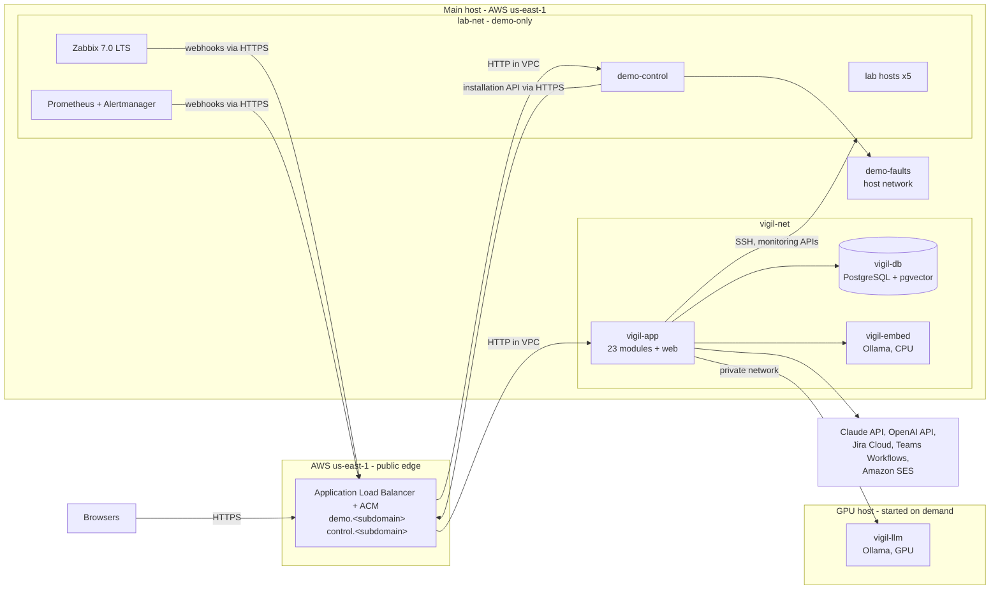

# Vigil — Architecture

| Field | Value |
| --- | --- |
| Document | 50-architecture (ID prefix `AR-`) |
| Version | 1.6 |
| Date | 18 October 2026 |
| Owner | Abdul Wadood |
| Status | Baseline (owner reviewed). Round 5 closed. Amended by Round 6 (`60-build-plan` BP-A-01 to BP-A-10, BP-A-15, BP-A-16) and during the build (BP-A-17, BP-A-19, BP-A-20, BP-A-21, BP-A-22). |

## 1. Purpose

This document decides how Vigil and the demo-only components are built and run: the deployable units and where they run, the technology stack, the final module names and how modules are laid out in code and in the database, how modules communicate (requests, events, ordering, timers, restart), the public interface of `vigil-api` and the link formats, every connector's settings and wire format, the AI layer, security, the reset mechanism and seed bundle format, and the hosting. It resolves every open item that earlier documents assign to Round 5 (complete list in Section 21.1).

It does not change what Vigil does. Behaviour is defined by `01-scope-lock`, `10-product-map`, `20-domain-model`, `30-jazz-storyboard`, `31-demo-data` and `40-demo-cut`. Where a mechanism chosen here needs a field or rule that an earlier document lacks, the change is listed as an amendment (Section 23.2) and is written into that document only when the owner closes this round.

## 2. Inputs read

- `docs/00-context.md` v1.8.
- `docs/01-scope-lock.md` v1.8.
- `docs/10-product-map.md` v1.2.
- `docs/20-domain-model.md` v1.2.
- `docs/30-jazz-storyboard.md` v1.1.
- `docs/31-demo-data/` v1.1: every file.
- `docs/40-demo-cut.md` v1.0.
- `docs/sources/Techfinity NOC Demo — What Will Be Delivered.md` (story and stack baseline only, CTX §8).
- `docs/sources/Continuum — Business Solution Document.md` v0.2: Sections 5, 6, 12 and 14 in detail; the rest for background.
- Owner answers given in the Claude project conversation on 10 October 2026 (complete list): (1) the stack is Java with Spring Boot as a modular monolith, with a React and TypeScript web application and PostgreSQL; (2) Cloudflare is preferred for anything it can host, otherwise AWS; the owner's existing domain is on Cloudflare; (3) the local model runs on a GPU server started on demand (resolves CTX-O-04, first part); (4) the demo Team in Microsoft Teams and the team mailboxes are in Techfinity's own Microsoft 365 tenant.
- Owner answers to the owner review (CTX-Q-7), 12 October 2026 (complete list): (5) host everything on AWS rather than combining AWS and Cloudflare; use AWS's default region rather than Mumbai (a Gulf region only if a change were really needed) — region `us-east-1` chosen; (6) the demo's name is a subdomain of the owner's domain delegated to Amazon Route 53; (7) the local model, reset and Microsoft 365 designs (review items 2 to 4) and the AI defaults (item 5) are agreed; (8) the running costs are already approved (CTX-O-02).
- Official documentation of the external products, checked on 10 October 2026 (Section 20).

Not read: `docs/_superseded/`. Its README states that its files are not inputs to any round.

## 3. Terms (complete list)

Terms defined in earlier documents keep their meaning. The terms below are added.

| Term | Meaning |
| --- | --- |
| Installation | One running copy of Vigil: one `vigil-app` process and its database (AR-U-01, AR-U-02). An installation holds many tenants. |
| Deployable unit | A program that is built, shipped and started on its own (Section 6). |
| Main host | The always-available Linux server that runs Vigil and the lab (AR-H-01). |
| GPU host | The Linux server with a GPU that runs the local model and is started only when needed (AR-H-02). |
| Tenant alias | An installation-level record that maps a host name (Example: `demo.<domain>`) to one tenant (AR-B-01). A request, login, webhook or link reaches the tenant that the alias of its host name points to. |
| Active tenant | A tenant that some tenant alias points to. Scheduled work runs only for active tenants (AR-R-19). |
| Dormant tenant | A tenant in state `ready` that no alias points to. From the moment its alias moves away it gets no new work (AR-R-19): its records stay as they were, its open incidents and runs stay where they were, and no screen, webhook or login reaches it. |
| In-process request | A request (`10-product-map` Section 3) made as a Java method call on the callee module's public interface inside the one `vigil-app` process (AR-R-10). |
| External call | Any network call from `vigil-app` to a system outside it: an AI provider, Jira, Teams, the email server, a monitoring source's interface, a target server, a local model runtime (AR-R-09). Reading a secret file and parsing a received body are not external calls. |
| Ordered log | A sequence of records owned by one module that another module reads in order with a cursor (AR-R-17). |
| Worker | A thread inside `vigil-app` that processes one kind of work for one key (a tenant, a run or a request) one item at a time; the complete list is Section 8.7. |
| Installation token | The bearer token with which the demo control panel, or any installation operator, calls the installation operations of `vigil-api` (AR-S-07; resolves PM-O-17). |
| Seed bundle file | A ZIP file that carries a seed bundle (AR-B-05). |
| Deployment values | The values that differ per installation and are not secrets (Example: the demo domain), filled into the seed bundle before import (AR-B-07). |
| Secret store | The place where the secret values behind credential references are kept (AR-S-04; resolves PM-O-11). |
| Locator | The text in a credential reference (DM-E-11 `locator`) that names a secret in the secret store. |
| Live update topic | A named stream of change notices that `vigil-api` pushes to screens (AR-I-04). |
| Spike | An early build test that proves an assumption before product code depends on it (Section 19.3). |

## 4. Architecture overview

Vigil is one Spring Boot application (`vigil-app`) that contains the 23 built Java product modules as separate code modules, each of the 22 that own records with its own database schema (`vigil-api` owns none), plus the React web application (`vigil-web`) it serves. It runs with its PostgreSQL database and a local embedding model runtime on one AWS server, the main host. The same host runs the demo-only lab, its real Zabbix, Prometheus and Alertmanager, and the demo control panel, on a separate container network. A second AWS server with a GPU runs the local model and is started only for rehearsals and presentations. An AWS Application Load Balancer gives the public HTTPS names, under a subdomain of the owner's domain served by Amazon Route 53; the main host accepts inbound connections only from that load balancer. Everything runs in AWS region `us-east-1`.

Why one application and not separate services (AR-D-01): the domain model depends on atomic changes across modules (Example: DM-R-09 finishes a grouping decision including its routing evaluation before the next alert; DM-R-63 needs atomic acknowledgements and approvals; DM-E60-R1 writes the execution record before the runner call), on at-least-once events (DM-R-66) and on a 2-second live highlight (SL-A1-08). In one process with one database each of these is a local transaction; across services each becomes a distributed protocol that one builder would have to write and test (CTX-C-01). Module boundaries are kept as strictly as service boundaries: each module owns one database schema, is reached only through its public interface, and its dependencies are checked by tests (AR-R-01 to AR-R-04), so a module can later be moved into its own service without changing its contract (CTX-G-2). The runner is the first expected move (PM-M05-L1).

## 5. Technology stack (complete list)

A version written as "X.Y.x" means the latest patch release of X.Y on the day the build package that introduces it starts; the exact version is pinned in the build files (Round 6) and changed only by a recorded decision. Every container image is pinned by version tag and digest.

| ID | Part | Choice | Reason | Trace |
| --- | --- | --- | --- | --- |
| AR-T-01 | Language and runtime (product) | Java 25 (LTS), Eclipse Temurin JRE, virtual threads enabled | The owner's strongest skill, so he can judge every package Claude Code writes (CTX-C-01); standard in telco IT; virtual threads make blocking external calls cheap. | CTX-D-008; SL-X-12 |
| AR-T-02 | Application framework | Spring Boot 4.1.x | Current release line with free support to 31 July 2027; supports Java 25 (Section 20, item 1). | CTX-D-008 |
| AR-T-03 | Module boundaries and events | Spring Modulith 2.1.x: application modules verified by `ApplicationModules.verify()`, Event Publication Registry with the JDBC starter, `@ApplicationModuleListener` | Checks the module rules PM-R-02 and PM-R-03 in tests; stores each event with the business change in one transaction and republishes incomplete ones after a restart (DM-R-66) (Section 20, item 2). | PM-R-02, PM-R-03, DM-R-66 |
| AR-T-04 | Persistence access | Spring Data JDBC for entities; Spring `JdbcClient` for queries; HikariCP connection pool, set to 20 connections (`spring.datasource.hikari.maximum-pool-size=20`; the default is 10); no JPA | No lazy loading or session cache to reason about; one table per entity is easy to review. | DM-C-06 |
| AR-T-05 | Database | PostgreSQL 17.x with the pgvector extension 0.8.x (image `pgvector/pgvector:pg17`) | One database for every module's schema, the event registry and the embeddings (DM-E-65). | SL-X-12; DM-E-65 |
| AR-T-06 | Schema migrations | Flyway (through Spring Boot), one migration folder per module (AR-P-05) | Versioned, reviewable schema changes per module. | PM-R-01 |
| AR-T-07 | Build | Maven 3.9.x; one Maven project for `vigil-app`; the web application is built by `frontend-maven-plugin` into the JAR's static resources | One build command produces one deployable; Maven is declarative and familiar to the owner. | CTX-C-01 |
| AR-T-08 | Web application | React 19.x, TypeScript 5.x, Vite, React Router, TanStack Query; CSS Modules for styles | Single-page application served by `vigil-app` from the same origin (no cross-origin setup). | SL-A4-01 to SL-A4-11 |
| AR-T-09 | Workflow canvas | `@xyflow/react` 12.x (React Flow) with `elkjs` (ELK layered algorithm) for "Auto layout" | Gives zoom, pan, fit, multi-select, connection handles and layered left-to-right layout without a custom canvas engine (resolves DC-ASM-02; Section 20, item 15). | SL-WE-01 to SL-WE-06, SL-WE-10; DC-ASM-02 |
| AR-T-10 | Live updates to screens | Server-Sent Events (SSE) from `vigil-app` (AR-I-04) | One-way push is all the screens need; works through the load balancer with heartbeats every 15 s and an idle timeout of 120 s (AR-H-05; AR-ASM-03, proved by AR-SP-01). | SL-A1-08, PM-M23-04; PM-O-01 |
| AR-T-11 | Security framework and password hashing | Spring Security with a custom authentication filter that reads the `vigil_session` cookie (AR-S-02), Spring Security's CSRF protection with `CookieCsrfTokenRepository` set to cookie `vigil_csrf` and header `X-Vigil-CSRF` (AR-S-03), and `Argon2PasswordEncoder` with Bouncy Castle (AR-S-01) | One standard framework for the filter chain, CSRF and hashing; OWASP's recommended algorithm. | DM-O-05; SL-B-13 |
| AR-T-12 | Target access | SSH with key authentication, Apache MINA SSHD client library | Agentless, read and act on one Linux server profile (BSD §6.2). | PM-K-03 |
| AR-T-13 | HTTP client (connectors) | Java `HttpClient` (JDK) with explicit connect and request timeouts | No extra library; timeouts are explicit (AR-TM-01). | PM-K-01 to PM-K-10 |
| AR-T-14 | Email | Jakarta Mail (Spring Boot mail) over SMTP with STARTTLS to Amazon SES | Avoids Exchange Online's retiring basic SMTP authentication (Section 20, item 9). | PM-K-06 |
| AR-T-15 | YAML, JSON, CSV, canonical JSON | Jackson (JSON, YAML, CSV data formats); RFC 8785 canonical JSON with the library `io.github.erdtman:java-json-canonicalization` | One library for the seed bundle (AR-B-05) and every connector payload; canonical form for hashes (AR-P-03). | SL-O-11; DM-O-08 |
| AR-T-16 | Local model runtime | Ollama (GPU host, `vigil-llm`) serving model `gemma4:12b` | One HTTP call per answer, with JSON-schema output and token counts per call (Section 20, items 12 and 13). | PM-K-09; CTX-O-04 |
| AR-T-17 | Local embedding runtime | Ollama (main host, CPU, `vigil-embed`) serving model `embeddinggemma` | Always available on the main host, independent of the GPU host and of SL-F-4 (CTX-D-011). | PM-K-10; SL-T-3 |
| AR-T-18 | Containers | Docker Engine 28.0 or later with a Docker Compose v2 release that accepts the network option `gw_priority`, on each host (`deploy/deploy.sh` stops when `docker compose config` rejects the file) | One file per host describes every container; one builder can run it. | CTX-C-01 |
| AR-T-19 | Public edge | AWS Application Load Balancer with an AWS Certificate Manager certificate; DNS in Amazon Route 53 for a subdomain delegated from the owner's domain | Owner chose AWS only (Section 2, answer 5); TLS certificates are issued and renewed by AWS; the hosts accept inbound connections only from the load balancer (AR-H-05). | SL-A3-05, SL-B-14 |
| AR-T-20 | Tests | JUnit 5, AssertJ, Testcontainers (PostgreSQL), WireMock (HTTP connectors), Spring Modulith test support, ArchUnit; Vitest and Testing Library (web); Playwright (end-to-end); in end-to-end tests the dev fakes and Mailpit of `60-build-plan` Section 11.3 stand in for the external systems (amendment BP-A-07) | Covers module rules, connectors without the real systems, and the screens (Section 19). | SL-B-04 (automated tests) |
| AR-T-21 | Demo-only software (lab mocks, fault scripts, control panel) | Lab mocks and fault agents: Python 3.12 (image base `ubuntu:24.04` with Ubuntu's Python 3.12 and a virtual environment `/opt/venv`, amendment `60-build-plan` BP-A-08) with the standard library and `prometheus_client`; fault scripts: bash; control panel: Java 25 with Spring Boot 4.1.x serving one static HTML page with plain JavaScript | The lab mocks are small scripts; the control panel shares the product's language and build. Kept in `demo/`, separate from `vigil-app` (CTX-C-03). | SL-A3-01 to SL-A3-03; PM-DC-01 to PM-DC-04 |
| AR-T-22 | Monitoring products in the lab | Zabbix 7.0 LTS (7.0.12 or later: server, web interface, agent 2, PostgreSQL 16 for Zabbix); Prometheus 3.x; Alertmanager 0.28.x or later; Prometheus node exporter | Real monitoring as the scope lock requires; 7.0 is the Zabbix LTS line in full support until 30 June 2027 (Section 20, item 4). | SL-A3-01, SL-A1-01 |
| AR-T-23 | Cloud | AWS, region `us-east-1` (N. Virginia) | Owner's choice of AWS's default region (Section 2, answer 5). It offers every service used (G6 GPU instances, SES SMTP endpoints, Route 53, ACM, ECR) at lower prices than Mumbai; the Gulf regions have no SES SMTP endpoint (Section 20, item 17). Pages respond about 200 to 250 ms slower from Pakistan than from Mumbai, which the 2 s budget of SL-A1-08 absorbs (AR-SP-01). | CTX-O-02 |

## 6. Deployable units (complete list)

### 6.1 Product units

| ID | Unit | Content | Runs on | Network and ports | Trace |
| --- | --- | --- | --- | --- | --- |
| AR-U-01 | `vigil-app` | One Spring Boot application containing every built product module of `10-product-map` Section 4.1 except `vigil-web` (Section 7), plus the built `vigil-web` files, served from the same origin. Container image `vigil-app`. The same image started with the Spring profile `migrate` is the one-shot unit `vigil-migrate`, which runs the migrations of AR-P-05 as the owner role and stops; `vigil-app` starts only after it has finished successfully and never holds the owner role's password. In the compose file `vigil-migrate` has `depends_on: {vigil-db: {condition: service_healthy}}`, where `vigil-db`'s health check, every 2 s, is `psql -h 127.0.0.1 -U postgres -d vigil -tAc "select 1 from pg_roles where rolname = 'vigil_app'"` returning `1` (over TCP, so it fails while the image's first-start initialisation runs on its socket-only temporary server, and it passes only after the AR-U-02 init script has created the roles); `vigil-migrate` also retries its first connection 30 times, 2 s apart, before it fails. | Main host | HTTP on port 8080, bound only to its fixed address on `vigil-net` (172.30.0.10), set by the installation property `vigil.http.bind-address` (a local installation sets `0.0.0.0`, amendment `60-build-plan` BP-A-09); joins `lab-net` (172.31.0.10) for outbound calls to the lab only. Port 8080 is published only on the main host's private address (`10.40.1.10:8080`) for the load balancer (AR-H-05); in the compose file `vigil-net` has the highest `gw_priority` of its two networks (Docker Engine 28.0 or later, AR-T-18), so the published port reaches its `vigil-net` address; AR-SP-01 checks this. Settings for running behind the load balancer (complete list): `server.forward-headers-strategy=native` (the application sees the HTTPS scheme and the client's address); `management.endpoints.web.exposure.include=health`; `management.endpoint.health.probes.enabled=true` (turns on `/actuator/health/liveness` outside Kubernetes). | PM-M01 to PM-M24; SL-A3-05 |
| AR-U-02 | `vigil-db` | PostgreSQL 17 with pgvector; database `vigil`; one schema per module (AR-P-04). Data on a named Docker volume. At its first start an init script creates the roles `vigil_owner` and `vigil_app` (AR-P-06) with the passwords of AR-S-13 and the extension `vector`. | Main host | Port 5432 on `vigil-net` only. | PM-R-01; SL-B-01 |
| AR-U-03 | `vigil-embed` | Ollama on CPU serving `embeddinggemma` (the local embedding model, PM-K-10). Models on a named Docker volume (AR-H-11). | Main host | Port 11434 on `vigil-net` only. | SL-T-3; CTX-D-011 |
| AR-U-04 | `vigil-llm` | Ollama on the GPU serving `gemma4:12b` (the local model, PM-K-09). Models on a named Docker volume (AR-H-11). | GPU host | Port 11434 on the GPU host's private address, reachable only from the main host (AR-H-04). | SL-A2-05, SL-A2-07; CTX-O-04 |
| AR-U-05 | (withdrawn) | Was the Cloudflare Tunnel connector; the public edge is now the AWS load balancer (AR-H-05, owner answer 5). | — | — | — |

`vigil-web` (PM-M24) is a TypeScript code base in the same repository; it is built into AR-U-01 and is not a unit of its own.

### 6.2 Demo-only units

| ID | Unit | Content | Runs on | Network and ports | Trace |
| --- | --- | --- | --- | --- | --- |
| AR-U-06 | `demo-control` | The demo control panel (PM-DC-04), with the seed bundle content (PM-DC-05) and the deployment values (AR-B-07) built into its image. | Main host | Port 8090 on `lab-net`, published only on the main host's private address (`10.40.1.10:8090`); reached by the public name `control.${demo_domain}` through the load balancer (AR-H-05); `GET /health` answers 200 without login for the load balancer's health check. | SL-A3-03, SL-A4-12 |
| AR-U-07 | `demo-faults` | The fault agent (PM-DC-03): injects and clears SL-F-1 to SL-F-4 (AR-X-03). | Main host | Host network; listens only on `172.31.0.1:8091` (the host's address on `lab-net`), so `demo-control` reaches it at `http://172.31.0.1:8091`; runs as root (user 0) with capabilities `NET_ADMIN` and `NET_RAW` (needed by `iptables` and `conntrack` on the host network); the Docker socket `/var/run/docker.sock` is mounted so it can run fault scripts inside lab containers with `docker exec`. Root and the Docker socket give this unit full control of the host; this is accepted for the demo installation only, because the unit is reachable only from `lab-net` and only with the `faults-token` (AR-X-03), and it is never part of a customer installation (PM-DC-03). | SL-A3-02 |
| AR-U-08 | Lab hosts | Five containers named as the lab hosts of DD-F-10: `lab-db-01`, `lab-api-01`, `lab-vas-01`, `lab-probe-01`, `lab-rpt-01` (PM-DC-01), from one image `demo-lab` started with a role per host; `lab-db-01` is privileged for its loop-mounted `/data` (AR-X-01). | Main host | `lab-net`; `lab-db-01` runs `sshd` on port 22 for the runner. Outbound internet allowed (they do not need it, but the network is shared with the monitoring units). | SL-A3-01; SL-C-02 |
| AR-U-09 | Zabbix | `lab-zabbix-server`, `lab-zabbix-web` (port 8080), `lab-zabbix-db` (PostgreSQL 16 for Zabbix), Zabbix agent 2 inside `lab-db-01`, `lab-vas-01` and `lab-rpt-01`; one-shot `lab-zabbix-provision` that configures hosts, items, triggers, the media type and the action through the Zabbix API (PM-DC-02). | Main host | `lab-net`; outbound HTTPS to `demo.<domain>` for webhooks (the base address is the lab value `webhook_base_url`, Section 12.3). | SL-A3-01, SL-A1-01 |
| AR-U-10 | Prometheus and Alertmanager | `lab-prometheus`, `lab-alertmanager` (port 9093, basic authentication, AR-K-02), Prometheus node exporter inside `lab-db-01` (PM-DC-02). | Main host | `lab-net`; outbound HTTPS to `demo.<domain>` for webhooks (the base address is the lab value `webhook_base_url`, Section 12.3). | SL-A3-01, SL-A1-01 |

### 6.3 Unit rules (complete list)

| ID | Rule | Trace |
| --- | --- | --- |
| AR-R-01 | Exactly one `vigil-app` process runs per installation. At start, `vigil-app` MUST take the PostgreSQL session advisory lock with key 4835711 (a fixed constant of the code) on its database connection and keep that connection open for its whole life; when the lock is held by another process it MUST stop with the log message "Another vigil-app is running against this database." High availability is Later (SL-C-07). | SL-C-07; DM-R-62, DM-R-67 |
| AR-R-02 | Demo-only units MUST be built from the `demo/` folder of the repository and product units from `app/` and `web/` (repository layout in `60-build-plan` Section 5.1). The folders `dev/`, `spikes/` and `tests/` hold test tooling; no product or demo-only unit includes them (amendment BP-A-07). No product unit includes demo-only code or data. | CTX-C-03; PM-R-08, SL-B-10 |
| AR-R-03 | `vigil-app` MUST NOT call `demo-faults` or `demo-control`, and has no address for them. Lab hosts are reached only by `vigil-runner` (SSH) and monitoring sources only by the monitoring connectors (AR-K-01, AR-K-02). | SL-B-10; PM-R-07 |

## 7. Modules in code

### 7.1 Final module names (resolves CTX §3 "Round 5 makes them final")

The working module names of `10-product-map` Section 4.1 become the final names, unchanged (AR-D-12). Each built Java module is one Spring Modulith application module: a top-level package under the root package `vigil`. Each module owns exactly one database schema, named as below. `vigil-api` owns no schema (PM-M23); `vigil-web` is not Java.

| ID | Final module name | Java package | Database schema | Allowed dependencies (modules whose requests and event types it may use; PM-R-03 order) |
| --- | --- | --- | --- | --- |
| AR-M-01 | `vigil-audit` | `vigil.audit` | `audit` | none |
| AR-M-02 | `vigil-tenancy` | `vigil.tenancy` | `tenancy` | `vigil-audit` |
| AR-M-03 | `vigil-identity` | `vigil.identity` | `identity` | `vigil-tenancy`, `vigil-audit` |
| AR-M-04 | `vigil-connectors` | `vigil.connectors` | `connectors` | `vigil-audit` |
| AR-M-05 | `vigil-runner` | `vigil.runner` | `runner` | `vigil-tenancy` (active tenants, for AR-R-24 step (1), amendment AR-A-21), `vigil-connectors` (credential secrets and the target connector type, amendment AR-A-02), `vigil-audit` |
| AR-M-06 | `vigil-servicemap` | `vigil.servicemap` | `servicemap` | `vigil-audit` |
| AR-M-07 | `vigil-intake` | `vigil.intake` | `intake` | `vigil-tenancy` (active tenants, AR-A-21), `vigil-connectors`, `vigil-audit` |
| AR-M-08 | `vigil-ai-gateway` | `vigil.aigateway` | `ai_gateway` | `vigil-connectors`, `vigil-audit` |
| AR-M-09 | `vigil-knowledge` | `vigil.knowledge` | `knowledge` | `vigil-tenancy` (active tenants), `vigil-ai-gateway`, `vigil-audit` |
| AR-M-10 | `vigil-incidents` | `vigil.incidents` | `incidents` | `vigil-tenancy` (active tenants), `vigil-identity`, `vigil-audit` |
| AR-M-11 | `vigil-investigation` | `vigil.investigation` | `investigation` | `vigil-incidents`, `vigil-servicemap`, `vigil-knowledge`, `vigil-ai-gateway`, `vigil-audit` |
| AR-M-12 | `vigil-notifications` | `vigil.notifications` | `notifications` | `vigil-connectors`, `vigil-identity`, `vigil-incidents`, `vigil-investigation`, `vigil-tenancy`, `vigil-audit` |
| AR-M-13 | `vigil-ticketing` | `vigil.ticketing` | `ticketing` | `vigil-connectors`, `vigil-intake` (reopening alert for DC-OUT-04, AR-A-22), `vigil-incidents`, `vigil-investigation`, `vigil-tenancy`, `vigil-audit` |
| AR-M-14 | `vigil-routing` | `vigil.routing` | `routing` | `vigil-incidents`, `vigil-servicemap`, `vigil-identity`, `vigil-notifications`, `vigil-ticketing`, `vigil-audit` |
| AR-M-15 | `vigil-correlation` | `vigil.correlation` | `correlation` | `vigil-tenancy` (active tenants), `vigil-intake`, `vigil-servicemap`, `vigil-incidents`, `vigil-routing`, `vigil-audit` |
| AR-M-16 | `vigil-recovery` | `vigil.recovery` | `recovery` | `vigil-intake`, `vigil-incidents`, `vigil-correlation`, `vigil-servicemap`, `vigil-audit` |
| AR-M-17 | `vigil-diagnostics` | `vigil.diagnostics` | `diagnostics` | `vigil-runner`, `vigil-servicemap`, `vigil-incidents`, `vigil-audit` |
| AR-M-18 | `vigil-actions` | `vigil.actions` | `actions` | `vigil-knowledge`, `vigil-runner`, `vigil-servicemap`, `vigil-incidents`, `vigil-identity`, `vigil-notifications`, `vigil-recovery`, `vigil-audit` |
| AR-M-19 | `vigil-engine` | `vigil.engine` | `engine` | `vigil-tenancy` (active tenants), `vigil-intake` (event types AR-E-02, AR-E-03), `vigil-incidents`, `vigil-diagnostics`, `vigil-investigation`, `vigil-actions`, `vigil-recovery`, `vigil-routing`, `vigil-notifications`, `vigil-ticketing`, `vigil-knowledge`, `vigil-servicemap`, `vigil-identity`, `vigil-audit` |
| AR-M-20 | `vigil-workflows` | `vigil.workflows` | `workflows` | `vigil-tenancy` (active tenants, AR-R-14, amendment AR-A-21), `vigil-engine`, `vigil-incidents`, `vigil-routing`, `vigil-identity`, `vigil-diagnostics`, `vigil-audit` |
| AR-M-21 | `vigil-reporting` | `vigil.reporting` | `reporting` | `vigil-incidents`, `vigil-intake`, `vigil-knowledge`, `vigil-tenancy`, `vigil-audit` |
| AR-M-22 | `vigil-setup` | `vigil.setup` | `setup` | `vigil-connectors`, `vigil-intake`, `vigil-servicemap`, `vigil-identity`, `vigil-audit`; for seed import and reset also `vigil-tenancy`, `vigil-runner`, `vigil-ai-gateway`, `vigil-knowledge`, `vigil-incidents`, `vigil-correlation`, `vigil-routing`, `vigil-diagnostics`, `vigil-recovery`, `vigil-actions`, `vigil-notifications`, `vigil-workflows`, `vigil-reporting` |
| AR-M-23 | `vigil-api` | `vigil.api` | none | every module above |
| AR-M-24 | `vigil-web` | (TypeScript, folder `web/`) | none | `vigil-api` over HTTP only |
| AR-M-25 | `vigil-packs` | not built | — | Later (PM-M25) |
| AR-M-26 | `vigil-ai-evaluation` | not built | — | Later (PM-M26) |
| AR-M-27 | `vigil-platform-health` | not built | — | Later (PM-M27) |
| AR-M-28 | `vigil-discovery` | not built | — | Later (PM-M28) |

The dependency lists are the "Sends requests to" rows of `10-product-map` Section 6, plus the modules whose events a module reacts to, with amendments DM-A-01 to DM-A-28, DC-A-01 to DC-A-19 and AR-A-01 to AR-A-24 applied. Every list names only modules earlier in the PM-R-03 order. In `@ApplicationModule(allowedDependencies = …)` each listed module is written `{package} :: api` (Example: `intake :: api`), so only its public named interface is allowed (AR-R-04), and every list also contains `shared` (the package `vigil.shared`, AR-R-06), which the table does not repeat. Example: `vigil-audit` declares `allowedDependencies = {"shared"}`; `vigil-tenancy` declares `{"shared", "audit :: api"}`.

### 7.2 Code rules (complete list)

| ID | Rule | Trace |
| --- | --- | --- |
| AR-R-04 | Each module package has exactly one public sub-package, `api`, declared as a Spring Modulith named interface. It holds the module's public interface types (complete list): service interfaces for its requests; request and result records; event records; the step handler for each step type it implements (AR-R-21); its seed import interface (AR-B-11). Every other type of the module is internal and MUST NOT be referenced from another module. | PM-R-02 |
| AR-R-05 | Each module declares its allowed dependencies (Section 7.1) in `@ApplicationModule(allowedDependencies = …)`. A test MUST run `ApplicationModules.of(VigilApplication.class).verify()` and MUST fail on any dependency not in the list, on any cycle, and on any reference to another module's internal type. | PM-R-02, PM-R-03 |
| AR-R-06 | A package `vigil.shared` holds code used by every module that owns no record and depends on no module (complete list): identifier, key and actor types (AR-P-01); the tenant identifier type; the clock; canonical JSON and hashing (AR-P-03); the error type of AR-I-03; the transaction guard of AR-R-09; the step protocol types `StepCall`, `StepCancel`, `StepAnswer`, `Completed` and `Waiting` (AR-R-21), so step-implementing modules do not depend on `vigil-engine`. It is declared `@ApplicationModule(type = Type.OPEN, allowedDependencies = {})`, so all its types are usable and it may use no module; it is listed in every module's allowed dependencies (Section 7.1) and in `@Modulithic(sharedModules = "shared")`, which only makes module integration tests load it. | PM-R-01 |
| AR-R-07 | A module reads and writes only tables of its own schema. A test MUST fail when the SQL or table mapping of a module names another schema. Database foreign keys are allowed only within one schema; a reference to another module's record holds its identifier or key only (DM-C-06). | PM-R-01, PM-R-02; DM-C-06 |
| AR-R-08 | Only code in `vigil.connectors` and `vigil.runner` may use the JDK HTTP client, Jakarta Mail or the SSH library. An ArchUnit test MUST fail on any other use. | PM-R-04; SL-B-07 |
| AR-R-09 | No external call is made while a database transaction is open. Every connector and runner entry point that makes an external call MUST check this and throw `IllegalStateException("external call inside a transaction")` when a transaction is active; the operations that make no network call (monitoring `parse`, and the secret operations of AR-S-04) are not external calls and are not checked. A module that records an external call writes its record in a transaction before the call and its result in a new transaction after it (Example: DM-E60-R1 execution record, DM-E76-R2 pending ticket sync). | DM-E60-R1, DM-E76-R2; SL-B-11 |

## 8. Communication between modules (resolves PM-O-01)

### 8.1 Requests and transactions

| ID | Rule | Trace |
| --- | --- | --- |
| AR-R-10 | A request (`10-product-map` Section 3) is a synchronous Java call on a service interface in the callee's `api` package. Operations that write records are `@Transactional` with propagation `REQUIRED`, so a request made inside the caller's transaction joins it and the whole change commits or rolls back together (Example: a grouping decision, its incident, its membership, its routing evaluation and its audit events commit as one, DM-R-09). An operation that makes an external call is marked in its interface documentation "external call: not inside a transaction", and callers MUST call it with no transaction open (AR-R-09). | DM-R-09, DM-R-63; PM-R-02 |
| AR-R-11 | Every audit event is written by a request to `vigil-audit` inside the transaction of the change it reports, so a change and its audit event commit together (DM-E08-R3). | SL-B-06; DM-E08-R3 |
| AR-R-12 | Checks that MUST be atomic (DM-R-63: acknowledgement, approval decision; DM-E46-R1 draft revision; DM-E21-R2 one firing alert per key; DM-R-61 one decision per alert; DM-R-64 one record per step execution) are each done in one transaction that first locks the record the check reads (`SELECT … FOR UPDATE`) and are backed by a unique constraint where the rule is a uniqueness rule. | DM-R-61 to DM-R-64 |

### 8.2 Events

| ID | Rule | Trace |
| --- | --- | --- |
| AR-R-13 | An event is a Java record published with Spring's `ApplicationEventPublisher` inside the transaction of the change it announces. The Spring Modulith Event Publication Registry (JDBC starter) stores one publication per listener in the same transaction, in table `platform.event_publication`. Settings (complete list): `spring.modulith.events.jdbc.schema=platform`; `spring.modulith.events.jdbc.schema-initialization.enabled=false` (the table is created by a Flyway migration that matches the DDL that Spring Modulith 2.1 ships for PostgreSQL); `spring.modulith.events.completion-mode=UPDATE` (completed publications are kept); `spring.modulith.events.republish-outstanding-events-on-restart=false` (republishing is step (3) of the restart procedure, AR-R-24). | DM-R-66; DM-C-04 |
| AR-R-14 | Listeners are `@ApplicationModuleListener` methods: they run after the publishing transaction commits, on a separate thread, in their own transaction. A listener (complete list of what it MAY do): checks that the event's tenant is active and, when it is not, completes without doing anything (AR-R-19; listeners of the installation-level event AR-E-14 make no such check); reads records by requests; writes its own module's records; hands work to a worker of Section 8.7 after its transaction commits. A listener MUST NOT make an external call and MUST finish within 5 s. Each listener MUST give the same result when it receives the same event twice (DM-R-66); a test delivers each event twice to its listener. Publications that are not complete 60 s after publication are resubmitted every 60 s (`IncompleteEventPublications.resubmitIncompletePublicationsOlderThan(Duration.ofSeconds(60))`). | DM-R-66 |
| AR-R-15 | An event record carries (complete list): the tenant identifier (except AR-E-14, which is installation-level and carries only its payload); the identifiers, keys and state values named in the "Payload" column of Section 8.3; nothing else. A listener that needs more reads it from the owning module by a request (PM-R-02). | PM-R-02, PM-R-05 |

### 8.3 Event catalogue (complete list)

Events PM-EV-01 to PM-EV-14 of `10-product-map` Section 9.2 with the amendments of earlier rounds, and the new event AR-E-14 (amendment AR-A-21). "Payload" lists the fields beyond the tenant identifier.

| ID | Event (Java record) | Published by | Payload | Reacted to by | Trace |
| --- | --- | --- | --- | --- | --- |
| AR-E-01 | `AlertReceived` | `vigil-intake` | alert id, alert `sequence` (AR-A-10) | `vigil-correlation` (wakes its worker, AR-R-17); `vigil-api` (topic `alerts`, AR-I-04) | PM-EV-01 |
| AR-E-02 | `AlertStateChanged` | `vigil-intake` | alert id, new status | `vigil-engine` (marks runs at a Recovery check step for wake, AR-R-20); `vigil-api` (topic `alerts`) | PM-EV-02; DM-A-11 |
| AR-E-03 | `SourceHealthChanged` | `vigil-intake` | source id, new health | `vigil-setup`; `vigil-engine` (marks runs at a Recovery check step for wake, DM-A-22, AR-R-20); `vigil-api` (topic `sources`) | PM-EV-03 |
| AR-E-04 | `ServiceMapImported` | `vigil-servicemap` | generation | `vigil-setup` | PM-EV-04 |
| AR-E-05 | `IncidentCreated` | `vigil-incidents` | incident id | `vigil-workflows` | PM-EV-05 |
| AR-E-06 | `IncidentAcknowledged` | `vigil-incidents` | incident id, episode | `vigil-engine` | PM-EV-07 |
| AR-E-07 | `IncidentStateChanged` | `vigil-incidents` | incident id, from state, to state | `vigil-engine`; `vigil-workflows` (reopen, DM-A-18) | PM-EV-08 |
| AR-E-08 | `IncidentChanged` | `vigil-incidents` | incident id | `vigil-api` (topics `incidents` and `incident`) | PM-EV-09 |
| AR-E-09 | `ApprovalDecided` | `vigil-actions` | approval request id, run id, step execution id | `vigil-engine`; `vigil-api` (topic `approval`) | PM-EV-10 |
| AR-E-10 | `RunStarted`, `StepChanged`, `RunFinished` | `vigil-engine` | run id, incident id, mode, test replay id (test mode only), step execution id and state (`StepChanged` only) | `vigil-api` (live runs: topics `run`, `incident` and `incidents`; test-mode runs: only topic `test-replay`, DM-R-59) | PM-EV-11 |
| AR-E-11 | `TaskProviderChanged` | `vigil-ai-gateway` | task, provider key | `vigil-knowledge` | PM-EV-12 |
| AR-E-12 | `WorkflowVersionPublished` | `vigil-workflows` | version id | `vigil-api` (topic `workflow`) | PM-EV-13 |
| AR-E-13 | `TenantSettingsChanged` | `vigil-tenancy` | none | `vigil-api` (topic `tenant`) | PM-EV-14 |
| AR-E-14 | `TenantAliasChanged` | `vigil-tenancy` | host name, new tenant id, previous tenant id (or none) | `vigil-identity`, `vigil-intake`, `vigil-incidents`, `vigil-correlation`, `vigil-knowledge`, `vigil-engine`: each reads the active tenants from `vigil-tenancy` and makes its scheduled work and workers match that list (starts what is missing, stops what belongs to a tenant no longer active), so a repeated or late delivery gives the same result (AR-R-19) | New (amendment AR-A-21) |

The `vigil-api` reactions to AR-E-01, AR-E-02, AR-E-03 and AR-E-09 are added by amendment AR-A-03; they only notify screens. AR-E-14 is published inside the transaction that writes the new alias revision; it is the only installation-level event.

### 8.4 Ordering

| ID | Rule | Trace |
| --- | --- | --- |
| AR-R-16 | **Intake order.** A webhook call is processed in this order (complete list): (1) `vigil-api` resolves the tenant from the host (AR-I-02) and passes the call to `vigil-intake`; (2) `vigil-intake` finds the active source by `source_key` and asks `vigil-connectors` to verify the bearer token against the source's webhook token credential (AR-S-04, constant time); a missing or wrong token answers 401 and nothing is stored (DM-E18-R1); (3) the source's connector parses the body (no network call); (4) in one transaction `vigil-intake` locks the tenant's alert counter row (`intake.alert_counter`, `SELECT … FOR UPDATE`, held until commit), stores the webhook call, the raw and normalised alerts, applies each entry (DM-E21-R1), gives every new alert the next counter value as its `sequence` (amendment AR-A-10), updates source contact (DM-R-39) and publishes the events; (5) the transaction commits and the call is answered. Because the counter row stays locked until commit, two calls of a tenant cannot commit their alerts out of `sequence` order, and alerts become visible in `sequence` order with no gap. A test sends concurrent webhook calls and checks this. | DM-R-03, DM-R-09; DM-E18-R1 |
| AR-R-17 | **Correlation reads the intake log in order.** `vigil-correlation` keeps, per tenant, a cursor: the highest alert `sequence` it has decided, stored in its schema. Its worker for the tenant (Section 8.7) repeatedly asks `vigil-intake` for the alerts with `sequence` above the cursor (every alert is created firing, DM-E21-R1 a, and is decided whatever its status at the time of the decision), in ascending order, at most 100 at a time (request PM-I-07, amendment AR-A-04), and decides each one in its own transaction (DM-R-09), which also stores the new cursor. "Alert received" (AR-E-01) only wakes the worker; the worker also wakes every `stability_check_interval`. This is the order of DM-R-09: the order of alert creation. When a decision's transaction fails, the worker logs the error at level ERROR with the tenant id, alert id and attempt number at every failed attempt, and retries the same alert after 1 s, 5 s and 30 s, then every 60 s, and never skips it (DM-R-61). While a retry is pending, the `vigil-app` health indicator `correlation` (AR-H-12) reports `DOWN` with the tenant id and alert id, so a stalled worker is visible to `deploy/status.sh`. | DM-R-09, DM-R-61, DM-R-62 |
| AR-R-18 | **One tenant sequence.** The same correlation worker of a tenant makes the alert decisions, the stability checks and transitions (DM-R-15) and the reopen decisions (DM-R-21), one at a time, so they never overlap (DM-R-62). | DM-R-62 |
| AR-R-19 | **Active and dormant tenants.** A tenant becomes active when an alias is set to it and stops being active when its last alias moves to another tenant (AR-B-03); `vigil-tenancy` answers which tenants are active, and AR-E-14 announces each change. Only active tenants get (complete list): scheduled work (AR-R-23); processing of event deliveries (AR-R-14); the restart procedure's steps (AR-R-24), except step (2), which covers the seed imports of every tenant (a tenant being prepared by a reset is not yet active); webhooks, logins and screen operations (they are routed by alias, AR-I-02). When AR-E-14 makes a tenant active, its modules start its scheduled work and workers at once (its first stability check, health test, health evaluation and timer poll run within 1 s). Work already running for a tenant when it stops being active (at most one step evaluation per run, one decision of its correlation worker, one connector call) finishes; after that nothing changes its records. This is how an earlier demo run stays unmodified (SL-A3-03); its open incidents and runs stay where they were (amendment AR-A-23 records the exceptions in `20-domain-model`). | SL-A3-03; DM-C-04 |

### 8.5 Step protocol in code (PM-S-12 to PM-S-14)

| ID | Rule | Trace |
| --- | --- | --- |
| AR-R-20 | **Run executors, wakes and cancellation.** `vigil-engine` evaluates the steps of one run one at a time (DM-R-67) on the run's executor: an in-process queue of hand-offs per run, processed one at a time by one virtual thread. A hand-off is only a signal: what the executor does is decided by the stored state (below), so a repeated or late hand-off does no harm, and a step is called only while the executor processes a hand-off. Hand-offs are made (complete list): after a transaction of `vigil-engine` commits that started a run, recorded a wake, or stored a run as `waiting` while its wake flag was set (Spring `TransactionSynchronization.afterCommit`); when a step's retry falls due (AR-R-22); 5 s after an executor transaction failed (the executor logs the error at level ERROR); and at restart (AR-R-24 (4)). During a restart, executors accept hand-offs only from step (4) of AR-R-24 on; earlier hand-offs are dropped, because step (4) hands every unfinished run. **Wakes are recorded durably on the run** (DM-E-50 `wake_pending`, `wake_reason`, amendment AR-A-20). Wake sources and the runs each one marks (complete list): AR-E-02 and AR-E-03 → every unfinished live run of the tenant whose current step is a Recovery check step; AR-E-06 and AR-E-07 → every unfinished live run of the incident (for AR-E-07 this includes runs waiting with `wait_reason = incident_forming`, DM-R-16); AR-E-09 → the run named in the event; the timer poll → the run of each due timer. Of these, a run is marked when it is `waiting` and either the wake is listed for its current step execution or it waits with `incident_forming` and the wake is AR-E-07; and always when it is `running`, because its step may have read the state before the change (one more evaluation gives the same result when nothing changed, DM-R-64, DM-R-65). The listener or poll sets `wake_pending = true` and `wake_reason` (`event:{event type}` or `timer`) with one `UPDATE … WHERE state IN ('running', 'waiting')` in its own transaction and hands each marked run to its executor after commit. `wake_reason` keeps only the last wake; handlers decide from the current state and time (DM-R-37, DM-S-08), so the reason is used only for logging. **Processing a hand-off** (complete list of cases), in one transaction that locks the run (`SELECT … FOR UPDATE`): (a) the run is `finished`, `cancelled` or `failed`, or its tenant is not active (the engine's set of active tenants, refreshed by its AR-E-14 listener, AR-R-19): nothing; (b) the run is `waiting` without `wake_pending`: nothing; (c) `waiting` with `wake_pending` and `wait_reason = incident_forming`: the flag is cleared and the incident's state is read from `vigil-incidents` — still `forming`: the run stays waiting; any other state: the checkpoint step starts (AR-R-22; DM-SM07-T3); (d) `waiting` with `wake_pending` and `wait_reason = step_waiting`: when its current step execution is not `waiting` the flag is cleared and nothing else happens (DM-R-67); otherwise the step is evaluated again (AR-R-22); (e) `running`, and its current step execution has `retry_due_at` later than now: nothing (the retry's own hand-off will come); (f) `running`, with `retry_due_at` at or before now: the retry is made (AR-R-22); (g) `running`, and its current step execution is `running` with no retry pending: the call was interrupted (a restart, or a failed executor transaction). An Action step execution without a named output is not called again: the engine asks `vigil-actions` to reconcile it (PM-M12-10, DM-SM12-T7; an external call, made with no transaction open) and stores the named output the reconciliation gives as the step's answer (part (3) of AR-R-22). Any other step is called again with reason `resume`; (h) `running`, and its current step execution is `completed` (stopped between two steps): the run continues from its checkpoint. **No wake is lost:** part (1) of AR-R-22 clears `wake_pending`; every transaction that stores a run as `waiting` reads `wake_pending` under the run's row lock and, when it is set, hands the run to its executor again after commit, so a wake that arrived while the step was being called is evaluated (amendment AR-A-20 to DM-R-67). **Cancellation** (DM-SM07-T5) is done in the transaction that decides it: `vigil-engine`'s listener for AR-E-07 to `merged` or `closed`, and the engine's start of a reopen run (DM-R-22, which cancels and starts in one transaction). That transaction locks the run, sets it `cancelled` with its `end_reason`, cancels the current step execution and its timer, and calls the step handler's `cancel` (AR-R-21) in the same transaction. A call in progress at that moment is handled by part (3) of AR-R-22. `vigil-workflows`' listener for AR-E-05 and AR-E-07 asks `vigil-engine` to start a run in its own transaction; the engine stores the run and its Trigger step and hands it to the executor after commit (AR-R-14). | DM-R-16, DM-R-22, DM-R-66, DM-R-67, DM-E52-R1, DM-SM-07; PM-S-13 |
| AR-R-21 | Each step-implementing module exposes, in its `api` package, a handler with three operations, using the types of `vigil.shared` (AR-R-06): `start(StepCall)` and `evaluate(StepCall)` (external call: not inside a transaction); and `cancel(StepCancel)`, which makes no external call, joins the caller's transaction (AR-R-10), gives the same result when called twice, and cancels whatever the step has created that is still open (complete list: a `pending` approval request, DM-SM11-T8; an observing recovery verification, DM-SM13-T4). `StepCall` holds (complete list): tenant id, run id, incident id, step execution id, step id, step type, parameters (the step's JSON from the run's content), `evaluation_count`, the stored `step_state`, the wake reason (`start`, `event:{event type}`, `timer`, `retry`, `resume`, `restart`; the operation called is `start` when the step execution has never stored a `Waiting` answer and `evaluate` otherwise), and the extra inputs of DM-A-15 (recovery check key for Recovery check steps; earlier approvers of the run for Approval steps). Each operation returns a `StepAnswer`: either `Completed(named output, result reference)` or `Waiting(wake events, timer due time or none, step state)`. | PM-S-12 to PM-S-14; DM-A-15 |
| AR-R-22 | The executor runs each step in three parts (AR-R-20): (1) in one transaction that locks the run, it checks that the run's tenant is active and that the run is `running` or is being woken (cases (c), (d) of AR-R-20), and otherwise stops; it sets the run `running` and clears `wait_reason` (DM-SM07-T3) and `wake_pending`, marks the step execution `running` (or `running` again after a wake), clears its `retry_due_at`, stores the increased `evaluation_count` (DM-E-51) and publishes `StepChanged`; (2) with no transaction open it calls the handler; (3) in one transaction that locks the run, it stores the result. When the run is no longer `running` (it was cancelled meanwhile, DM-SM07-T5), the answer is discarded and the handler's `cancel` is called in this transaction, so anything the call created after the cancellation is cancelled too. Otherwise: for `Completed`, it stores the named output, `finished_at`, and either the next step as checkpoint or the end of the run; for `Waiting`, the wake events, a new `pending` timer (cancelling the previous one) and the step state, and the run becomes `waiting` with `wait_reason = step_waiting` (DM-SM07-T2); it publishes `StepChanged`. After a `Completed` answer the executor goes on with the next step (part (1) again, which repeats the tenant check, so a run of a tenant that has just become dormant goes no further, AR-R-19). **Retries:** when the handler throws, part (3) stores on the step execution `failed_attempts + 1` and `retry_due_at` = now + the wait of AR-TM-05 for that attempt (amendment AR-A-20), and schedules a hand-off at that time; the executor is not held in the meantime, and a hand-off before then does nothing (AR-R-20 (e)). The retry (AR-R-20 (f)) is a new call with reason `retry` and a new `evaluation_count`; a wake during the wait only sets `wake_pending`, which the retry's part (1) clears, and the retry reads the current state. When the fourth attempt fails, the run fails (DM-SM07-T6, `end_detail` "step '{step label}' did not answer after 4 attempts"). Test-mode runs use the same executors but compute their outputs inside `vigil-engine` (DM-R-48) and make no external call. | DM-E-51, DM-SM-07, DM-SM-08; DM-O-06 |

### 8.6 Scheduled work and restart

| ID | Rule | Trace |
| --- | --- | --- |
| AR-R-23 | **Scheduled work (complete list), per active tenant:** correlation stability check every `stability_check_interval` (DM-E-31; demo 5 s); incident closure check every `closure_check_interval` (DM-E-40; demo 30 s); monitoring source connection test every `health_check_interval` per source (DM-E-15; demo 30 s) and health evaluation every 1 s; engine timer poll every 1 s (timers due at or before now are marked fired and their runs get a wake, in `due_at` order, AR-R-20); knowledge re-embedding retry every 30 s while `embedding_state = reembedding` (DM-SM15-T3); session expiry sweep every 60 s (DM-SM02-T3). Per installation: event resubmission every 60 s (AR-R-14). The tasks are registered in code with Spring's `TaskScheduler` (no `@Scheduled` annotation): the per-installation task and the tasks of the active tenants at step (6) of AR-R-24, and a tenant's tasks when AR-E-14 makes it active; a tenant's tasks are cancelled when AR-E-14 shows it is no longer active. | DM-R-15, DM-R-23, DM-R-39, DM-R-40, DM-E52-R1, DM-SM15-T3 |
| AR-R-24 | **Restart procedure.** `vigil-app` answers every HTTP request except `/actuator/health/liveness` with 503 `{"error":{"code":"starting"}}` until this procedure has finished (a servlet filter checks a ready flag). The procedure runs after the application context has started (an `ApplicationRunner`), in this order (complete list): (1) `vigil-runner` moves every operation run of an active tenant still `running` to `unknown` (action) or `failed` (diagnostic) (DM-SM10-T6); (2) `vigil-setup` moves every seed import record still `running` to `failed` with error "interrupted by restart" and its tenant to `failed` (DM-E82-R1, DM-SM01-T3); (3) the event registry resubmits every incomplete publication (`IncompleteEventPublications.resubmitIncompletePublications(p -> true)`); (4) run executors start accepting hand-offs; for each active tenant, `vigil-engine` marks every overdue timer fired (DM-E52-R1), sets `wake_pending = true` with reason `restart` on every `waiting` run (both wait reasons, DM-R-66), clears `retry_due_at` and sets `failed_attempts` to 0 on the current step execution of every `running` run (retries count from zero after a restart), and hands every `running` and `waiting` run to its executor (live and test mode). The executor handles them by the cases of AR-R-20: an interrupted call by case (g) (an Action step without a named output is reconciled, PM-M12-10; any other step is called again with reason `resume`), a run stopped between steps by case (h), and the woken waiting runs by cases (c) and (d); (5) the correlation workers of active tenants start from their cursors; (6) scheduled work starts (AR-R-23); (7) the ready flag is set. | SL-B-11; DM-R-66, DM-SM10-T6, DM-E52-R1; PM-M12-10 |

### 8.7 Workers (complete list)

| ID | Worker | Key and threads | Queue and durability | After a restart |
| --- | --- | --- | --- | --- |
| AR-R-25 | Webhook intake | Each webhook call on its request thread; ordered per tenant by the counter row lock (AR-R-16) | None needed: a call is answered only after commit; a source that gets no 2xx sends again (Alertmanager) or the problem stays (Zabbix) | Nothing to do |
| AR-R-26 | Correlation worker | One virtual thread per active tenant (AR-R-17) | The intake log and the stored cursor | Starts from the cursor (AR-R-24 (5)) |
| AR-R-27 | Run executors | One per run, one evaluation at a time (AR-R-20) | Run state, run `wake_pending`, step execution `retry_due_at`, durable timers | AR-R-24 (4) |
| AR-R-28 | Timer poll and scheduled tasks | One scheduler thread pool of 4 threads for the tasks of AR-R-23 | Their schedules are configuration; due timers are records | Start at AR-R-24 (6) |
| AR-R-29 | AI re-run | One virtual thread per accepted re-run request (AR-I-26) | Not durable: a re-run interrupted by a restart stores no result and leaves `ai_last_request_group_id` set to its group; the user can re-run | Nothing to do |
| AR-R-30 | Re-embedding | One virtual thread per tenant while `embedding_state = reembedding` | `embedding_state` and the embeddings already stored | Resumes at its next 30 s tick (AR-R-23) |
| AR-R-31 | Seed import | One virtual thread per accepted import (AR-I-96) | The seed import record | AR-R-24 (2) fails it; the operator resets again |
| AR-R-32 | Teams sender | One per installation: Teams posts wait for each other so that two posts are at least 300 ms apart (AR-K-19) | In memory, inside the Notification, Escalation or Approval step evaluation that sends | The step is evaluated again (DM-R-64, DM-R-65) |
| AR-R-33 | Live update fan-out | One SSE connection per open stream (AR-I-04), on virtual threads | None: a screen re-reads on reconnection | Browsers reconnect |

## 9. Persistence (resolves DM-O-08)

| ID | Rule | Trace |
| --- | --- | --- |
| AR-P-01 | **Physical types (complete list, for the field types of DM-C-01).** `Id` → `uuid`, a UUID version 7 (RFC 9562) generated by `vigil-app`. `Key` → `varchar(64)` with `CHECK (col ~ '^[A-Za-z0-9._-]{1,64}$')`. `Text(n)` → `varchar(n)`. `Integer` → `bigint`. `Decimal(p,s)` → `numeric(p,s)`. `Boolean` → `boolean`. `Timestamp` → `timestamptz`, written truncated to whole milliseconds. `Duration` → `integer` seconds with `CHECK (col >= 0)`. `Enum{…}` → `varchar(40)` with `CHECK (col IN (…))`. `List<T>`, `Set<T>`, `Json` and value structures → `jsonb`; a `Set` is written as a JSON array sorted alphabetically (DM-C-01). `Ref<E>` → `uuid`. `Bytes` → `bytea`. `Vector` → pgvector `vector` without a fixed dimension. `Actor` (DM-V-01) → three columns `{field}_kind`, `{field}_user_id`, `{field}_module`. Two exceptions keep received content exact (SL-B-02): DM-E-18 `body` → `bytea`; DM-E-19 `payload` → `text` holding the exact characters of the entry as they appear in the body (AR-K-01, AR-K-02). | DM-C-01, DM-C-11; SL-B-02 |
| AR-P-02 | **Tables.** One table per entity, in its owner's schema, named by the entity in snake case (Example: DM-E-32 Incident → `incidents.incident`; DM-E-34 → `incidents.incident_alert_membership`); columns are the field names of `20-domain-model`. Every table of a tenant-scoped entity has `tenant_id uuid NOT NULL`; every secondary index on it starts with `tenant_id`; every query filters by it. | SL-B-01, PM-R-05 |
| AR-P-03 | **Hashes (complete list).** `snapshot_hash` (DM-V-12, DM-E-58, DM-E-59) is SHA-256 over the JSON Canonicalization Scheme form (RFC 8785) of the snapshot, written as 64 lowercase hexadecimal characters. `file_hash` (DM-E-24) is SHA-256 over the file's bytes, same notation. `token_hash` (DM-E-07) is SHA-256 over the session token's bytes, same notation. | DM-V-12, DM-E-24, DM-E-07; DM-O-08 |
| AR-P-04 | **Schemas (complete list).** The 22 module schemas of Section 7.1 and `platform`, which holds only the event registry table (AR-R-13) and Flyway's history table `platform.flyway_schema_history`. Installation-level entities have no `tenant_id` (complete list): DM-E-01 Tenant and DM-E-83 Tenant alias (amendment AR-A-09), both in schema `tenancy`. | PM-R-01; DM-C-02 |
| AR-P-05 | **Migrations.** Flyway, one folder per schema, `db/migration/{schema}/`, one Flyway history for the database; file names `V{yyyyMMddHHmmss}__{schema}_{description}.sql` (UTC date and time to the second, then the schema; `{description}` is lowercase `a–z 0–9 _`; Example: `V20261020143005__intake_create_alert.sql`), so migrations of any module can be added later without reordering and two modules' files cannot get the same version. Migrations run as the owner role in the one-shot unit `vigil-migrate` (AR-U-01) before `vigil-app` starts; `vigil-app` runs no migration. | PM-R-01 |
| AR-P-06 | **No deletion, enforced by the database.** Two roles: `vigil_owner` owns every schema and runs migrations; `vigil_app` is the runtime role. `vigil_app` has `SELECT, INSERT, UPDATE` on tables of Stateful and Configuration entities, `SELECT, INSERT` only on tables of Immutable and Revisioned entities (DM-C-05), `SELECT, INSERT, UPDATE` on the two technical tables `intake.alert_counter` (AR-R-16) and `correlation.cursor` (AR-R-17) and on `platform.event_publication`, no privilege on `platform.flyway_schema_history`, and no `DELETE` or `TRUNCATE` on any table. A test MUST check these privileges against the entity classes of DM Section 6.1. | DM-C-04, DM-C-05; SL-B-02, SL-B-06 |
| AR-P-07 | **Similarity search.** Embeddings (DM-E-65) are stored in a `vector` column with no index. A search is an exact scan of the tenant's active past incidents whose embedding has the search's provider key: similarity = `1 - (embedding <=> query)` (pgvector cosine distance), read as a Java `BigDecimal` and rounded half-up to 2 decimal places in Java; ties on the rounded score go to the alphabetically first past incident key (DM-E66-R1). | DM-E-65, DM-E66-R1; SL-T-3 |

## 10. Public interface: `vigil-api`

### 10.1 Conventions (complete list)

| ID | Rule | Trace |
| --- | --- | --- |
| AR-I-01 | **Base and format.** Every operation is under `/api/v1`, exchanges JSON in UTF-8 (except AR-I-11, AR-I-16, AR-I-74 and AR-I-96), names fields in snake case as in `20-domain-model`, writes timestamps as `YYYY-MM-DDTHH:MM:SS.sssZ` (UTC), durations as whole seconds, identifiers as UUID strings. Lists that DC-U-12 pages take `limit` (1 to 50, default 50) and `after` (an opaque cursor from the previous answer) and answer `{items, next_cursor}`. | PM-M23 |
| AR-I-02 | **Tenant of a request.** The tenant is the one that the tenant alias of the request's host name points to (AR-B-01); the host name is the `Host` header without its port, in lower case (amendment `60-build-plan` BP-A-03). A host with no alias answers `404 {"error":{"code":"unknown_host","message":"This address is not set up."}}` to every `/api` path except the installation operations `/api/v1/installation/**`, which are not tied to a tenant and are reached on any host name (AR-S-07). A session, webhook token or link of another tenant is not valid for this tenant. | SL-B-01, PM-R-05 |
| AR-I-03 | **Errors.** Status and `code` (complete list): 400 `bad_request` (the request is malformed); 401 `session_ended` (the session cookie names a session that ended or belongs to another tenant), `not_signed_in` (no session or token; also wrong credentials at login, AR-I-12, BP-A-20), `bad_token` (wrong webhook or installation token); 403 `forbidden` (message "You do not have permission to do this.", DC-U-05; also a missing CSRF header); 404 `not_found` (also a method that the path does not offer, amendment `60-build-plan` BP-A-20; a method other than GET, HEAD, POST, PUT, DELETE, PATCH and OPTIONS is refused before `vigil-api` runs: TRACE with 405 by the web server, the others with 400 `bad_request` after the host check), `unknown_host`; 409 `conflict` (a revision or state changed, Example: DC-S06-11); 413 `too_large`; 422 `refused` (a domain refusal: `message` is the refusal's text from `40-demo-cut`, `details.refusal` its key, Example: `already_acknowledged`) or `invalid` (`details` lists the problems, Example: validation violations or DC-TX-11 texts); 500 `internal_error` (an unexpected error; its cause is logged, BP-A-20); 503 `dependency_failed`, `starting` (AR-R-24). Body: `{"error":{"code","message","details"}}`; `details` is left out when empty. `message` is the `{reason}` that DC-U-09 shows. When neither the documents nor the module give a text, `message` is the default text of its code (complete list, BP-A-20): `bad_request` "The request is not valid."; `session_ended` "Your session ended. Sign in again."; `not_signed_in` "You are not signed in."; `bad_token` "The token is not valid."; `forbidden` "You do not have permission to do this."; `not_found` "Not found."; `unknown_host` "This address is not set up."; `conflict` "This was changed meanwhile. Reload and try again."; `too_large` "The request is too large."; `refused` "The request was refused."; `invalid` "The request has problems."; `internal_error` "Something went wrong. Try again."; `dependency_failed` "A service is not available. Try again later."; `starting` has no message (its body is `{"error":{"code":"starting"}}`, AR-R-24). A read operation that shows a page with a refusal (AR-I-32, AR-I-34) returns `refusal: {key, message}` or `null` in its answer. | DC-U-05, DC-U-09 |
| AR-I-04 | **Live updates (PM-M23-04).** `GET /api/v1/live?topics={comma-separated topics}` opens a Server-Sent Events stream for a logged-in user. Each notice is `event: change` with data `{"topic","id","at"}` and carries no record content; the screen then re-reads what it shows through the operations below. Topics (complete list) and the events that produce them: `incidents` (AR-E-08, and AR-E-10 of live runs, which also covers the Stage and Ticket columns, because a ticket link is created inside a Ticket step whose completion publishes AR-E-10); `incident:{incident id}` (AR-E-08, and AR-E-10 of that incident's live runs); `run:{run id}` (AR-E-10, live runs); `alerts` (AR-E-01, AR-E-02); `sources` (AR-E-03); `approval:{request id}` (AR-E-09); `workflow` (AR-E-12); `tenant` (AR-E-13); `test-replay:{test replay id}` (AR-E-10 of that test-mode run only, DM-R-59). `vigil-api` starts each stream with `retry: 1000`, sends a comment line `: ping` every 15 s and closes each stream after 300 s; the browser's `EventSource` reconnects after 1 s and the screen re-reads its data on every (re)connection. The DC-U-09 line "Live updates interrupted" is shown when the stream has not been open for more than 5 s. A notice MUST reach the browser within 1 s of the commit that caused it; AR-SP-01 proves this through the load balancer before screens depend on it. Screens and their topics (complete list): DC-S02 `incidents`, `alerts`, `sources`; DC-S03 `incident:{id}`, `run:{latest live run id}`, `alerts`; DC-S04 `incident:{id}`; DC-S05 `approval:{id}`, `incident:{id}`; DC-S06 `workflow`, `test-replay:{id}` while a replay panel is open; every screen `tenant`. | SL-A1-08, DC-U-08; PM-O-01 |
| AR-I-05 | **Polling (complete list), for data that changes without an event.** Incoming alerts strip (DC-S02-02): re-read every 1 s while the incident list is open (its 10-minute counts change with time alone). Incident workspace recovery section (DC-S03-11): re-read every 1 s while one of the run's recovery verifications is `observing`. Approval page (DC-S05): request state re-read every 1 s while `pending` (expiry and cancellation publish no event). Acknowledge page (DC-S04): incident state re-read every 1 s. Setup screen (DC-S07): sources and readiness gaps re-read every 3 s. Every other change in DC-U-08's list is pushed (AR-I-04). | DC-U-08; PM-O-01 |
| AR-I-06 | **Composition only.** An operation that shows records of several modules asks each owning module (DC-R-08) and combines the answers; `vigil-api` holds no business rule and no record. | DC-R-08, PM-M23 |
| AR-I-07 | **Permission check.** Every operation in Section 10.2 checks the permission in its "Permission" column through `vigil-identity` before calling any module (PM-M23-02); refusal 403. "Logged in" means any active session of the request's tenant. | PM-M23-02, SL-B-13 |
| AR-I-08 | **Contract.** Round 5 fixes the operations, paths, permissions, owners and the conventions of this section; the field-level request and answer schemas of each operation are written in the build package that builds it, as part of one OpenAPI 3.1 file in the code (the public contract of CTX-G-2), and MUST hold every content item of the screen sections named in its "Used by" column. `subject_kind` (AR-I-48) is `version` or `draft` (DM-E-49). | CTX-G-2; PM-M23-L1 |

### 10.2 Operations (complete list)

"Owner modules" are the modules `vigil-api` asks. Screens are named by their DC-S IDs.

| ID | Operation | Permission | Owner modules | Used by |
| --- | --- | --- | --- | --- |
| AR-I-10 | `GET /api/v1/public/branding` → product display name, customer name, whether a logo exists, environment label of the host's tenant | none | `vigil-tenancy` | DC-S01, DC-S01-05 (resolves DC-O-04, AR-B-10) |
| AR-I-11 | `GET /api/v1/public/logo` → the logo image, or 404 | none | `vigil-tenancy` | DC-S01, DC-U-03 |
| AR-I-12 | `POST /api/v1/session` `{username, password}` → sets the session and CSRF cookies (AR-S-02, AR-S-03), returns the user (username, display name, permissions, team keys); wrong credentials or inactive user → 401 with message "Username or password is incorrect." | none | `vigil-identity` | DC-S01-03 |
| AR-I-13 | `GET /api/v1/session` → the current user, or 401 | logged in | `vigil-identity` | every screen |
| AR-I-14 | `DELETE /api/v1/session` → ends the session (DM-SM02-T2) | logged in | `vigil-identity` | "Sign out" |
| AR-I-15 | `GET /api/v1/tenant` → tenant settings for the banner and header | logged in | `vigil-tenancy` | DC-U-01, DC-U-03, DC-S04-02 |
| AR-I-16 | `GET /api/v1/live` → live update stream (AR-I-04) | logged in | — | DC-U-08 |
| AR-I-20 | `GET /api/v1/alerts/strip` → the four parts of DC-S02-02 | `view` | `vigil-intake`, `vigil-incidents` | DC-S02-02 |
| AR-I-21 | `GET /api/v1/incidents` → rows of DC-S02-04 (paged) | `view` | `vigil-incidents`, `vigil-identity`, `vigil-ticketing`, `vigil-engine` | DC-S02-04 |
| AR-I-22 | `GET /api/v1/incidents/{incident id}` → header (DC-S03-02), hypothesis and impact (DC-S03-03, DC-S03-04); for a `merged` incident `{merged_into_incident_id}` | `view` | `vigil-incidents`, `vigil-correlation`, `vigil-routing`, `vigil-identity`, `vigil-ticketing`, `vigil-engine` | DC-S03 |
| AR-I-23 | `GET /api/v1/incidents/{incident id}/alerts` → member alerts grouped by type with status and final reason | `view` | `vigil-incidents`, `vigil-intake`, `vigil-correlation`, `vigil-servicemap` | DC-S03-05 |
| AR-I-24 | `GET /api/v1/incidents/{incident id}/evidence` | `view` | `vigil-incidents`, `vigil-runner` (output value order) | DC-S03-08 |
| AR-I-25 | `GET /api/v1/incidents/{incident id}/investigation` → DC-S03-09 content | `view` | `vigil-investigation`, `vigil-incidents`, `vigil-ai-gateway`, `vigil-identity` | DC-S03-09 |
| AR-I-26 | `POST /api/v1/incidents/{incident id}/investigation-reruns` → 202 `{request_group_id}`; the re-run runs on `vigil-investigation`'s worker (AR-R-29) | `rerun_ai_investigation` | `vigil-investigation` | DC-S03-09 (SL-A2-07) |
| AR-I-27 | `GET /api/v1/incidents/{incident id}/response` → DC-S03-10 content | `view` | `vigil-knowledge`, `vigil-actions`, `vigil-engine`, `vigil-identity` | DC-S03-10 |
| AR-I-28 | `GET /api/v1/incidents/{incident id}/recovery` → DC-S03-11 content | `view` | `vigil-recovery`, `vigil-intake` | DC-S03-11 |
| AR-I-29 | `GET /api/v1/incidents/{incident id}/run` → the latest live run: content, state, step executions, pending timers, run number and run count | `view` | `vigil-engine` | DC-S03-06, DC-S03-07, DC-S03-12 |
| AR-I-30 | `GET /api/v1/incidents/{incident id}/timeline` | `view` | `vigil-incidents` | DC-S03-13 |
| AR-I-31 | `GET /api/v1/incidents/{incident id}/notified-teams` | `view` | `vigil-incidents`, `vigil-identity` | DC-S03-14 |
| AR-I-32 | `GET /api/v1/incidents/{incident id}/acknowledgement` → DC-S04-03 content, whether the user may act, and the refusal of DC-S04-05 that applies, if any | `acknowledge` or `view` | `vigil-incidents`, `vigil-investigation`, `vigil-identity` | DC-S04 |
| AR-I-33 | `POST /api/v1/incidents/{incident id}/acknowledgements` → 201, or 422 with the refusal of DC-S04-05 | `acknowledge` | `vigil-incidents` | DC-S04-04 |
| AR-I-34 | `GET /api/v1/approval-requests/{request id}` → DC-S05-03 content with `snapshot_hash`, state, and the refusal of DC-S05-06 that applies, if any | `approve_action` or `view` | `vigil-actions`, `vigil-incidents`, `vigil-identity` | DC-S05 |
| AR-I-35 | `POST /api/v1/approval-requests/{request id}/decisions` `{decision: approve or reject, snapshot_hash_shown}` → 201, or 422 with the refusal of DC-S05-06 | `approve_action` | `vigil-actions` | DC-S05-04 |
| AR-I-40 | `GET /api/v1/workflow` → workflow name, active version (number, content), open draft (id, revision, base version, content) or none | `view` | `vigil-workflows` | DC-S06 |
| AR-I-41 | `GET /api/v1/workflow/step-types` → the step type catalogue (DM Section 9) | `view` | `vigil-workflows` | DC-S06-04, DC-S06-08 |
| AR-I-42 | `GET /api/v1/workflow/versions` → every version with origin, publisher, time and change list | `view` | `vigil-workflows`, `vigil-identity` | DC-S06-15 |
| AR-I-43 | `POST /api/v1/workflow/draft` → opens the open draft, or starts one (DM-SM06-T1) | `edit_workflow` | `vigil-workflows` | DC-S06-02 |
| AR-I-44 | `PUT /api/v1/workflow/draft` `{revision, content}` → new revision, or 409 (DC-S06-11) | `edit_workflow` | `vigil-workflows` | DC-S06-11 |
| AR-I-45 | `POST /api/v1/workflow/draft/publish` `{revision}` → new version number, or 422 with the violations (DC-S06-12) | `publish_workflow` | `vigil-workflows` | DC-S06-14 |
| AR-I-46 | `POST /api/v1/workflow/versions/{number}/rollback` → new version number | `publish_workflow` | `vigil-workflows` | DC-S06-15 |
| AR-I-47 | `GET /api/v1/test-replays/candidates` → incidents that can be replayed (DM-R-68), newest first | `run_test_replay` | `vigil-workflows` | DC-S06-13 |
| AR-I-48 | `POST /api/v1/test-replays` `{incident_id, subject_kind, version_number or draft_revision}` → `{test_replay_id}` | `run_test_replay` | `vigil-workflows` | DC-S06-13 |
| AR-I-49 | `GET /api/v1/test-replays/{test replay id}` → the result of DC-S06-13 | `view` | `vigil-workflows`, `vigil-routing`, `vigil-identity` | DC-S06-13 |
| AR-I-50 | `GET /api/v1/reference/editor` → active teams, active diagnostic definitions, escalation levels, current service map services and components (key and name), alert types | `view` | `vigil-identity`, `vigil-diagnostics`, `vigil-routing`, `vigil-servicemap`, `vigil-intake` | DC-S06-08, DC-S08-04, DC-TX-05, DC-TX-06 |
| AR-I-55 | `GET /api/v1/routing/rules` → the current routing rule set revision | `view` | `vigil-routing`, `vigil-identity` | DC-S08-02, DC-S08-03 |
| AR-I-56 | `PUT /api/v1/routing/rules` `{base_revision, rules}` → new revision, 409 when `base_revision` is not current, or 422 with refusals (DC-TX-11) | `manage_routing` | `vigil-routing` | DC-S08-04 |
| AR-I-60 | `GET /api/v1/ai/settings` → provider configurations, allowed providers, task assignments, data routing rules, embedding state | `view` | `vigil-ai-gateway`, `vigil-knowledge` | DC-S09-02, DC-S09-03 |
| AR-I-61 | `PUT /api/v1/ai/task-assignments/{task}` `{provider_keys}` → saved, or 422 (DC-TX-11) | `manage_ai_settings` | `vigil-ai-gateway` | DC-S09-02 |
| AR-I-62 | `PUT /api/v1/ai/data-routing` `{rules}` → saved | `manage_ai_settings` | `vigil-ai-gateway` | DC-S09-03 |
| AR-I-63 | `GET /api/v1/ai/usage/summary` → the two tables of DC-S09-04 | `view` | `vigil-ai-gateway` | DC-S09-04 |
| AR-I-64 | `GET /api/v1/ai/usage/records` (paged; optional `request_group_id`) → the lines of DC-S09-05 | `view` | `vigil-ai-gateway`, `vigil-incidents` | DC-S09-05 |
| AR-I-70 | `GET /api/v1/setup/sources` → the cards of DC-S07-02 | `view` | `vigil-intake`, `vigil-connectors` | DC-S07-02 |
| AR-I-71 | `POST /api/v1/setup/sources/{source key}/connection-tests` → the test result (PM-M06-07) | `manage_setup` | `vigil-intake` | DC-S07-02 |
| AR-I-72 | `PUT /api/v1/setup/sources/{source key}/address` `{address}` → saved, or 422 | `manage_setup` | `vigil-setup` | DC-S07-02 |
| AR-I-73 | `GET /api/v1/setup/service-map` → the current generation summary | `view` | `vigil-servicemap`, `vigil-identity` | DC-S07-03 |
| AR-I-74 | `POST /api/v1/setup/service-map` (multipart form field `file`, at most 1 MiB) → the new generation summary, or 422 with the problems (DC-TX-11) | `manage_setup` | `vigil-servicemap` | DC-S07-03 |
| AR-I-75 | `GET /api/v1/setup/readiness-gaps` | `view` | `vigil-setup` | DC-S07-04 |
| AR-I-80 | `GET /api/v1/dashboard` → the four tiles and the data line of DC-S10 | `view` | `vigil-reporting` | DC-S10 |
| AR-I-81 | `GET /api/v1/audit-events` (paged; filters `incident_id`, `event_type`, `actor`, `from`, `to`) → rows and the total count | `view` | `vigil-audit`, `vigil-incidents`, `vigil-identity` | DC-S11 |
| AR-I-82 | `GET /api/v1/reference/audit-filters` → users, numbered incidents, event types | `view` | `vigil-identity`, `vigil-incidents` | DC-S11-02 |
| AR-I-90 | `POST /api/v1/webhooks/{source key}` with `Authorization: Bearer {webhook token}` (body at most 5 MiB), processed as AR-R-16 → 200 `{"entries": n}`; 401 on a missing or wrong token (nothing stored, DM-E18-R1); 404 unknown or inactive source key; 413 too large | webhook token (AR-S-05) | `vigil-intake`, `vigil-connectors` | SL-A1-01 |
| AR-I-95 | `POST /api/v1/installation/tenants` `{name}` → `{tenant_id}` in state `provisioning` | installation token (AR-S-07) | `vigil-setup` (asks `vigil-tenancy`) | AR-B-03 |
| AR-I-96 | `POST /api/v1/installation/tenants/{tenant id}/seed-imports` (multipart form field `bundle`, a seed bundle file of at most 10 MiB) → 202 `{seed_import_id}` | installation token | `vigil-setup` | AR-B-03 |
| AR-I-97 | `GET /api/v1/installation/seed-imports/{seed import id}` → state and parts (DM-E-82) | installation token | `vigil-setup` | AR-B-03 |
| AR-I-98 | `PUT /api/v1/installation/aliases/{host name}` `{tenant_id}` → sets the alias to a `ready` tenant (new alias revision) and starts the tenant's scheduled work (AR-R-19); 422 when the tenant is not `ready` | installation token | `vigil-setup` (asks `vigil-tenancy`) | AR-B-03 |

`GET /actuator/health` exists only inside the VPC: the load balancer answers 404 for `/actuator` paths (AR-H-05) and uses `GET /actuator/health/liveness` directly on the target for its health check.

### 10.3 Links into Vigil (resolves DC-O-02)

| ID | Link | Address |
| --- | --- | --- |
| AR-I-100 | Incident (Jira, DC-OUT-01) | `https://{host}/incidents/{incident id}` |
| AR-I-101 | Acknowledge page (DC-OUT-05, DC-OUT-06) | `https://{host}/m/acknowledge/{incident id}` |
| AR-I-102 | Approval page (DC-OUT-07) | `https://{host}/m/approve/{approval request id}` |

Links start with the installation property `vigil.links.base` (default `https://{host}`; a local installation sets `http://{host}:8080`, amendment `60-build-plan` BP-A-09) in place of `https://{host}`. `{host}` is the host name of the tenant's latest alias revision that points to it (AR-B-01), returned by `vigil-tenancy` to `vigil-notifications` and `vigil-ticketing` (requests PM-I-37, PM-I-38 add "read the tenant's public base address", amendment AR-A-05). Identifiers are UUIDs, so a link from an earlier demo run never opens a record of a later tenant: in a dormant tenant it answers "not found". A link carries no token and grants no authority (SL-B-13); opening it without a session shows DC-S01 and returns to the link after login (DC-U-13).

## 11. Web application: `vigil-web`

| ID | Rule | Trace |
| --- | --- | --- |
| AR-W-01 | **Routes (complete list).** `/login` DC-S01; `/no-access` DC-S01-05; `/incidents` DC-S02 (`/` redirects here); `/incidents/{incident id}` DC-S03; `/m/acknowledge/{incident id}` DC-S04; `/m/approve/{approval request id}` DC-S05; `/workflow` DC-S06; `/setup` DC-S07; `/routing` DC-S08; `/ai` DC-S09 (query `request_group_id` filters the usage log, DC-S03-09); `/dashboard` DC-S10; `/audit` DC-S11. `vigil-app` answers every other path that does not start with `/api/` or `/actuator/` with `index.html` (`Cache-Control: no-cache`); built assets have content-hashed names and `Cache-Control: max-age=31536000, immutable`. | SL-A4-01 to SL-A4-11 |
| AR-W-02 | **Data.** Screens read only through Section 10.2 operations with TanStack Query; each screen subscribes to the live topics and polls exactly as AR-I-04 and AR-I-05 state, and re-reads on each notice (at most once per 500 ms per topic). An answer that has not arrived after 15 s shows "No connection." (DC-U-09). | DC-U-08, DC-U-09 |
| AR-W-03 | **Canvas.** Every canvas (editor DC-S06, run band DC-S03-06) is `@xyflow/react` with one custom node type per step type (card content DC-S06-05), one target handle (none on Trigger) and one source handle per named output in the order of DM Section 9 (Condition: branches in order, then `otherwise`). The run band is the same component with editing disabled; follow mode calls `setCenter` on the current step at zoom 0.8 within 0.5 s of a step change (DC-S03-06). Zoom steps 10% between 25% and 200% (DC-S06-10). | SL-WE-01 to SL-WE-06, SL-WE-10; DC-S03-06 |
| AR-W-04 | **Auto layout (resolves DC-S06-10 "algorithm Round 5").** `elkjs` with options (complete list): `elk.algorithm` = `layered`; `elk.direction` = `RIGHT`; `elk.layered.considerModelOrder.strategy` = `NODES_AND_EDGES`; `elk.layered.spacing.nodeNodeBetweenLayers` = `80`; `elk.spacing.nodeNode` = `40`; `elk.layered.nodePlacement.strategy` = `NETWORK_SIMPLEX`; port constraint `FIXED_ORDER` with target ports on side `WEST` and source ports on side `EAST` in handle order. Node sizes are the rendered card sizes. Resulting positions are rounded to whole pixels and applied as one undoable change. | SL-WE-06; DC-S06-10 |
| AR-W-05 | **Undo and redo.** The editor keeps a command stack in the browser of at most 100 changes (each a forward and a backward patch of the draft content), cleared when the editing session ends (DC-S06-09). | SL-WE-05 |
| AR-W-06 | **Times.** Viewer times use the browser's time zone through the `Intl` API (DC-U-07); the header offset text is computed from the same zone. | DC-U-07 |
| AR-W-07 | **Mobile pages** (DC-S04, DC-S05) are the same application with a one-column layout for widths below 600 px; they load only the code they need. | SL-A4-04, SL-A4-05 |

## 12. Connectors (resolves DM-O-04, DM-O-12, PM-O-09, PM-O-10, DC-O-03, DD-O-04)

### 12.1 Connector type interfaces (PM-M04-01)

Each interface is in `vigil.connectors.api`. Implementations are Spring beans registered by connector kind (DM-E-09 `kind`); adding a kind adds one implementation and changes no module (PM-M04-02). Callers pass credential reference identifiers, never secret values. The connector implementation reads the secret through the secret store (AR-S-04) at the moment of use; secrets leave `vigil-connectors` only through the `Secrets` operations of AR-S-04, to the callers named there.

| ID | Connector type | Operations (complete list; external calls, AR-R-09, except monitoring `parse`) | Trace |
| --- | --- | --- | --- |
| AR-K-00a | Monitoring source | `parse(body bytes, content type)` → the entries of DM-E-19 and DM-E-20 (exact payload text, alert key, status, title, source time, source severity, identity pairs, mapping fields), or `failed` with a reason; `test(connector instance)` → passed or failed with reason. `parse` makes no network call and is not an external call (AR-R-09); `test` is an external call. | PM-M06-02, PM-M06-04, PM-M04-04 |
| AR-K-00b | Target | Implemented by `vigil-runner` (AR-K-03): `run(target address, settings, credential reference id, command, timeout)` → exit status, output, outcome. | PM-K-03, PM-D-02 |
| AR-K-00c | Ticketing | `create(content, label)` → key and address; `addComment(key, lines)`; `transition(key, status name)`; `status(key)`; `findByLabel(label)` → key or none. | PM-M19 |
| AR-K-00d | Notification channel | `send(address, credential reference id or none, subject line, lines)` → sent, or failed with reason. | PM-M20-02 |
| AR-K-00e | AI provider | `complete(model, system text, parts, output schema name, output schema, max output units)` → output text and units, or `unreachable` / `provider_error` with reason; `embed(model, texts)` → vectors and units, or `unreachable` / `provider_error`. | PM-M18, SL-B-08 |

**Connection test failure reasons (complete list; amendment `60-build-plan` BP-A-22, owner decision CTX-D-043).** A monitoring source connection test (AR-K-01, AR-K-02) that does not pass returns the first of these reasons that applies: (1) the address with the kind's path is not an `http` or `https` address with a host: "The address is not a valid http or https address."; (2) the instance has no credential reference: "No credential is set."; (3) its secret file is missing or unreadable: "Secret {name} is not available."; (4) no connection within the connect timeout (AR-TM-01): "No connection to {host}:{port} within 5 s."; (5) no complete answer within the call timeout (AR-TM-01): "No answer within 10 s."; (6) the host name does not resolve: "Host {host} not found."; (7) any other failure to connect (Example: refused): "Could not connect to {host}:{port}."; (8) any other failure of the call: "Connection failed: {message}.", where `{message}` is the first non-empty message among the error and its causes, or the error's type name; (9) an answer that does not pass: the kind's rule (AR-K-01: `error.data`, otherwise "HTTP {status}"; AR-K-02: "HTTP {status}"). `{port}` is the address's port, or 80 for `http` and 443 for `https`. A reason has at most 500 characters (DM-E-15 `last_test_reason`) and never contains a secret value. The setup screen shows it as written (DC-S07-02).

### 12.2 Connector kinds (complete list, PM-K-01 to PM-K-10)

`settings` is the JSON of DM-E-10; "Secret" is the content of the secret named by the credential reference's locator (AR-S-04).

| ID | Kind | `address` | `settings` (complete list of keys) | Secret | Wire format and behaviour |
| --- | --- | --- | --- | --- | --- |
| AR-K-01 | `zabbix` | Zabbix web interface base address (demo `http://lab-zabbix-web:8080`) | `api_path` (demo `/api_jsonrpc.php`) | Zabbix API token | Section 12.3. Test: `POST {address}{api_path}` JSON-RPC 2.0 `{"jsonrpc":"2.0","method":"host.get","params":{"output":["hostid"],"limit":1},"id":1}` with header `Authorization: Bearer {token}`; passed when the answer is HTTP 200 with a `result` array; failed otherwise, with the reason `error.data` of the answer, or "HTTP {status}", or a connection test failure reason of Section 12.1 (amendment `60-build-plan` BP-A-22). Requires Zabbix 7.0.12 or later (Section 20, item 4). |
| AR-K-02 | `alertmanager` | Alertmanager base address (demo `http://lab-alertmanager:9093`) | `username` (demo `vigil`) | Alertmanager basic authentication password | Section 12.4. Test: `GET {address}/api/v2/status` with HTTP basic authentication; passed on HTTP 200; failed otherwise with "HTTP {status}" or a connection test failure reason of Section 12.1 (amendment `60-build-plan` BP-A-22). |
| AR-K-03 | `linux_server` | Host name of the target (demo `lab-db-01`) | `port` (demo 22); `host_key_sha256` (the target's SSH host key fingerprint, `SHA256:` followed by base64, a deployment value, AR-B-07) | Per grant (DM-E-13), JSON `{"username": …, "private_key": …}` with an OpenSSH private key; the diagnostic and action grants use different users and keys (DM-E13-R1) | Section 12.5. |
| AR-K-04 | `jira_cloud` | `https://{site}.atlassian.net` (placeholder `endpoint.jira`, AR-B-07) | `project_key` (demo `NOC`); `issue_type` (demo `Task`); `resolved_status` (demo `Done`); `reopened_status` (demo `To Do`); `label_prefix` (demo `vigil-`) | JSON `{"email": …, "api_token": …}` (Jira basic authentication with an API token; tokens expire after at most 365 days, AR-H-07) | Section 12.6. |
| AR-K-05 | `ms_teams` | `https://teams.microsoft.com` (informational) | none (empty object) | None on the instance. Each Teams delivery address has its own credential reference whose secret (`teams-team-{team key}` or `teams-user-{username}`, AR-S-13) is the channel's Workflows webhook address (amendment AR-A-12; resolves PM-O-10 and DD-O-04) | Section 12.7. |
| AR-K-06 | `email` | SMTP server and port (placeholder `endpoint.smtp`; demo `smtp://email-smtp.us-east-1.amazonaws.com:587`) | `from_address` (demo `techfinity-demo@${demo_domain}`); `starttls` (placeholder `smtp_starttls`; demo `true`) | JSON `{"username": …, "password": …}` (Amazon SES SMTP credentials) | Section 12.8. |
| AR-K-07 | `claude` | `https://api.anthropic.com` (placeholder `endpoint.claude`) | `anthropic_version` (demo `2023-06-01`) | API key | Section 13.4. |
| AR-K-08 | `openai` | `https://api.openai.com` (placeholder `endpoint.openai`) | none | API key | Section 13.4. One kind serves both instances `openai-api` and `openai-embed-api` (DD-F-07). |
| AR-K-09 | `local_model` | Ollama base address on the GPU host (demo `http://${gpu_host_ip}:11434`) | `keep_alive` (demo `-1`, the model stays loaded); `num_ctx` (demo 16384) | none | Section 13.4. |
| AR-K-10 | `local_embedding` | Ollama base address on the main host (placeholder `endpoint.local_embedding`; demo `http://vigil-embed:11434`) | `keep_alive` (demo `-1`) | none | Section 13.4. |

### 12.3 Zabbix webhook message and normalisation (DM-O-04, DD-ASM-01)

The lab's Zabbix media type script (`demo-monitoring`) posts one message per problem and per recovery to `{webhook_base_url}/api/v1/webhooks/zabbix-lab`, where `webhook_base_url` is the lab value of `deploy/values/{installation}.yaml` (demo installation `https://demo.${demo_domain}`; local installation `http://demo.vigil.test:8080`; amendment `60-build-plan` BP-A-04), with headers `Content-Type: application/json` and `Authorization: Bearer {webhook token}`. The body is exactly this JSON object (complete list of keys; every value a string, except `tags`):

| Key | Value (media type parameter, DD-F-10) |
| --- | --- |
| `event_id` | `{EVENT.ID}` |
| `event_value` | `{EVENT.VALUE}`: `"1"` for a problem, `"0"` for a recovery |
| `event_name` | `{EVENT.NAME}` |
| `host` | `{HOST.HOST}` |
| `severity` | `{EVENT.SEVERITY}` |
| `tags` | the array parsed by the script from `{EVENT.TAGSJSON}`: objects `{"tag": …, "value": …}` |
| `event_date`, `event_time` | `{EVENT.DATE}` (`YYYY.MM.DD`), `{EVENT.TIME}` (`HH:MM:SS`) |
| `recovery_date`, `recovery_time` | `{EVENT.RECOVERY.DATE}`, `{EVENT.RECOVERY.TIME}` when `event_value` is `"0"`; empty strings otherwise |

Normalisation by the `zabbix` connector (complete list): one call carries one entry (`entry_index` 0; the payload is the whole body as text). `alert_key` = `event_id`. `reported_status` = `firing` for `"1"`, `resolved` for `"0"`; any other value, or no `event_id`, makes the entry `failed`. `title` = `event_name`. `source_time` = `event_date` and `event_time` for a problem, `recovery_date` and `recovery_time` for a recovery, read as UTC (the lab's Zabbix server runs in UTC, DD-F-10); empty or unreadable gives no source time. `source_severity` = `severity`. **Identity pairs, in this order (complete list):** `component` = the value of the first tag named `component`, when present; `host` = `host`, when not empty. **Fields usable in alert type mappings (DM-E-17, complete list):** `event_name`, `host`, `severity`, `tag.{tag name}` (the value of the first tag with that name).

### 12.4 Alertmanager webhook message and normalisation (DM-O-04, DD-ASM-01)

The lab's Alertmanager sends its standard webhook message (version `"4"`) to `{webhook_base_url}/api/v1/webhooks/alertmanager-lab` (as Section 12.3) with `http_config.authorization` type `Bearer` and the webhook token in `credentials_file`, `send_resolved: true` and `max_alerts: 0` (Section 20, item 5).

Normalisation by the `alertmanager` connector (complete list): entries are the elements of the `alerts` array, in order; each entry's payload is the exact text of that element in the body (located with the JSON parser's character offsets, AR-P-01). `alert_key` = `fingerprint`. `reported_status` = `status` (`firing` or `resolved`); any other value, or no `fingerprint`, makes the entry `failed`. `title` = `annotations.summary` when not empty, otherwise `labels.alertname` (DM-E-20). `source_time` = `startsAt` for `firing`, `endsAt` for `resolved` (RFC 3339). `source_severity` = `labels.severity` when present. **Identity pairs, in this order (complete list):** `component` = `labels.component`, when present; `instance` = `labels.instance`, when present. **Fields usable in alert type mappings (complete list):** `label.{name}`, `annotation.{name}`.

These key names and orders are the ones `31-demo-data` already uses (DD-F-02 identity keys, DD-F-03 mappings `event_name` and `label.alertname`); DD-ASM-01 is resolved without data change.

### 12.5 Runner and the `linux_server` connector

| ID | Rule | Trace |
| --- | --- | --- |
| AR-K-11 | `vigil-runner` connects with SSH (Apache MINA SSHD) to `address`:`port`, accepts only the host key whose SHA-256 fingerprint equals `host_key_sha256`, and authenticates with the grant's user and private key (DM-E-13). It opens one connection per operation run and closes it after. Connect timeout 5 s. | SL-B-05; PM-M05-02 |
| AR-K-12 | The command sent on the SSH exec channel is the operation's `command_template` with each placeholder replaced by its checked value quoted for bash: the value between single quotes, with every `'` in it written as `'\''` (DD-R-10 says which braces are placeholders). The target users' login shell is `/bin/bash`, so the template runs in bash. | DM-E-12; DD-R-10 |
| AR-K-13 | The run's `output_text` is standard output (up to 65,536 characters, DM-C-11); standard error, up to 1,000 characters, goes to `error` when the exit status is not 0. The operation's `timeout` ends the run: the channel is closed and the outcome is set by DM-SM10-T4 or T5. The output parsers (`df_row`, `du_top`, `count_bytes`, `single_number`, `removed_files`) are Java code in `vigil-runner` that follows DD-F-04 `output_parsers` exactly. | DM-E-14, DM-SM-10; DD-F-04 |

### 12.6 Jira Cloud (DC-O-03, DM-O-12; DM-ASM-07, DM-ASM-09)

| ID | Rule | Trace |
| --- | --- | --- |
| AR-K-14 | Calls (complete list) use REST API v3 with basic authentication `{email}:{api_token}`: create `POST /rest/api/3/issue` with fields `project.key`, `issuetype.name`, `summary` (the title of DC-OUT-01), `description` (ADF, AR-K-15) and `labels` = [`{label_prefix}{incident id}`] (DM-E76-R2); comment `POST /rest/api/3/issue/{key}/comment` with `body` in ADF; status `GET /rest/api/3/issue/{key}?fields=status`; transition: `GET /rest/api/3/issue/{key}/transitions`, then `POST /rest/api/3/issue/{key}/transitions` with the id of the transition whose target status name equals `resolved_status` (resolve) or `reopened_status` (reopen); search by label `GET /rest/api/3/search/jql?jql=project={project_key} AND labels="{label}"&fields=status` (the older `/rest/api/3/search` is removed, Section 20, item 7). Because search results can lag behind a just-created issue (AR-ASM-08), a search made to avoid a duplicate (DM-E76-R2) is repeated up to 3 times, 5 s apart, before `vigil-ticketing` decides that no issue exists. The ticket address is `{address}/browse/{key}`. | DM-E76-R2, DM-SM-14; PM-ASM-03 |
| AR-K-15 | **ADF encoding of outbound lines (DC-OUT-00).** The description or comment is a `doc` (version 1) with one `paragraph` per line, in order, each holding the line as one `text` node; in a line that contains a link into Vigil (AR-I-100), the link's address is a separate `text` node with a `link` mark whose `href` is that address, and the text before it is its own `text` node, so the visible text of every line is unchanged. | DC-OUT-00 to DC-OUT-04 |
| AR-K-16 | Resolve (DC-OUT-03) and reopen (DC-OUT-04) add the comment first and then make the transition; record escalation (DC-OUT-02) adds a comment only. A step that finds a `pending` sync record reads the status first (DM-E76-R2). | DM-SM14-T2, DM-SM14-T3 |

### 12.7 Microsoft Teams through Workflows webhooks (resolves PM-O-10, DD-O-04; SL-ASM-02)

| ID | Rule | Trace |
| --- | --- | --- |
| AR-K-17 | **Delivery address form.** A Teams delivery address (DM-E-77) holds in `address` the readable channel name (demo "Techfinity Demo / NOC L1") and in the new field `credential_ref_id` a credential reference of purpose `webhook_url` whose secret is the address of the channel's Workflows webhook (template "Send webhook alerts to a channel"). The webhook address is a secret and never appears in a record, log or screen (amendments AR-A-11, AR-A-12). | SL-ASM-02; PM-O-10, DD-O-04 |
| AR-K-18 | **Message encoding.** `POST` to the webhook address with `Content-Type: application/json` and the body `{"type":"message","attachments":[{"contentType":"application/vnd.microsoft.card.adaptive","content":{"$schema":"http://adaptivecards.io/schemas/adaptive-card.json","type":"AdaptiveCard","version":"1.4","body":[…]}}]}`. `body` holds one `TextBlock` per outbound line in order, each `{"type":"TextBlock","text": line,"wrap":true}`; the first line also has `"weight":"Bolder"`. A line that ends with a link into Vigil is written with the link as Markdown whose visible text is the address itself (`[{address}]({address})`), so the line reads exactly as in DC-OUT-05 to DC-OUT-07 and the link can be copied (SB-SET-04). An answer with HTTP status 200 to 299 is `sent`; any other answer or no answer is `failed` with the status or error text. Proved by spike SB-T-06. | DC-OUT-00, DC-OUT-05 to DC-OUT-07; SB-T-06 |
| AR-K-19 | **Rate.** Across the installation, Teams posts are sent one at a time with at least 300 ms between two posts (worker AR-R-32), below the 4 requests per second at which Teams throttles webhooks (Section 20, item 6). | SL-A1-05 |

### 12.8 Email (DC-O-03)

| ID | Rule | Trace |
| --- | --- | --- |
| AR-K-20 | One email per recipient address, sent over SMTP with STARTTLS to Amazon SES (AR-H-08) with the SES SMTP credentials. `From`: `{product display name} <{from_address}>`. `To`: the delivery address. `Subject`: line 1 of the message (DC-OUT-05 to DC-OUT-07). Body: `text/plain; charset=UTF-8`, the lines in order joined by CRLF, line 1 included (DM-E02-R2). A message accepted by the SMTP server is `sent`; a refusal or connection error is `failed` with its text. | DC-OUT-00; DM-E02-R2 |
| AR-K-21 | Email recipients are mailboxes in Techfinity's Microsoft 365 tenant (owner answer, Section 2): one shared mailbox per team and approver that has an email delivery address in DD-F-07 (complete list: `noc-l1`, `db-ops`, `vas-service-owners`, `it-apps`, `noc-shift-lead`, `noc-management`, `customer-care`, `dbops-engineer`, `dbops-lead`). Their addresses are deployment values `${mailbox.{key}}` (AR-B-07; amendment AR-A-13). | SL-A1-05, SL-A1-06 |

## 13. AI layer

### 13.1 Providers and models (resolves DM-O-13)

| ID | Provider key (DD-F-07) | Kind | Model | Price, USD per million units (input / output) | Location | Trace |
| --- | --- | --- | --- | --- | --- | --- |
| AR-G-01 | `claude` | `claude` | `claude-sonnet-5-5` | 2.00 / 10.00 | external | SL-T-1, SL-T-2 |
| AR-G-02 | `openai` | `openai` | `gpt-6.1-sol` | 2.00 / 10.00 | external | SL-T-1, SL-T-2 |
| AR-G-03 | `openai-embed` | `openai` | `text-embedding-3-small` | 0.02 / 0 | external | SL-T-3 |
| AR-G-04 | `local-llm` | `local_model` | `gemma4:12b` | 0 / 0 | in_house | SL-T-1, SL-T-2 |
| AR-G-05 | `local-embed` | `local_embedding` | `embeddinggemma` | 0 / 0 | in_house | SL-T-3 |

Reasons: Claude Sonnet 5.5 is Anthropic's model that balances speed and quality, so SL-T-1 and SL-T-2 fit the 60 s of SB-TL-04; GPT-6.1 Sol is OpenAI's model at the same price and quality tier, so a fallback answer is comparable; `text-embedding-3-small` is OpenAI's current small embedding model; `gemma4:12b` fits the 24 GB GPU of the GPU host; `embeddinggemma` runs on CPU (Section 20, items 10 to 13). Prices are those published on 10 October 2026 and are seed data (DM-E-70); a price change is a seed data change, not a code change.

### 13.2 Default AI settings (resolves SL-O-20 and SB-O-01)

The Round 3 proposal SB-V-31 is confirmed (AR-D-13): SL-T-1 and SL-T-2 use `claude`, then `openai`, then `local-llm`; SL-T-3 uses `local-embed` only (CTX-D-011). Default data routing stays DD-F-07 (every category to every provider).

### 13.3 Requests, prompts and outputs

| ID | Rule | Trace |
| --- | --- | --- |
| AR-G-10 | **Request structure.** `vigil-investigation` sends `vigil-ai-gateway` a request made of (complete list): the task; a request group id; the incident id; a system text (code, AR-G-12); an ordered list of parts, each `{label, data category, text}` (DM-R-43); the output schema (AR-G-11); the maximum output units (SL-T-1: 1,500; SL-T-2: 600). The gateway applies data routing to the categories of all parts (DM-R-45) before choosing a provider, and the provider connector renders the parts into one user message, each part as a heading line `### {label} ({data category display name})` followed by its text. | SL-B-08; DM-R-43, DM-R-45 |
| AR-G-11 | **Output schemas.** SL-T-1: a JSON object with exactly these properties, all required: `likely_cause` (string), `hypothesis_verdict` (`"confirms"`, `"disputes"` or `"not_applicable"`), `evidence_labels` (array of strings), `uncertainty` (string), `runbooks_cited` (array of strings). SL-T-2: an object with exactly one required property, `summary` (string). Both schemas set `"additionalProperties": false`; their names (for providers that need one) are `sl_t_1` and `sl_t_2`. Each evidence entry in the request is labelled `E1`, `E2`, … in `collected_at` order, and each supplied runbook by its `runbook_key`; `vigil-investigation` maps `evidence_labels` back to evidence entry ids and checks the output by PM-M17-03, with `"not_applicable"` accepted only when the incident has no hypothesis (DM-E68-R3). An output that is not valid JSON for the schema, including a truncated or refused answer (AR-G-13), is `rejected` with the DC-TX-11 reasons that apply ("no likely cause" when nothing can be read). | PM-M17-03; DM-E-68, DM-E68-R3 |
| AR-G-12 | **Prompts.** Prompt texts are code in `vigil-investigation` (PM-M17). The SL-T-1 system text MUST instruct (complete list): act as an IT/service NOC investigator; use only the supplied parts; give the most likely cause; say whether it confirms or disputes the supplied hypothesis, or `not_applicable` when none is supplied; list the labels of the evidence entries the cause rests on; state what remains uncertain; cite the key of every supplied runbook whose steps address the likely cause, and no other key; do not decide severity, owner or any action; answer only with the JSON object. The SL-T-2 system text MUST instruct: write a summary of at most 600 characters for NOC staff, in plain sentences, from the supplied parts only; answer only with the JSON object. SB-T-02 records how often RB-DB-01 is cited (SB-S04, raised to Round 5); fewer than 4 of 5 runs is a prompt defect that the build package fixes by rewording within these rules before SL-CP-2. | SL-A1-04, SL-A1-05; SB-S04 |
| AR-G-13 | **Fallback and failure.** For SL-T-1 and SL-T-2 the gateway tries the providers of the task assignment in order, skipping a provider that data routing refuses (usage outcome `refused_by_data_routing`), and moves to the next on `unreachable` (connection failure, connect timeout, name resolution failure, request timeout) or `provider_error` (any answer with an HTTP status outside 200 to 299, including rate limits) (DM-R-69). A 2xx answer is a result: usage outcome `succeeded`; when it is a refusal (Claude `stop_reason` `refusal`, an OpenAI `refusal` content item), truncated (Claude `stop_reason` `max_tokens`, OpenAI `status` `incomplete`, Ollama `done_reason` `length`) or has no output text, `vigil-investigation` rejects it (AR-G-11) and no other provider is tried (PM-D-14). Embedding calls: a status outside 200 to 299, or a number of vectors different from the number of texts, is `provider_error`. SL-T-3 uses only the provider that `vigil-knowledge` names (DM-E72-R2). Timeouts: AR-TM-01. | SL-A2-05; DM-R-69, DM-E72-R2 |
| AR-G-14 | **Usage records.** One record per provider call (DM-E-74), including one per batched embedding call. Units: Claude `usage.input_tokens` and `usage.output_tokens`; OpenAI Responses `usage.input_tokens` and `usage.output_tokens`; OpenAI embeddings `usage.prompt_tokens` and 0; Ollama `prompt_eval_count` and `eval_count` (embeddings: `prompt_eval_count` and 0). Cost = (input units × input price + output units × output price) ÷ 1,000,000, rounded half-up to 6 decimal places. Every provider in use reports units (resolves DM-ASM-06; Section 20, items 10 to 13). | SL-A2-02; DM-E-74, DM-ASM-06 |

### 13.4 Provider wire formats (complete list)

| ID | Call | Request | Answer used |
| --- | --- | --- | --- |
| AR-G-20 | Claude, SL-T-1 and SL-T-2 | `POST {address}/v1/messages`, headers `x-api-key`, `anthropic-version`, `content-type: application/json`; body `{model, max_tokens, system, messages:[{role:"user", content:<rendered parts>}], output_config:{format:{type:"json_schema", schema:<AR-G-11>}}}` | the first `text` content block, parsed as JSON; `usage`; `stop_reason` |
| AR-G-21 | OpenAI, SL-T-1 and SL-T-2 | `POST {address}/v1/responses`, header `Authorization: Bearer {key}`; body `{model, instructions:<system>, input:<rendered parts>, max_output_tokens, text:{format:{type:"json_schema", name:"sl_t_1" or "sl_t_2", schema:<AR-G-11>, strict:true}}}` | the `text` of every `output` item of type `message` whose `content` items have type `output_text`, concatenated in order and parsed as JSON (`output_text` is a convenience of the SDKs, not a field of the HTTP answer); `usage`; `status` |
| AR-G-22 | OpenAI, SL-T-3 | `POST {address}/v1/embeddings` with `{model, input:[texts]}` | `data[i].embedding` in input order; `usage.prompt_tokens` |
| AR-G-23 | Local model, SL-T-1 and SL-T-2 | `POST {address}/api/chat` with `{model, messages:[{role:"system"},{role:"user"}], format:<AR-G-11 schema>, stream:false, think:false, keep_alive, options:{temperature:0, seed:7, num_ctx, num_predict:<max output units>}}` | `message.content`, parsed as JSON; `done_reason`; `prompt_eval_count`, `eval_count` |
| AR-G-24 | Local embedding, SL-T-3 | `POST {address}/api/embed` with `{model, input:[texts], keep_alive}` | `embeddings[i]` in input order; `prompt_eval_count` |

### 13.5 Embeddings and the local runtimes (resolves CTX-O-04)

| ID | Rule | Trace |
| --- | --- | --- |
| AR-G-30 | The SL-T-3 search text is that of DM-R-51. Past-incident embeddings are computed during seed import with the seeded SL-T-3 provider in one batched `embed` call (AR-B-09), and again on re-embedding (PM-M16-04) in batches of at most 50 texts, retried every 30 s on failure (DM-SM15-T3). A live incident's embedding is computed once per similarity search. The batched call at import creates one AI usage record (SL-T-3, `local-embed`, cost 0) in the new tenant, so the usage view of a demo run starts with that record (DC-S09-04, DC-S09-05; SB-D05 step 3 includes it). | SL-T-3; PM-M16-03, PM-M16-04 |
| AR-G-31 | **GPU host on demand (owner answer).** `vigil-llm` runs only while the GPU host is started (AR-H-02). The operator starts it with `deploy/gpu.sh start` at least 15 minutes before a rehearsal or presentation; the script waits until `vigil-llm` answers a warm-up chat request, so the model is loaded. When the GPU host is stopped, every call to `local-llm` fails as `unreachable` within the 5 s connect timeout, and the gateway falls back or reports "unavailable" as for any provider (SL-A2-05). SB-SET-07 adds the check "the local model answers" (amendment AR-A-14). | SL-A2-05, SL-A2-07; CTX-O-04 |
| AR-G-32 | **Acceptable local-model answer time (resolves CTX-O-04, second part).** An SL-T-1 call to `local-llm` on the GPU host MUST finish within 45 s, measured by SB-T-04 over 5 calls with the storm incident; if it does not, the build package records the measurement and the owner chooses a smaller model through the decision log. SB-D03 and SB-D04 budget this time ("plus the local model's answer time"). | CTX-O-04; SB-T-04 |
| AR-G-33 | Embeddings are deterministic for the same text on the same runtime (SL-ASM-04) is still an assumption: Ollama's documentation does not state it (Section 20, item 13). SB-T-03 proves it; the demo match does not depend on it, because the storm's search text equals PI-1001's and rounds to 1.00 (DD-ASM-04). | SL-ASM-04 |

## 14. Security (resolves DM-O-05, PM-O-11, PM-O-17)

| ID | Rule | Trace |
| --- | --- | --- |
| AR-S-01 | **Password hashing.** Argon2id with memory 19,456 KiB, 2 iterations, parallelism 1, a 16-byte random salt and a 32-byte hash, stored in `password_hash` in the PHC string format (the OWASP minimum, Section 20, item 14). | DM-E-03; DM-O-05; SL-B-14 |
| AR-S-02 | **Sessions.** A session token is 32 random bytes from a cryptographically secure generator, sent to the browser base64url-encoded in cookie `vigil_session` (`HttpOnly`, `Secure`, `SameSite=Lax`, `Path=/`, no `Max-Age`; the `Secure` attribute is set by the installation property `vigil.security.secure-cookies`, default `true`, which MUST be `true` on every installation reachable from outside its own host; only a local installation, `60-build-plan` Section 11, sets it to `false`, amendment BP-A-02); only its SHA-256 hash is stored (DM-E-07). Lifetime 12 h from login (`expires_at`); idle limit 2 h since `last_activity_at`, which is updated at most once per 60 s (resolves DM-O-05). A session belongs to one tenant; it is not valid on a host whose alias points to another tenant (AR-I-02). | DM-E-07, DM-SM-02; SL-B-13 |
| AR-S-03 | **Cross-site request forgery.** Every `POST`, `PUT` and `DELETE` with a session MUST carry header `X-Vigil-CSRF` equal to the value of cookie `vigil_csrf`; otherwise 403 `forbidden` (AR-I-03). Implementation (complete list): Spring Security's `CookieCsrfTokenRepository` with cookie name `vigil_csrf`, `HttpOnly` false (the page reads it), `Secure` (by `vigil.security.secure-cookies`, AR-S-02), `SameSite=Strict`, path `/`, and header name `X-Vigil-CSRF`; request handler `CsrfTokenRequestAttributeHandler` (plain token, no masking), so the header is compared with the cookie as is; the token is a random UUID (Spring's default generator). The login operation (AR-I-12) is exempt, because it has no session yet; it creates a new token and sets the cookie in its answer, and logout (AR-I-14) clears it. Webhook and installation operations (bearer tokens, no cookies) are exempt. | SL-B-13 |
| AR-S-04 | **Secret store (resolves PM-O-11).** Each secret is one file. On the main host the files are in `/srv/vigil/secrets/{unit}/`, one directory per unit that uses secrets (AR-S-13), named by the unit's compose service name (Example: `/srv/vigil/secrets/vigil-app/`), holding only the secrets that unit uses; each directory and file is owned by the user the unit's container runs as, directory mode 0500, file mode 0400; the directory is mounted read-only at `/run/secrets/vigil` in that unit. A locator has the form `secret:{name}`, where `{name}` is 1 to 64 characters from `a–z 0–9 -` and is the file name. The file content is the secret, UTF-8, with no trailing newline; secrets made of several values are a JSON object (AR-S-13). Files are written only by `deploy/secrets.sh`, which runs as root on the host: from the AWS Systems Manager Parameter Store `SecureString` parameters `/vigil/demo/{name}` (read with the host's instance role), and, for `zabbix-api`, the one secret Zabbix generates, by copying the file `/srv/vigil/generated/zabbix-api` that `lab-zabbix-provision` writes (AR-X-02). `/srv/vigil/generated/` is owned by the user of `lab-zabbix-provision`, mode 0700, and is mounted read-write only into that unit; `deploy/secrets.sh` never writes `zabbix-api` from Parameter Store and leaves it unchanged when the generated file is missing. Each unit runs as a fixed numeric user (complete list; set with `user:` in the compose file for Vigil's own images, the image's own user for the others, AR-ASM-13): `vigil-app`, `vigil-migrate`, `demo-control`, `lab-zabbix-provision` 10001; `demo-faults` 0 (it changes the host's packet filter and uses the Docker socket, AR-U-07); `vigil-db`, `lab-zabbix-db` 999; `lab-zabbix-server`, `lab-zabbix-web` 1997; `lab-prometheus`, `lab-alertmanager` 65534; `lab-db-01` 0 (its entrypoint installs the host key and the authorised keys, then starts `sshd`). `deploy/units.yaml` records these users and each unit's secret names; `deploy/secrets.sh` uses it, and `deploy/status.sh` reports any unit that cannot read its directory. In `vigil-app` only `vigil-connectors` reads secret files, at each use, so a changed file needs no restart; its interface `Secrets` offers (complete list): `verify(credential reference id, presented value)` → true or false, compared in constant time (caller: `vigil-intake`, for webhook tokens); `read(credential reference id)` → the secret (caller: `vigil-runner` only, for target credentials); `readSeedPassword(username)` → the secret `seed-password-{username}` (caller: `vigil-setup` only, during seed import); `verifyInstallationToken(presented value)` → true or false, compared in constant time (caller: `vigil-api` only, AR-S-07). `vigil-app` and `vigil-migrate` read their database password from their secret file at start through Spring Boot's configuration tree import; this is the one secret read outside `vigil-connectors`. In a local installation (`60-build-plan` Section 11) secret files are written by `deploy/local.sh`, mode 0444 in directories mode 0555, owned by the user who runs it (amendment BP-A-10). The connector implementations inside `vigil-connectors` read the secrets of their own calls. Test AR-Q-09 checks the callers. No secret is in the repository, in a container image, in a log or in a record (SL-B-14). | SL-B-14; PM-M04-03 |
| AR-S-05 | **Webhook tokens.** One per monitoring source (SL-B-14), 32 random bytes base64url-encoded, held as secrets `webhook-zabbix` and `webhook-alertmanager`; `vigil-intake` checks the `Authorization: Bearer` value with `Secrets.verify` (AR-S-04, constant time). | SL-B-14; DM-E18-R1 |
| AR-S-06 | **Seeded passwords.** The password of each seeded user is the secret `seed-password-{username}`, 20 random characters generated per installation (so no two installations share a password, PM-M02-02). During seed import `vigil-setup` reads it with `Secrets.readSeedPassword` (AR-S-04) and passes it to `vigil-identity`'s import interface, which hashes it (AR-S-01); the password itself is never stored. The operator reads the passwords from Parameter Store to log in. | PM-M02-02; SL-B-14 |
| AR-S-07 | **Installation token (resolves PM-O-17).** The installation operations AR-I-95 to AR-I-98 accept only `Authorization: Bearer {installation token}`, the secret `installation-token`, compared in constant time, on any host name (AR-I-02). The token grants those four operations and nothing else: it is not a user, holds no tenant permission and cannot read any tenant record. Records that installation operations create carry the module actor `vigil-setup` (DM-V-01): the tenant's `created_by`, the seed import record's `started_by` and the import's `configuration_changed` audit event (DM-E08-R3); alias revisions carry `set_by` "installation token" (AR-B-01). Each use is logged (time, operation, outcome) in the application log. | SL-A3-03; PM-O-17, PM-M22-03 |
| AR-S-08 | **Network exposure.** The main host accepts inbound connections only from the load balancer's security group, on TCP 8080 (`vigil-app`) and 8090 (`demo-control`) (AR-H-05). The GPU host accepts only TCP 11434 from the main host's private address. Administration of both hosts uses AWS Systems Manager Session Manager; no SSH port is open. `vigil-app` listens only on its `vigil-net` address (AR-U-01), and a rule in the host's `DOCKER-USER` chain drops new connections from `lab-net` (172.31.0.0/24) to `vigil-app` (172.30.0.10), so lab containers reach Vigil only through the public HTTPS name, like a customer's systems (SL-B-10). This applies to the demo installation; a local installation (`60-build-plan` Section 11) has no load balancer and no `DOCKER-USER` rule, and lab containers reach `vigil-app` on `lab-net` through the network alias `demo.vigil.test` (amendment BP-A-16). | SL-A3-05, SL-B-10, SL-B-14 |
| AR-S-09 | **HTTPS (decision AR-D-18).** Browsers, webhooks and `demo-control` reach Vigil only by HTTPS at the load balancer (security policy `ELBSecurityPolicy-TLS13-1-2-2021-06`, TLS 1.2 or later; port 80 only redirects to HTTPS). Traffic that stays inside the VPC or on the main host's private Docker networks is plain HTTP (complete list): the load balancer to `vigil-app` and `demo-control`; `vigil-app` to `vigil-embed`, to the Zabbix and Alertmanager interfaces on `lab-net`, and to `vigil-llm` on the GPU host; `demo-control` to `demo-faults`, Zabbix and Alertmanager. The lab DB server is reached by SSH (encrypted). PM-M23-05 is reworded accordingly (amendment AR-A-03). This applies to the demo installation; a local installation, reachable only from its own machine, serves plain HTTP at `http://demo.vigil.test:8080` (SL-B-14 as clarified by CTX-D-031; amendment `60-build-plan` BP-A-16). | SL-A3-05, SL-B-14; PM-M23-05 |
| AR-S-10 | Withdrawn in v0.2 (was: extra response headers; hardening beyond SL-B-14 is excluded by SL-C-07). | — |
| AR-S-11 | **Logs.** `vigil-app` writes JSON log lines to standard output. No log line contains a password, token, secret, session cookie, webhook address or AI prompt text; a test checks the log of an end-to-end run for the known test secrets. | SL-B-14 |
| AR-S-12 | **Control panel login.** `demo-control` has one user, `operator`, whose password is its secret `control-password` (Argon2id as AR-S-01), with its own session cookie, whose `Secure` attribute follows the same property `vigil.security.secure-cookies` (AR-S-02); it is separate from every Vigil user (SL-A3-03). | SL-A3-03, DC-S12-01 |
| AR-S-13 | **Secrets (complete list).** See the table below. "Made by" says who creates the value: `new-installation` = `deploy/new-installation.sh`, run once per installation, which creates the value and stores it in Parameter Store; `operator` = copied by the operator into Parameter Store from the named service; `provision` = `lab-zabbix-provision` (AR-X-02), copied into the units' directories by `deploy/secrets.sh`; `derived` = computed by `deploy/secrets.sh` from another secret. | SL-B-14 |

| Secret name | Content | Units that read it | Made by |
| --- | --- | --- | --- |
| `webhook-zabbix` | 32 random bytes, base64url | `vigil-app`; `lab-zabbix-provision` (writes it into the media type) | new-installation |
| `webhook-alertmanager` | 32 random bytes, base64url | `vigil-app`; `lab-alertmanager` (`credentials_file`) | new-installation |
| `zabbix-api` | Zabbix API token of the Zabbix user `vigil` | `vigil-app`; `demo-control` | provision |
| `zabbix-admin-password` | 20 random characters | `lab-zabbix-provision` | new-installation |
| `zabbix-db-password` | 20 random characters | `lab-zabbix-db`, `lab-zabbix-server`, `lab-zabbix-web` | new-installation |
| `alertmanager-password` | 20 random characters | `vigil-app`; `demo-control`; `lab-prometheus` (`password_file`) | new-installation |
| `alertmanager-web-config` | Alertmanager web configuration YAML with user `vigil` and the bcrypt hash of `alertmanager-password` | `lab-alertmanager` (`--web.config.file`) | derived (from `alertmanager-password`) |
| `lab-db-01-diag`, `lab-db-01-action` | JSON `{"username": "vigil-diag" or "vigil-action", "private_key": <OpenSSH ed25519 private key>}` | `vigil-app` | new-installation |
| `lab-db-01-diag-pub`, `lab-db-01-action-pub` | The matching OpenSSH public keys | `lab-db-01` (`authorized_keys` of each user) | new-installation |
| `lab-db-01-host-key` | OpenSSH ed25519 host private key of `lab-db-01`; its SHA-256 fingerprint is the deployment value `lab_db_host_key_sha256`, derived by `deploy/secrets.sh` (AR-B-07) | `lab-db-01` | new-installation |
| `jira` | JSON `{"email", "api_token"}` | `vigil-app` | operator (Atlassian) |
| `smtp` | JSON `{"username", "password"}` (SES SMTP credentials) | `vigil-app` | operator (AWS SES) |
| `claude`, `openai` | API keys | `vigil-app` | operator (Anthropic, OpenAI) |
| `teams-team-{team key}` (7: `noc-l1`, `db-ops`, `vas-service-owners`, `it-apps`, `noc-shift-lead`, `noc-management`, `customer-care`) and `teams-user-{username}` (2: `dbops-engineer`, `dbops-lead`) | Workflows webhook address of the channel | `vigil-app` | operator (Teams) |
| `seed-password-{username}` (5 users of SL-A3-07) | 20 random characters | `vigil-app` | new-installation |
| `installation-token` | 32 random bytes, base64url | `vigil-app`; `demo-control` | new-installation |
| `control-password` | 20 random characters | `demo-control` | new-installation |
| `faults-token` | 32 random bytes, base64url | `demo-control`; `demo-faults` | new-installation |
| `vigil-db-superuser`, `vigil-db-owner`, `vigil-db-app` | 24 random characters each | `vigil-db` (all three, at first start); `vigil-migrate` (`vigil-db-owner`); `vigil-app` (`vigil-db-app`) | new-installation |

## 15. Reset mechanism and seed bundle (resolves SL-O-17, SL-O-11, DD-O-01, DD-O-02, DC-O-04)

### 15.1 Tenant aliases and a new tenant per demo run

| ID | Rule | Trace |
| --- | --- | --- |
| AR-B-01 | **Tenant alias (new entity DM-E-83, owner `vigil-tenancy`, installation-level, Revisioned; amendment AR-A-09).** Fields: `host_name` (Text(253), lower case, the public host name, demo `demo.${demo_domain}`); `revision` (Integer, 1, 2, 3, … per host name); `tenant_id` (Ref<Tenant>); `set_at` (Timestamp); `set_by` (Text(40), "installation token"). Setting an alias creates the next revision; earlier revisions are kept. The alias of a host name is its highest revision. | SL-O-17; DM-C-04 |
| AR-B-02 | **Every demo run is its own tenant (keeps PM-M01-03).** A reset creates a new tenant, imports the seed bundle into it and then points the demo host's alias at it. Records of earlier demo runs are not modified or deleted: the earlier tenant becomes dormant (Section 3, AR-R-19) and keeps every record (SL-A3-03, DM-C-04). Its sessions are not ended but are refused on the demo host, which now resolves to the new tenant (AR-I-02, AR-S-02), so the operator logs in again after every reset; its links answer "not found" (AR-I-100). | SL-A3-03; PM-M01-03, PM-M22-03 |
| AR-B-03 | **Reset protocol (complete list of steps).** When the operator confirms "Reset" (DC-S12-02), `demo-control` starts two branches at once: **(A) lab clear** — it asks `demo-faults` to clear every active fault, then reads the firing lab alerts from Zabbix (`problem.get` filtered by tag `vigil=lab`) and Alertmanager (`/api/v2/alerts` filtered to the five catalogue alert names) every 2 s until none is firing, then waits 12 s (DD-F-10 `clear_all_faults`); **(B) Vigil prepare** — it calls AR-I-95 with the name `jazz-demo {UTC time as YYYY-MM-DDTHH:MM:SSZ}`, builds the seed bundle file (AR-B-05, AR-B-07), calls AR-I-96 and reads AR-I-97 every 1 s until the import is `succeeded` or `failed`. When both branches have succeeded it calls AR-I-98 with the demo host name and the new tenant. The reset is complete when AR-I-98 answers. The reset fails, with the error text shown by DC-S12-05, and the alias is not changed, so the earlier tenant stays active, when (complete list): `demo-faults` answers an inject or clear request with an error (branch A fails at once); AR-I-95 or AR-I-96 answers with an error, or the import ends `failed` (branch B fails at once); Zabbix's or Alertmanager's read interface or AR-I-97 cannot be read (each read is retried every 2 s, or 1 s for AR-I-97, and the branch fails only at the time limit); either branch has not finished 58 s after the start. After a failed reset the control panel's record of active faults keeps every fault that was not cleared, and the operator presses "Reset" again. Targets: branch A 52 s (SB-D-12), branch B 20 s, total 60 s or less (SL-A3-03), checked by SB-T-05. | SL-A3-03; SB-D-12, DM-R-24 (d) |
| AR-B-04 | **Why the alias moves last.** Until the lab is clear, the resolve notifications of the earlier storm reach the earlier tenant; the new tenant receives no entry of an earlier storm and starts with no alert (starting state). The earlier tenant then stops being active: incidents that were still open or observing recovery stay open, and their Jira tickets stay in their status (AR-R-19). The demo shows Jira only through the ticket opened from the current incident's link, never the whole board, so earlier runs' tickets are not shown (amendment AR-A-14). Scheduled work of the new tenant starts when the alias is set (AR-R-19), so its monitoring sources were tested at creation (DM-R-39) and are tested again at once: both are `healthy` when the reset completes (starting state). | DM-R-24 (d), DM-R-39; `01-scope-lock` Section 3 |
| AR-B-10 | **Login screen tenant (resolves DC-O-04).** Before login, the login screen and its tab title show the product display name, customer name and logo of the tenant that the request's host alias points to (AR-I-10). On a host with no alias, AR-I-10 answers `unknown_host` and the login screen shows the error state of DC-U-09 with that answer's message. | DC-U-02; DC-O-04 |

### 15.2 Seed bundle file

| ID | Rule | Trace |
| --- | --- | --- |
| AR-B-05 | **Format (complete list).** A seed bundle file is a ZIP file with these entries at its root and no others: `bundle.yaml`; `01-tenant-identity.yaml`; `02-service-map.yaml`; `03-monitoring.yaml`; `04-operations-actions-recovery.yaml`; `05-routing-escalation.yaml`; `06-workflow.yaml`; `07-settings.yaml`; `08-runbooks.md`; `09-past-incidents.csv`. Each data entry has exactly the format of the same file in `docs/31-demo-data/` (YAML 1.2, UTF-8; Markdown per DD-R-09; CSV per DD-R-07 (5) with a header row). `bundle.yaml` holds `bundle_name` and `bundle_version` (DD-R-11). The import reads only the sections that map to the parts of DM-R-56 and ignores exactly these sections, which are not seed data (complete list): `output_parsers` (04, a description of the runner's parsers, which are code, AR-K-13), `lab_alert_catalogue` (03), `routing_change_for_sl_a2_06` (05), `draft_changes_for_version_2` (06); any other unknown top-level section refuses the part. An optional entry `logo.png` or `logo.svg` (at most 512 KB) MAY be added; `tenant_settings.customer_logo` then holds its entry name and the import stores its bytes and media type (DM-E-02; the demo has none until CTX-O-05). `bundle.yaml` is written by `demo-control` when it builds the bundle: `bundle_name` `jazz-demo` and `bundle_version` equal to the Version of `docs/31-demo-data/README.md`, copied into the image at build time. A build test zips `docs/31-demo-data/` as `demo-control` does and imports it into a test database (AR-Q-10). File-to-part mapping: `31-demo-data` README Section 3. The seed bundle of the demo is built from `docs/31-demo-data/`; the only changes are the placeholder values of AR-B-07 (DD-R-03 as amended by AR-A-13). | SL-O-17; DD-R-03, DM-R-56 |
| AR-B-06 | **Service map file (resolves SL-O-11, format).** The file imported on DC-S07-03 is a YAML 1.2 file in UTF-8 of at most 1 MiB with exactly the four top-level keys of DM-R-54 (`services`, `components`, `identity_keys`, `dependencies`), each a list of mappings with exactly the DM-R-54 fields; comments are allowed; anchors, aliases and custom tags are refused. `02-service-map.yaml` is a valid example. A file that YAML cannot read is refused with "The file could not be read: {parser message}" (DC-TX-11), where the parser message is the YAML parser's text with its line and column; an anchor, alias or custom tag is reported the same way with the parser message "anchors, aliases and custom tags are not allowed (line {n})", and an unknown top-level key with the parser message "unknown section '{name}' (line {n})". | SL-A2-01, SL-O-11; DM-R-54, DM-R-55 |
| AR-B-07 | **Deployment values (resolves DD-O-02).** Values that differ per installation are written in the data files as placeholders `${name}` (amendment AR-A-13). `demo-control` replaces them from its file `deploy/values/{installation}.yaml` when it builds the bundle; Vigil refuses a bundle that still contains `${` with 422 `invalid` and the message "The bundle still contains placeholders: {placeholder names, comma-separated}." Placeholders are replaced as text before the files are parsed, so a value is inserted exactly as the values file writes it (amendment `60-build-plan` BP-A-01). Placeholders (complete list): `demo_domain`; `endpoint.jira` (demo `https://{site name}.atlassian.net`, the Jira site the operator created, AR-H-07); `endpoint.smtp` (demo `smtp://email-smtp.us-east-1.amazonaws.com:587`); `smtp_starttls` (demo `true`); `endpoint.claude` (demo `https://api.anthropic.com`); `endpoint.openai` (demo `https://api.openai.com`); `endpoint.local_embedding` (demo `http://vigil-embed:11434`); `gpu_host_ip`; `lab_db_host_key_sha256`; `mailbox.noc-l1`, `mailbox.db-ops`, `mailbox.vas-service-owners`, `mailbox.it-apps`, `mailbox.noc-shift-lead`, `mailbox.noc-management`, `mailbox.customer-care`, `mailbox.dbops-engineer`, `mailbox.dbops-lead`. Secret values are never deployment values (AR-S-04). `lab_db_host_key_sha256` is not written by hand: at each deployment `deploy/secrets.sh` computes the SHA-256 fingerprint of the public key of secret `lab-db-01-host-key` and writes it to `/srv/vigil/values/derived.yaml`, mounted read-only into `demo-control`, which merges it with `deploy/values/demo.yaml` (a name present in both is an error that stops the reset). So a new host key reaches the bundle at the next deployment without rebuilding an image, and `lab-db-01` and the runner always use the same key. | DD-O-02; DD-R-05 |
| AR-B-08 | **Relative times (resolves DD-O-01).** `vigil-knowledge`'s import interface converts the minute offsets of DD-F-09 (DD-R-04) into timestamps from one instant, the seed import record's start time T: `opened_at` = T − `opened_minutes_before_import` minutes; `acknowledged_at` = `opened_at` + `acknowledged_after_minutes` minutes when that cell is not empty; `recovered_at` = `opened_at` + `recovered_after_minutes` minutes when that cell is not empty. | DD-O-01, DD-R-04 |
| AR-B-09 | **Embeddings at import.** The `vigil-knowledge` part computes the embeddings of all active past incidents with the bundle's SL-T-3 provider (`embedding_provider_key`, DD-F-07) through `vigil-ai-gateway`, in one batched call made before the part's transaction (AR-R-09), and fails the part (and the import, DM-E82-R1) when the provider is unreachable. This resolves the DM-R-56 (8) choice "computed during import". | DM-R-56 (8); SL-O-17 |
| AR-B-11 | **Import interfaces.** Each module listed in DM-R-56 exposes in its `api` package one import operation that takes the tenant id, its part's parsed content, the import start time and a handle map, imports the part in one transaction, checks it (DM-R-57) and returns the identifiers of the records it created for each handle (DD-R-07 (1)). `vigil-setup` reads the bundle, calls the parts in DM-R-56 order, passes the handle map on, then checks cross-module keys (DM-R-60), and writes the one `configuration_changed` audit event of the import (DM-E08-R3). A failed part stops the import (DM-E82-R1). Work that a part's new records start (complete list: the first connection test of each monitoring source, DM-SM03-T1) runs right after that part's transaction commits (AR-R-09). | PM-D-09; DM-R-56, DM-R-57, DM-R-60, DM-E82-R1 |

## 16. Demo-only components

| ID | Component | Architecture | Trace |
| --- | --- | --- | --- |
| AR-X-01 | `demo-lab` (PM-DC-01) | Five containers of AR-U-08 on `lab-net`, image `demo-lab` (Ubuntu 24.04 with Ubuntu's Python 3.12 and a virtual environment for PyPI packages, OpenSSH server and the Prometheus node exporter from Ubuntu's archive, and Zabbix agent 2 of the 7.0 LTS line copied from the official `zabbix/zabbix-agent2` image (the newest tag built on Ubuntu 24.04), pinned by tag and digest, because Ubuntu 24.04's archive has no Zabbix package; each role starts only its processes; amendments `60-build-plan` BP-A-08, BP-A-17). `lab-db-01` runs as a privileged container that, at every start, creates its XFS image file on a named volume when it does not exist and loop-mounts it at `/data`, in the size of its lab size profile (`demo`: 16 GiB, DD-F-10 `data_filesystem`; `test`: 4 GiB, `60-build-plan` BP-R-30); the host needs loop devices and XFS support. This is accepted for the demo-only lab on the same grounds as `demo-faults` (AR-U-07) (amendment BP-A-05). `lab-db-01` has the users `vigil-diag` and `vigil-action` with login shell `/bin/bash`, each allowing only its own public key (DM-E13-R1; DD-F-10 `permissions`); its SSH host key and the two public keys come from its secret files (AR-S-13) at every start, so the fingerprint stays the same when the image or container is rebuilt. Containers use the host clock (UTC, AR-H-09). | SL-A3-01; DD-F-10 |
| AR-X-02 | `demo-monitoring` (PM-DC-02) | Units AR-U-09 and AR-U-10 on `lab-net`, configured exactly as DD-F-10 `monitoring_configuration`, with the webhook base address `webhook_base_url` (Section 12.3). Zabbix is configured by `lab-zabbix-provision` through the Zabbix API at each deployment, logging in as `Admin` (on the first run it changes the default password to `zabbix-admin-password`): hosts, items, triggers with tags, the webhook media type of Section 12.3 holding the Zabbix webhook token and sending the header `User-Agent: zabbix-webhook`, the action, and a Zabbix user `vigil` with read access to the lab host group. It then checks the API token named `vigil` of that user: when the token file `zabbix-api` exists and the token is valid it keeps it; otherwise it creates a new token (`token.create`, `token.generate`, no expiry) and writes it to `/srv/vigil/generated/zabbix-api`; `deploy/secrets.sh` then copies it into the secret directories of `vigil-app` and `demo-control` (AR-S-04). It reads the existing token from that generated file, never from another unit's directory. Because the Zabbix database is on a named volume, the token survives redeployments. Alertmanager uses `--web.config.file` (the secret `alertmanager-web-config`) with basic authentication for user `vigil`, and the webhook receiver of Section 12.4. Because basic authentication also protects the interface on which Prometheus sends alerts, Prometheus's `alerting.alertmanagers` entry uses `basic_auth` with user `vigil` and `password_file` set to its `alertmanager-password` file. Both send webhooks to the public demo host name, so webhooks travel by HTTPS like a customer's (SL-B-14). The monitoring containers read the webhook tokens and the Alertmanager password from their own secret directories (AR-S-04), each holding copies of the same values as `vigil-app`'s, mounted read-only. | SL-A3-01, SL-A1-01 |
| AR-X-03 | `demo-faults` (PM-DC-03) | Unit AR-U-07. HTTP interface at `http://172.31.0.1:8091`, accepting only `Authorization: Bearer {faults-token}`; operations (complete list): `POST /faults/{SL-F-1, SL-F-2, SL-F-3 or SL-F-4}/inject`, `POST /faults/clear` (clears every fault given in its body `{"faults": [...]}`), each answering 200 when done or 500 with an error text; both are idempotent. It keeps the set of injected faults in a file on a Docker volume, so after its own restart it resumes the 30 s re-resolve of an active SL-F-4. SL-F-1 to SL-F-3 run the fault scripts of DD-F-10 inside the lab containers with `docker exec`. SL-F-4 (DD-F-10 `SL-F-4`, placed here as Round 3 required): in the host's `DOCKER-USER` iptables chain, for source addresses 172.30.0.10 and 172.31.0.10 (`vigil-app`'s two addresses) and every address `api.anthropic.com` and `api.openai.com` resolve to, a rule `-p tcp --dport 443 -j REJECT --reject-with tcp-reset`; established connections to those addresses are removed with `conntrack -D`; the names are resolved again every 30 s while active. It never calls Vigil (SL-B-10). | SL-A3-02; SB-ASM-03 |
| AR-X-04 | `demo-control` (PM-DC-04) | Unit AR-U-06 at `https://control.${demo_domain}` (screen DC-S12, login AR-S-12). It calls `demo-faults` (AR-X-03), Zabbix's and Alertmanager's read-only APIs (AR-B-03 branch A) and Vigil's installation operations at `https://demo.${demo_domain}` with the installation token (AR-S-07). It keeps its record of active faults and the last operation result in a JSON file on a Docker volume, so a restart keeps them (DD-F-10 `fault_state`). Its image contains `docs/31-demo-data/` (PM-DC-05) and `deploy/values/demo.yaml`, which holds the placeholder values of AR-B-07 (except `lab_db_host_key_sha256`, which `deploy/secrets.sh` derives, AR-B-07) and the control panel's own setting `product_display_name` (DC-S12, value "Techfinity"). | SL-A3-03, SL-A4-12 |
| AR-X-05 | `demo-data` (PM-DC-05) | Content only: `docs/31-demo-data/`, built into `demo-control`'s image and sent as a seed bundle file at every reset (AR-B-03). | SL-DR-04 |

## 17. Hosting (resolves CTX-O-04 and CTX-O-02)

| ID | Item | Content | Trace |
| --- | --- | --- | --- |
| AR-H-01 | Main host | AWS EC2 `m7i.xlarge` (4 vCPU, 16 GiB memory) in `us-east-1`, Ubuntu Server 24.04 LTS, 100 GiB `gp3` root volume, Docker Engine with Compose; runs AR-U-01 to AR-U-03 and AR-U-06 to AR-U-10 from `deploy/main/compose.yaml`. Always running, because the seller can ask for the demo at short notice. | SL-A3-05; CTX-O-02 |
| AR-H-02 | GPU host | AWS EC2 `g6.xlarge` (4 vCPU, 16 GiB memory, 1 NVIDIA L4 with 24 GB) in `us-east-1`, an AWS Deep Learning Base GPU AMI (Ubuntu 24.04, NVIDIA driver and container toolkit), 100 GiB `gp3`; runs AR-U-04 from `deploy/gpu/compose.yaml`. Started and stopped by the operator (AR-G-31); stopped by default. Fixed private address `10.40.1.20`. | CTX-O-04; SL-A2-05, SL-A2-07 |
| AR-H-03 | Network | One VPC `10.40.0.0/16` in `us-east-1` with two public subnets in two Availability Zones (an Application Load Balancer needs two): `10.40.1.0/24` for both hosts and the load balancer, and `10.40.2.0/24` for the load balancer only; an internet gateway for inbound traffic to the load balancer and outbound traffic of the hosts. Main host private address `10.40.1.10`. Security groups per AR-S-08. Docker networks on the main host: `vigil-net` 172.30.0.0/24 and `lab-net` 172.31.0.0/24. | AR-S-08 |
| AR-H-04 | GPU host access | Security group of the GPU host: inbound TCP 11434 from `10.40.1.10/32` only. | AR-S-08 |
| AR-H-05 | Public edge (owner answers 5 and 6) | **DNS:** an Amazon Route 53 public hosted zone for `${demo_domain}`, a subdomain of the owner's domain (Example: `vigil.<owner's domain>`), delegated once by adding the hosted zone's four name servers as `NS` records for that subdomain in the owner's existing DNS zone at Cloudflare. That is the only setting outside AWS; no Cloudflare service carries Vigil's traffic. Records (complete list): `demo.${demo_domain}` and `control.${demo_domain}` as alias `A` records to the load balancer; the SES records of AR-H-08; the certificate validation records. **TLS:** one AWS Certificate Manager public certificate for both names, validated by DNS and renewed by AWS. **Load balancer:** one internet-facing Application Load Balancer, `vigil-alb`, in both public subnets of AR-H-03; its security group allows TCP 443 and 80 from anywhere. Listener 80 redirects to 443. Listener 443 (security policy of AR-S-09) has these rules in this order (complete list): host `demo.${demo_domain}` and path `/actuator*` → fixed response 404; host `demo.${demo_domain}` → target group `vigil-app` (the main host, port 8080, health check `GET /actuator/health/liveness` every 10 s); host `control.${demo_domain}` → target group `demo-control` (port 8090, health check `GET /health`); anything else → fixed response 404. Idle timeout 120 s, so SSE streams with 15 s heartbeats stay open (AR-I-04, Section 20 item 8). `deploy/edge.sh` (Round 6) creates these resources with the AWS CLI; the delegation records are entered by hand once (`deploy/edge.md`). It also creates the ECR repositories with immutable tags, the deployment bucket and the GitHub OIDC role (AR-H-06, AR-H-11; `60-build-plan` Section 10.3). | SL-A3-05, SL-B-14; owner answers 5, 6 |
| AR-H-06 | AWS identity | Instance role of the main host (complete list of permissions): Systems Manager managed instance; read the Parameter Store parameters under `/vigil/{installation}/`; pull images from the installation's Amazon ECR repositories. Instance role of the GPU host: Systems Manager managed instance; pull from ECR. The operator's AWS user may start and stop the GPU host. The main host's instance role also reads the deployment bucket `vigil-{installation}-deploy-{account id}` (amendment `60-build-plan` BP-A-21). `deploy/edge.sh` creates the GitHub OIDC identity provider and a role, limited to the repository's `main` branch, that may push to the installation's ECR repositories, so no AWS key is stored in GitHub (amendment `60-build-plan` BP-A-06). | AR-S-04 |
| AR-H-07 | Jira Cloud | A Jira Cloud site on the Free plan (`{site name}.atlassian.net`, written as `endpoint.jira` in `deploy/values/demo.yaml`) with one team-managed project, key `NOC`, issue type `Task`, statuses `To Do`, `In Progress`, `Done`. One Atlassian account for Vigil; its API token is secret `jira`; the token expires after at most 365 days and MUST be renewed before then (`deploy/secrets.sh` prints its expiry date). | SL-A1-05; PM-ASM-03 |
| AR-H-08 | Email | Amazon SES in `us-east-1` with the domain identity `${demo_domain}` (DKIM records in the Route 53 zone of AR-H-05) and SMTP credentials (secret `smtp`). SES starts in sandbox mode, which allows sending only to verified addresses; production access is requested for the account (stated use: notifications to nine internal mailboxes, under 1,000 messages a month). Until it is granted, each of the nine mailboxes of AR-K-21 is verified (the mailbox receives a verification message whose link someone opens). | SL-A1-05; Section 20, item 9 |
| AR-H-09 | Clock | Both hosts use the Amazon Time Sync Service through `chrony`, time zone UTC; containers use the host clock. | DD-F-10 `clock`; DM-C-08 |
| AR-H-10 | Microsoft 365 | In Techfinity's tenant (owner answer): one team "Techfinity Demo" with the nine channels of SB-SET-06, one Workflows webhook per channel created by a Techfinity member with a second Techfinity member as co-owner (a workflow whose owner leaves stops working, Section 20, item 6), and the nine shared mailboxes of AR-K-21. Their webhook addresses are secrets `teams-team-{team key}` and `teams-user-{username}` (AR-S-13; amendment AR-A-12); their mailbox addresses are deployment values (AR-B-07). Prerequisite open item AR-O-01. | SL-A1-05, SL-ASM-02; SB-SET-06 |
| AR-H-11 | Deployment | Images are built from the repository for `linux/amd64` by `deploy/build.sh`, which the GitHub Actions workflow `release.yml` runs, and pushed to Amazon ECR in `us-east-1` under the release name as an immutable tag (ECR tag immutability on). `deploy/deploy.sh` uploads the deployment files (compose file, `units.yaml`, `secrets.sh`, `values/{installation}.yaml`) to the deployment bucket `vigil-{installation}-deploy-{account id}` (BP-A-21); the host downloads them to `/srv/vigil/deploy/` through Systems Manager and records the image digests it started in `/srv/vigil/deploy/deployed.yaml`. The hosts are bootstrapped by user data that installs Docker Engine 28 or later with the pinned Compose plugin, the AWS CLI, `chrony` in UTC, and the `DOCKER-USER` rule of AR-S-08 as a persistent rule (amendment `60-build-plan` BP-A-06). `deploy/deploy.sh` runs, through Systems Manager on the host, in this order (complete list): `deploy/secrets.sh`; `docker compose pull`; `docker compose up -d` for every unit except `vigil-app` and `demo-control`, where `lab-zabbix-provision` (one-shot) waits up to 120 s for the Zabbix API and then provisions; `docker wait lab-zabbix-provision`, which stops the deployment with an error when the provision's exit code is not 0 (Compose's own `wait` lists only running containers, so it fails when the provision has already ended; amendment `60-build-plan` BP-A-19); `deploy/secrets.sh --generated` (copies `zabbix-api` and writes the derived values, AR-B-07); then `docker compose up -d` for the rest. In the compose file `vigil-app` has `depends_on: {vigil-migrate: {condition: service_completed_successfully}}`. Third-party images (PostgreSQL with pgvector, Ollama, Zabbix, Prometheus, Alertmanager) are pulled from their public registries by version tag and digest. Ollama models are kept on a named Docker volume per Ollama unit; `deploy/deploy.sh` (main host) and `deploy/gpu.sh start` (GPU host) pull `embeddinggemma` and `gemma4:12b` by tag when missing and then compare the model digest that Ollama reports (`/api/tags`) with the one recorded in `deploy/models.lock`; a different digest stops the script with an error (Ollama cannot pull by digest). To change a model on purpose, the operator runs `deploy/models.sh update {model}`, which pulls the tag, writes the new digest into `deploy/models.lock`, and the change is committed; the AI tests of Section 19 are run again before the next demo. Round 6 defines the scripts and the build pipeline. | CTX-C-01 |
| AR-H-12 | Logs and health | Container logs use Docker's `local` log driver, 10 MiB per file, 5 files per container. `deploy/status.sh` shows each container's state and `vigil-app`'s `/actuator/health` from inside the host; besides Spring Boot's own indicators, `vigil-app` has the indicator `correlation` (AR-R-17). Monitoring of the platform itself is Later (PM-M27, SL-C-07). | SL-C-07 |
| AR-H-13 | Backups | None: the demo database is rebuilt by a reset, and backup and restore are Later (SL-C-07). Earlier demo runs are kept only as long as the main host's volume exists. | SL-C-07 |

### 17.1 Running cost estimate (CTX-O-02; costs approved, owner answer 8)

On-demand prices in `us-east-1` published on 12 October 2026, in USD per month (730 hours); estimates, not quotes (complete list of cost items).

| Item | Basis | Estimate |
| --- | --- | --- |
| Main host `m7i.xlarge` | 0.2016 per hour × 730 h | 147.17 |
| GPU host `g6.xlarge` | 0.8048 per hour × 30 h of rehearsals and presentations | 24.14 |
| Storage | 2 × 100 GiB `gp3` at 0.08 per GiB-month | 16 (estimate) |
| Load balancer | 0.0225 per hour × 730 h = 16.43, plus at most 1 LCU at 0.008 per LCU-hour = 5.84 | 22 (estimate) |
| Public IPv4 addresses | Main host 1 and load balancer 2, always; GPU host 1 while running; 0.005 per address-hour | 11 (estimate) |
| Amazon Route 53 | One hosted zone (0.50) and its queries | 1 (estimate) |
| AI usage | Claude Sonnet 5.5 at 2.00 / 10.00 per million tokens: about 0.03 per demo run; rehearsals and tests | 10 (budget) |
| Amazon SES, Amazon ECR, data transfer | Under 1,000 emails; under 5 GB of images; under 10 GB out | 3 (estimate) |
| Owner's existing DNS zone at Cloudflare (delegation records only), Jira Cloud (Free plan) | — | 0 |
| Microsoft 365 | Techfinity's existing licences; shared mailboxes need none | 0 |
| **Total** | | **about 234** |

Not chosen: stopping the main host outside working hours (Monday to Friday, 12 hours a day, about 260 hours a month) would lower the total to about 139, but the demo would then not be available at short notice (AR-H-01).

## 18. Timeouts, retries and intervals (resolves DM-O-06; complete list)

| ID | Item | Value | Trace |
| --- | --- | --- | --- |
| AR-TM-01 | Connector timeouts | Connect: 5 s for every HTTP, SMTP and SSH connection (SB-ASM-03). Whole call: Claude and OpenAI chat 90 s; local model chat 120 s; embeddings 30 s; Jira 15 s per request; Teams 15 s; SMTP 15 s; monitoring source connection test 10 s; SSH operation: the operation's `timeout` (DD-F-04). | SB-ASM-03; DM-E-12 |
| AR-TM-02 | Webhook body limit | 5 MiB per call. | PM-M06-01 |
| AR-TM-03 | Session | Lifetime 12 h; idle limit 2 h (AR-S-02). | DM-O-05 |
| AR-TM-04 | Live updates | Notice within 1 s of the commit; heartbeat every 15 s; stream closed after 300 s; re-read at most once per 500 ms per topic (AR-I-04, AR-W-02). | SL-A1-08 |
| AR-TM-05 | Engine requests to step-implementing modules | On an exception: 3 retries, after 5 s, 15 s and 45 s (4 attempts in total); then the run fails (AR-R-22, DM-SM07-T6). | DM-O-06 |
| AR-TM-06 | Reconciliation state checks | 3 attempts, 10 s apart; then the execution is `unresolved` (DM-R-33). | DM-O-06 |
| AR-TM-07 | Re-embedding retry | Every 30 s while `reembedding` (DM-SM15-T3). | DM-O-06 |
| AR-TM-08 | Event resubmission | Every 60 s for publications older than 60 s (AR-R-14). | DM-R-66 |
| AR-TM-09 | Polling | 1 s (incoming alerts strip, workspace recovery section, mobile pages); 3 s (setup screen) (AR-I-05). Source health evaluation every 1 s (AR-R-23), so a health change shows on the setup screen within 4 s. | DC-U-08 |
| AR-TM-10 | Reset | Total 60 s or less; branch A 52 s target; branch B 20 s target; branch time limit 58 s (AR-B-03). | SL-A3-03 |

## 19. Tests that the architecture needs

### 19.1 Enforcement tests (complete list; every one runs in the normal build)

| ID | Test | Proves |
| --- | --- | --- |
| AR-Q-01 | `ApplicationModules.verify()` with the allowed dependencies of Section 7.1 | AR-R-04, AR-R-05; PM-R-02, PM-R-03 |
| AR-Q-02 | Each module's SQL and table mappings name only its own schema | AR-R-07; PM-R-01 |
| AR-Q-03 | ArchUnit: HTTP, mail and SSH classes used only in `vigil.connectors` and `vigil.runner` | AR-R-08; PM-R-04 |
| AR-Q-04 | Every connector and runner entry point throws when called inside a transaction | AR-R-09 |
| AR-Q-05 | Every event listener, given the same event twice, leaves the same records | AR-R-14; DM-R-66 |
| AR-Q-06 | The runtime database role has exactly the privileges of AR-P-06 | AR-P-06; DM-C-04, SL-B-02, SL-B-06 |
| AR-Q-07 | The application log of an end-to-end test run contains none of the test secrets | AR-S-11; SL-B-14 |
| AR-Q-08 | Every tenant-scoped table has `tenant_id`; the tables without it are exactly (complete list): `tenancy.tenant` (DM-E-01), `tenancy.tenant_alias` (DM-E-83), `platform.event_publication`, `platform.flyway_schema_history` | AR-P-02, AR-P-04; SL-B-01 |
| AR-Q-09 | `Secrets.read` is called only from `vigil.runner` and `Secrets.readSeedPassword` only from `vigil.setup` (ArchUnit) | AR-S-04 |
| AR-Q-10 | A ZIP of `docs/31-demo-data/` made as `demo-control` makes it (with test placeholder values) imports into an empty tenant with `succeeded` | AR-B-05; SL-A3-03 |
| AR-Q-11 | Wakes are not lost (engine tests with a handler that blocks until released): (a) an event listed for the step arrives while its step is `running` and the handler answers `Waiting` — the step is evaluated once more; (b) the incident leaves `forming` while the Trigger is completing, and while the run is `waiting` with `incident_forming` — the checkpoint step starts; (c) a restart with runs `running` (Action and non-Action steps, and one in a retry wait) and `waiting` (both reasons) — every run continues as AR-R-24 (4) says; (d) a wake and a duplicate hand-off during a retry wait — no call before `retry_due_at`, and the run fails after exactly 4 attempts; (e) a cancellation while `start` of an Approval step is in progress — the approval request it creates ends `cancelled`; (f) a tenant becomes dormant while one of its runs is in a step call — the run stops after that call's answer is stored | AR-R-20, AR-R-22, AR-R-24; DM-R-16, DM-R-67, DM-SM07-T5 |

### 19.2 Test layers

Unit tests per module (JUnit 5); module tests with Spring Modulith's module test support and PostgreSQL in Testcontainers; connector tests against WireMock with payloads recorded from the real systems during the spikes (Zabbix, Alertmanager, Jira, Teams, Claude, OpenAI, Ollama); runner tests against an SSH server in Testcontainers; web tests with Vitest; end-to-end tests with Playwright against the local installation (`deploy/local/compose.yaml`, `60-build-plan` Section 11) with the dev fakes and Mailpit as test doubles, and against the demo installation in the owner-run steps of `60-build-plan` P-32, P-34 and P-40, including SB-T-02 driven through the public interface (amendment BP-A-07). `60-build-plan` Section 9 assigns tests to build packages.

### 19.3 Spikes (run before the product code that depends on them; Round 6 orders them)

| ID | Spike | Pass condition | Proves |
| --- | --- | --- | --- |
| AR-SP-01 | Live updates through the load balancer, from Pakistan | A test page on `demo.${demo_domain}`, opened in a browser in Pakistan, receives 200 notices sent over 10 minutes, each within 1 s of the server's send time; a stream idle for 5 minutes stays open with 15-second heartbeats; after the server closes it at 300 s the browser reconnects within 5 s; the load balancer reaches `vigil-app` through the published port, and a lab container cannot open a connection to `vigil-app` except through the public name (AR-S-08). | AR-ASM-03; AR-I-04 |
| AR-SP-02 | Email from Amazon SES to Techfinity's shared mailboxes | 10 messages to each of 2 shared mailboxes arrive in the inbox (not junk) within 60 s each, with every line and the link intact. | AR-ASM-04; AR-K-20 |
| AR-SP-03 | Main host capacity | During 3 storms of SB-T-01 with `vigil-app` processing them, host CPU stays at or below 80% and memory at or below 85%, averaged over each 10 s, and SB-TL-02 to SB-TL-04 hold. | AR-ASM-05; AR-H-01 |
| SB-T-01 | Lab storm timing (Round 3), extended | Also: the Zabbix connection test of AR-K-01 passes with a bearer API token on Zabbix 7.0.12 or later; Zabbix messages have the keys of Section 12.3 with `tags` as an array; Alertmanager accepts the basic authentication of AR-X-02, Prometheus sends its alerts with basic authentication, and Alertmanager sends the bearer token of Section 12.4; every webhook call passes the load balancer to `vigil-app`. | AR-K-01, AR-K-02; AR-ASM-07 |
| SB-T-03 | Similarity (Round 3) | With `embeddinggemma` on `vigil-embed`. | SL-ASM-04 |
| SB-T-04 | Step times (Round 3), extended | Also: SL-T-1 with `local-llm` on the GPU host finishes within 45 s in each of 5 runs (AR-G-32). | CTX-O-04 |
| SB-T-05 | Reset and clear (Round 3) | With the protocol of AR-B-03, including the new tenant per run. | SL-A3-03 |
| SB-T-06 | Teams posting (Round 3) | With the payload of AR-K-18, in Techfinity's tenant. | SL-ASM-02; AR-ASM-01 |
| SB-T-07 | Jira (Round 3) | With the calls of AR-K-14 and the encoding of AR-K-15. | PM-ASM-03, DM-ASM-07, DM-ASM-09 |
| SB-T-09 | Cloud AI cut (Round 3) | With the rule of AR-X-03. | SB-ASM-03 |

## 20. Fact check of external products (CTX-Q-6)

Checked on 10 October 2026 against official documentation where it could be read, otherwise against the named secondary source. "Confirmed" means the source states it; the named spike still proves it in the lab.

| # | Claim | Result | Source |
| --- | --- | --- | --- |
| 1 | Spring Boot 4.1 is the current release line (4.1.1 shown on the project page), released in June 2026 with free support to 31 July 2027, supporting Java 17 to 26; Spring Modulith 2.1 GA works with Spring Boot 4.1. | Confirmed for the version and Java support (project page); support dates from a secondary source. | [Spring Boot project page](https://spring.io/projects/spring-boot); [Spring Modulith 2.1 GA](https://spring.io/blog/2026/06/11/spring-modulith-2-1-ga-2-0-7-and-1-4-12-released/); [Spring Boot versions and support (issoh.co.jp)](https://www.issoh.co.jp/tech/details/5172/) |
| 2 | Spring Modulith's Event Publication Registry writes one log entry per transactional listener in the publishing transaction; `@ApplicationModuleListener` = async + new transaction + after commit; a failed listener leaves its entry incomplete; `spring.modulith.events.republish-outstanding-events-on-restart`; `IncompleteEventPublications` resubmits; JDBC starter; completion mode `UPDATE` is the default. | Confirmed. At-least-once delivery is a consequence of the design, not stated as a term; listeners are made idempotent (AR-R-14). | [Spring Modulith reference: events](https://docs.spring.io/spring-modulith/reference/2.0/events.html) |
| 3 | pgvector supports PostgreSQL 13 and later (images for pg13 to pg18); a column may be `vector` without dimensions (indexes then need casts); `<=>` is cosine distance and similarity is 1 − distance; search without an index is exact. | Confirmed. | [pgvector README](https://github.com/pgvector/pgvector) |
| 4 | Zabbix 7.0 LTS is in full support to 30 June 2027; 8.0 LTS is only planned for Q4 2026. The API accepts `Authorization: Bearer {token}`; header forwarding was fixed in 7.0.12. | Confirmed. | [Zabbix life cycle](https://www.zabbix.com/life_cycle_and_release_policy); [ZBX-22952](https://support.zabbix.com/browse/ZBX-22952) |
| 5 | Alertmanager `webhook_config`: `send_resolved` (default true), `max_alerts` (0 = all), `http_config.authorization` (type `Bearer`, `credentials_file`); webhook message version 4 with `alerts[]` each holding `status`, `labels`, `annotations`, `startsAt`, `endsAt`, `fingerprint`. Alertmanager's `--web.config.file` supports basic authentication with bcrypt hashes (marked experimental). | Confirmed. Also answers DC-O-03's question: webhook alerts carry `annotations`, so `annotations.summary` reaches Vigil. | [Alertmanager configuration](https://prometheus.io/docs/alerting/latest/configuration/); [Alertmanager HTTPS and authentication](https://prometheus.io/docs/alerting/latest/https/) |
| 6 | Teams Workflows webhooks: created per channel from the Workflows menu; accept Adaptive Cards; messages above 28 KB are refused; more than 4 requests per second are throttled; workflows belong to their owners and stop when the owner leaves without a co-owner; messages come from the Workflows bot; the templates use standard connectors (no premium licence); a guest cannot create them. | Confirmed for creation, size, rate and owners (Microsoft Learn); licence and identity from secondary sources (AR-ASM-01). The exact payload accepted by the "Send webhook alerts to a channel" template is not documented by Microsoft: AR-ASM-01, proved by SB-T-06. | [Microsoft Learn: Workflows webhooks](https://learn.microsoft.com/en-us/microsoftteams/platform/webhooks-and-connectors/how-to/add-incoming-webhook); [Last9: Teams integration](https://last9.io/docs/msteams-integration.md); [Webhook Relay: Teams webhook (2026)](https://webhookrelay.com/blog/microsoft-teams-webhook/) |
| 7 | Jira Cloud: search through `/rest/api/3/search/jql` (Round 3); API tokens expire after at most 365 days and authenticate as `email:token`; ADF documents are a `doc` node with `paragraph` blocks holding `text` nodes and `link` marks. | Confirmed for search and tokens; ADF node structure confirmed, the `href` attribute name of the link mark is not shown on the page (AR-ASM-11). | [Atlassian: API tokens](https://support.atlassian.com/atlassian-account/docs/manage-api-tokens-for-your-atlassian-account/); [ADF structure](https://developer.atlassian.com/cloud/jira/platform/apis/document/structure/); `30-jazz-storyboard` Section 13 item 6 |
| 8 | Application Load Balancer connection idle timeout: default 60 s, range 1 to 4,000 s (attribute `idle_timeout.timeout_seconds`); HTTP client keep-alive duration default 3,600 s. A server that streams with heartbeats more often than the idle timeout keeps the connection open. | Confirmed (official) for the timeouts; SSE behaviour through the load balancer is proved by AR-SP-01 (AR-ASM-03). Hence idle timeout 120 s, heartbeats every 15 s and streams closed by the server after 300 s (AR-I-04, AR-H-05). | [AWS: Application Load Balancer attributes](https://docs.aws.amazon.com/elasticloadbalancing/latest/application/edit-load-balancer-attributes.html) |
| 9 | Exchange Online is retiring basic authentication for SMTP client submission (disabled by default from late December 2026); Amazon SES accepts SMTP with STARTTLS on 587 with SES SMTP credentials; new SES accounts are in a sandbox. | SES confirmed (official); the Exchange timeline is from a secondary source citing Microsoft message MC786329. Hence email is sent through SES (AR-K-20). | [CaptainDNS: end of basic auth SMTP](https://www.captaindns.com/en/blog/microsoft-exchange-basic-auth-smtp-end); [Amazon SES SMTP](https://docs.aws.amazon.com/ses/latest/dg/smtp-connect.html) |
| 10 | Claude API: `claude-sonnet-5-5` exists (described by Anthropic as the best balance of speed and intelligence); price 2 / 10 USD per million input / output tokens; structured outputs with `output_config.format` of type `json_schema`, no beta header, supported on Sonnet 5.5; responses report `usage`. | Confirmed. | [Claude models overview](https://platform.claude.com/docs/en/about-claude/models/overview); [Claude pricing](https://platform.claude.com/docs/en/about-claude/pricing); [Structured outputs](https://platform.claude.com/docs/en/build-with-claude/structured-outputs) |
| 11 | OpenAI: `gpt-6.1-sol` at 2 / 10 USD per million tokens, `gpt-6-luna` at 0.10 / 0.50; Responses API structured outputs through `text.format` with `type: "json_schema"` and `strict: true`; `text-embedding-3-small` is a current embedding model (1,536 dimensions) at about 0.02 USD per million tokens (derived from OpenAI's 62,500 pages per dollar at 800 tokens per page). | Confirmed, except the embedding price, which is derived. Token usage fields of the Responses and Embeddings APIs are not on the pages read (AR-ASM-10). | [OpenAI pricing](https://developers.openai.com/api/docs/pricing); [OpenAI models](https://developers.openai.com/api/docs/models); [Structured outputs](https://developers.openai.com/api/docs/guides/structured-outputs); [Embeddings](https://developers.openai.com/api/docs/guides/embeddings) |
| 12 | Ollama `/api/chat`: `format` accepts a JSON schema; `options.seed` and `temperature`; `stream: false`; `keep_alive`; answers report `prompt_eval_count` and `eval_count`. | Confirmed. Resolves DM-ASM-06 for the local runtimes. | [Ollama chat API](https://docs.ollama.com/api/chat) |
| 13 | Ollama `/api/embed` takes an array of inputs and returns one vector per input and `prompt_eval_count`; the documentation does not state whether results are deterministic or normalised. Model tags `gemma4:12b` (about 12B parameters, 7.6 GB, fits a 12 GB GPU) and `embeddinggemma` (about 300M parameters, 768 dimensions) are in Ollama's library. | Confirmed for the API; model tags and sizes from a secondary source updated 25 September 2026 (AR-ASM-12). Determinism stays SL-ASM-04 (SB-T-03). | [Ollama embed API](https://docs.ollama.com/api/embed); [ComputingForGeeks: Ollama models 2026](https://computingforgeeks.com/ollama-models-cheat-sheet/) |
| 14 | OWASP minimum for Argon2id: 19 MiB memory, 2 iterations, parallelism 1. | Confirmed. | [OWASP Password Storage Cheat Sheet](https://cheatsheetseries.owasp.org/cheatsheets/Password_Storage_Cheat_Sheet.html) |
| 15 | React Flow (`@xyflow/react`) with `elkjs` gives a layered left-to-right layout with fixed-order ports, as a free (not Pro) example. | Confirmed. | [React Flow: ELKjs multiple handles](https://reactflow.dev/examples/layout/elkjs-multiple-handles) |
| 16 | On-demand prices in `us-east-1`: `m7i.xlarge` 0.2016 USD per hour (4 vCPU, 16 GiB); `g6.xlarge` 0.8048 USD per hour (4 vCPU, 16 GiB, 1 NVIDIA L4). Application Load Balancer 0.0225 USD per hour and 0.008 USD per LCU-hour; the load balancer's public IPv4 addresses are charged at the standard rate. | Instance prices from a secondary source (a price aggregator; the operating system of the rate is not stated); load balancer prices official. | [DoiT: m7i.xlarge us-east-1](https://www.doit.com/compute/spot/us-east-1/m7i.xlarge); [DoiT: g6.xlarge us-east-1](https://www.doit.com/compute/spot/us-east-1/g6.xlarge); [AWS: Elastic Load Balancing pricing](https://aws.amazon.com/elasticloadbalancing/pricing/) |
| 17 | Region choice: Amazon SES SMTP endpoints exist in `us-east-1` and `ap-south-1` but not in the Middle East (UAE, `me-central-1`) or Middle East (Bahrain, `me-south-1`) regions; G6 instances have been available in the UAE region since 25 August 2025. So a Gulf region would need email sent through SES in another region; `us-east-1` (owner's choice of the default region) has every service in one region. | Confirmed (official). | [AWS: Amazon SES endpoints](https://docs.aws.amazon.com/general/latest/gr/ses.html); [AWS: G6 in the UAE region](https://aws.amazon.com/about-aws/whats-new/2025/08/amazon-ec2-g6-now-available-middle-east-uae-region/) |

Assumptions of earlier rounds marked "Fact check in R5" (complete list): SL-ASM-01, DM-ASM-05 — configuration confirmed in Round 3 (item 1 there), timing still SB-T-01; SL-ASM-04 — not stated by Ollama (item 13), SB-T-03; PM-ASM-01, DM-ASM-01, DM-ASM-02 — confirmed in Round 3 (items 1 and 4 there) and by item 5; PM-ASM-02 — confirmed (items 4 and 5; AR-K-01, AR-K-02); DM-ASM-03 — a test every 30 s is 2 requests a minute per source; SB-T-01 runs them for its whole duration; DM-ASM-04 — confirmed (Alertmanager derives the fingerprint from labels; item 5); DM-ASM-06 — confirmed (items 10 to 13); PM-ASM-03, DM-ASM-07, DM-ASM-09 — search confirmed (item 7), transitions and labels proved by SB-T-07.

## 21. Traceability

### 21.1 Open items resolved by this document (complete list)

| Open item | Resolved by |
| --- | --- |
| CTX-O-04 GPU server and acceptable local-model answer time | AR-H-02, AR-G-31, AR-G-32 (owner answer: GPU on demand) |
| CTX-O-02 Hosting and running costs | Resolved: hosting AR-H-01 to AR-H-13 and the estimate of Section 17.1; the owner states the running costs are already approved (Section 2, answer 8; AR-D-17: Abdul's statement, recorded with the date; estimate about 234 USD a month) |
| SL-O-11 (format) | AR-B-06 |
| SL-O-17 | AR-B-01 to AR-B-04, AR-B-09, AR-R-19 |
| SL-O-20, SB-O-01 | Section 13.2 |
| PM-O-01 | Section 8; AR-I-04, AR-I-05 |
| PM-O-09 (connector capability) | Sections 12.3 and 12.4: both sources send resolve notifications (Zabbix recovery operations, Alertmanager `send_resolved`) |
| PM-O-10, DD-O-04 | AR-K-17 |
| PM-O-11 | AR-S-04 |
| PM-O-17 | AR-S-07 |
| DM-O-04, DD-ASM-01 | Sections 12.3 and 12.4 |
| DM-O-05 | AR-S-01, AR-S-02 |
| DM-O-06 | Section 18 |
| DM-O-08 | AR-P-01, AR-P-03 |
| DM-O-12 | Section 12.2 |
| DM-O-13 | Section 13.1 |
| DD-O-01 | AR-B-08 |
| DD-O-02 | AR-B-07; Sections 12.2 and 13.1; amendments AR-A-12, AR-A-13 |
| DC-O-02 | Section 10.3 |
| DC-O-03 | AR-K-15, AR-K-18, AR-K-20; Section 20 item 5 |
| DC-O-04 | AR-B-10 |
| DC-ASM-02 | AR-T-09; Section 20 item 15 |
| Items left to Round 5 inside earlier documents (complete list) | Final module names (CTX §3): Section 7.1. Public interface operations (PM-I-04; DM Section 6.1): Section 10.2. DC-S06-10 auto layout algorithm: AR-W-04. DC-U-08 push or polling: AR-I-04, AR-I-05. DC-S07-03 service map file name and format: AR-B-05, AR-B-06. DM-R-56 (8) embeddings: AR-B-09. SB-S04 prompt design: AR-G-12. SB-ASM-03 connect timeout: AR-TM-01. SL-X-09 answer time: AR-G-32. DD-F-10 lab host placement, monitoring placement and SL-F-4 network namespace: AR-U-08 to AR-U-10, AR-X-03. |

### 21.2 Scope lock items (complete list; CTX-Q-1)

| Scope lock item | Covered by |
| --- | --- |
| SL-A1-01 | AR-I-90; AR-R-16; Sections 12.3, 12.4; AR-X-02 |
| SL-A1-02 | AR-R-17, AR-R-18, AR-R-10 |
| SL-A1-03 | AR-K-11 to AR-K-13; AR-R-21, AR-R-22 |
| SL-A1-04 | Section 13; AR-G-10 to AR-G-14 |
| SL-A1-05 | AR-K-14 to AR-K-21; AR-I-32, AR-I-33, AR-I-101 |
| SL-A1-06 | AR-P-07; AR-I-34, AR-I-35, AR-I-102; AR-R-12; AR-P-03 |
| SL-A1-07 | AR-E-02, AR-E-03; AR-R-22, AR-R-23; AR-K-16 |
| SL-A1-08 | AR-E-10; AR-I-04; AR-W-03; AR-SP-01 |
| SL-A1-09 | AR-I-80 |
| SL-A2-01 | AR-I-70 to AR-I-75; AR-B-06; AR-K-01, AR-K-02 |
| SL-A2-02 | AR-I-60 to AR-I-64; Section 13.1 |
| SL-A2-03 | AR-R-22, AR-R-23; AR-K-16 |
| SL-A2-04 | AR-TM-06; AR-R-22 |
| SL-A2-05 | AR-G-13, AR-G-31; AR-X-03 |
| SL-A2-06 | AR-I-40 to AR-I-50, AR-I-56; AR-W-03 to AR-W-05 |
| SL-A2-07 | AR-I-26; AR-G-31, AR-G-14 |
| SL-A2-08 | AR-I-81, AR-I-82; AR-R-11 |
| SL-A3-01 | AR-U-08 to AR-U-10; AR-X-01, AR-X-02 |
| SL-A3-02 | AR-U-07; AR-X-03 |
| SL-A3-03 | AR-B-01 to AR-B-04; AR-X-04; AR-S-07, AR-S-12 |
| SL-A3-04 | AR-R-16, AR-R-17; AR-P-07; AR-B-02 |
| SL-A3-05 | AR-H-01, AR-H-05; AR-S-08, AR-S-09 |
| SL-A3-06 | AR-I-10, AR-I-15 |
| SL-A3-07 | AR-S-06; AR-I-07 |
| SL-A3-08 | No architecture content (a recording, PM-DC-06) |
| SL-A4-01, SL-A4-02, SL-A4-03, SL-A4-04, SL-A4-05, SL-A4-06, SL-A4-07, SL-A4-08, SL-A4-09, SL-A4-10, SL-A4-11 | AR-W-01; Section 10.2 (the "Used by" column names each screen) |
| SL-A4-12 | AR-U-06; AR-X-04 |
| SL-ASM-01 | Section 20 (closing paragraph); SB-T-01 |
| SL-ASM-02 | AR-K-17, AR-K-18; SB-T-06 |
| SL-ASM-03 | Unchanged (confirmed in Round 3) |
| SL-ASM-04 | AR-G-33; SB-T-03 |
| SL-B-01 | AR-P-02, AR-P-04; AR-I-02; AR-Q-08 |
| SL-B-02 | AR-P-01, AR-P-06 |
| SL-B-03 | AR-R-21, AR-R-22; AR-W-03 |
| SL-B-04 | AR-R-21, AR-R-22; AR-R-12; Section 19 (automated tests of preauthorized and blocked stay as DC-M-14) |
| SL-B-05 | AR-K-11; DM-E13-R1 credentials (AR-K-03) |
| SL-B-06 | AR-R-11; AR-P-06 |
| SL-B-07 | Section 12.1; AR-R-08 |
| SL-B-08 | AR-G-10, AR-G-13, AR-G-14 |
| SL-B-09 | Section 15.2 (configuration arrives as seed data) |
| SL-B-10 | AR-R-02, AR-R-03; AR-X-03 |
| SL-B-11 | AR-R-13, AR-R-14, AR-R-22, AR-R-24; AR-R-09 |
| SL-B-12 | AR-E-07; AR-R-18 |
| SL-B-13 | AR-S-02, AR-S-03; AR-I-07; Section 10.3 |
| SL-B-14 | AR-S-01 to AR-S-11 |
| SL-C-01, SL-C-02, SL-C-03, SL-C-04, SL-C-05, SL-C-06, SL-C-07, SL-C-08, SL-C-09, SL-C-10, SL-C-11, SL-C-12, SL-C-13, SL-C-14, SL-C-15, SL-C-16, SL-C-17, SL-C-18, SL-C-19 | No architecture content beyond leaving room: AR-M-25 to AR-M-28 (Later modules); single instance and no backups follow SL-C-07 (AR-R-01, AR-H-13). SL-C-11 is withdrawn. |
| SL-DR-01, SL-DR-02, SL-DR-03, SL-DR-04 | AR-B-05, AR-B-07 (content unchanged, DD-R-03) |
| SL-F-1, SL-F-2, SL-F-3, SL-F-4 | AR-X-03 |
| SL-O-01, SL-O-02, SL-O-03, SL-O-04, SL-O-05, SL-O-06, SL-O-07, SL-O-08, SL-O-09, SL-O-10, SL-O-12, SL-O-13, SL-O-14, SL-O-15, SL-O-16, SL-O-18, SL-O-21, SL-O-22, SL-O-23 | Resolved in earlier rounds; no architecture content |
| SL-O-11, SL-O-17, SL-O-20 | Section 21.1 |
| SL-O-19 | Round 6 |
| SL-T-1, SL-T-2, SL-T-3 | Section 13 |
| SL-WE-01, SL-WE-02, SL-WE-03, SL-WE-04, SL-WE-05, SL-WE-06, SL-WE-07, SL-WE-08, SL-WE-09, SL-WE-10 | AR-W-03 to AR-W-05; AR-I-40 to AR-I-50 |
| SL-X-01, SL-X-02, SL-X-03, SL-X-04, SL-X-05, SL-X-06, SL-X-07, SL-X-08, SL-X-09, SL-X-10, SL-X-11, SL-X-12, SL-X-13, SL-X-14, SL-X-15, SL-X-16 | No architecture content; SL-X-12 (stack) is decided by Section 5, SL-X-09 by AR-G-32, SL-X-15 by Section 17.1 and AR-D-17 |
| SL-CR-01, SL-CR-02, SL-CR-03, SL-CP-1, SL-CP-2, SL-CP-3 | No architecture content |

## 22. Scenario walkthrough of the primary demo (CTX-Q-3)

| Scene | Units and mechanisms, in order | Data it needs | Time budget it must fit |
| --- | --- | --- | --- |
| At least 15 minutes before SB-S00 | The operator starts the GPU host (`deploy/gpu.sh start`, AR-G-31), which ends when the local model answers. | Model digests (`deploy/models.lock`) | 15 minutes, outside the reset budget |
| Before SB-S00 (SB-SET-07) | Reset (AR-B-03): new tenant, seed import with embeddings (AR-B-09), alias set; sources tested at once (AR-B-04); the operator logs in again (AR-B-02). | Seed bundle (AR-B-05) with deployment values (AR-B-07); secrets (AR-S-13) | 60 s (SL-A3-03) |
| SL-A1-01 | `demo-control` → `demo-faults` (SL-F-1, SL-F-3) → lab mocks fail → Zabbix and Alertmanager send webhooks over HTTPS through the load balancer to `vigil-app` (AR-I-90) → `vigil-intake` verifies the token, parses, stores, normalises and creates alerts with sequences in one transaction per call (AR-R-16); `AlertReceived` stored with them; `vigil-api` notifies topic `alerts` (AR-I-04); the strip is re-read (AR-I-05). | Webhook tokens; monitoring sources with `source_key`; alert type mappings (Sections 12.3, 12.4) | 126 + 1 alerts within 120 s (SB-TL-01); each call is answered after one transaction |
| SL-A1-02 | `vigil-correlation`'s tenant worker reads the alerts in sequence (AR-R-17) and decides each in one transaction with `vigil-servicemap`, `vigil-incidents`, `vigil-routing` and `vigil-audit` (AR-R-10); stability checks every 5 s on the same worker (AR-R-18); `IncidentCreated` → `vigil-workflows` starts a run that waits while forming (AR-R-20). | Service map, correlation settings, routing rules, workflow version 1 (seed) | Open by T+165 s (SB-TL-02) |
| SL-A1-03 | `IncidentStateChanged` marks the run for wake; its executor calls `vigil-diagnostics`' handler (AR-R-22), which calls `vigil-runner` (SSH, AR-K-11) outside any transaction (AR-R-09). | Grants and keys of `lab-db-01` (AR-S-13); host key fingerprint (AR-B-07) | 15 s (SB-TL-03) |
| SL-A1-04 | AI task step: `vigil-investigation` builds the request (AR-G-10), `vigil-ai-gateway` calls Claude (AR-G-20) and records usage (AR-G-14). | Secret `claude`; AI settings (Section 13.2) | Within the 60 s of SB-TL-04 |
| SL-A1-05 | SL-T-2, then `vigil-ticketing` → Jira (AR-K-14, AR-K-15), `vigil-notifications` → Teams (AR-K-18, 300 ms apart, AR-R-32) and SES (AR-K-20) with the links of Section 10.3; the Escalation step waits; the operator acknowledges on `/m/acknowledge/{id}` (AR-I-33, atomic, AR-R-12); `IncidentAcknowledged` marks the run for wake and the Escalation step is evaluated again (AR-R-20). | Secrets `jira`, `smtp`, `teams-*`; mailbox values; tenant's public base address (AR-A-05) | Within SB-TL-04; Escalation waiting by SB-TL-05; acknowledgement SB-TL-06 |
| SL-A1-06 | SL-T-3 on `vigil-embed` (AR-G-24, exact scan AR-P-07); Approval step; approval page `/m/approve/{id}` (AR-I-34, AR-I-35); `ApprovalDecided` wakes the step; Action step: rechecks and runner (AR-R-09, DM-E60-R1). | Past-incident embeddings from the import (AR-B-09) | Request sent within 5 s of acknowledgement (SB-TL-07); action within 15 s (SB-TL-08) |
| SL-A1-07 | Resolve notifications arrive as in SL-A1-01; `AlertStateChanged` marks the Recovery check step for wake (AR-E-02); the 1 s timer poll ends the window (AR-R-23); the incident resolves and the Ticket step resolves Jira (AR-K-16). The workspace re-reads recovery every 1 s (AR-I-05). | Recovery check definition (seed); source health (tests every 30 s, evaluation every 1 s) | Alerts resolved by SB-TL-09; incident resolved by 11:50 (SB-TL-10) |
| SL-A1-08 | Every step change publishes `StepChanged` (AR-R-22) → `vigil-api` notifies `run:{id}`, `incident:{id}` and `incidents` within 1 s (AR-I-04) → the band re-reads AR-I-29 and moves the highlight (AR-W-03). | The run's content | Within 2 s of each step change (SL-A1-08) |
| SL-A1-09 | AR-I-80 → `vigil-reporting` computes the metrics over the current tenant (the current demo run) and its 50 seeded past incidents. | Past incidents with times converted at import (AR-B-08); baselines | Read on open (DC-S10-04) |

Result: every scene has its units, mechanisms, data and a time budget that the mechanisms meet; the budgets that depend on the cloud (AR-SP-01) and on the lab (SB-T-01, AR-SP-03) are proved by spikes before dependent code.

## 23. Decisions, changes to earlier documents, assumptions and Later items

### 23.1 Decisions made in this round

Status "Decided by owner" means Abdul gave the answer himself (Section 2). "Owner review" marks the items put to Abdul under CTX-Q-7. "Proposed" means Claude made the decision within the earlier documents; Abdul MAY change any of them through the `00-context` decision log.

| ID | Decision | Reason | Status | Trace |
| --- | --- | --- | --- | --- |
| AR-D-01 | Vigil is one deployable application (a modular monolith) whose 23 built Java modules keep their own schemas and are reached only through their public interfaces, with dependencies checked by tests. | Section 4: the domain model's atomic changes, at-least-once events and 2-second highlight are local in one process; one builder; modules can still move out later. | Decided by owner | CTX-C-01, CTX-G-2; PM-D-01 |
| AR-D-02 | Stack of Section 5. Decided by the owner: Java with Spring Boot, a React and TypeScript web application, PostgreSQL. Proposed by Claude within that choice: Java 25, Spring Boot 4.1, Spring Modulith 2.1, Spring Data JDBC, pgvector, Maven, React Flow with ELK and the other rows of Section 5. | Owner's strongest skill for reviewing Claude Code's work; current supported versions; libraries cover the module rules and the canvas. | Decided by owner (languages, frameworks, database); Proposed (the rest) | CTX-D-008; SL-X-12 |
| AR-D-03 | Everything on AWS in `us-east-1`: EC2 hosts, an Application Load Balancer with an ACM certificate, Route 53 for a subdomain delegated from the owner's domain, SES, ECR and Systems Manager; the hosts accept inbound connections only from the load balancer. | Owner answers 5 and 6 (review item 1 changed): AWS only, AWS's default region; one provider to run and pay; `us-east-1` has every service needed in one region (Section 20, item 17). Trade-off accepted: about 200 to 250 ms more per page request from Pakistan than Mumbai. | Decided by owner | CTX-O-02; SL-A3-05 |
| AR-D-04 | One always-on main host runs Vigil, the lab and the monitoring stack on separate Docker networks; the GPU host runs only the local model. | One server to run and pay for; the network split keeps the lab reachable only as customer infrastructure (SL-B-10); AR-SP-03 proves capacity. | Agreed by owner (review item 1) | SL-A3-01, SL-A3-05, SL-B-10 |
| AR-D-05 | Local model `gemma4:12b` on Ollama on a `g6.xlarge` started on demand; an SL-T-1 answer within 45 s is acceptable; local embedding `embeddinggemma` on the main host's CPU. | Owner chose a GPU on demand; the model fits the L4's memory; the embedding model must stay available while the GPU host is stopped and during SL-F-4 (CTX-D-011). | Agreed by owner (review item 2) | CTX-O-04; SL-X-09 |
| AR-D-06 | A reset creates a new tenant, seeds it while the lab clears, and then points the demo host's alias at it; earlier tenants become dormant and unchanged; scheduled work runs only for active tenants; after every reset the operator logs in again, because the earlier run's sessions are refused on the demo host (AR-B-02). | Implements the scope lock's recommended mechanism (SL-O-17) without modifying any earlier record; the alias moves after the lab is clear so the new run starts clean. | Agreed by owner (review item 3) | SL-A3-03, SL-O-17; PM-M01-03 |
| AR-D-07 | `vigil-correlation` reads `vigil-intake`'s alerts in sequence order with a cursor, on one worker thread per tenant; events only wake it. | Gives DM-R-09's one-at-a-time order and DM-R-62's single sequence without depending on event delivery order. | Proposed | DM-R-09, DM-R-62 |
| AR-D-08 | Screens get change notices by Server-Sent Events and re-read their data; four kinds of data without an event are polled (AR-I-05). | Meets DC-U-08 with one mechanism for every screen; notices carry no data, so permissions stay in the read operations. | Proposed | SL-A1-08, DC-U-08; PM-O-01 |
| AR-D-09 | Secrets are files on the main host, filled from AWS Systems Manager Parameter Store; a locator is `secret:{name}`. | No secret in the repository, images or records; rotation without restart; no extra secret server to run. | Proposed | SL-B-14; PM-O-11 |
| AR-D-10 | Email goes through Amazon SES to shared mailboxes in Techfinity's tenant; Teams messages go through one Workflows webhook per channel in Techfinity's tenant; mailbox addresses are deployment values and webhook addresses are secrets. | Owner chose Techfinity's tenant; Exchange Online is retiring basic SMTP authentication (Section 20, item 9); Teams' replacement for connectors is Workflows webhooks (CTX-D-021). | Agreed by owner (review item 4) | SL-A1-05, SL-ASM-02; PM-O-10, DD-O-04 |
| AR-D-11 | Teams delivery addresses refer to a credential reference per channel (new field and purpose, amendments AR-A-11, AR-A-12). | The webhook address works as a secret (Round 3 fact check); the readable channel name stays in `address` for screens and records. | Proposed | DD-O-04 |
| AR-D-12 | The working module names become the final names, unchanged; Java packages `vigil.{name}` and schemas per Section 7.1. | The names already describe the modules; renaming would touch every document for no gain. | Proposed | CTX §3 |
| AR-D-13 | AI models and default settings of Section 13: Claude Sonnet 5.5, then GPT-6.1 Sol, then the local model for SL-T-1 and SL-T-2; local embedding for SL-T-3; prices as seed data. | Its answer time fits SB-TL-04 (SB-ASM-02); a fallback of the same quality tier; confirms the Round 3 proposal SB-V-31. | Agreed by owner (review item 5) | SL-O-20, SB-O-01; DM-O-13 |
| AR-D-14 | The database enforces "no deletion" and append-only records through the runtime role's privileges. | Makes DM-C-04, SL-B-02 and SL-B-06 hold even when code is wrong. | Proposed | DM-C-04; SL-B-02, SL-B-06 |
| AR-D-15 | Exactly one `vigil-app` per installation, enforced by an advisory lock. | Per-tenant and per-run serialization can then be in-process; high availability is Later (SL-C-07). | Proposed | SL-C-07 |
| AR-D-16 | `vigil-app` reaches the monitoring sources' interfaces and the lab DB server on the lab network (internal addresses), while the sources send webhooks to the public HTTPS name. | Monitoring interfaces need not be on the internet; webhooks still travel the way a customer's would (SL-B-14). | Proposed | SL-B-10, SL-B-14 |
| AR-D-18 | TLS ends at the load balancer; traffic from the load balancer to the main host inside the VPC, and on the main host's private Docker networks, is plain HTTP (AR-S-09); PM-M23-05 is reworded to "reachable from outside the host only over HTTPS". | The demo data is fictional and these networks are not reachable from the internet (AR-S-08); internal TLS is hardening beyond SL-B-14 (SL-C-07). | Proposed | SL-B-14, SL-C-07; PM-M23-05 |
| AR-D-17 | The running costs are approved (CTX-O-02 closed): on 12 October 2026 Abdul stated that the running costs are already approved (CTX-O-02 names Muzaffar as the approver); this document records that statement and does not hold the approved amount. The estimate for the chosen design is about 234 USD a month (Section 17.1). | Owner answer 8. | Decided by owner | CTX-O-02 |

Owner review items (six, CTX-Q-7), with the answers of 12 October 2026: (1) AR-D-03 with AR-D-04 and the cost estimate — changed: AWS only, region `us-east-1`, subdomain delegated to Route 53 (AR-D-03 rewritten; AR-D-04 agreed); (2) AR-D-05 — agreed; (3) AR-D-06 — agreed; (4) AR-D-10 with the Techfinity prerequisites of AR-H-10 (AR-O-01) — agreed; (5) AR-D-13 — agreed; (6) AR-D-17 — changed: costs already approved.

### 23.2 Changes to earlier documents (complete list)

Written into the named documents when the owner closed this round, 12 October 2026 (CTX-D-025). None adds an item to list A or list B of `01-scope-lock`.

| ID | Document and item | Change |
| --- | --- | --- |
| AR-A-01 | `10-product-map` PM-M01 card | Owns adds "tenant alias (DM-E-83)". New responsibility PM-M01-04, Built, trace SL-A3-03, SL-O-17: "MUST keep tenant aliases as installation-level revisioned records; resolve a host name to the tenant its alias points to; set an alias to a `ready` tenant on an installation operation; return a tenant's public base address (the host name of its latest alias revision)." |
| AR-A-02 | `10-product-map` PM-M05 card; Section 9.1 | "Sends requests to" adds `vigil-connectors`. New request PM-I-47: `vigil-runner` → `vigil-connectors`, "read a grant's credential secret through the secret store; implement the target connector type" (allowed by PM-R-03). |
| AR-A-03 | `10-product-map` PM-M23 card | "Reacts to events" adds PM-EV-01, PM-EV-02, PM-EV-03 and PM-EV-10 (live update notices only, `50-architecture` AR-I-04). PM-M23-05 becomes "MUST be reachable from outside the host only over HTTPS (`50-architecture` AR-S-09, AR-D-18)." New responsibility PM-M23-06, Built, trace SL-A3-03, PM-O-17: "MUST accept the installation operations (`50-architecture` AR-I-95 to AR-I-98) only with the installation token, which grants nothing else." PM-O-17 closed. |
| AR-A-04 | `10-product-map` PM-I-07 | Purpose adds "read the alerts created after a given alert sequence number, in sequence order (`50-architecture` AR-R-17)". |
| AR-A-05 | `10-product-map` PM-I-37, PM-I-38 | Purposes add "read the tenant's public base address for links (`50-architecture` Section 10.3)". |
| AR-A-06 | `10-product-map` PM-M22 card | "Sends requests to" adds `vigil-tenancy` (alias). New responsibility PM-M22-05, Built, trace SL-A3-03, SL-O-17: "MUST carry out the installation operations of seed import and alias setting used by reset (`50-architecture` AR-B-03), and pass the seeded users' passwords, read from the secret store through `vigil-connectors`, to `vigil-identity`'s import (AR-S-06)." |
| AR-A-07 | `10-product-map` Section 5 | New module rule PM-R-11: "Scheduled work runs only for active tenants, that is, tenants that a tenant alias points to (`50-architecture` AR-R-19, AR-R-23)." |
| AR-A-08 | `10-product-map` Section 4.1 and `00-context` Section 3 | The working module names are final (`50-architecture` AR-D-12). |
| AR-A-09 | `20-domain-model` Sections 3, 4, 6.1, 7.1 | New entity DM-E-83 Tenant alias (owner `vigil-tenancy`, Revisioned, installation-level) with the fields of `50-architecture` AR-B-01; DM-C-02's exception list adds DM-E-83; Section 3 adds the terms "Active tenant" and "Dormant tenant" of `50-architecture` Section 3. DM-C-07 adds: "A new tenant alias revision is installation-level and writes no tenant audit event; it is logged by `vigil-api` (`50-architecture` AR-S-07)." |
| AR-A-10 | `20-domain-model` DM-E-15, DM-E-21 | DM-E-15 adds `source_key: Key`, Req Y, unique per tenant: the last path segment of the source's webhook address (AR-I-90). DM-E-21 adds `sequence: Integer`, Req Y: 1, 2, 3, … per tenant in creation order (AR-R-16). |
| AR-A-11 | `20-domain-model` DM-E-11, DM-E-77 | DM-E-11 `purpose` adds `webhook_url`. DM-E-77 adds `credential_ref_id: Ref<Credential reference>`, Req N: required for channel `teams` (purpose `webhook_url`), empty for `email`. |
| AR-A-12 | `31-demo-data` DD-F-07 | Credential references: every locator `R5` becomes `secret:{name}` (names: `webhook-zabbix`, `webhook-alertmanager`, `zabbix-api`, `alertmanager-password`, `lab-db-01-diag`, `lab-db-01-action`, `jira`, `smtp`, `claude`, `openai`); nine are added with purpose `webhook_url` and locators `secret:teams-team-{team key}` or `secret:teams-user-{username}` (AR-S-13) for the nine Teams delivery addresses, each of which gets `credential_ref`. Connector instance addresses and settings become those of Section 12.2 (`linux-lab-db-01` address `lab-db-01`; Zabbix and Alertmanager internal addresses). Model names and prices become those of Section 13.1. |
| AR-A-13 | `31-demo-data` DD-F-01 to DD-F-10 and README | `<demo-domain>` becomes `${demo_domain}` (DD-R-05 reworded to the placeholders of AR-B-07); the nine email delivery addresses become `${mailbox.{key}}`; DD-F-03's monitoring sources add `source_key: zabbix-lab` and `alertmanager-lab`. DD-R-03 becomes "… Round 5 MAY convert these files to that format and MUST NOT change their content, except the deployment placeholders of `50-architecture` AR-B-07." `tools/check_data.py` is updated for the new fields and still passes (DD-R-06). DD-O-01, DD-O-02, DD-O-04 and DD-ASM-01 are closed. |
| AR-A-14 | `30-jazz-storyboard` | SB-SET-03 item (3) "the demo Team \"Vigil Demo\"" becomes "the demo Team \"Techfinity Demo\"" (left over from DC-A-04). SB-SET-03 item (4) "A browser tab with the Jira project board" becomes "A browser tab for Jira, in which the operator opens the current incident's ticket from its link (DC-S02-04), so tickets of earlier runs are not shown (AR-B-04)". SB-SET-03 item (5) "the mailbox of NOC L1 (`noc-l1@<demo-domain>`)" becomes "the mailbox of NOC L1 (`${mailbox.noc-l1}`)". SB-SET-07 adds "the GPU host is started and the local model answers (`50-architecture` AR-G-31)". SB-D07 step 1 "log in again if the reset requires it" becomes "log in again (after every reset the earlier run's sessions are refused, AR-B-02)". SB-ASM-01 "the Teams client, the Jira board and a mail client" becomes "the Teams client, the Jira ticket of the current incident and a mail client". SB-O-01 closed by AR-D-13. |
| AR-A-15 | `31-demo-data` DD-F-10 | `lab_hosts`: containers on the main host (AR-U-08); monitoring placement AR-U-09, AR-U-10; SL-F-4 `inject` "in the network namespace … placed in Round 5" becomes the rule of AR-X-03; `monitoring_configuration.alertmanager` adds basic authentication and the bearer webhook token; `zabbix_media_type` adds the message of Section 12.3; `control_panel.reset` becomes the protocol of AR-B-03. |
| AR-A-16 | `01-scope-lock` Section 11 | "Verified by" of SL-ASM-02: "Route designed in Round 5 (`50-architecture` AR-K-17, AR-K-18); proved by SB-T-06." SL-ASM-04: "Fact check in R5: not stated by the runtime's documentation; proved by SB-T-03." SL-ASM-01: "Configuration confirmed in Round 3; proved by SB-T-01." Section 12: SL-O-11 (format), SL-O-17 and SL-O-20 closed by `50-architecture` (Section 21.1). |
| AR-A-17 | `40-demo-cut` | DC-O-02, DC-O-03 and DC-O-04 closed; DC-ASM-02 resolved by AR-T-09. |
| AR-A-18 | `20-domain-model` Sections 15.2 and 16 | DM-O-04, DM-O-05, DM-O-06, DM-O-08, DM-O-12, DM-O-13 closed; DM-ASM-06 confirmed; DM-R-56 (8) reads "computed during import (`50-architecture` AR-B-09)". |
| AR-A-19 | `00-context` | Records the adoption of this round, its decisions, CTX-O-04 and CTX-O-02 closed (AR-D-05, AR-D-17), and the Round 5 status. |
| AR-A-20 | `20-domain-model` DM-E-50, DM-E-51 and DM-R-67 | DM-E-50 Workflow run adds `wake_pending: Boolean`, Req Y (false at creation), and `wake_reason: Text(60)`, Req N: a wake recorded for the run and not yet evaluated (`50-architecture` AR-R-20). DM-E-51 Step execution adds `failed_attempts: Integer`, Req Y (0 at creation), and `retry_due_at: Timestamp`, Req N: failed calls of the current attempt series and the time of the next retry (AR-R-22). DM-R-67 becomes: "`vigil-engine` MUST evaluate the steps of one run one at a time. A wake event or timer for a run that is no longer `running` or `waiting`, or for a step execution that is no longer current, MUST be ignored. A wake that arrives while the run's step is being evaluated MUST lead to one more evaluation after the answer is stored, and a run waiting while its incident is forming MUST be woken when the incident leaves `forming`." |
| AR-A-21 | `10-product-map` Section 9.2 and cards PM-M02, PM-M05, PM-M06, PM-M08, PM-M09, PM-M11, PM-M12, PM-M16 | New event PM-EV-15 "Tenant alias changed" (installation-level), published by `vigil-tenancy`, reacted to by `vigil-identity`, `vigil-intake`, `vigil-incidents`, `vigil-correlation`, `vigil-knowledge` and `vigil-engine` (start and stop scheduled work, `50-architecture` AR-E-14). "Sends requests to" of `vigil-runner`, `vigil-intake`, `vigil-incidents`, `vigil-correlation`, `vigil-knowledge`, `vigil-engine` and `vigil-workflows` adds `vigil-tenancy` (read the active tenants), new request PM-I-49; `vigil-engine`'s adds `vigil-intake` (event types), allowed by PM-R-03. |
| AR-A-22 | `10-product-map` PM-M19 card; Section 9.1 | "Sends requests to" adds `vigil-intake`; new request PM-I-48: `vigil-ticketing` → `vigil-intake`, "read the reopening alert's title, source kind and receive time for DC-OUT-04". |
| AR-A-23 | `20-domain-model` Section 8.18 | New rule DM-R-70: "Only active tenants (`50-architecture` AR-R-19) get scheduled work, event processing and the restart procedure. DM-R-15, DM-R-23, DM-R-39, DM-R-40, DM-R-66 (restart evaluation), DM-E52-R1 and DM-SM02-T3 apply to active tenants only. After a tenant stops being active and the work already running for it has finished, none of its records changes." |
| AR-A-24 | `10-product-map` Section 16; PM-M01-03 | PM-O-01, PM-O-09, PM-O-10, PM-O-11 and PM-O-17 closed by `50-architecture` (Section 21.1). PM-M01-03 is kept: the reset creates a new tenant (AR-D-06), so its condition "if Round 5 chooses another mechanism" does not apply. |

### 23.3 Assumptions (complete list)

| ID | Assumption | Verified by |
| --- | --- | --- |
| AR-ASM-01 | The Workflows template "Send webhook alerts to a channel" posts the Adaptive Card payload of AR-K-18 into its channel, with standard Microsoft 365 licences, when a Techfinity member creates it. | SB-T-06 |
| AR-ASM-02 | Techfinity's tenant allows one team "Techfinity Demo" with nine channels, nine workflows and nine shared mailboxes for the demo period. | AR-O-01 |
| AR-ASM-03 | Change notices reach a browser in Pakistan through the load balancer within 1 s. | AR-SP-01 |
| AR-ASM-04 | Email from Amazon SES reaches Techfinity's shared mailboxes' inboxes within 60 s. | AR-SP-02 |
| AR-ASM-05 | One `m7i.xlarge` carries Vigil, the lab and the monitoring stack during a storm. | AR-SP-03 |
| AR-ASM-06 | AWS has `g6.xlarge` capacity in `us-east-1` when the operator starts the GPU host; when it reports insufficient capacity, starting 15 minutes early leaves time to retry. | First rehearsal |
| AR-ASM-07 | Zabbix's `{EVENT.TAGSJSON}` gives a JSON array of `{tag, value}` objects that the media type script can parse. | SB-T-01 |
| AR-ASM-08 | Jira's label search finds an issue within 15 s of its creation (AR-K-14). | SB-T-07 |
| AR-ASM-09 | The owner can add `NS` records for `${demo_domain}` in the owner's DNS zone at Cloudflare, served as plain DNS records, so Route 53 answers for the subdomain. | First deployment (`deploy/edge.md`: `dig NS ${demo_domain}` shows the Route 53 name servers) |
| AR-ASM-10 | OpenAI's Responses answer carries `usage.input_tokens` and `usage.output_tokens`, and its Embeddings answer carries `usage.prompt_tokens` (AR-G-14). | Connector spike recordings (Section 19.2) |
| AR-ASM-11 | ADF's `link` mark takes the address in `attrs.href` (AR-K-15). | SB-T-07 |
| AR-ASM-12 | Ollama's library serves `gemma4:12b` and `embeddinggemma` with the sizes of Section 20 item 13, and `gemma4:12b` fits the L4's 24 GB with `num_ctx` 16384. | First deployment (`deploy/models.lock`); SB-T-04 |
| AR-ASM-13 | The pinned third-party images run as the users listed in AR-S-04 (PostgreSQL 999 after its entrypoint drops root, Zabbix 1997, Prometheus and Alertmanager 65534). | First deployment: `deploy/status.sh` reports any unit that cannot read its secret directory; a different user is corrected in `deploy/units.yaml`. |

### 23.4 Later (not built) items added by this document (complete list)

| ID | Item | Builds on | Trace |
| --- | --- | --- | --- |
| AR-L-01 | Several `vigil-app` instances with shared locks and work queues (high availability). | AR-R-01, AR-R-16 to AR-R-20 | SL-C-07; BSD-BR-026 |
| AR-L-02 | Retiring dormant tenants and their records under a retention policy. | AR-B-02 | PM-M01-L2; BSD-BR-029 |
| AR-L-03 | A secret store service (Example: AWS Secrets Manager or HashiCorp Vault) behind the same locator form. | AR-S-04 | BSD §12.1 Identity/secrets |

## 24. Explicitly out of scope for this document

Build packages, their order, sizes, done-checks and the repository's folder conventions and build pipeline (Round 6); exact pinned versions of libraries and images (Round 6, under the rule of Section 5); the content of prompts beyond the rules of AR-G-12 (build package); visual design; the measured lab values (SB-O-03); every behaviour already defined by earlier documents.

## 25. Open items

| ID | Item | Owner | Resolved in |
| --- | --- | --- | --- |
| AR-O-01 | Techfinity tenant prerequisites (AR-H-10): permission to create the team "Techfinity Demo" with its nine channels and nine Workflows webhooks (owner and co-owner), and nine shared mailboxes with their addresses (AR-K-21). | Abdul | BP-OT-07, before `60-build-plan` P-07 (the Teams and email spikes) |

Carried open items still open: CTX-O-01, CTX-O-05; SL-O-19; SB-O-03; DD-O-03.

## 26. Quality-check results

| Check | Result |
| --- | --- |
| AR-Q-N1 Input versions | The repository held `00-context` v1.8, `01-scope-lock` v1.8, `10-product-map` v1.2, `20-domain-model` v1.2, `30-jazz-storyboard` v1.1, `31-demo-data` v1.1 and `40-demo-cut` v1.0 at the start of this round; these are the inputs. |
| CTX-Q-1 Coverage both ways | Done by script on v0.2 and again on v1.0: every one of the 140 scope lock IDs appears in Section 21.2; every AR ID referred to is defined; every open item assigned to Round 5 by earlier documents is in Section 21.1. Items found over-building in review and removed: extra response headers and HSTS (AR-S-10 withdrawn), the alias read operation (former AR-I-99). |
| CTX-Q-2 Consistency | Checked against every earlier document during both review passes; the contradictions found are corrected here or by amendments AR-A-01 to AR-A-24 (Section 23.2). |
| CTX-Q-3 Scenario walkthrough | Section 22. |
| CTX-Q-4 Independent review | Pass 1, 10 Oct 2026, on v0.1 by a separate Claude reviewer that read only `docs/` (not `_superseded/`): 41 findings (4 High, 19 Medium, 18 Low), resolved in v0.2. High: (1) engine wakes ran steps, with external calls, inside listener transactions — run executors with durable wake flags (AR-R-20, AR-A-20); (2) the seed import refused DD-F-04's `output_parsers` section, so every reset failed — section ignored and an import test added (AR-B-05, AR-Q-10); (3) the first reset was impossible because installation calls needed an alias — installation paths exempt (AR-I-02); (4) module verification could not pass (engine without intake, shared types, named interfaces) — Section 7.1 and AR-R-06. Medium: secret access and transaction guard reconciled (AR-S-04, AR-R-09); gap-free alert order by a counter row lock (AR-R-16); startup gate (AR-R-24); dormant tenants defined with DM amendment (AR-R-19, AR-A-23); earlier runs freeze and Jira shown per ticket (AR-B-04, AR-A-14); screen-to-topic map, strip polling, faster health evaluation (AR-I-04, AR-I-05); workers table (Section 8.7); TLS decision (AR-D-18); fallback triggers aligned with DM-R-69 and PM-D-14 (AR-G-13); OpenAI answer parsing (AR-G-21); Jira search lag (AR-K-14, AR-ASM-08); Cloudflare challenges (AR-H-05, AR-ASM-09); Prometheus to Alertmanager authentication (AR-X-02); secrets table with owners (AR-S-13); logo entry (AR-B-05); fixed SSH host key (AR-X-01); fact-check sources labelled and new assumptions (Section 20, AR-ASM-08 to AR-ASM-12). Low: traces, payload wording, privileges, migrations in `vigil-migrate`, alias audit exception, DD-R-03, stack completeness, AI request details, event table settings, reset failure cases, import usage record, cost table, walkthrough data column, SSE retry and banner, citation rule, model volumes, fault agent address, Teams name. |
| CTX-Q-5 Claude Code readiness test | Pass 1, 10 Oct 2026, on v0.1 by a fresh Claude given only `docs/`: 22 questions (10 affecting the demo, repeatability or reset), answered in v0.2 (complete list of where): active-tenant mechanism (AR-E-14, AR-R-19, AR-A-21); engine and ticketing dependencies (Section 7.1, AR-A-22); webhook order (AR-R-16); secrets interface (AR-S-04); `output_parsers` (AR-B-05); Zabbix token, admin and database secrets (AR-X-02, AR-S-13); Alertmanager and Prometheus credentials (AR-X-02); SSH keys (AR-X-01, AR-S-13); complete secrets list (AR-S-13); fault agent interface (AR-X-03); reset branch failures (AR-B-03); model provisioning (AR-H-11); startup order (AR-R-13, AR-R-24); workers (Section 8.7, AR-R-20, AR-R-22); correlation failure (AR-R-17); list topics (AR-I-04, AR-I-05); local model limits and errors (AR-G-13, AR-G-23); Cloudflare setup (AR-H-05); response schemas, error codes and refusals (AR-I-03, AR-I-08); tenant check exemptions and Flyway history (AR-P-04, AR-Q-08); installation actor, import thread, `bundle.yaml`, time format (AR-S-07, AR-R-31, AR-B-05, AR-B-03). |
| CTX-Q-4 Independent review, pass 2 | 10 Oct 2026, on v0.2 by the same separate reviewer: 36 of the 41 pass-1 findings resolved, 5 partly resolved, and 16 new findings (2 High, 2 Medium, 12 Low), all resolved in v0.3. High: (1) a wake arriving while its step was running was cleared unseen, so the storm incident's Recovery check could miss the resolution — wakes moved to the run, cleared when a step starts and re-checked when a run is stored waiting (AR-R-20, AR-R-22, AR-A-20, AR-Q-11); (2) runs waiting while the incident was forming were never woken — AR-E-07 marks them and the executor starts the checkpoint step (AR-R-20, AR-R-24 (4)). Medium: `vigil-workflows` and `vigil-runner` need the active tenants (Section 7.1, AR-A-21); the generated Zabbix token's write path and deployment order (AR-S-04, AR-X-02, AR-H-11). Partly resolved items completed: `shared` listed in every allowed-dependency list (Section 7.1, AR-R-06); sessions are refused, not ended, in AR-D-06 and AR-A-14; AR-I-26 reference. Low: one migration file name format (AR-P-05); pool size (AR-T-04); CSRF implementation and login exemption (AR-S-03); connector table header (Section 12.1); restart step (2) for tenants not yet active (AR-R-19); scheduled tasks registered in code (AR-R-23); AR-E-14 installation-level (AR-R-14, AR-R-15, AR-E-14); SB-ASM-01 (AR-A-14); GPU start outside the reset budget (Section 22); "derived" in the secrets legend (AR-S-13); two service-map parser messages (AR-B-06); model digest procedure (AR-H-11); correlation stall signal (AR-R-17, AR-H-12). |
| CTX-Q-5 Claude Code readiness test, pass 2 | 10 Oct 2026, on v0.2 by the same fresh Claude: 19 of 22 pass-1 questions answered, 3 partly, and 5 new questions (2 affecting the demo), all answered in v0.3: run wake while forming (AR-R-20); tenancy dependency of `vigil-workflows` and `vigil-runner` (Section 7.1); restart of a `running` step — operation, wake reason, retry count and Action reconciliation (AR-R-21, AR-R-24 (4)); migration name pattern (AR-P-05); CSRF details (AR-S-03); AR-E-14 tenant check (AR-R-14); Zabbix token write (AR-X-02, AR-S-04); secret directory wording (AR-X-02). |
| CTX-Q-4 Independent review, pass 3 | 12 Oct 2026, on v0.3: all 21 pass-2 findings resolved; 7 new findings (0 High, 4 Medium, 3 Low), all resolved in v0.4. Medium: a wake or duplicate hand-off during a retry wait called the step early — durable `retry_due_at` and `failed_attempts`, and a hand-off is a signal whose effect is decided by stored state (AR-R-20 cases (a) to (h), AR-R-22, AR-A-20); the run's own `waiting` → `running` change on a wake (AR-R-22 part (1)); cancellation during a step call — `cancel` runs inside the cancelling transaction and again in part (3) (AR-R-20, AR-R-21, AR-R-22); a run of a tenant that just became dormant could go on through further steps — tenant check before every step (AR-R-20 (a), AR-R-22). Low: `docker compose wait` for the Zabbix provision (AR-H-11); `vigil-migrate` waits for a healthy `vigil-db` (AR-U-01); `wake_reason` used only for logging (AR-R-20). Tests AR-Q-11 (d) to (f) added. Pass 4, 12 Oct 2026, on v0.4: all 7 pass-3 findings resolved; 1 new Medium (the database health check could pass during first-start initialisation, so `vigil-migrate` failed on a new installation), resolved in v0.4 (AR-U-01). Final result: 0 open findings. Pass 5, 12 Oct 2026, on v0.5 (the owner's AWS-only hosting change only): 3 Medium, resolved in v0.5: published port depends on `gw_priority` — Docker Engine 28.0 or later pinned and checked by AR-SP-01 (AR-T-18, AR-U-01); the liveness health path needs Spring Boot probe settings, plus forwarded headers (AR-U-01); the cost approval is recorded with who stated it and when (AR-D-17). Low: SB-T-01 wording. |
| CTX-Q-5 Claude Code readiness test, pass 3 | 12 Oct 2026, on v0.3: all 8 pass-2 items answered; 5 new questions (1 affecting the demo), all answered in v0.4: how a run is cancelled (AR-R-20, AR-R-21); a wake during a retry wait (AR-R-20 (e), AR-R-22); listener hand-offs during a restart (AR-R-20, AR-R-24 (4)); secret directory names and unit users (AR-S-04, AR-ASM-13); [demo] the SSH host key fingerprint is derived at each deployment (AR-B-07, AR-X-04, AR-S-13). Pass 4, 12 Oct 2026, on v0.4: all 5 pass-3 questions answered; 1 new question affecting the demo (which user and permissions `demo-faults` needs for `docker exec`, `iptables` and `conntrack`), answered in v0.4 (AR-U-07, AR-S-04). Final result: 0 open questions. |
| CTX-Q-6 Fact check | Section 20. |
| CTX-Q-7 Owner review | Done 12 October 2026: six items (Section 23.1); four agreed; item 1 changed to AWS only in `us-east-1` with a delegated Route 53 subdomain; item 6 changed (costs already approved). The changes were made in v0.5. |

## 27. Change history

| Version | Date | Change |
| --- | --- | --- |
| 0.1 | 10 Oct 2026 | First draft (Round 5). |
| 0.2 | 10 Oct 2026 | Resolved independent review pass 1 and readiness test pass 1 (Section 26). |
| 0.3 | 12 Oct 2026 | Resolved independent review pass 2 and readiness test pass 2 (Section 26). |
| 0.4 | 12 Oct 2026 | Resolved independent review pass 3 and readiness test pass 3 (Section 26). |
| 0.5 | 12 Oct 2026 | Owner review (CTX-Q-7): AWS only in `us-east-1` (load balancer, ACM, Route 53 subdomain) instead of Cloudflare and `ap-south-1`; costs approved; Cloudflare Tunnel unit and secret withdrawn. Review pass 5 on the hosting change resolved. |
| 1.0 | 12 Oct 2026 | Owner review recorded (CTX-D-025 to CTX-D-028); amendments AR-A-01 to AR-A-24 written; Round 5 closed. |
| 1.1 | 12 Oct 2026 | Round 6 amendments (`60-build-plan` Section 17.2, CTX-D-029, CTX-D-031): AR-B-07 placeholders `endpoint.*` and `smtp_starttls` replace `jira_site`, replaced as text (BP-A-01; AR-K-04, AR-K-06, AR-K-07, AR-K-08, AR-K-10, AR-H-07); `Secure` cookie attribute by `vigil.security.secure-cookies` (BP-A-02; AR-S-02, AR-S-03, AR-S-12); host name without port (BP-A-03; AR-I-02); lab webhook base address `webhook_base_url` (BP-A-04; AR-X-02, AR-U-09, AR-U-10, Sections 12.3, 12.4); `lab-db-01` loop-mounts its own `/data` with size profiles (BP-A-05; AR-X-01, AR-U-08); OIDC push role, immutable ECR tags, deployment bucket and host user data (BP-A-06; AR-H-05, AR-H-06, AR-H-11); test tooling folders and end-to-end tests on the local installation (BP-A-07; AR-R-02, AR-T-20, Section 19.2); Ubuntu 24.04 base for demo-only images (BP-A-08; AR-T-21, AR-X-01); `vigil.http.bind-address` and `vigil.links.base` (BP-A-09; AR-U-01, Section 10.3); database passwords by configuration tree, `verifyInstallationToken`, local secret file modes (BP-A-10; AR-S-04); AR-O-01 "Resolved in" (BP-A-15); AR-S-08 and AR-S-09 for the local installation (BP-A-16). |
| 1.2 | 15 Oct 2026 | Build amendment `60-build-plan` BP-A-17 (CTX-D-034): AR-X-01 takes Zabbix agent 2 from the official `zabbix/zabbix-agent2` 7.0 image instead of Ubuntu's archive. |
| 1.3 | 15 Oct 2026 | Build amendment `60-build-plan` BP-A-19 (CTX-D-035): AR-H-11 waits for `lab-zabbix-provision` with `docker wait`. |
| 1.4 | 16 Oct 2026 | Build amendment `60-build-plan` BP-A-20 (owner decision CTX-D-039): AR-I-03 adds 500 `internal_error`, answers a method that a path does not offer with 404 `not_found`, gives each code a default message and leaves out empty `details`. |
| 1.5 | 16 Oct 2026 | Build amendment `60-build-plan` BP-A-21 (CTX-D-041): the deployment bucket's name carries the AWS account ID (AR-H-06, AR-H-11). |
| 1.6 | 18 Oct 2026 | Build amendment `60-build-plan` BP-A-22 (owner decision CTX-D-043): the monitoring source connection test failure reasons (Section 12.1; AR-K-01, AR-K-02). |
